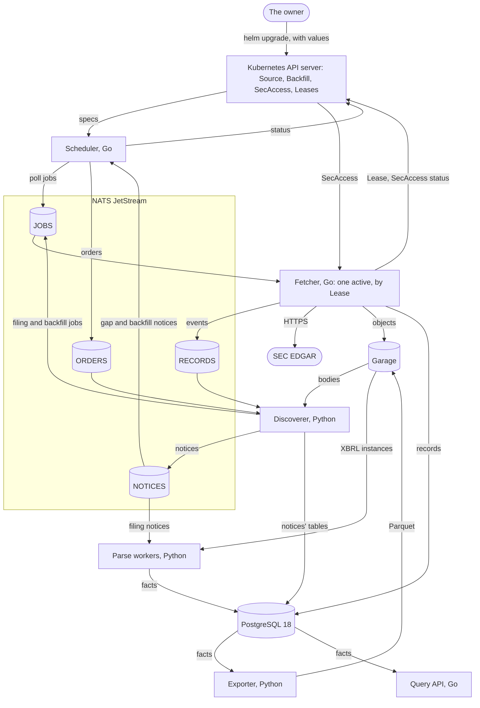
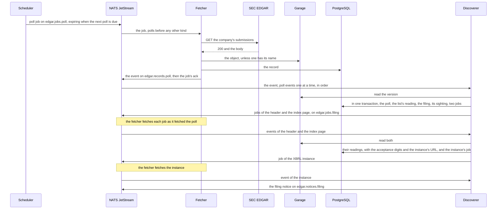
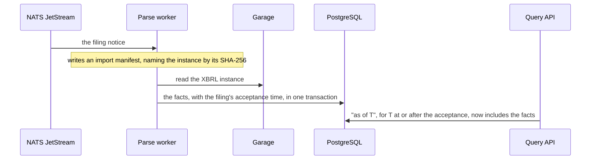

# The architecture

<!-- status: Scheduler; Fetcher; Discoverer; Parse workers; Exporter; Query API; NATS JetStream; Garage; PostgreSQL 18; The controls; `edgar-asof`; The snapshot store in the cluster -->
**Status** ([status page](../status.md)): Scheduler: Specified; built in part. Fetcher: Built. Discoverer: Specified. Parse workers: Decided. Exporter: Decided. Query API: Decided. NATS JetStream: Built. Garage: Built. PostgreSQL 18: Built. The controls: Specified; built in part. `edgar-asof`: Decided. The snapshot store in the cluster: Built.
<!-- end status -->

This page covers the pipeline's components and the boundaries between
them, follows one filing from the poll that first shows it to its facts,
and shows how continuous and daily operation are one pipeline. It ends with
why the parts are split as they are, from the decision records that split
them.

## The components

Six services of the pipeline's own run beside NATS JetStream, Garage,
PostgreSQL, and the monitoring, all on Kubernetes, installed with Helm on
kind ([components][design-components], [0001]).

| Component | What it does | Language | On the cluster | What it keeps |
| --- | --- | --- | --- | --- |
| Scheduler | A controller: queues each Source's polls at its cadence, hands each Backfill to the discoverer ([ORDER-1], [LIST-1]), and keeps Sources' and Backfills' status ([0007]) | Go, with controller-runtime | A Deployment of two, one active through leader election | Nothing of its own: status, in the API server. It never fetches and never writes the record ([0007]). |
| Fetcher | Sends every request to the SEC, stores each body, adds each record, and announces it ([0005]) | Go, with client-go's leader election, `golang.org/x/time/rate`, nats.go, the AWS SDK for Go v2, and pgx | A Deployment of two, one active through the Lease `fetcher` | Objects in Garage, rows of `records`, and the `SecAccess` status |
| Discoverer | Reads each version of a company's `submissions`, records each filing and when each Source first showed it, queues the fetches of its files, lists each Backfill's filings, and publishes notices ([`notices.md`][notices]) | Python, with nats-py, psycopg, boto3, and `edgar-asof` | A Deployment | The notices' tables |
| Parse workers | Read a stored XBRL instance and write its facts, with the filing's acceptance time, under an import manifest | Python, with an XBRL parser still to choose | A Deployment, scaled by queue depth | The facts |
| Exporter | Writes the facts to Parquet in Garage, deterministically, with each file's SHA-256 | Python, with pyarrow | A CronJob | Parquet files |
| Query API | Answers "as of T" | Go, with `net/http` and pgx | A stateless Deployment | Nothing |
| NATS JetStream | Durable queues and events ([0003]) | — | A StatefulSet of three | The streams |
| Garage | Bodies by SHA-256, exports, and the database's backups ([0002]) | — | A StatefulSet of three, replication factor 3 | Objects |
| PostgreSQL 18 | Records, filings, coverage and gaps, and facts ([0004]) | — | A CloudNativePG cluster of three | Tables |
| Monitoring | Metrics, dashboards, and alerts, then traces and logs ([0008]) | — | kube-prometheus-stack, then Tempo, then Loki with Alloy | Metrics, and later traces and logs |

The languages and libraries are decision 0006's ([0006]), and the
discoverer's use of `edgar-asof` is task T24's ([plan][plan-observing]).
The parse workers' parser and how they scale by queue depth are decisions
still to come, tasks T12 and T10 ([decision records][decisions]). The
facts, and where the parse workers keep their manifests, are for the facts
specification, task T17, which isn't written; the query API is built after
it, in task T26 ([plan][plan-facts]). The pages on the
[scheduler](scheduler.md), the [fetcher](fetcher.md), the
[discoverer](discoverer.md), the [parse workers](parse-workers.md), the
[exporter](exporter.md), [NATS JetStream](nats-jetstream.md),
[Garage](garage.md), [PostgreSQL 18](postgresql.md), and
[monitoring](monitoring.md) take each component in turn.

## The boundaries

The services meet only at NATS messages, PostgreSQL tables, and Garage
objects, each a schema in `spec/schemas/` ([0006]), and at the Kubernetes
API, for the controls and the Leases ([0007], [0005]).

| Boundary | Through | Contract |
| --- | --- | --- |
| The owner to the controls | The umbrella chart's values, applied with `helm install` or `helm upgrade` | The definitions in `spec/schemas/` and the chart's checks ([VAL-1] to [VAL-4], [RBAC-6]) |
| The scheduler and the API server | Reads every spec; writes only Sources' and Backfills' status | [RBAC-1], [SOURCE-1] to [SOURCE-5], [BACKFILL-3] |
| The fetcher and the API server | Holds the Lease `fetcher`; reads the `SecAccess` and writes only its status | [LEASE-1], [RBAC-2], [ACCESS-3] |
| The scheduler to the fetcher | Jobs on `edgar.jobs.poll`, in the stream `JOBS` | [`job.schema.json`][job-schema], [JOB-2] |
| The discoverer to the fetcher | Jobs on `edgar.jobs.filing` and `edgar.jobs.backfill`, in `JOBS` | [`job.schema.json`][job-schema], [JOB-3], [FILE-1] |
| The fetcher to the SEC | HTTPS to `www.sec.gov` and `data.sec.gov` | [FETCH-1] to [FETCH-18] |
| The fetcher to the cluster store | Objects in Garage's bucket `snapshots`; rows of `records` in the database `edgar` | [OBJ-4], [GARAGE-4], [`records.sql`][records-sql], [LOG-3] |
| The fetcher to the discoverer | Events on `edgar.records.*`, in the stream `RECORDS` | [`event.schema.json`][event-schema], [JOB-6] |
| The scheduler to the discoverer | Orders on `edgar.orders.backfill`, in the stream `ORDERS` | [`order.schema.json`][order-schema], [ORDER-1] |
| The discoverer to the scheduler | Gap and backfill notices, in the stream `NOTICES` | [`notice.schema.json`][notice-schema], [NOTICE-1], [NOTICE-2] |
| The discoverer to the parse workers | Filing notices, in `NOTICES` | [`notice.schema.json`][notice-schema], [FILE-5]; what the workers do with them is for the facts specification |
| The discoverer to the record | The notices' tables and views | [`notices.sql`][notices-sql], [TABLE-3] |
| Python services to Garage | Reads only, with a key of their own | [GARAGE-4], [FETCH-18] |
| Grafana to the record | Only the views in the schema `dashboards` | [`dashboards.sql`][dashboards-sql], [VIEW-3] |
| Prometheus to the services | `/metrics` on each replica's port `metrics` | [METRIC-1], [SCRAPE-1] |

Who may write each store is narrow by design. Only the fetcher's database
role may insert records, and only the discoverer's may add the notices'
rows; no role may update, delete, or truncate either ([LOG-3], [TABLE-3]).
Only the fetcher's Garage key may write the bucket `snapshots`; every other
service's may only read it ([GARAGE-4]). The deployment's version 1.1.0
installs the four streams ([NATS-3]), the discoverer's role and key
([PG-7], [GARAGE-4]), and the durable consumers of the discoverer, the
scheduler, and the parse workers, each made right after its stream
([NATS-5]). Grafana reads only the views in `dashboards`, as a role of its
own, through its PostgreSQL data source ([PG-11], [PG-13], [MON-5]).

## One filing, end to end

This follows the design's account ([one filing, end to
end][design-filing]), with the statements that govern each step. A Source
polls a company's `submissions`, and the filing is one the Source didn't
list at its previous poll.

1. **The poll.** The scheduler queues each poll of a Source that's polling
   as a job, with the Source's name, feed, and URL, and an `expires_at` when
   the next poll is due ([SOURCE-1], [SOURCE-2], [JOB-2]).
2. **The fetch.** The fetcher holding the Lease takes the first job of the
   first kind waiting, polls before filings' fetches and filings' before
   Backfills' ([JOB-4]). It acknowledges an expired job without a request
   ([JOB-5]), and sends one only while requests are allowed ([ACCESS-1]),
   at least 0.2 seconds after the one before ([FETCH-6]). It stores the body
   as an object named by its SHA-256, only if no object has that name
   ([OBJ-4]); adds the record; publishes the event; and acknowledges the
   job, each once the step before has succeeded ([JOB-6]).
3. **The list.** The discoverer reads each poll event in the order the
   stream holds them ([DISC-1]). It adds the poll to `polls` ([GAP-1]),
   reads the version from the bucket as a list, unless it has read that
   version before ([SEEN-1]), and adds each filing it names, with the
   values the list gives ([SEEN-2]). For a filing this Source hadn't shown,
   it adds a sighting: this poll as `first_shown`, and as `last_not_shown`
   the Source's latest earlier poll whose list it read ([SEEN-2]).
4. **The filing's files.** For a new sighting with a `last_not_shown`, the
   discoverer queues the fetches of the filing's header and index page, at
   the URLs the findings give ([FILE-1], [FILE-2], [SRC-21]). It adds every
   row in one transaction, then publishes the jobs, then acknowledges the
   event ([DISC-2]).
5. **The header and the index page.** The fetcher fetches them as it did
   the poll, behind any polls waiting. The discoverer reads the header's
   `ACCEPTANCE-DATETIME` as its 14 digits, and from the index page the URL
   of the XBRL instance, whose fetch it queues ([FILE-3], [SRC-1],
   [SRC-20]).
6. **The notice.** Once the header and index page are held and read
   without an error, and the instance is held, the filing is complete, and
   the discoverer publishes its notice ([FILE-5]). The notice carries both
   acceptance times as given, and each file's feed, URL, and SHA-256, as an
   import's manifest names an input ([§9 of the notices][notices-messages]).

The rest is the design's, since the facts specification isn't written
([plan][plan-facts]):

- **The facts.** A parse worker writes an import manifest, reads the
  instance from Garage, and inserts the facts in one transaction with the
  filing's acceptance time ([one filing, end to end][design-filing]). An
  import writes its manifest before it reads its inputs, and reads them
  only from the bucket, never from the SEC ([IMP-3]). Where an import in
  the cluster keeps its manifest is for the facts specification ([§11 of
  the store][store-imports]).
- **The answer.** "As of" queries for any time at or after the acceptance
  now include the facts ([one filing, end to end][design-filing]).

**Repeats are harmless.** NATS JetStream may deliver a message more than
once, so each step is safe to repeat: bodies are named by their SHA-256,
and filings by their accession numbers ([0003]). A job whose record the
table already holds isn't fetched again: the fetcher publishes the record's
event again and acknowledges the job ([JOB-6]). A message the discoverer
receives again adds no row twice, and the jobs its first delivery queued
are published again, with their `id`s, until fetched ([DISC-2]).
[Delivery and consistency](delivery-and-consistency.md) covers what each
stream guarantees, and [failures and recovery](failures-and-recovery.md)
what stops and what's kept when a part fails.

**One trace follows the filing.** The scheduler starts a trace for each
poll. The fetch, the list's reading, and each filing the list first shows
join it, through the fetches of the filing's files to its notice, carried
in each message's NATS headers ([§9 of telemetry][telemetry-traces]). The
parse workers continue it to the facts, as the facts specification will say.

**A filing a Source already showed at its first poll** has no
`last_not_shown`, since the record doesn't say how long the Source had shown
it. Its files aren't fetched for that sighting; a Backfill of its dates
fetches them ([FILE-2], [§6 of the notices][notices-seen]).

## Two modes, one pipeline

A mode is a cadence on each Source, not a different deployment
([two modes][design-modes], [0007]). Continuous and daily operation differ
only in each Source's `cadenceSeconds`, which the owner sets in the chart's
values ([§6 of the controls][controls-source]).

| | Continuous | Daily |
| --- | --- | --- |
| A Source's cadence | 10 seconds for each company's `submissions`, to start ([0010]) | Once a day ([two modes][design-modes]) |
| Requests a second for three companies | 3 × 1/10 = 0.3, against a limit of 5 ([0010]) | 3 × 1/86,400, about 0.000035 |
| Each poll's window | 10 seconds: its job expires when the next poll is due ([JOB-2]) | A day |
| How closely a filing's arrival is bounded | Its public availability, within about 10 seconds plus the source's own delay ([0010]) | Its first-seen time, within a day ([two modes][design-modes]) |
| The records, tables, and views | The same | The same |

Both write the same records. A Source polled once a day is covered between
its polls, as one polled every 10 seconds is, since coverage takes each
poll's window as the cadence in force when it was queued ([§5 of the
notices][notices-gaps]). So a day in daily mode reads as continuous
operation whose filings' first-seen times are each bounded within a day
([two modes][design-modes]). Each poll of `submissions` downloads the whole
body, since `submissions` sends no validators ([SRC-4]), and adds a
record ([FETCH-14]), so a shorter cadence costs bandwidth and records in
proportion. An unchanged body adds no object, since each is stored once by
its SHA-256 ([OBJ-4]). A change of cadence applies from the next poll
([SOURCE-2]), and around the change the gaps can be inexact ([open
questions of the notices][notices-open]).

## Why the parts are split as they are

Each section here takes one decision record's split. The
[tradeoffs](tradeoffs.md) page takes every decision record in turn, with
what would change it.

### A queue between the services (0003)

Work passes between the services as messages in NATS JetStream's streams,
not as calls, so it survives a crashed pod or a restart, is acknowledged
when done, and is delivered again if a worker dies partway ([0003]). The
record weighed Kafka or Redpanda, built for far larger volumes and heavier
to run; RabbitMQ, on the Erlang VM, with more memory than NATS; and a queue
in PostgreSQL, with no new component, but which would stop fetching
whenever the database failed over and would make the database carry the
polling load ([0003]).

What it costs: a message may arrive twice, so each step is written to be
repeated ([JOB-6], [DISC-2]); and NATS is one more stateful component, a
StatefulSet of three whose streams are replicated on each server
([NATS-1], [NATS-3]). The record expected fetching to continue while
PostgreSQL fails over, with parse work waiting in its stream ([0003]). The
store's specification has the fetcher add each fetch's record to the
database before it publishes the event and acknowledges the job ([JOB-6]),
and the owner decided that the fetcher holds a fetch whose record the
database can't take, trying it again until the database does, and sends no
other request meanwhile ([T23][plan-observing]). So a failover pauses
fetching as well as parsing ([outages and recovery][design-outages]), and
the owner decided that a decision record that supersedes 0003's
consequence comes with the version of the store's specification that
states the held fetch ([T23][plan-observing]).

### One fetcher, and only one (0005)

The SEC's limits have to hold across the whole cluster, and a `403` has to
stop all fetching, not one pod's ([0005]). So one fetcher replica, the one
holding a Kubernetes Lease, sends every request, at most 5 a second, and
the other waits to take over ([0005], [FETCH-16]). The record weighed a
limit per pod, which breaks when the replica count changes; a shared token
bucket in NATS or PostgreSQL, with more moving parts and a `403` every
worker must check; and an egress proxy with a global rate-limit service,
realistic for many upstreams but heavy for one ([0005]).

What it costs: the whole pipeline is capped at 5 requests a second ([0005]).
A handover after the active replica is lost takes up to the Lease's
duration, 15 seconds by default, which decision 0005 and the deployment's
specification record as a gap ([0005], [the fetcher's
Lease][deployment-lease]); the notices' specification gives a gap only where
the handover misses a poll ([§5 of the notices][notices-gaps]). The active
replica stops sending when it can't renew the Lease within its renewal
deadline, 10 seconds, before another can take the Lease over ([the fetcher's
Lease][deployment-lease], [LEASE-1]). The stop after a `403` is kept in
`SecAccess`, not in the active replica's memory, so the standby reads it
there ([ACCESS-3], [0007]).

### Go where bytes move, Python where EDGAR is read (0006)

Services that read what EDGAR publishes are written in Python: the
discoverer, the parse workers, and the exporter. Services that move bytes
or keep the rules for talking to the SEC are written in Go: the scheduler,
the fetcher, and the query API ([0006]). So a change in EDGAR's formats
touches one language. The record weighed a Python fetcher built from
`snapshot.py`, which would put the Lease and the rate limit in Python, where
leader election by Lease is much less used; and a split by stage, which
would put knowledge of EDGAR's formats in both languages ([0006]).

The same line is why the scheduler hands each Backfill to the discoverer,
which lists its filings: the scheduler doesn't read EDGAR's content, and the
discoverer can't read Backfills ([§8 of the notices][notices-backfills],
[RBAC-4]). What it costs: the fetching rules have two implementations,
`snapshot.py` and the Go fetcher, and one set of checks, on the requests a
fake EDGAR records, runs against both; and CI runs two toolchains
([0006]).

### The scheduler as a controller, out of the data path (0007)

The pipeline's controls are fields of three custom resources, which the
scheduler reconciles as a controller, so the API server keeps them through
restarts, RBAC says who may change them, and their status shows what the
pipeline did ([0007]). The scheduler never fetches and never writes the
record; the record in PostgreSQL stays authoritative, and status is a
summary for people ([0007]). The record weighed controls in the dashboard,
which would need their own login, permissions, and audit trail; an admin
API, which would rebuild what the API server already has; Helm values and
scaling alone, where a pause looks like a failure and a stop after a `403`
has nowhere to be recorded; and a separate operator, one more Deployment for
work the scheduler exists to do ([0007]).

### A library for reading EDGAR (0009)

The Python services read EDGAR's content through
[`edgar-asof`](edgar-asof.md), a public library in a repository of its own, whose specification defines the fact
model and what "as of T" returns ([0009]). In the cluster, the library
reads only bodies that a service gives it from the cluster store, and never
sends a request or keeps a cache; only the active fetcher sends requests
([FETCH-18], [readers outside the pipeline][store-readers]). The record
weighed a package in this repository, which would be public only when the
whole repository is, and no library at all ([0009]). What it costs: a change
the pipeline needs is released in the library first, then pinned, so tasks
here wait on its releases: the discoverer on its first, the facts
specification on one that specifies the fact model, and the parse workers on
one that reads XBRL instances ([observing filings][plan-observing] and
[facts][plan-facts] in the plan). The query API is tested against cases the
library publishes, so both answer "as of T" the same way ([0009]).

[0001]: ../decisions/0001-deploy-on-kubernetes-with-helm-on-kind.md
[0002]: ../decisions/0002-store-bodies-in-garage.md
[0003]: ../decisions/0003-queue-work-in-nats-jetstream.md
[0004]: ../decisions/0004-keep-the-record-in-postgresql-18.md
[0005]: ../decisions/0005-send-sec-requests-through-one-active-fetcher.md
[0006]: ../decisions/0006-write-the-services-in-go-and-python.md
[0007]: ../decisions/0007-control-the-pipeline-through-custom-resources.md
[0008]: ../decisions/0008-monitor-with-prometheus-and-grafana-then-tempo-and-loki.md
[0009]: ../decisions/0009-read-edgar-through-a-public-point-in-time-library.md
[0010]: ../decisions/0010-poll-each-companys-submissions-and-measure-lag-from-the-record.md
[ACCESS-1]: ../../spec/controls.md#8-secaccess
[ACCESS-3]: ../../spec/controls.md#8-secaccess
[BACKFILL-3]: ../../spec/controls.md#7-backfill
[controls-source]: ../../spec/controls.md#6-source
[dashboards-sql]: ../../spec/schemas/dashboards.sql
[decisions]: ../decisions/README.md
[deployment-lease]: ../../spec/deployment.md#the-fetchers-lease
[design-components]: ../design.md#components
[design-filing]: ../design.md#one-filing-end-to-end
[design-modes]: ../design.md#two-modes-one-pipeline
[design-outages]: ../design.md#outages-and-recovery
[DISC-1]: ../../spec/notices.md#processing
[DISC-2]: ../../spec/notices.md#processing
[event-schema]: ../../spec/schemas/event.schema.json
[FETCH-1]: ../../spec/snapshots.md#10-fetching
[FETCH-14]: ../../spec/snapshots.md#10-fetching
[FETCH-6]: ../../spec/snapshots.md#10-fetching
[FETCH-16]: ../../spec/snapshots.md#the-fetcher
[FETCH-18]: ../../spec/snapshots.md#the-fetcher
[FILE-1]: ../../spec/notices.md#7-a-filings-files
[FILE-2]: ../../spec/notices.md#7-a-filings-files
[FILE-3]: ../../spec/notices.md#7-a-filings-files
[FILE-5]: ../../spec/notices.md#7-a-filings-files
[GAP-1]: ../../spec/notices.md#5-polls-coverage-and-gaps
[GARAGE-4]: ../../spec/deployment.md#garage
[IMP-3]: ../../spec/snapshots.md#11-imports
[JOB-2]: ../../spec/snapshots.md#jobs-and-events
[JOB-3]: ../../spec/snapshots.md#jobs-and-events
[JOB-4]: ../../spec/snapshots.md#jobs-and-events
[JOB-5]: ../../spec/snapshots.md#jobs-and-events
[JOB-6]: ../../spec/snapshots.md#jobs-and-events
[job-schema]: ../../spec/schemas/job.schema.json
[LEASE-1]: ../../spec/deployment.md#the-fetchers-lease
[LIST-1]: ../../spec/notices.md#8-backfills
[LOG-3]: ../../spec/snapshots.md#8-history
[METRIC-1]: ../../spec/telemetry.md#4-metrics
[MON-5]: ../../spec/deployment.md#monitoring
[NATS-1]: ../../spec/deployment.md#nats
[NATS-3]: ../../spec/deployment.md#nats
[NATS-5]: ../../spec/deployment.md#durable-consumers
[NOTICE-1]: ../../spec/notices.md#8-backfills
[NOTICE-2]: ../../spec/notices.md#8-backfills
[notice-schema]: ../../spec/schemas/notice.schema.json
[notices]: ../../spec/notices.md
[notices-backfills]: ../../spec/notices.md#8-backfills
[notices-gaps]: ../../spec/notices.md#5-polls-coverage-and-gaps
[notices-messages]: ../../spec/notices.md#9-messages-and-processing
[notices-open]: ../../spec/notices.md#12-open-questions
[notices-seen]: ../../spec/notices.md#6-when-each-source-first-showed-each-filing
[notices-sql]: ../../spec/schemas/notices.sql
[OBJ-4]: ../../spec/snapshots.md#5-objects
[ORDER-1]: ../../spec/notices.md#8-backfills
[order-schema]: ../../spec/schemas/order.schema.json
[PG-7]: ../../spec/deployment.md#the-stores-database
[PG-11]: ../../spec/deployment.md#the-notices-and-the-dashboards
[PG-13]: ../../spec/deployment.md#the-notices-and-the-dashboards
[plan-facts]: ../plan.md#facts
[plan-observing]: ../plan.md#observing-filings
[RBAC-1]: ../../spec/controls.md#9-who-may-change-what
[RBAC-2]: ../../spec/controls.md#9-who-may-change-what
[RBAC-4]: ../../spec/controls.md#9-who-may-change-what
[RBAC-6]: ../../spec/controls.md#9-who-may-change-what
[records-sql]: ../../spec/schemas/records.sql
[SCRAPE-1]: ../../spec/telemetry.md#6-scraping
[SEEN-1]: ../../spec/notices.md#6-when-each-source-first-showed-each-filing
[SEEN-2]: ../../spec/notices.md#6-when-each-source-first-showed-each-filing
[SOURCE-1]: ../../spec/controls.md#6-source
[SOURCE-2]: ../../spec/controls.md#6-source
[SOURCE-5]: ../../spec/controls.md#6-source
[SRC-1]: ../../investigation/edgar.md#findings-so-far
[SRC-4]: ../../investigation/edgar.md#findings-so-far
[SRC-20]: ../../investigation/edgar.md#findings-so-far
[SRC-21]: ../../investigation/edgar.md#findings-so-far
[store-imports]: ../../spec/snapshots.md#11-imports
[store-readers]: ../../spec/snapshots.md#readers-outside-the-pipeline
[TABLE-3]: ../../spec/notices.md#4-the-record-of-notices
[telemetry-traces]: ../../spec/telemetry.md#9-traces
[VAL-1]: ../../spec/controls.md#5-the-charts-values
[VAL-4]: ../../spec/controls.md#5-the-charts-values
[VIEW-3]: ../../spec/telemetry.md#8-the-views-grafana-reads
