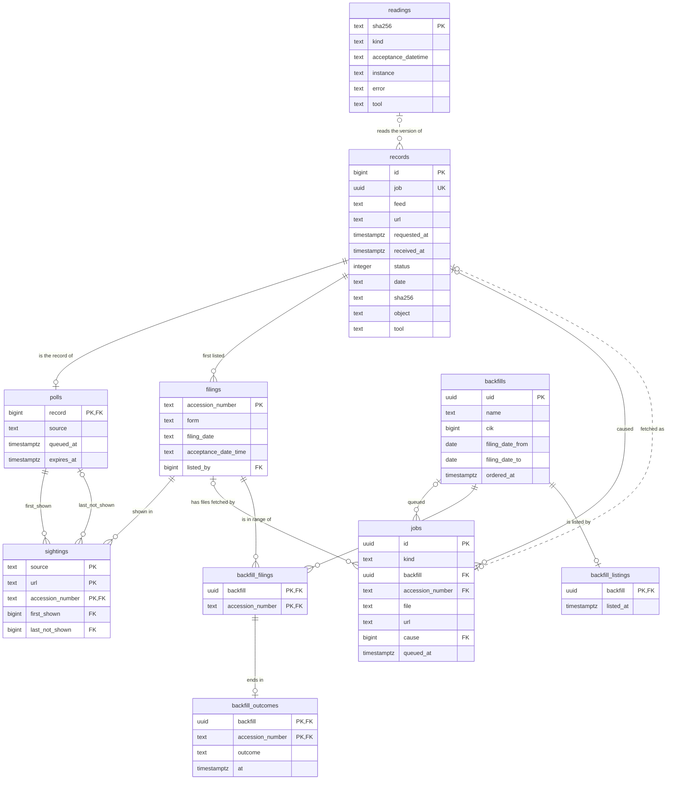

# The data model and its times

<!-- status: The snapshot store in git; The snapshot store in the cluster; The transfer from the cluster to git; Discoverer; Parse workers; Query API; `edgar-asof`; Monitoring: metrics, alerts, and dashboards -->
**Status** ([status page](../status.md)): The snapshot store in git: Built. The snapshot store in the cluster: Specified; built in part. The transfer from the cluster to git: Specified. Discoverer: Decided; specified in part. Parse workers: Decided. Query API: Decided. `edgar-asof`: Decided. Monitoring: metrics, alerts, and dashboards: Decided; specified in part; built in part.
<!-- end status -->

This page covers what the pipeline stores: the snapshot store's objects and
records, in git and in the cluster; the notices' record of polls, filings,
sightings, coverage, and gaps; and the facts, as far as they're specified.
It then covers the times each keeps, and what an "as of T" query returns.
Facts about `edgar-asof` here were checked against its `main`, at commit
`515bb0d`, on October 14, 2026.

## The snapshot store

The store keeps what the pipeline fetched from the SEC: each distinct body
once, as an object, and one record for each fetch
([§2 of the store][store-terms]). It has two places, which name an object
the same way and give a record the same fields
([§4 of the store][store-layout]):

| | The git store | The cluster store |
| --- | --- | --- |
| Objects | `data/objects/AA/SHA256.gz` | `objects/AA/SHA256.gz` in Garage's bucket `snapshots` |
| Records | One JSON line per fetch in `data/feeds/FEED/versions.jsonl` | One row per fetch in PostgreSQL's table `records` |
| Written by | `scripts/snapshot.py`, and the transfer from the cluster | The fetcher |
| Kept unchanged by | git's history, which `scripts/verify.py --since` checks ([LOG-1], [LOG-2]) | Records: grants, since only the fetcher's role may insert one, and none may update or delete one ([LOG-3]). Objects: only the fetcher's key may write one, and the fetcher never replaces or deletes one ([LOG-4]); Garage can't refuse a change ([0002]), so a check of the objects finds any ([STORE-3]) |
| Scope | `data/scope.json`, the URLs it may hold, each with its reason ([§9 of the store][store-scope]) | What the owner's values ask for, through the controls ([the scope and the cluster][store-scope-cluster]) |
| Import manifests | `data/imports/IMPORT.json`, one for each import | Where the facts specification will say ([§11 of the store][store-imports]) |

### Objects

An object is gzip data whose decompressed bytes have the SHA-256 in its
name, and `AA` is the hash's first two characters. The identity is the
decompressed bytes, so two writers' compressed bytes may differ
([OBJ-1]). An object is written only if none has its name, since the same
name means the same body ([OBJ-2], [OBJ-4]). So a body fetched a thousand
times, or from two URLs, is one object.

### Records

A record is one fetch, with these fields, in both stores
([§6 of the store][store-records]):

| Group | Fields | What they say |
| --- | --- | --- |
| What was asked | `feed`, `url`, `final_url` | The feed it's recorded under, the URL requested, and the URL after any redirects |
| When | `requested_at`, `received_at` | When the final attempt was sent, and when its status and headers arrived, by the writer's clock, in UTC to the millisecond |
| What happened | `attempts`, `status`, `error` | The requests made, retries included; the final HTTP status; and why nothing was stored, when the status doesn't say |
| What the response said | `date`, `etag`, `last_modified`, `content_type` | Its headers, each as received |
| What was stored | `sha256`, `bytes`, `object` | The body's hash and length, and its object: all set, or all null ([REC-3]) |
| Who wrote it | `tool` | The program and its commit, such as `fetcher@` and the commit its image was built from |

The cluster's table adds two columns: `id`, which numbers the records in the
order they're added, and `job`, the `id` of the job the fetch was made for,
which no two records share ([STORE-1]). The database refuses a malformed
row: a `200` with no error must name a body, a `304` that names no version
must have an error, and no other outcome names one ([STORE-2],
[`records.sql`][records-sql]). No request header, the user agent among
them, is stored ([ID-1]).

### Versions

A URL's versions are the distinct `sha256` values among its records,
numbered in the order each first appears. A URL that returned A, then B,
then A has two versions, and its records show the return ([VER-1]). So the
store answers what a URL served at the time of any fetch, and when its body
changed, to the precision of its fetches.

### From the cluster to git

The git store holds a small declared scope, within GitHub's limits: no file
over 50 MiB, and at most 1 GB in all ([SCOPE-2], [SCOPE-4], [SCOPE-5]).
Copying every poll's record would outgrow it: at the starting cadence, the
three companies' polls add 25,920 records a day to the `submissions` log,
about 15 MB at some 600 bytes a record, past 50 MiB within four days
([records the cluster made][store-transfer]). So the transfer copies only
the records of a range of time the owner names, whose URLs `scope.json`
covers, with their objects, unchanged, and nothing at all if that would
break the budget ([XFER-1], [XFER-2]). A finding then cites them as it
cites any stored version ([0010]).

## The record of notices

The discoverer keeps what it finds beside the store's `records`, in tables
whose rows are only added, and views over them
([§4 of the notices][notices-record], [`notices.sql`][notices-sql]).

| Table or view | One row for each | What it's for |
| --- | --- | --- |
| `polls` | Poll whose event the discoverer read | Coverage and gaps |
| `readings` | Version read as a list, a header, or an index page | What the discoverer read from each version, once |
| `filings` | Filing a list named | The filing, with the values of the list it was first read from |
| `sightings` | Filing and Source whose polls showed it | When the Source first showed it |
| `jobs` | Job the discoverer queued | Each fetch of a filing's file, or of a Backfill's list, and what caused it |
| `backfills`, `backfill_filings`, `backfill_listings`, `backfill_outcomes` | Backfill ordered; filing in its range; Backfill listed; filing fetched or failed | Each Backfill's progress |
| `held_files` (view) | File of a filing the record holds | The first record of its URL that names a version |
| `gaps` (view) | Gap in a Source's coverage, ended or open | Where the record wasn't looking |
| `backfill_progress` (view) | Backfill | Its counts, as its status shows them |
| `lags` (view) | Sighting | Its times, and the bounds of each lag |

The diagram shows only some of `records`' columns. Solid lines are foreign
keys in [`notices.sql`][notices-sql]; dotted lines join without one: a
reading to the records of its version, by `sha256`, and a job to the record
of its fetch, by the record's `job`.

A row records what the discoverer found when it found it. A `filings` row
keeps the form, filing date, and `acceptanceDateTime` of the list it was
first read from ([SEEN-2]), and a `readings` row keeps what the first
discoverer to read that version read, with its commit in `tool`. How a later
discoverer that would read a version differently records a correction is
still open ([open questions of the notices][notices-open]).

### Polls, coverage, and gaps

A Source's polls are due a cadence apart, and each poll's job expires when
the next is due, so a poll whose job expires before the fetcher takes it
isn't sent ([SOURCE-2], [JOB-2], [JOB-5]). A job gives neither its due time
nor its Source's cadence, so the record takes each poll's window, from when
its job was queued to when it expired, as the cadence in force then
([§5 of the notices][notices-gaps]). Over a Source's successful polls of a
URL, in the order of their records' `id`s:

- A successful poll **follows** the one before it when its job was queued
  less than its own window after the earlier one's job expired.
- **Coverage** runs from each successful poll's request to the next one's,
  when the next follows it, and otherwise to when its job expired.
- A **gap** runs from when the earlier one's job expired to the later one's
  request, when the later one doesn't follow.
- A gap is **open** once the latest successful poll's job has been expired
  for as long as its window, with no later successful poll.

An example, with times made up for it, of a Source at 10 seconds whose
second poll fails:

| Job queued | Job expires | Outcome | Follows? | In the record |
| --- | --- | --- | --- | --- |
| 12:00:00 | 12:00:10 | Succeeds, sent at 12:00:00.200 | The first | Coverage from 12:00:00.200 to 12:00:10 |
| 12:00:10 | 12:00:20 | Fails | — | Not a successful poll |
| 12:00:20 | 12:00:30 | Succeeds, sent at 12:00:20.300 | No: queued 10 seconds after 12:00:10, not less than its window | A gap from 12:00:10 to 12:00:20.300 |
| 12:00:30 | 12:00:40 | Succeeds, sent at 12:00:30.100 | Yes: queued as the one before expired | Coverage from 12:00:20.300 on |

If no poll succeeded after the last, a gap would open at 12:00:50, from
12:00:40. Since `gaps` is a view, not a table, a record that arrives late
changes what it gives, and nothing stored ([GAP-2]).

### Sightings: when a Source first showed a filing

For each filing a poll's list names, unless the Source has shown it before,
the discoverer adds a sighting: the poll as `first_shown`, and as
`last_not_shown` the Source's latest earlier poll whose list it read
([SEEN-2]). The first names the filing and the second doesn't, so the Source
first showed the filing after `last_not_shown`'s request was sent, and by
the time `first_shown`'s response arrived ([SEEN-3]). These are the tightest
bounds the record holds, unless an event reached the discoverer late, as
after a fetcher's restart, when they still bound it, more loosely. A filing
the Source shows at its first poll whose list is read has no
`last_not_shown`, since the record doesn't say how long it had shown it
([§6 of the notices][notices-seen]).

### A filing's files

The jobs a filing's files are fetched by are kept in `jobs`, each with the
record whose event caused it, so each fetch traces back to the poll, or the
Backfill's order, that led to it ([§7 of the notices][notices-files]). A
filing's file is **held** when one of its URL's records names a version, and
the view `held_files` gives the first such record ([FILE-6]). A filing is
complete when its header and index page are held, each read without an
error, and the instance the index page names is held ([FILE-5]).

### Backfills' progress

`backfills` keeps each order, `backfill_filings` each filing in a
Backfill's range, `backfill_listings` when the discoverer had read every
list, and `backfill_outcomes` whether each filing was fetched or failed. The
view `backfill_progress` counts them, and the scheduler sets the Backfill's
status from it, through backfill notices ([§8 of the
notices][notices-backfills], [NOTICE-2]).

### The dashboards' views

Grafana reads the record only through three views in the schema
`dashboards`, over the notices' tables and views, so a dashboard shows what
the record holds by the same definitions ([§8 of
telemetry][telemetry-views], [`dashboards.sql`][dashboards-sql]):
`coverage`, each stretch of a Source's coverage between its gaps; `gaps`,
each gap with its length in seconds; and `lags`, each sighting whose lag the
record bounds, in seconds ([VIEW-4] to [VIEW-6]).

## The facts, as far as they're specified

The pipeline's facts specification, task T17, isn't written. It's to cite a
version of `edgar-asof`'s specification for the fact model and what "as of
T" returns, and add how the pipeline stores facts ([plan][plan-facts],
[0009]). What the documents already say:

- **A fact has two times** ([times][design-times], [0004]). Its valid time
  is the fiscal period or instant it describes. Its transaction time is the
  acceptance time of the filing that reported it, read from the filing.
  Times are explicit columns, never the database's write time.
- **A fact's key** is its company, concept, unit, period, and dimensions
  ([times][design-times]).
- **A filing's facts are written in one transaction**, by a parse worker,
  under an import manifest, with the filing's acceptance time
  ([one filing, end to end][design-filing]). Decision 0004 has one
  transaction record a filing, its parse, and its facts, so that they can't
  disagree ([0004]). The notices' specification records the filing apart
  from its parse: the discoverer adds it to `filings` when a poll's list
  names it, in that message's own transaction ([SEEN-2], [DISC-2]).
- **Facts come from each filing's XBRL instance.** The SEC's summaries are
  kept as evidence of what it published, not as the facts' source
  ([what the pipeline keeps][design-keeps]).

`edgar-asof`'s facts specification, version 0.1.0, defines the fact model
for `companyfacts`, which its first release reads ([0009]); the
[`edgar-asof`](edgar-asof.md) page explains the library as a whole:

- **Each value is one fact,** and none is dropped, merged, or replaced by
  another filing's value for its key ([FACT-6]).
- **A key is** the company's CIK, the concept as `taxonomy:name`, the unit,
  and the value's `start`, if it has one, and its `end`. A value without a
  `start` isn't taken for an instant, since a duration that starts and ends
  on one day has none either ([FACT-7], [SRC-11]).
- **A value is kept exactly,** as an integer or a decimal, never as a binary
  floating-point number ([FACT-8]).
- **`form`, `filed`, `fy`, `fp`, and `frame` are kept as given,** and none
  of them decides an answer, since they describe the filing or a calendar
  period, not the value's own period ([FACT-9], [SRC-6], [SRC-8],
  [SRC-17]).
- **A fact's filing has its raw acceptance times,** from `submissions` and,
  when asked for, from its header: two, one, or none ([FACT-10] to
  [FACT-12]).
- **A company's facts record their inputs:** each body's URL and SHA-256
  ([FACT-5]).

The pipeline's parse workers read XBRL instances, which `edgar-asof` reads
only in a later release; task T25 waits on it ([plan][plan-facts]). Keys
read from instances may need dimensions, which no `companyfacts` value has
([what `edgar-asof`'s facts specification leaves to others][asof-facts-10],
[SRC-14]).

## The times each keeps

The record keeps every time as its source gives it, and interprets time
zones in queries ([0010]). A time the discoverer copies from a job or a
record is as given there; one it adds itself is by its own clock
([§4 of the notices][notices-record]).

| Time | Kept in | Given by | As |
| --- | --- | --- | --- |
| A fetch's request and response | `records.requested_at`, `received_at` | The fetcher's clock | Timestamps in UTC, to the millisecond |
| The response's `Date` and `Last-Modified` | `records.date`, `last_modified` | The SEC's response | Strings, as received |
| A poll's window | `polls.queued_at`, `expires_at` | Its job | Timestamps |
| Acceptance, from `submissions` | `filings.acceptance_date_time` | The list the filing was first read from | The string given, RFC 3339 with a `Z` ([SRC-2]) |
| Acceptance, from the header | `readings.acceptance_datetime` | The filing's header | 14 digits, with no time zone ([SRC-1]) |
| Filing date | `filings.filing_date` | The list | The string given |
| First shown, and last not shown | `sightings.first_shown`, `last_not_shown` | Two polls' records | The polls' `requested_at` and `received_at` |
| A Backfill's order, listing, and outcomes | `backfills.ordered_at`; `backfill_listings.listed_at`; `backfill_outcomes.at` | The scheduler's order; the discoverer's clock | Timestamps |
| A Source's last poll and last successful poll | Its status | The polls' records' `requested_at` ([SOURCE-4]) | Timestamps |
| A stop after a `403` | The `SecAccess`'s status, `stop.at` | That fetch's record's `requested_at` ([ACCESS-3]) | A timestamp |
| A fact's period | The facts, task T17 | The value's `start` and `end` ([FACT-7]) | Dates |

### Instants, read only in queries

The view `lags` reads the two acceptance times as instants
([§10 of the notices][notices-lags]):

- **`submissions`' `acceptanceDateTime`** as the instant it states
  ([SRC-2]).
- **The header's digits** as US Eastern time, `America/New_York`. Read so,
  Microsoft's and Walmart's headers agree with their `submissions`, and all
  eight stored headers fall within EDGAR's hours. Apple's three are then 4
  hours earlier than their `submissions` times, so lags from one of the two
  show as outliers until a finding settles which is right ([SRC-2],
  [SRC-13], [0010]).

A finding that settles the header's zone changes one function in
`notices.sql`, in a new version of the notices specification, and nothing
stored ([open questions of the notices][notices-open]). `edgar-asof` keeps
the same rule: it compares or converts raw times only through an
interpreter the caller passes. It provides one that reads `submissions`'
time as the instant it states, and one that reads the header's digits in a
zone the caller names, and has no default ([TIME-5] to [TIME-9]).

### Each lag is a range

A Source first showed a filing after the request of its last poll that
didn't show it was sent, and by the time the response of the first that did
arrived ([SEEN-3]). So each lag, from an acceptance time to the Source's
first showing, is more than its low bound and at most its high bound
([LAG-1]):

| Bound | From `submissions`' time | From the header's time |
| --- | --- | --- |
| Low | `not_shown_requested_at` − `listed_acceptance` | `not_shown_requested_at` − `header_acceptance` |
| High | `shown_received_at` − `listed_acceptance` | `shown_received_at` − `header_acceptance` |

Each lag is measured by the fetcher's clock ([0010]). The fetcher checks
that clock against each response's `Date`, which a server stamps with the
second it generated the response, and serves the skew as a metric
([the fetcher's clock][telemetry-clock]). Whether the SEC's `Date` is when
it generated each response is still to be shown, so the skew is shown, not
alerted on ([open questions of telemetry][telemetry-open]).

## What "as of T" returns

An "as of T" query uses acceptance as transaction time. For each fact's key,
it returns the value from the latest filing accepted at or before T. A
restated value appears from its filing's acceptance on, and earlier answers
stay reproducible ([times][design-times]).

`edgar-asof`'s specification gives an answer of its own, which differs
from the design's summary in detail, as the
[query API](query-api.md#where-the-design-and-the-librarys-specification-differ-in-detail)
page sets out ([`edgar-asof`'s facts specification, §7][asof-facts-7]):

- **An answer is for one key, one instant T, and one interpreter,** all
  passed by the caller ([ASOF-1]). The interpreter places each filing at an
  instant, or leaves it unplaced ([ASOF-2]).
- **Each fact is in exactly one of four parts** ([ASOF-3]): `known`, the
  facts placed at the latest instant at or before T; `earlier`, the others
  placed at or before T; `later`, those placed after T; and `unplaced`.
  `known` holds more than one fact only when they share that instant: the
  library doesn't choose among them.
- **Only T and the instants decide the parts** ([ASOF-4]). `fy`, `fp`,
  `frame`, `form`, and `filed` change nothing. So an amendment is known from
  its own acceptance, and two filings of one day are ordered by their
  instants, not by their filing date ([SRC-10], [SRC-16]).
- **An answer can be reproduced.** It gives its key, T, its interpreter, and
  the URL and SHA-256 of each body read ([ASOF-6]), and orders each part the
  same way every time ([ASOF-5]).
- **It doesn't say whether a fact restates or repeats another,** since
  `companyfacts` marks no change and gives no `decimals` ([SRC-15]).

The specification's example: Apple's `us-gaap:OtherAssetsNoncurrent` in
`USD` at 2025-09-27 is 83,727,000,000 in its 10-K and its 10-Q of
2026-01-30, and 72,634,000,000 in its 10-Qs of 2026-05-01 and 2026-07-31
([SRC-15]). As of 2026-03-01T00:00:00Z, with the interpreter of
`submissions`' time, the 10-Q of 2026-01-30's fact is `known`, the 10-K's
`earlier`, and the other two 10-Qs' `later` ([`edgar-asof`'s facts
specification, §7][asof-facts-7]).

The query API answers "as of T" for the pipeline, and is tested against
cases `edgar-asof` publishes, so both answer the same way ([0009]). Which
acceptance time it uses, and in which zone, waits on the investigation
([what waits][design-waits]) and on the facts specification, task T17
([plan][plan-facts]).

"As of T" isn't the only time question the record answers:

| Question | Answered by | Its limit |
| --- | --- | --- |
| What had the company reported by T? | Acceptance time, from the filing ([times][design-times]) | Which acceptance time to trust, and the header's time zone, are unsettled ([what waits][design-waits]) |
| What did the pipeline hold at T? | First-seen time, from the polls ([times][design-times]) | The answer is approximate where a gap lies between the polls that bound it ([times][design-times], [LAG-1]) |
| What did a feed serve at T? | The versions its polls returned ([VER-1]) | A version served and replaced during a gap is lost ([what the pipeline keeps][design-keeps], [GAP-2]) |

The time of recovery is never put in place of the SEC's: a filing first
seen after an outage keeps its acceptance time, and its first-seen time
carries the gap's bounds ([times][design-times], [outages and
recovery][design-outages]).

[0002]: ../decisions/0002-store-bodies-in-garage.md
[0004]: ../decisions/0004-keep-the-record-in-postgresql-18.md
[0009]: ../decisions/0009-read-edgar-through-a-public-point-in-time-library.md
[0010]: ../decisions/0010-poll-each-companys-submissions-and-measure-lag-from-the-record.md
[ACCESS-3]: ../../spec/controls.md#8-secaccess
[ASOF-1]: https://github.com/nslaughter/edgar-asof/blob/515bb0dc7af1b76a269413f29ba3edc390193e46/spec/facts.md#7-as-of-t
[ASOF-2]: https://github.com/nslaughter/edgar-asof/blob/515bb0dc7af1b76a269413f29ba3edc390193e46/spec/facts.md#7-as-of-t
[ASOF-3]: https://github.com/nslaughter/edgar-asof/blob/515bb0dc7af1b76a269413f29ba3edc390193e46/spec/facts.md#7-as-of-t
[ASOF-4]: https://github.com/nslaughter/edgar-asof/blob/515bb0dc7af1b76a269413f29ba3edc390193e46/spec/facts.md#7-as-of-t
[ASOF-5]: https://github.com/nslaughter/edgar-asof/blob/515bb0dc7af1b76a269413f29ba3edc390193e46/spec/facts.md#7-as-of-t
[ASOF-6]: https://github.com/nslaughter/edgar-asof/blob/515bb0dc7af1b76a269413f29ba3edc390193e46/spec/facts.md#7-as-of-t
[asof-facts-7]: https://github.com/nslaughter/edgar-asof/blob/515bb0dc7af1b76a269413f29ba3edc390193e46/spec/facts.md#7-as-of-t
[asof-facts-10]: https://github.com/nslaughter/edgar-asof/blob/515bb0dc7af1b76a269413f29ba3edc390193e46/spec/facts.md#left-to-other-specifications
[dashboards-sql]: ../../spec/schemas/dashboards.sql
[design-filing]: ../design.md#one-filing-end-to-end
[design-keeps]: ../design.md#what-the-pipeline-keeps
[design-outages]: ../design.md#outages-and-recovery
[design-times]: ../design.md#times
[design-waits]: ../design.md#what-waits-on-the-investigation
[DISC-2]: ../../spec/notices.md#processing
[FACT-5]: https://github.com/nslaughter/edgar-asof/blob/515bb0dc7af1b76a269413f29ba3edc390193e46/spec/facts.md#4-reading-a-companys-facts
[FACT-6]: https://github.com/nslaughter/edgar-asof/blob/515bb0dc7af1b76a269413f29ba3edc390193e46/spec/facts.md#5-facts
[FACT-7]: https://github.com/nslaughter/edgar-asof/blob/515bb0dc7af1b76a269413f29ba3edc390193e46/spec/facts.md#5-facts
[FACT-8]: https://github.com/nslaughter/edgar-asof/blob/515bb0dc7af1b76a269413f29ba3edc390193e46/spec/facts.md#5-facts
[FACT-9]: https://github.com/nslaughter/edgar-asof/blob/515bb0dc7af1b76a269413f29ba3edc390193e46/spec/facts.md#5-facts
[FACT-10]: https://github.com/nslaughter/edgar-asof/blob/515bb0dc7af1b76a269413f29ba3edc390193e46/spec/facts.md#6-filings-and-their-acceptance-times
[FACT-12]: https://github.com/nslaughter/edgar-asof/blob/515bb0dc7af1b76a269413f29ba3edc390193e46/spec/facts.md#6-filings-and-their-acceptance-times
[FILE-5]: ../../spec/notices.md#7-a-filings-files
[FILE-6]: ../../spec/notices.md#7-a-filings-files
[GAP-2]: ../../spec/notices.md#5-polls-coverage-and-gaps
[ID-1]: ../../spec/snapshots.md#10-fetching
[JOB-2]: ../../spec/snapshots.md#jobs-and-events
[JOB-5]: ../../spec/snapshots.md#jobs-and-events
[LAG-1]: ../../spec/notices.md#10-times-and-lags
[LOG-1]: ../../spec/snapshots.md#8-history
[LOG-2]: ../../spec/snapshots.md#8-history
[LOG-3]: ../../spec/snapshots.md#8-history
[LOG-4]: ../../spec/snapshots.md#8-history
[NOTICE-2]: ../../spec/notices.md#8-backfills
[notices-backfills]: ../../spec/notices.md#8-backfills
[notices-files]: ../../spec/notices.md#7-a-filings-files
[notices-gaps]: ../../spec/notices.md#5-polls-coverage-and-gaps
[notices-lags]: ../../spec/notices.md#10-times-and-lags
[notices-open]: ../../spec/notices.md#12-open-questions
[notices-record]: ../../spec/notices.md#4-the-record-of-notices
[notices-seen]: ../../spec/notices.md#6-when-each-source-first-showed-each-filing
[notices-sql]: ../../spec/schemas/notices.sql
[OBJ-1]: ../../spec/snapshots.md#5-objects
[OBJ-2]: ../../spec/snapshots.md#5-objects
[OBJ-4]: ../../spec/snapshots.md#5-objects
[plan-facts]: ../plan.md#facts
[REC-3]: ../../spec/snapshots.md#6-records
[records-sql]: ../../spec/schemas/records.sql
[SCOPE-2]: ../../spec/snapshots.md#9-scope
[SCOPE-4]: ../../spec/snapshots.md#9-scope
[SCOPE-5]: ../../spec/snapshots.md#9-scope
[SEEN-2]: ../../spec/notices.md#6-when-each-source-first-showed-each-filing
[SEEN-3]: ../../spec/notices.md#6-when-each-source-first-showed-each-filing
[SOURCE-2]: ../../spec/controls.md#6-source
[SOURCE-4]: ../../spec/controls.md#6-source
[SRC-1]: ../../investigation/edgar.md#findings-so-far
[SRC-2]: ../../investigation/edgar.md#findings-so-far
[SRC-6]: ../../investigation/edgar.md#findings-so-far
[SRC-8]: ../../investigation/edgar.md#findings-so-far
[SRC-10]: ../../investigation/edgar.md#findings-so-far
[SRC-11]: ../../investigation/edgar.md#findings-so-far
[SRC-13]: ../../investigation/edgar.md#findings-so-far
[SRC-14]: ../../investigation/edgar.md#findings-so-far
[SRC-15]: ../../investigation/edgar.md#findings-so-far
[SRC-16]: ../../investigation/edgar.md#findings-so-far
[SRC-17]: ../../investigation/edgar.md#findings-so-far
[STORE-1]: ../../spec/snapshots.md#the-cluster-store
[STORE-2]: ../../spec/snapshots.md#the-cluster-store
[STORE-3]: ../../spec/snapshots.md#the-cluster-store
[store-imports]: ../../spec/snapshots.md#11-imports
[store-layout]: ../../spec/snapshots.md#4-layout
[store-scope]: ../../spec/snapshots.md#9-scope
[store-scope-cluster]: ../../spec/snapshots.md#the-scope-and-the-cluster
[store-records]: ../../spec/snapshots.md#6-records
[store-terms]: ../../spec/snapshots.md#2-terms
[store-transfer]: ../../spec/snapshots.md#records-the-cluster-made
[telemetry-clock]: ../../spec/telemetry.md#the-fetchers-clock
[telemetry-open]: ../../spec/telemetry.md#11-open-questions
[telemetry-views]: ../../spec/telemetry.md#8-the-views-grafana-reads
[TIME-5]: https://github.com/nslaughter/edgar-asof/blob/515bb0dc7af1b76a269413f29ba3edc390193e46/spec/times.md#3-raw-times
[TIME-9]: https://github.com/nslaughter/edgar-asof/blob/515bb0dc7af1b76a269413f29ba3edc390193e46/spec/times.md#4-interpreters
[VER-1]: ../../spec/snapshots.md#7-versions
[VIEW-4]: ../../spec/telemetry.md#8-the-views-grafana-reads
[VIEW-6]: ../../spec/telemetry.md#8-the-views-grafana-reads
[XFER-1]: ../../spec/snapshots.md#records-the-cluster-made
[XFER-2]: ../../spec/snapshots.md#records-the-cluster-made
