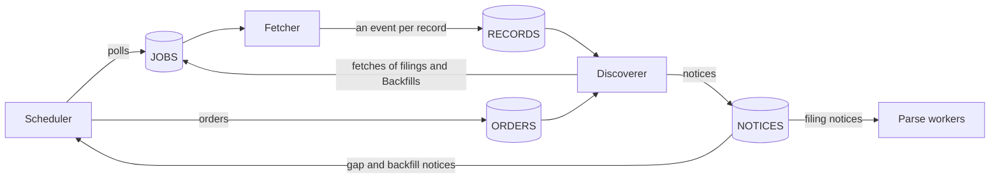
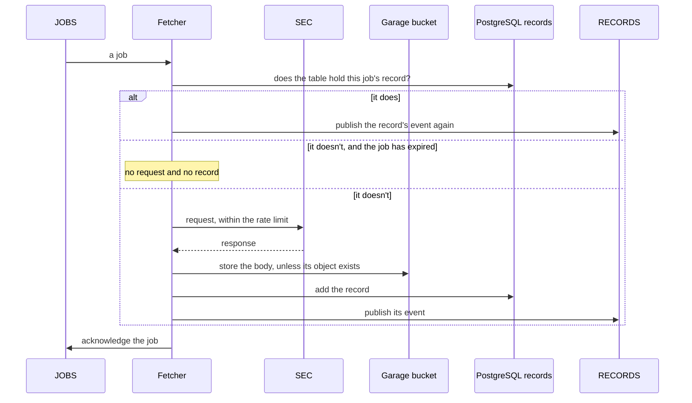

# Delivery and consistency

<!-- status: NATS JetStream; Scheduler; Fetcher; Discoverer; Parse workers; Garage; PostgreSQL 18; The snapshot store in the cluster; The snapshot store in git -->
**Status** ([status page](../status.md)): NATS JetStream: Specified. Scheduler: Specified. Fetcher: Specified. Discoverer: Specified. Parse workers: Decided. Garage: Specified. PostgreSQL 18: Specified. The snapshot store in the cluster: Specified. The snapshot store in git: Built.
<!-- end status -->

How the pipeline's services hand each other work, what each stream
guarantees, why a message delivered twice does no harm, which writes are
transactions, and what a reader of the record can rely on while the services
are writing it.

## The streams

The Go and Python services meet only at NATS messages, PostgreSQL tables,
and Garage objects, and each is a schema in `spec/schemas/` ([0006]). The
messages travel in four streams of NATS JetStream, chosen for its durable
streams, acknowledgements, redelivery, and work-queue retention ([0003]):

| Stream | Subjects | Published by | Read by | Kept |
| --- | --- | --- | --- | --- |
| `JOBS` | `edgar.jobs.poll`, `edgar.jobs.filing`, `edgar.jobs.backfill` | The scheduler, a job for each Source's poll ([JOB-2]); the discoverer, a job for each fetch of a filing's or a Backfill's ([JOB-3]) | The fetcher | As a work queue: until the fetcher acknowledges the job |
| `RECORDS` | `edgar.records.poll`, `edgar.records.filing`, `edgar.records.backfill` | The fetcher, an event for each record it adds ([JOB-6]) | The discoverer ([DISC-1]) | Until each of the stream's consumers acknowledges the event |
| `ORDERS` | `edgar.orders.backfill` | The scheduler, an order handing the discoverer each Backfill ([ORDER-1]) | The discoverer ([DISC-1]) | As a work queue: until the discoverer acknowledges the order |
| `NOTICES` | `edgar.notices.filing`, `edgar.notices.gap`, `edgar.notices.backfill` | The discoverer, a notice of each filing, gap, and Backfill's progress ([FILE-5], [GAP-3], [LIST-5]) | The scheduler, gap and backfill notices ([NOTICE-1], [NOTICE-2]); the parse workers, filing notices | Until each of the stream's consumers acknowledges the notice |

The first two are the snapshot store's ([the store's jobs and events]), and
the other two the notices' ([the notices' streams]). A job's subject and its
event's end in the job's `kind`, and a notice's in its own.

Every message is JSON, and validates against a schema: a job's and an
event's ([JOB-1]), and an order's and a notice's ([MSG-1]); the
[interfaces](interfaces.md) page gives their fields. A consumer ignores
fields it doesn't know, as a reader of records does, so a later version can
add a field without breaking a consumer ([JOB-7], [MSG-2], [REC-9]).

All four streams are kept in files and replicated on all three NATS
servers, one on each worker node, so each keeps its messages and its leader
through the loss of a node ([NATS-1], [NATS-3], [PLACE-1],
[the deployment's NATS]). Their volumes keep their data in a directory of
the host, where a cluster recreated with it finds them ([VOL-2], [VOL-3],
[KIND-2]). The Job that makes the streams also makes the durable consumers
of the discoverer, the scheduler, and the parse workers, each with three
replicas, so each keeps its place in its stream through the loss of a node
too ([NATS-5]); the fetcher's consumer of `JOBS` comes with the fetcher
([later versions][deployment-later]).

The two retentions differ in what a missing consumer costs. A work queue
keeps each job until the fetcher acknowledges it, so jobs wait while no
fetcher sends ([a filing's files][notices-files]). A stream kept until each
of its consumers acknowledges keeps a message only for the consumers it has
when the message is published, so each service that reads one needs its
durable consumer before what it should see is published. That's why the
Job makes each stream's consumers as soon as it has made the stream, and
makes `NOTICES` first, then `RECORDS`, `ORDERS`, and `JOBS` last. An event
follows a job, and a notice follows an event or an order, so no event, and
no notice that follows a message, reaches its stream before the stream's
consumers ([NATS-5]). Only a gap notice published from polls the record
already holds follows no message, and on a new install whose database was
restored while NATS's data wasn't kept, one published before `NOTICES` has
its consumers is kept for none ([durable consumers][deployment-consumers]).

## Acknowledgement and redelivery

Queued work survives restarts, and work not acknowledged is delivered again
([the design's outages and recovery], [0003]). So each consumer acknowledges
a message only once it's done with it:

- **The fetcher** adds a fetch's record, then publishes its event, then
  acknowledges the job, each once the step before has succeeded ([JOB-6]).
- **The discoverer** adds the rows a message calls for, then publishes the
  jobs and notices they lead to, then acknowledges the message, so a message
  it stopped on is delivered again ([DISC-1], [DISC-2]).

Two kinds of message are acknowledged without their step, so that neither
comes back forever:

- **A message that doesn't validate,** or whose `kind` isn't its subject's:
  the fetcher acknowledges such a job without a request or a record
  ([JOB-7]), and a consumer of orders or notices acknowledges one without
  acting on it ([MSG-2]). Each service counts them, by subject
  ([the fetcher's metrics], [the discoverer's][the discoverer's metrics],
  [the scheduler's][the scheduler's metrics]).
- **A poll whose job has expired.** A poll's job expires when its Source's
  next poll is due ([JOB-2]), and the fetcher acknowledges an expired job
  without a request or a record, unless the table already holds its record
  ([JOB-5]). A missed poll then shows as a gap in coverage, as
  [failures and recovery](failures-and-recovery.md) explains. Jobs of
  filings and Backfills never expire ([JOB-3]).

Order matters in two places:

- **The fetcher serves polls first.** Before each request, it takes the job
  queued first of the first kind that has one waiting: polls, then filings',
  then Backfills' ([JOB-4]). So a backfill never delays the record of new
  filings ([BACKFILL-2]), and the polls, which the chart holds to half the
  fetcher's limit ([VAL-3]), leave the other half to the rest ([JOB-4]).
- **The discoverer reads poll events one at a time,** in the order the
  stream holds them, so each Source's in the order the fetcher published
  them ([DISC-1]); its consumer of them, `discoverer-polls`, has one
  unacknowledged at a time ([NATS-5]). That keeps the bounds
  of when a Source first showed a filing tight. When an event does arrive
  after a later poll's of the same Source, as when the fetcher publishes an
  event again after a restart, the bounds still hold, more loosely
  ([SEEN-3], [when each Source first showed each filing]).

## Why a message delivered twice does no harm

A message may be delivered more than once, so each step is safe to repeat
([0003]). Bodies are named by their SHA-256, and filings by their accession
numbers ([one filing, end to end]). In each case:

| Delivered again | What the step finds | Why nothing is done twice |
| --- | --- | --- |
| A job whose fetch wasn't recorded | No record of the job | It's fetched again. The same body has the same name, and the fetcher stores an object only if none has that name ([OBJ-4], [OBJ-1]); a different body is a new version beside the old ([VER-1]). |
| A job whose fetch was recorded | The job's record | The fetcher publishes that record's event again and acknowledges the job, without a request ([JOB-6]). The table holds at most one record of a job, since no two records share a `job` ([STORE-1]). |
| An event | The rows its first delivery added | The discoverer adds nothing twice, and leaves each row as it is. It publishes again each job its first delivery queued, with the same `id`, unless the job's record is in the table, and the fetcher fetches a job once ([DISC-2], [JOB-6]). |
| An order | Its Backfill in `backfills` | The discoverer adds a Backfill and its first job only for an order whose `uid` it doesn't hold ([LIST-1]), and publishes that job again, with the same `id`, until it's fetched ([DISC-2]). The scheduler sends an order again, on purpose, each time it becomes the active replica or requests are allowed again, until the Backfill's status says it has started ([ORDER-1]). |
| A notice | The status it set | The scheduler sets each Source's open gap and each Backfill's status from the latest notice, by its `at` ([NOTICE-1], [NOTICE-2]). |

The discoverer's tables are keyed for this. A poll is kept by its record, a
reading by the SHA-256 of the version read, a filing by its accession
number, a sighting by its Source, URL, and filing, a job by its `id`, and a
Backfill by its `uid` ([the record of notices],
[`notices.sql`][notices-sql]).

So a consumer downstream can see the same message twice ([0003]): an event,
with the same `id` ([JOB-6]); a job, with the same `id`, which the fetcher
fetches once ([DISC-2]); or a notice. When a Backfill's filing has its jobs
published again, it gets a second trace, linked to the same list
([TRACE-4]). What the parse workers do with a filing notice is for the facts
specification ([the notices, left to other specifications]).

## The order of a fetch's writes

A fetch writes to two stores and a stream, and no transaction spans them.
The order of the writes does the work instead: the body, then the record,
then the event, then the acknowledgement ([FETCH-14], [OBJ-4], [JOB-6]).

A fetcher can stop between any two of these writes. What each stop leaves,
and what follows when the job is delivered again:

| The fetcher stops | What's left | When the job is delivered again |
| --- | --- | --- |
| Before the body is stored | Nothing | It's fetched again, unless it's a poll whose job has expired, which is acknowledged without a request ([JOB-5]) |
| After the body, before the record | An object that no record names ([OBJ-4]) | It's fetched again, and a fetch of the same body names the object ([OBJ-4]) |
| After the record, before the event | The record | The event is published from the record, and the job acknowledged, without a request ([JOB-6]) |
| After the event, before the acknowledgement | The record and its event | The event is published again, with the same `id` ([JOB-6]) |

So a job is fetched again only if its fetch wasn't recorded, and a record
never names an object that isn't in the bucket.

## Which writes are transactions

- **A fetch's record is one row** of the table `records`, which the database
  checks as it's added. It refuses a row whose fields aren't of the record's
  types and forms, whose SHA-256, size, and object disagree, or that breaks
  several of the record's other invariants, such as a `200` without an
  error that names no body ([STORE-2]), and a second record of the same job
  ([STORE-1]).
- **Storing a body and adding its record are not one transaction.** Garage
  and PostgreSQL are separate stores, and the order of the writes, above,
  stands in for one.
- **Each message the discoverer acts on is one transaction.** It adds the
  rows the message calls for in one transaction, leaving each row the record
  holds as it is, and only then publishes jobs and notices and acknowledges
  the message ([DISC-2]).
- **A filing's facts are one transaction.** A parse worker writes an import
  manifest, reads the XBRL instance from Garage, and inserts the facts in
  one transaction with the filing's acceptance time
  ([one filing, end to end]). Decision 0004 has one transaction record a
  filing, its parse, and its facts, so they can't disagree ([0004]); the
  notices' specification records the filing apart from its parse, in the
  discoverer's own transaction, when a poll's list names it ([SEEN-2],
  [DISC-2]). The facts specification is still to say how facts are written
  ([T17]).
- **The store's table is created with its index in one transaction,** so the
  table never exists without its index ([PG-8]). So are the notices' tables
  and views, so none exists without the others, and the schema `dashboards`
  with its views ([PG-12], [PG-13]).
- **The controls' status isn't the record.** The scheduler sets a Source's
  status from its polls' records and its gap notices, and a Backfill's from
  backfill notices ([SOURCE-4], [NOTICE-1], [NOTICE-2]); the fetcher sets
  the SecAccess's stop ([ACCESS-3]). Status is a summary for people, and the
  record in PostgreSQL stays authoritative ([0007]).

## What a reader of the record can rely on

While the services write the record, a reader of it can rely on these:

- **A row never changes.** Records are only added: the fetcher's role may
  insert and select them, each other service's role may only select them,
  and none may update, delete, or truncate them ([LOG-3], [PG-9]). The
  discoverer's rows are the same ([TABLE-3], [PG-14]). So a row read once
  reads the same later, and each of the discoverer's rows says what it
  found when it found it ([the record of notices]).
- **A record's object is in the bucket, and is the body it names.** A record
  is added only after the object it names is in place ([FETCH-14]), and an
  object's decompressed bytes have the SHA-256 in its name ([OBJ-1]). Garage
  can't refuse a change to an object, so the pipeline makes none, and a
  check of the objects finds any other
  ([store guarantees][store-guarantees], [LOG-4], [STORE-3]). How often that
  check runs in operation is still open ([telemetry's open questions]).
- **Records are numbered in the order they're added** ([STORE-1]), so
  "earlier" means one thing: a URL's latest earlier record gives the
  validators of a conditional request ([FETCH-4]), and the version a `304`
  names ([REC-5]).
- **A message's rows appear together, or not at all** ([DISC-2]).
- **The invariants hold whenever no one is writing.** The cluster store's
  hold whenever no fetch is writing it ([store statement IDs][store-ids]),
  and the notices' whenever the discoverer isn't writing the record
  ([notices statement IDs][notices-ids]). Between a body and its record, the
  bucket can hold an object no record names, until a fetch of the same body
  names it ([OBJ-4]).
- **What's derived is computed when it's read.** Gaps, coverage, and lags
  are views, so a record that arrives late changes what they give, and
  nothing stored ([notices guarantees][notices-guarantees]). An open gap
  that a late poll closes, after retries, leaves no gap once that poll is
  recorded: a reader can see a gap open that later reads as none
  ([coverage and gaps][notices-gaps]).
- **A sighting's bounds hold** when events arrive out of order, more loosely
  ([SEEN-3], [when each Source first showed each filing]).
- **Grafana reads only views made for it,** and can neither read nor change
  the tables ([VIEW-3], [PG-13]).
- **Status follows the record, a little behind.** The discoverer publishes a
  change in a Source's open gap within 10 seconds of the change ([GAP-3]),
  and the scheduler then sets the Source's status from it ([NOTICE-1]).

In the git store, its invariants hold whenever `data/` is at rest, between
runs, and `verify.py` checks them ([store statement IDs][store-ids]). An
object is written to a temporary file and renamed into place ([OBJ-2]), and
after every completed fetch every object is named by a record and no
temporary file remains ([OBJ-3]). The transfer from the cluster places each
object before appending its record, copies each record unchanged, in the
order of the records' `id`s, and skips only a record equal to one `data/`
already holds, so a range copied twice adds nothing ([XFER-2], [XFER-3]).

An import reads what the store holds, never the live source. It writes its
manifest before it reads its inputs, names each input by its SHA-256, and
reads it only from its store's objects, so a rerun with the same inputs and
the same `tool` commit reads the same bytes ([IMP-1], [IMP-2], [IMP-3]).

[0003]: ../decisions/0003-queue-work-in-nats-jetstream.md
[0004]: ../decisions/0004-keep-the-record-in-postgresql-18.md
[0006]: ../decisions/0006-write-the-services-in-go-and-python.md
[0007]: ../decisions/0007-control-the-pipeline-through-custom-resources.md
[one filing, end to end]: ../design.md#one-filing-end-to-end
[SEEN-2]: ../../spec/notices.md#6-when-each-source-first-showed-each-filing
[the design's outages and recovery]: ../design.md#outages-and-recovery
[T17]: ../plan.md#facts
[store-guarantees]: ../../spec/snapshots.md#1-guarantees
[store-ids]: ../../spec/snapshots.md#3-statement-ids
[the store's jobs and events]: ../../spec/snapshots.md#jobs-and-events
[STORE-1]: ../../spec/snapshots.md#the-cluster-store
[STORE-2]: ../../spec/snapshots.md#the-cluster-store
[STORE-3]: ../../spec/snapshots.md#the-cluster-store
[OBJ-1]: ../../spec/snapshots.md#5-objects
[OBJ-2]: ../../spec/snapshots.md#5-objects
[OBJ-3]: ../../spec/snapshots.md#5-objects
[OBJ-4]: ../../spec/snapshots.md#5-objects
[REC-5]: ../../spec/snapshots.md#6-records
[REC-9]: ../../spec/snapshots.md#6-records
[VER-1]: ../../spec/snapshots.md#7-versions
[LOG-3]: ../../spec/snapshots.md#8-history
[LOG-4]: ../../spec/snapshots.md#8-history
[XFER-2]: ../../spec/snapshots.md#records-the-cluster-made
[XFER-3]: ../../spec/snapshots.md#records-the-cluster-made
[FETCH-4]: ../../spec/snapshots.md#10-fetching
[FETCH-14]: ../../spec/snapshots.md#10-fetching
[JOB-1]: ../../spec/snapshots.md#jobs-and-events
[JOB-2]: ../../spec/snapshots.md#jobs-and-events
[JOB-3]: ../../spec/snapshots.md#jobs-and-events
[JOB-4]: ../../spec/snapshots.md#jobs-and-events
[JOB-5]: ../../spec/snapshots.md#jobs-and-events
[JOB-6]: ../../spec/snapshots.md#jobs-and-events
[JOB-7]: ../../spec/snapshots.md#jobs-and-events
[IMP-1]: ../../spec/snapshots.md#11-imports
[IMP-2]: ../../spec/snapshots.md#11-imports
[IMP-3]: ../../spec/snapshots.md#11-imports
[the deployment's NATS]: ../../spec/deployment.md#nats
[NATS-1]: ../../spec/deployment.md#nats
[NATS-3]: ../../spec/deployment.md#nats
[NATS-5]: ../../spec/deployment.md#durable-consumers
[PLACE-1]: ../../spec/deployment.md#placement
[VOL-2]: ../../spec/deployment.md#volumes
[VOL-3]: ../../spec/deployment.md#volumes
[KIND-2]: ../../spec/deployment.md#the-kind-cluster
[PG-8]: ../../spec/deployment.md#the-stores-database
[PG-9]: ../../spec/deployment.md#the-stores-database
[PG-12]: ../../spec/deployment.md#the-notices-and-the-dashboards
[PG-13]: ../../spec/deployment.md#the-notices-and-the-dashboards
[PG-14]: ../../spec/deployment.md#the-notices-and-the-dashboards
[deployment-later]: ../../spec/deployment.md#9-later-versions
[deployment-consumers]: ../../spec/deployment.md#durable-consumers
[VAL-3]: ../../spec/controls.md#5-the-charts-values
[SOURCE-4]: ../../spec/controls.md#6-source
[BACKFILL-2]: ../../spec/controls.md#7-backfill
[ACCESS-3]: ../../spec/controls.md#8-secaccess
[notices-guarantees]: ../../spec/notices.md#1-guarantees
[notices-ids]: ../../spec/notices.md#3-statement-ids
[the record of notices]: ../../spec/notices.md#4-the-record-of-notices
[notices-sql]: ../../spec/schemas/notices.sql
[notices-gaps]: ../../spec/notices.md#5-polls-coverage-and-gaps
[notices-files]: ../../spec/notices.md#7-a-filings-files
[when each Source first showed each filing]: ../../spec/notices.md#6-when-each-source-first-showed-each-filing
[the notices, left to other specifications]: ../../spec/notices.md#left-to-other-specifications
[the notices' streams]: ../../spec/notices.md#streams
[TABLE-3]: ../../spec/notices.md#4-the-record-of-notices
[GAP-3]: ../../spec/notices.md#5-polls-coverage-and-gaps
[SEEN-3]: ../../spec/notices.md#6-when-each-source-first-showed-each-filing
[FILE-5]: ../../spec/notices.md#7-a-filings-files
[ORDER-1]: ../../spec/notices.md#8-backfills
[LIST-1]: ../../spec/notices.md#8-backfills
[LIST-5]: ../../spec/notices.md#8-backfills
[NOTICE-1]: ../../spec/notices.md#8-backfills
[NOTICE-2]: ../../spec/notices.md#8-backfills
[MSG-1]: ../../spec/notices.md#streams
[MSG-2]: ../../spec/notices.md#streams
[DISC-1]: ../../spec/notices.md#processing
[DISC-2]: ../../spec/notices.md#processing
[the scheduler's metrics]: ../../spec/telemetry.md#the-scheduler
[the fetcher's metrics]: ../../spec/telemetry.md#the-fetcher
[the discoverer's metrics]: ../../spec/telemetry.md#the-discoverer
[telemetry's open questions]: ../../spec/telemetry.md#11-open-questions
[VIEW-3]: ../../spec/telemetry.md#8-the-views-grafana-reads
[TRACE-4]: ../../spec/telemetry.md#9-traces
