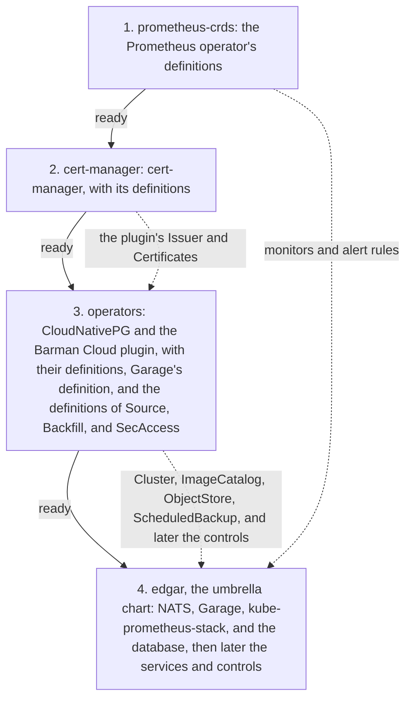

# Deployment

<!-- status: The charts -->
**Status** ([status page](../status.md)): The charts: Specified.
<!-- end status -->

The pipeline is installed on Kubernetes with Helm, by four charts in a
fixed order, on a kind cluster of one control-plane node and three workers,
with every chart, image, and tool pinned. This page explains the charts and
their order, the definitions they install, the kind cluster and its
volumes, the pins, `edgar-asof`'s among them, the pipeline's own images,
the credentials, and why each was chosen.

## Kubernetes, Helm, and kind

The pipeline demonstrates a system a team would run, not a script on a
laptop. Each component has to show how it's deployed, configured, scaled,
and recovered, and what it reports, and the whole has to run on one machine
and in CI ([0001]). So every component runs on Kubernetes, with kind as the
cluster for development and CI, and is deployed as it would be in
production: from the chart or operator its own project maintains, with its
own Secrets, storage, probes, resource requests and limits, and metrics
([0001]).

| Option | What decision 0001 says of it | Outcome |
| --- | --- | --- |
| Kubernetes on kind, installed with Helm | A real API server, scheduler, and controllers, in containers on one machine. The same charts would install on a managed cluster. | Chosen. |
| Docker Compose | Simpler, but without scheduling, Leases, CronJobs, or operators, so much of what a production team relies on couldn't be shown. | Rejected. |
| A managed cluster | Real, but it costs money to keep running, and can't run in CI the way kind can. | Rejected. |

Nothing comes from Bitnami: no chart, no repository a chart includes, and
no image ([CHART-3]). Since August and September 2025, Bitnami's free
catalog offers a reduced set of images under the `latest` tag only, and
earlier images moved to a legacy repository that no longer receives updates
([0001]).

The owner changes the cluster only through Helm. Even the pipeline's
controls are rendered from the umbrella chart's values and changed with
`helm upgrade`, never with `kubectl` ([VAL-1], [RBAC-6]), so the chart can
refuse a configuration before anything reaches the cluster ([0010]).

## The four charts and their order

The charts are four Helm charts under `deploy/`, each installed as a
release of its own, in this order, each once the release before it is ready
([CHART-4]):

| Order | Chart | Release | Namespace | Installs |
| --- | --- | --- | --- | --- |
| 1 | `deploy/prometheus-crds/` | `prometheus-crds` | `edgar` | The Prometheus operator's definitions |
| 2 | `deploy/cert-manager/` | `cert-manager` | `cert-manager` | cert-manager, with its definitions, which the Barman Cloud plugin requires for its certificates |
| 3 | `deploy/operators/` | `operators` | `cnpg-system` | The CloudNativePG operator and its Barman Cloud plugin, with their definitions; Garage's definition; and the pipeline's own |
| 4 | `deploy/chart/` | `edgar` | `edgar` | NATS, with JetStream; Garage; kube-prometheus-stack; the database; and later the pipeline's services and controls |



Solid arrows are the order of installation; dotted ones, the custom
resources a release renders of kinds an earlier release defines. CI
installs and upgrades the four with `--wait`, in this order, so a release
starts only once the one before it is ready, and the owner does the same
([CHART-4]). Each installs its components from the charts their own
projects maintain ([deployment, §5][dependencies]):

| Chart | Dependency | Repository |
| --- | --- | --- |
| `deploy/prometheus-crds/` | `prometheus-operator-crds` | `oci://ghcr.io/prometheus-community/charts` |
| `deploy/cert-manager/` | `cert-manager` | `oci://quay.io/jetstack/charts` |
| `deploy/operators/` | `cloudnative-pg`, `plugin-barman-cloud` | `https://cloudnative-pg.github.io/charts` |
| `deploy/chart/` | `nats` | `https://nats-io.github.io/k8s/helm/charts/` |
| `deploy/chart/` | `garage` | None: `script/helm/garage` in Garage's source tree, committed ([PIN-3]) |
| `deploy/chart/` | `kube-prometheus-stack` | `oci://ghcr.io/prometheus-community/charts` |

Each chart's dependencies are these and no others ([CHART-2]). The database
itself, a CloudNativePG `Cluster` and its `ImageCatalog`, is in the
umbrella chart's own templates ([PG-1], [PG-3]). The operators run one
replica each, as their charts deploy them by default: while one restarts,
its resources wait in the API server ([deployment, §5][dependencies]).

### Why four releases

Decision 0001 had one umbrella chart install everything. Decision 0011
replaced that part of it, because Helm offers no place for a custom
resource definition that serves a chart which also creates resources of its
kind ([0011]):

- **A chart's `crds/` directory** is installed before anything else on the
  first install, and never upgraded or deleted afterwards.
- **A definition in a chart's templates** is upgraded with its release, but
  Helm builds the whole release against the cluster's API before it creates
  anything, so a resource whose definition is in the same release fails to
  build.
- **Even once its definition exists,** a resource can be refused: Helm
  creates a release's resources in one pass, and cert-manager's and
  CloudNativePG's admission webhooks, which fail closed, refuse what they
  admit until their pods are ready.
- **cert-manager's documentation** says never to embed it as a subchart,
  since it manages cluster-scoped resources and must be installed exactly
  once.
- **Helm keeps each release in a Secret,** which can hold 1 MiB, and the
  four operators' definitions come to about 940 KiB there, the Prometheus
  operator's alone about 610 KiB, so they can't all be templates of one
  release.

| Option | What decision 0011 says of it | Outcome |
| --- | --- | --- |
| One release, with workarounds | Every definition in a local subchart's `crds/`, a pre-upgrade hook Job that applies them on each upgrade, and two admission checks loosened. Keeps 0001, but against cert-manager's advice, with definitions upgraded by a Job outside Helm's own record of the release. | Rejected. |
| One chart, installed as two releases | A value renders the operators and their definitions in the first release, and everything else in the second. Each release renders a different part of the chart, which every test must render both ways. | Rejected. |
| Three releases | cert-manager; the operators; then the umbrella chart, with the Prometheus operator's definitions left to kube-prometheus-stack's preview Job, which adds about 290 KB to the umbrella chart's release, and before which the operators' monitors can't be rendered. | Rejected. |
| Four releases | Each from a chart of its own, each installed once the one before it is ready. | Chosen. |

The choice has consequences ([0011]). An upgrade goes in the same order, so
a definition is upgraded before any resource that relies on a newer field
of it. The Prometheus operator's definitions and kube-prometheus-stack are
pinned apart, so a test checks that their versions agree ([CRD-5]). Garage
is told not to create its own definition, so it needs only a Role
([Garage](garage.md#three-nodes-three-copies)). And CI and the owner
install four releases instead of one.

### The layout

```text
deploy/
  prometheus-crds/             release 1: the Prometheus operator's definitions
  cert-manager/                release 2: cert-manager
  operators/                   release 3: the operators, and the other definitions
    files/garagenodes.deuxfleurs.fr.yaml
                               Garage's definition, from its source tree
  chart/                       release 4: the umbrella chart
    charts/garage/             Garage's chart, from its source tree
    files/records.sql          the store's table, from spec/schemas/
    values.schema.json         what its values must hold
  kind.yaml                    the kind cluster's configuration
```

Each chart holds a `Chart.yaml`, a `Chart.lock`, and a `values.yaml`
([CHART-1]), with each dependency from a chart repository committed as a
package under its `charts/` ([PIN-2]).

## The definitions

Every custom resource definition is rendered from a template, so none comes
from a `crds/` directory ([CRD-1]), and each is a template of a release
before the first that needs it, so Helm creates and upgrades it with that
release ([deployment, §5][definitions]):

| Definitions | Rendered by | Used by |
| --- | --- | --- |
| The Prometheus operator's | `deploy/prometheus-crds/` | The monitors and alert rules in the umbrella chart |
| cert-manager's | `deploy/cert-manager/` | The Barman Cloud plugin's certificates, in the operators' chart |
| CloudNativePG's and the Barman Cloud plugin's | `deploy/operators/` | The database, its catalog, its object store, and its scheduled backups, in the umbrella chart |
| Garage's | `deploy/operators/` | Garage, which finds its peers through Kubernetes |
| The pipeline's own: `Source`, `Backfill`, and `SecAccess` | `deploy/operators/` | The controls the umbrella chart renders from its values ([VAL-1]) |

The umbrella chart renders none ([CRD-2]). Each resource a chart renders is
of a kind an earlier chart defines, and no admission webhook a chart
renders, failing closed, admits a resource of the same chart ([CRD-3]).
Each definition is of the version of what uses it: those of cert-manager,
CloudNativePG, and the plugin come in their operators' charts, and the
pipeline's own are those in `spec/schemas/` ([CRD-5]; [API-2]). Two come
apart from what uses them, and must match it: the Prometheus operator's,
whose chart's `appVersion` is the tag of the operator's image that
kube-prometheus-stack renders, and Garage's, committed unchanged from its
source tree at the tag of Garage's chart ([CRD-5]).

Every definition carries `helm.sh/resource-policy: keep`, so Helm never
deletes it, and with it every resource of its kind, when a release is
uninstalled or an upgrade drops it ([CRD-4]). So a resource such as the
SecAccess, with its record of a stop after a `403`, outlives an uninstall,
and removing a definition is a deliberate step ([0011]). On the cluster,
every definition belongs to one of the four releases, and no component
creates one ([CRD-6]).

## The kind cluster

kind runs each node as a container on one machine ([0001]).
`deploy/kind.yaml` names one control-plane node and three worker nodes
([KIND-1]), and every node's image as `kindest/node:TAG@sha256:DIGEST`,
which also pins the cluster's Kubernetes version ([PIN-6]). It mounts one
directory of the host into every worker node, at
`/var/local-path-provisioner`, where kind's storage provisioner keeps each
volume, so every volume's data is kept on the host. The directory is one
git ignores, or one outside the repository ([KIND-2]).

### Volumes that outlive the cluster

kind's default class, `standard`, deletes a volume's data when its claim is
deleted, and names the volume's directory with a generated name, so a
cluster recreated with the same host directory can't find the data. The
umbrella chart adds a class of its own, `edgar-retained`, which keeps a
volume's data, with `reclaimPolicy: Retain`, and names its directory by its
claim's namespace and name ([VOL-1]). NATS, Garage, Prometheus, and
Alertmanager claim it ([VOL-2]), so a new claim of the same namespace and
name finds a deleted claim's data, in the same cluster or in one recreated
with the same host directory ([VOL-3]).

The database is the exception. Its volumes are on `standard`, because a
data directory left by an earlier cluster would stop a new one from
initializing; what outlives the cluster for the database is its backups in
Garage, from which it can be restored ([VOL-2]; [volumes]). So stored data
outlives the cluster: Garage's objects, the database's backups among them,
NATS's streams, and Prometheus's and Alertmanager's data ([deployment,
§1][dep-guarantees]).

### Replicas and placement

| Component | Replicas | Placement | Storage | Specified by |
| --- | --- | --- | --- | --- |
| NATS | 3 servers | One on each worker node | `edgar-retained` | [NATS-1], [PLACE-1] |
| Garage | 3 nodes, replication factor 3 | One on each worker node | `edgar-retained` | [GARAGE-1], [PLACE-1] |
| PostgreSQL 18 | 3 instances | One on each worker node | `standard` | [PG-3], [PLACE-1] |
| Prometheus, Alertmanager | 1 each | — | `edgar-retained` | [MON-4] |
| Grafana | 1 | — | None | [MON-4] |
| The operators | 1 each | — | — | [deployment, §5][dependencies] |
| The fetcher | 2, one active through a Lease | — | — | [components], [0005] |
| The scheduler | 2, one active through leader election | — | — | [components], [0007] |

The three components with three replicas each need a worker node of their
own for each replica: NATS's and Garage's pods by a required anti-affinity,
or a topology spread that refuses to schedule otherwise, and the database
by CloudNativePG's required anti-affinity, each on the node's host name
([PLACE-1]). On kind, each runs one replica on each worker node
([PLACE-2]), so NATS, Garage, and the database keep running when one worker
node is lost ([deployment, §1][dep-guarantees]): the reason for three, so
the loss of a node can be shown ([the kind cluster][KIND-1], [0002]).

The services' rows come from the design: the deployment adds each service,
with its replicas, credentials, and placement, in a later version, as it's
built ([deployment, §9][later]). The discoverer, the parse workers, the
exporter, and the query API are a Deployment, a Deployment scaled by queue
depth, a CronJob, and a stateless Deployment ([components]).

kind's nodes share one machine, so memory is the scarce resource. Each
component's resource requests and limits are measured on kind ([0001]), and
given in a later version of the deployment, with its probes ([deployment,
§9][later]).

## The pins

The same commit installs the same software: every chart is committed at an
exact version, every third-party image is named by its digest, and each of
the pipeline's own images by the commit it's built from ([deployment,
§1][dep-guarantees]). Since nothing is resolved at install time, an upgrade
is a reviewed change to a chart, the kind configuration, or CI; and since
every dependency is committed, the charts render without the network, so
their tests never reach it ([deployment, §1][dep-guarantees]).

| What | Pinned as | Statement |
| --- | --- | --- |
| Each chart's dependencies | One exact version each in `Chart.yaml`, without a range, which `Chart.lock` repeats | [PIN-1] |
| Each dependency from a chart repository | Committed as the package `helm dependency update` downloads | [PIN-2] |
| Garage's chart | Committed unchanged from `script/helm/garage` in Garage's source tree at a release tag, which the commit that adds or upgrades it names | [PIN-3] |
| Each third-party image the charts render | `REPOSITORY:TAG@sha256:DIGEST`: the tag for readers, the digest for the runtime | [PIN-4] |
| Each third-party image in the installed charts' pods, the operators' among them | By digest, as above | [PIN-5] |
| kind's nodes, and so Kubernetes | `kindest/node:TAG@sha256:DIGEST` | [PIN-6] |
| Helm and kind | Exact versions, installed by CI; Helm at major version 4 | [PIN-7] |
| PostgreSQL | Major version 18, in one image catalog, with its image by digest | [PG-1], [PG-2] |
| The pipeline's own images | The commit they're built from | [IMG-1] |
| `edgar-asof` | A release, in `uv.lock`; none is pinned yet | [Status page][status] |

Which version each pin names is for the charts, the kind configuration, and
CI to say, not the specification: an upgrade changes one of them and is
reviewed there. The exceptions are PostgreSQL's major version and Helm's,
which change only with a major version of the specification ([deployment,
§6][pins]). The statements come before the charts they describe, which task
T20 builds, with the CI job that installs them on kind; T20 isn't done, so
none of these pins exists yet ([deployment, §3][ids];
[plan][plan-observing]).

### `edgar-asof`'s pin

`edgar-asof` is the library the pipeline's Python services read EDGAR's
content through, in a repository of its own, which [its
page](edgar-asof.md) explains. The services import a pinned version of it
to read EDGAR's content and to build facts; the Go fetcher keeps its own
client ([0009]). Its pin is in the Python project's `uv.lock`, not in the
charts, and the status page counts `edgar-asof` built once `uv.lock` pins a
release of it ([STATUS-1]). None is pinned yet ([status]). The plan's tasks
wait on its releases: the discoverer, T24, on its first; the facts'
specification, T17, on a release that specifies the fact model; and the
parse workers, T25, on a release that reads XBRL instances
([plan][plan-observing], [plan][plan-facts]).

In `edgar-asof`'s own repository, the library isn't yet released
([README]), and its first release, version 0.1.0, is the task T9 of its
plan, which isn't done ([its plan][asof-plan]). These facts about
`edgar-asof` were checked against its `main` on October 14, 2026, at commit
`515bb0d`.

## The pipeline's own images

An image built from this repository has no registry, and so no digest. Each
is built from a commit, tagged with it, and loaded into kind's nodes, as
the owner decided ([deployment, §6][own-images]):

- **Tagged by commit.** Every image the umbrella chart renders is either
  third-party, by digest, or the pipeline's own, as `REPOSITORY:COMMIT`,
  where `COMMIT` is the value `images.commit`: 40 lower-case hexadecimal
  digits, which the chart requires and its default values don't set. Every
  container that runs one has `imagePullPolicy: Never` ([IMG-1]).
- **Built by one command.** It refuses a working tree with uncommitted
  changes, tags each image with the commit checked out, and loads it into
  each node with `kind load docker-image`. No image of the pipeline's own
  is pushed to a registry or pulled from one ([IMG-2]).
- **Installed from the same commit.** CI runs the images built from the
  commit it installs the charts from ([IMG-3]), and the owner installs the
  umbrella chart with `images.commit` set to the commit checked out, after
  building and loading its images ([IMG-4]).

The commit reaches the record. The fetcher's records name it in their
`tool`, as `fetcher@` and the commit its image was built from, which the
image's tag gives ([§6 of the store][records]), and each of the
discoverer's readings as `discoverer@` and its commit ([§6 of the
notices][readings]). So each record and each reading says which code wrote
it. The command and `images.commit` arrive with the first of the pipeline's
images, the fake EDGAR, task T21 ([plan][plan-observing]).

## Credentials

No credential is committed, generated as the charts render, or shown
outside a Secret ([deployment, §1][dep-guarantees]). Every credential the
umbrella chart's components use, apart from those an operator generates in
the cluster, is a value of the umbrella chart, which its
`values.schema.json` requires and no committed values file sets, so
`helm template` fails without it ([SECRET-1]). The same values render the
same manifests ([SECRET-2]), and a credential appears in what the charts
render only in a Secret, never in a ConfigMap, a container's arguments or
literal environment, or a custom resource's `spec` ([SECRET-3]).

| Credential | Comes from | Statement |
| --- | --- | --- |
| Garage's RPC secret and admin token | The umbrella chart's values | [SECRET-1] |
| Each Garage key's ID and secret, which the setup Job imports | The umbrella chart's values | [SECRET-1], [GARAGE-2] |
| Each service's database password | The umbrella chart's values | [SECRET-1], [PG-7] |
| Grafana's admin password | The umbrella chart's values | [SECRET-1] |
| The database owner's password | CloudNativePG, which generates it in the cluster | [PG-6] |

The user agent the fetcher sends the SEC isn't a credential, but it's kept
the same way: in one Secret, rendered from the value
`fetcher.secUserAgent`, which no committed values file sets, and read only
by the fetcher's containers ([ID-2]). The database archive's server name
isn't a credential either, but it too is a value the chart requires and no
committed values file sets, new for each cluster ([PG-4], [PG-10]). CI
generates new credentials for each cluster it creates, and the owner keeps
theirs in a values file git ignores, and never puts one in a commit, a pull
request, or a log ([SECRET-4]). Who holds each credential, and what each
service may read and write, is on [Security and
access](security-and-access.md).

## The fetcher's Lease

One fetcher replica at a time sends requests, the one holding the Lease
([0005]). It stops leading when it can't renew the Lease within its renewal
deadline, and another replica takes the Lease over only once a duration has
passed without a renewal, so the gap between the two keeps them from
sending at once ([FETCH-16]).

The umbrella chart gives the fetcher its Lease's name, `fetcher`, in the
release namespace, and its timings, from values: a duration of 15 seconds,
a renewal deadline of 10, and a retry period of 2, by default, those that
Kubernetes's own controllers and controller-runtime's leader election use
([LEASE-1]; [the fetcher's Lease][lease]). It refuses values that
client-go's leader election would refuse: any timing below 1, a renewal
deadline not shorter than the duration, a retry period not shorter than the
renewal deadline, or a renewal deadline not greater than 1.2 times the
retry period. It grants the fetcher's ServiceAccount `create` on Leases,
and `get` and `update` on the Lease `fetcher` only ([LEASE-1]). A handover
after the active replica is lost takes up to the duration, which this
specification and decision 0005 record as a gap ([lease], [0005]); the
notices' specification gives a gap only where the handover misses a poll
([§5 of the notices][notices-gaps]).

## How the charts are checked

Each statement of the deployment's specification is one of two kinds
([deployment, §3][ids]):

- **An invariant** is a property of the charts and the kind configuration
  as committed, and of what the charts render. Tests render each chart with
  `helm template`, with the values CI installs it with, apart from the
  credentials and the archive's server name, for which tests give values of
  their own. They need Helm, but no cluster or network.
- **A rule** is how the installed charts, or the tools around them, behave.
  Tests check it in the CI job that installs the charts on kind, and skip
  it where no cluster is installed.

The statements come before the charts they describe. Task T20 builds the
charts and writes their tests, apart from those of [IMG-1] to [IMG-3],
which T21 writes with the first of the pipeline's images, and those of
[LEASE-1] and [LEASE-2], which T23 writes with the fetcher ([deployment,
§3][ids]). The tests on kind, the fake EDGAR they run against, and the
drills are on [Testing and verification](testing-and-verification.md).

## What later versions add

The deployment's version 1.0.0 deploys the platform and what the snapshot
store needs. Later versions add ([deployment, §9][later]):

1. **The pipeline's services,** as each is built, with their replicas,
   credentials, and placement, and the database role and Garage key of each
   service after the fetcher.
2. **The streams' durable consumers,** each with its service, made before
   the fetcher publishes what it should see.
3. **Changes to the store's table,** with a migration, since the Job that
   makes the table creates it only where there's none.
4. **Each component's resource requests and limits,** measured on kind, and
   its probes.
5. **Tempo, Loki, and Alloy.**

Task T38 is the next of them: the streams `ORDERS` and `NOTICES`; the
tables and views of `notices.sql`, with their grants; the discoverer's
database role and its read-only Garage key; the durable consumers of the
discoverer, the scheduler, and the parse workers; and, for Grafana, its
database role, its password, its PostgreSQL data source, and the views of
`dashboards.sql` with their grants ([plan][plan-observing]).

## Where it's specified

| Area | Statements | What they cover | Explained on |
| --- | --- | --- | --- |
| `CHART` | [CHART-1] to [CHART-4] | The four charts, their dependencies, no Bitnami, and their order. | This page |
| `PIN` | [PIN-1] to [PIN-7] | Exact versions, committed packages, Garage's vendored chart, images by digest, kind's node image, Helm and kind. | This page |
| `CRD` | [CRD-1] to [CRD-6] | Every definition a template of the right chart, kept on uninstall, of the version of what uses it. | This page |
| `KIND`, `VOL`, `PLACE` | [KIND-1], [KIND-2], [VOL-1] to [VOL-3], [PLACE-1], [PLACE-2] | The cluster's nodes, the host directory, the retained class, and one replica on each worker node. | This page |
| `IMG` | [IMG-1] to [IMG-4] | The pipeline's images, tagged by commit and loaded into kind. | This page |
| `SECRET` | [SECRET-1] to [SECRET-4] | Credentials as required values, only in Secrets. | This page |
| `LEASE` | [LEASE-1], [LEASE-2] | The fetcher's Lease and its timings. | This page |
| `NATS` | [NATS-1] to [NATS-4] | Three servers, and the streams. | [NATS JetStream](nats-jetstream.md) |
| `GARAGE` | [GARAGE-1] to [GARAGE-4] | Three nodes, the setup Job, the buckets, and the keys. | [Garage](garage.md) |
| `PG` | [PG-1] to [PG-10] | PostgreSQL 18, three instances, the database, the roles, the table, and the backups. | [PostgreSQL 18](postgresql.md) |
| `MON` | [MON-1] to [MON-4] | What's scraped, read-only Grafana, Alertmanager, and their replicas. | [Monitoring](monitoring.md) |

[0001]: ../decisions/0001-deploy-on-kubernetes-with-helm-on-kind.md
[0002]: ../decisions/0002-store-bodies-in-garage.md
[0005]: ../decisions/0005-send-sec-requests-through-one-active-fetcher.md
[0007]: ../decisions/0007-control-the-pipeline-through-custom-resources.md
[0009]: ../decisions/0009-read-edgar-through-a-public-point-in-time-library.md
[0010]: ../decisions/0010-poll-each-companys-submissions-and-measure-lag-from-the-record.md
[0011]: ../decisions/0011-install-the-definitions-and-operators-before-the-umbrella-chart.md
[components]: ../design.md#components
[notices-gaps]: ../../spec/notices.md#5-polls-coverage-and-gaps
[plan-facts]: ../plan.md#facts
[plan-observing]: ../plan.md#observing-filings
[status]: ../status.md
[asof-plan]: https://github.com/nslaughter/edgar-asof/blob/515bb0dc7af1b76a269413f29ba3edc390193e46/docs/plan.md#the-first-release
[README]: https://github.com/nslaughter/edgar-asof/blob/515bb0dc7af1b76a269413f29ba3edc390193e46/README.md
[API-2]: ../../spec/controls.md#4-the-resources
[RBAC-6]: ../../spec/controls.md#9-who-may-change-what
[VAL-1]: ../../spec/controls.md#5-the-charts-values
[CHART-1]: ../../spec/deployment.md#4-layout
[CHART-2]: ../../spec/deployment.md#5-dependencies
[CHART-3]: ../../spec/deployment.md#5-dependencies
[CHART-4]: ../../spec/deployment.md#5-dependencies
[CRD-1]: ../../spec/deployment.md#definitions
[CRD-2]: ../../spec/deployment.md#definitions
[CRD-3]: ../../spec/deployment.md#definitions
[CRD-4]: ../../spec/deployment.md#definitions
[CRD-5]: ../../spec/deployment.md#definitions
[CRD-6]: ../../spec/deployment.md#definitions
[definitions]: ../../spec/deployment.md#definitions
[dep-guarantees]: ../../spec/deployment.md#1-guarantees
[dependencies]: ../../spec/deployment.md#5-dependencies
[GARAGE-1]: ../../spec/deployment.md#garage
[GARAGE-2]: ../../spec/deployment.md#garage
[GARAGE-4]: ../../spec/deployment.md#garage
[ids]: ../../spec/deployment.md#3-statement-ids
[IMG-1]: ../../spec/deployment.md#the-pipelines-own-images
[IMG-2]: ../../spec/deployment.md#the-pipelines-own-images
[IMG-3]: ../../spec/deployment.md#the-pipelines-own-images
[IMG-4]: ../../spec/deployment.md#the-pipelines-own-images
[KIND-1]: ../../spec/deployment.md#the-kind-cluster
[KIND-2]: ../../spec/deployment.md#the-kind-cluster
[later]: ../../spec/deployment.md#9-later-versions
[lease]: ../../spec/deployment.md#the-fetchers-lease
[LEASE-1]: ../../spec/deployment.md#the-fetchers-lease
[LEASE-2]: ../../spec/deployment.md#the-fetchers-lease
[MON-1]: ../../spec/deployment.md#monitoring
[MON-4]: ../../spec/deployment.md#monitoring
[NATS-1]: ../../spec/deployment.md#nats
[NATS-4]: ../../spec/deployment.md#nats
[own-images]: ../../spec/deployment.md#the-pipelines-own-images
[PG-1]: ../../spec/deployment.md#7-postgresql
[PG-2]: ../../spec/deployment.md#7-postgresql
[PG-3]: ../../spec/deployment.md#instances-and-backups
[PG-4]: ../../spec/deployment.md#instances-and-backups
[PG-6]: ../../spec/deployment.md#the-stores-database
[PG-7]: ../../spec/deployment.md#the-stores-database
[PG-10]: ../../spec/deployment.md#instances-and-backups
[pins]: ../../spec/deployment.md#6-pins
[PIN-1]: ../../spec/deployment.md#6-pins
[PIN-2]: ../../spec/deployment.md#6-pins
[PIN-3]: ../../spec/deployment.md#6-pins
[PIN-4]: ../../spec/deployment.md#6-pins
[PIN-5]: ../../spec/deployment.md#6-pins
[PIN-6]: ../../spec/deployment.md#6-pins
[PIN-7]: ../../spec/deployment.md#6-pins
[PLACE-1]: ../../spec/deployment.md#placement
[PLACE-2]: ../../spec/deployment.md#placement
[SECRET-1]: ../../spec/deployment.md#credentials
[SECRET-2]: ../../spec/deployment.md#credentials
[SECRET-3]: ../../spec/deployment.md#credentials
[SECRET-4]: ../../spec/deployment.md#credentials
[VOL-1]: ../../spec/deployment.md#volumes
[VOL-2]: ../../spec/deployment.md#volumes
[VOL-3]: ../../spec/deployment.md#volumes
[volumes]: ../../spec/deployment.md#volumes
[readings]: ../../spec/notices.md#6-when-each-source-first-showed-each-filing
[STATUS-1]: ../../spec/site.md#6-status
[FETCH-16]: ../../spec/snapshots.md#the-fetcher
[ID-2]: ../../spec/snapshots.md#the-fetcher
[records]: ../../spec/snapshots.md#6-records
