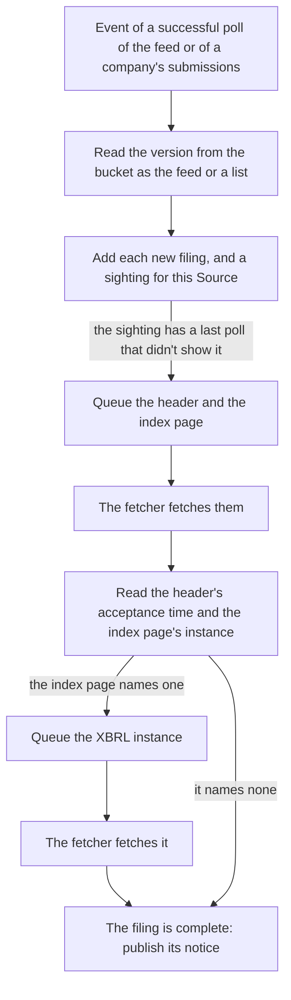
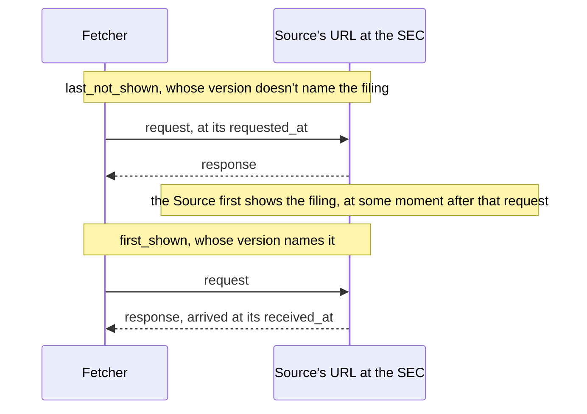
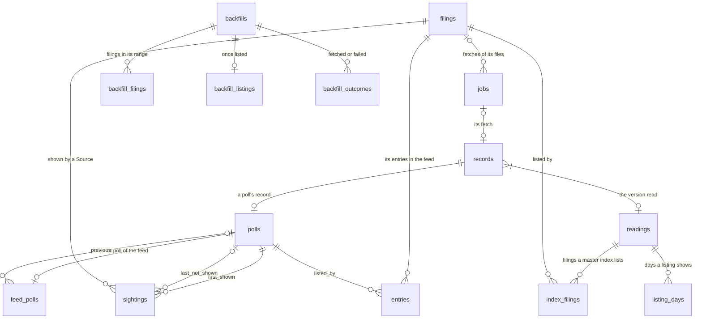

# The discoverer

<!-- status: Discoverer -->
**Status** ([status page](../status.md)): Discoverer: Specified.
<!-- end status -->

The discoverer reads what the fetcher fetched and makes the record of
filings from it: which filings each Source showed, between which two of its
polls, with their acceptance times as given; each day's check of the
latest-filings feed against that day's master index; each filing's files
and their fetches; each Source's coverage and gaps; and each Backfill's
filings and progress. This page explains how it does so, what it keeps, how
it fails, and the statements that govern it.

## What it does

The discoverer is a Python service ([0006]) that reads every event of the
stream `RECORDS` and every order of the stream `ORDERS` ([DISC-1]). From
them it does five things
([`spec/notices.md`][notices], [components][design-components]):

1. **It finds new filings.** It reads each new version of EDGAR's
   latest-filings feed, which lists the latest filings of every filer, and
   of each company's `submissions`, and records, for each Source, the two
   polls that bound when the Source first showed each filing
   ([§6 of the notices][notices-seen], [0015]).
2. **It checks each day against its master index.** From the first day
   checked, it reads each day's master index, and fetches the files of each
   filing it lists that the feed didn't name
   ([the daily check][notices-day]).
3. **It fetches each new filing's files:** its header, its index page, and
   the XBRL instance the index page names. It queues their fetches, reads
   the header's acceptance time and the index page's instance, and
   publishes a notice once the filing is complete
   ([§7 of the notices][notices-files]).
4. **It records where each Source was looking.** It adds each poll to the
   record, from which a view gives each Source's coverage and gaps, and it
   publishes a notice when a gap opens or ends
   ([§5 of the notices][notices-gaps]).
5. **It works through each Backfill** the scheduler hands it: it lists the
   Backfill's filings, queues their fetches, and reports its progress
   ([§8 of the notices][notices-backfills]).

It never sends a request. It queues jobs, which the fetcher fetches, and
reads each body from the cluster store's bucket ([FETCH-18], [SEEN-1],
[FEED-1], [DAY-3], [FILE-3]).

## From a poll to a sighting

For each event of a successful poll of a company's `submissions`, the
discoverer reads the version from the bucket as a list, and adds its
reading, unless the record already holds a reading of that version
([SEEN-1]). A version is read as a list when its `filings.recent` holds
the columns `accessionNumber`, `form`, `filingDate`, and
`acceptanceDateTime`, each a list of strings, all of one length, and its
`filings.files` names the further files, each with a `name`, a
`filingFrom`, and a `filingTo` ([SEEN-1], [SRC-12]). A version that isn't
has a reading with its `error` set. Each company's `submissions` in the
baseline listed about 1,000 recent filings ([SRC-9]). A poll of the feed
is read the same way, as the feed ([FEED-1]), as
[the feed's section](#the-latest-filings-feed) says.

For each filing a read list or version of the feed names, the discoverer
adds the filing, unless the record has it already, with the form, filing
date, and time that version gives it, as given, and the poll that listed
it ([SEEN-2]): a list's `form`, `filingDate`, and `acceptanceDateTime`, or
the feed's form, `Filed` date, and `updated` ([§6 of the
notices][notices-seen]). A later list can give the filing another
`acceptanceDateTime` ([SRC-24]), which the record of notices doesn't keep:
the list's version in the bucket does. Then, unless the record holds a
sighting of the filing for that Source and URL, it adds one ([SEEN-2]):

- **`first_shown`:** this poll, the first of the Source's polls whose
  version named the filing;
- **`last_not_shown`:** the latest of the Source's earlier polls of the
  URL whose version was read as the same kind, a list or the feed, without
  an error, or none.

The version of `last_not_shown` doesn't name the filing, and the version
of `first_shown` does. So the Source first showed the filing after
`last_not_shown`'s request was sent, and by the time `first_shown`'s
response arrived ([SEEN-3]).

These are the tightest bounds the record holds. A poll's event can reach
the discoverer after a later poll's of the same Source, as when the fetcher
publishes an event again after a restart ([JOB-6]); the bounds then still
hold, more loosely ([§6 of the notices][notices-seen]). A filing that a
Source shows at its first poll whose version is read has no
`last_not_shown`, since the record doesn't say how long the Source had
shown it.

Whether a gap lies between the two polls is part of each sighting's row in
the view `lags` ([LAG-1]). A filing first seen across a gap is bounded by
the polls on either side of it, and flagged, so the record doesn't imply a
tighter bound than it holds ([times][design-times]).

### The latest-filings feed

Each version of the feed lists the latest filings of every filer and form,
newest first, in 100 entries: a filing has one for each of its parties,
adjacent, each giving its form, the party's name, CIK, and role, the
filing's directory under the party's CIK, its filing date, and a time to
the second with its offset ([SRC-27], [SRC-33]). The discoverer reads a
version as the feed when it's Atom XML whose every entry has the parts
[SRC-33] describes, and whose filings' entries are adjacent and give one
form, filing date, and `updated` ([FEED-1]).

For each filing a read version names, the discoverer keeps the filing's
entries raw, in the table `entries`, from the first version it read that
names the filing: each entry's place, form, party, CIK, role, link, filing
date, and `updated`, as given ([FEED-2]). So `entries` holds each filing the
feed showed, and only those. The feed's last entry can be a filing's only
one, its issuer's cut off, and a later version that names the filing
doesn't add the rest ([SRC-27], [the latest-filings
feed][notices-feed]).

A filing's `updated` is the time the feed gives it, which the stored
version doesn't show to be its acceptance time: its header's is
([SRC-27], [SRC-1]). A filing the feed showed only between two of its polls
that neither names, as when the later doesn't reach back to the earlier,
has no sighting of the feed: a master index lists it
([§6 of the notices][notices-seen], [the daily check][notices-day]).

## A filing's files

When the discoverer adds a sighting that has a `last_not_shown`, and no
job of the filing exists yet, it queues the fetches of the filing's header
and its index page, as jobs of kind `filing` ([FILE-2], [JOB-3]). A filing
a Source shows with no `last_not_shown` isn't fetched for it: a Backfill
fetches it, when the owner asks for one ([FILE-2]). So a Source's first
poll whose version is read queues no fetches. A filing that a day's master
index lists, and that the feed didn't name, gets its header and index page
fetched too ([DAY-4], [the daily check](#the-daily-check)).

Each file of a filing has one URL, in the feed `filings`: that of the
file's first job, if it has one, and otherwise one made from a CIK and the
filing's accession number ([FILE-1], [SRC-21]):

| File | URL |
| --- | --- |
| Header | `https://www.sec.gov/Archives/edgar/data/CIK/NODASHES/ACCESSION-index-headers.html` |
| Index page | `https://www.sec.gov/Archives/edgar/data/CIK/NODASHES/ACCESSION-index.html` |
| XBRL instance | The URL its index page's reading names |

`CIK` is, without leading zeros, the CIK of what led to the fetch
([FILE-1]):

- **A company's `submissions`, or one of its further files,** a poll's or
  a Backfill's: the company's CIK. So a filing whose accession number
  begins with another filer's CIK, as Apple's 8-K/A's does, is found in a
  directory under the company's own ([SRC-21], [SRC-2]).
- **The feed:** the CIK in the `link` of the filing's first entry whose
  role is `Issuer`; failing one, of its first whose role is `Subject`; and
  failing both, of its first entry ([SRC-27], [0015]). In the feed's
  stored version, 35 of 41 Forms 4 and 4/A list a reporting owner's entry
  first ([SRC-33]), so the first entry's CIK would fetch most of them
  under an insider's ([0015]).
- **A master index:** the CIK of the first line that lists the filing
  ([SRC-35]).

For each event of a header's or an index page's job whose record names a
version, the discoverer reads the version from the bucket and adds its
reading, unless the record holds one of that version ([FILE-3]):

- **A header's reading** keeps the 14 digits of its
  `ACCEPTANCE-DATETIME`, as given, with no time zone ([SRC-1]), or has its
  `error` set if it gives none.
- **An index page's reading** keeps the URL that its row marked
  `EXTRACTED XBRL INSTANCE DOCUMENT` links, or none if no row is so
  marked. It has its `error` set if more than one row is, or if the link
  isn't a path in the filing's directory.

Only the index page marks the instance: the header lists the instance's file
with the same `TYPE` and `DESCRIPTION` as 4 to 115 other files of the same
filing, though both pages give the same acceptance time ([SRC-20]). When an
index page's reading names an instance the record doesn't hold, the
discoverer queues its fetch, of the same kind as the index page's job
([FILE-3]).

The discoverer queues each fetch whether or not requests are allowed.
While they aren't, the fetcher sends none, and the jobs wait
([§7 of the notices][notices-files], [ACCESS-1]). It doesn't queue the
fetch of a filing's file again because it ended without a version: the
record shows the failure, and a Backfill of the filing's date fetches the
filing again ([FILE-4]). A day's master index it does queue again
([the daily check](#the-daily-check)).

A filing is complete when its header and index page are held, each read
without an error, and the instance its index page names, if any, is held.
When an event makes a filing complete, the discoverer publishes the
filing's notice ([FILE-5]). The notice gives the filing's `form`, its
filing date, its acceptance times as given, and each of its files with its
feed, URL, and SHA-256: what an import's manifest names an input by
([notice.schema.json], [IMP-2]). Its listed time, `listed_acceptance`, is
null for a filing first listed by a master index, which gives none; its
header's is always there ([§9 of the notices][notices-messages]). The
parse workers read these notices
([§9 of the notices][notices-messages], [parse workers](parse-workers.md)).

## The daily check

The feed's polls can miss a filing, and nothing yet shows that the feed
shows every filing. So each day is checked against its master index, which
lists the filings EDGAR disseminated that day, some filed on earlier days,
on a line for each CIK a filing names ([SRC-28], [SRC-35], [0015]). A
Source polls the quarter's daily index listing, which names each day's
master index once it's published, at about 1:45 a.m. US Eastern time the
next morning ([SRC-23], [SRC-34]).

The **first day checked** is the day after the US Eastern date of the
request of the feed's first poll whose version is read as the feed without
an error; the function `first_day_checked` gives it. Earlier days, which
the feed didn't cover whole, are left to Backfills, as a filing a Source
shows at its first poll is ([FILE-2], [the daily check][notices-day]).
From it:

1. **The listing.** For each successful poll of a listing, the discoverer
   reads it, and adds each day it shows, by the `master.YYYYMMDD.idx` it
   names, to `listing_days` ([DAY-1], [SRC-34]).
2. **Each day's master index.** For each day the listing shows from the
   first day checked, it queues the fetch of that day's master index, as a
   job of kind `filing`, of the file `master`, in the feed `daily-index`.
   It doesn't while a job of that URL is waiting or has fetched a version,
   or was queued for this poll already, so a day whose fetch ended without
   one is queued again by the next poll of the listing that shows it, and
   not by this poll's event delivered again ([DAY-2]).
3. **Its filings.** It reads each fetched master index, and adds each
   filing it lists to `index_filings`, with the CIK, form type, and date
   filed of the first line that lists it, and to `filings`, unless it's
   there, with no time ([DAY-3], [SRC-35]).
4. **The filings the feed didn't name.** For each filing the index lists
   that `entries` doesn't hold and no job is queued of, it queues the
   fetches of the filing's header and index page, under its first line's CIK
   ([DAY-4], [FILE-1]). So a filing the feed missed is fetched within about
   a day, and when no other version listed it first, `filings` records it
   as first listed by the master index.

Two views give the check. `checks` gives each day checked, with the
number of filings its master index lists, the number of those no version
of the feed named, and the number of filings the feed named with that
filing date that no master index of a day checked lists ([DAY-5]).
`listings` gives each quarter's listing a Source fetched, and when it was
read through: when a poll of it requested after the next quarter's first
day ended, and the master index of each day it shows from the first day
checked, had been read, after which polling it can end ([DAY-6], [0015]).
Filings are matched by accession number, and to a day by the filing date
the feed gives. Since a master index lists some filings filed on earlier
days, such a filing counts in `feed_only` for its filing date only until
the index that lists it is read ([the daily check][notices-day]). A filing
that only a master index lists has no time but its header's, and no
sighting, so no lag ([§10 of the notices][notices-lags]).

## Coverage and gaps

For each event of a poll, the discoverer adds the poll to the table
`polls`, with its record and its job's Source, `queued_at`, and
`expires_at` ([GAP-1]). A job gives neither its due time nor its Source's
cadence, so a poll's window, from when its job was queued to when it
expired, stands for the cadence in force when it was queued
([§5 of the notices][notices-gaps]).

The feed lists only its latest entries, so it can show a filing between
two polls that neither names, when they come far enough apart ([SRC-27],
[SRC-28]). So for each successful poll of the feed, the discoverer also
adds a row to `feed_polls`: the Source's latest successful poll of the URL
before it, as `previous`, and whether the two polls' versions are both read
as the feed, without an error, and name a filing in common, as
`reaches_back` ([GAP-4]).

Taking a Source's successful polls of a URL in the order the fetcher added
them ([§5 of the notices][notices-gaps]):

- a successful poll **follows** the one before it when its job was queued
  less than its own window after the earlier one's job expired, so no slot
  passed between them without a successful poll;
- a successful poll of the feed **reaches back** when `feed_polls` gives
  the successful poll before it as its `previous`, with `reaches_back`
  true;
- a **gap**, when a poll of the feed doesn't reach back, is the time from
  the earlier one's request to its own, whether or not it follows;
  otherwise, when the later doesn't follow the earlier, it's the time from
  when the earlier one's job expired to the later one's request;
- **coverage** is the time no gap covers, from a Source's first successful
  poll until its latest successful poll's job expired;
- a gap is **open**, from when the latest successful poll's job expired,
  once that job has been expired for as long as its window with no later
  successful poll.

So a poll sent late in its slot, after retries, leaves no gap; a missed
poll leaves one of about a cadence; and a pause, a stop after a `403`, or a
fetcher's handover that misses a poll leaves one until polling resumes. A
lengthened cadence leaves none. A poll of the feed that doesn't reach back
leaves a gap of about a cadence at least, though both polls succeeded, and
so does one whose version, or the one before's, can't be read as the feed,
on each side of it. Whether a poll reaches back is judged by the poll
before it when the discoverer read it, so a poll whose event reached the
discoverer after a later poll's can leave a gap the polls didn't
([§5 of the notices][notices-gaps], [JOB-6]). The filings such a gap hides
are left to the day's check against its master index ([0015]).

The gaps are a view, `gaps`, not stored rows ([GAP-2]). A record that
arrives late changes what the view gives, and nothing stored
([§1 of the notices][notices-guarantees]). Within 10 seconds of a change
in a Source's open gap, the discoverer publishes a gap notice, with when
the gap began, or with none once it ends; when it starts, it publishes one
for each gap open then ([GAP-3]). The scheduler sets the Source's
`openGapSince` from these ([NOTICE-1]). At least every 10 seconds, the
discoverer also serves each open gap's start, and the first poll's expiry
of each Source and URL with no successful poll yet, as gauges that the
`SourceGap` alert reads ([METRIC-5], [ALERT-2]).

## Backfills

The scheduler doesn't read EDGAR's content ([0006]), and the discoverer
can't read Backfills ([RBAC-4]), so the scheduler hands each Backfill to
the discoverer in an order ([ORDER-1]). For an order whose Backfill it
hasn't seen, by `uid`, the discoverer queues the fetch of the company's
`submissions`, with the CIK padded to ten digits, as a job of kind
`backfill` ([LIST-1], [SRC-21]). Then, for each event of a Backfill's list
whose record names a version, it reads the list as it reads a poll's
([LIST-2]):

- From a company's `submissions`, it queues each further file whose
  `filingFrom` to `filingTo` overlaps the Backfill's range. A further file
  lists no filing from outside those dates, so the others hold none in the
  range ([SRC-12]).
- It adds each filing the list names with a `filingDate` in the range.
- For each such filing that's held already, it adds the outcome `fetched`.
  For each other, it queues the fetch of each of its files that isn't
  held, as jobs of kind `backfill`.

Once it has read each of a Backfill's lists, it records the Backfill as
listed ([LIST-3]). It adds one outcome for each of the Backfill's filings,
`failed` if a fetch of one of its files ended without a version, or
`fetched` once the filing is held ([LIST-4]). After each change, it
publishes a backfill notice with the Backfill's progress
([LIST-5], [LIST-6]), from which the scheduler sets the Backfill's status
([NOTICE-2]). Because held filings are skipped, a Backfill interrupted by a
restart continues where it stopped ([BACKFILL-1]). A Backfill removed from
the cluster isn't stopped: the jobs already queued for it are fetched, and
its rows stay ([§8 of the notices][notices-backfills]).

A backfill of every filing a company's `submissions` lists takes 4,671
requests for Apple's 2,264 filings, 6,166 for Microsoft's 3,004 in the
lists the scope holds, and 9,025 for Walmart's 4,421: 15.6, 20.6, and 30.1
minutes at 5 requests a second. Microsoft's second further file, outside the
scope, adds at least 3,042 requests more ([SRC-20]).

## Times and lags

The record keeps each time as its source gives it: each record's
`requested_at` and `received_at` by the fetcher's clock, each filing's time
as the version it was first added from gives it, `submissions`'
`acceptanceDateTime` or the feed's `updated`, and the 14 digits of its
header's `ACCEPTANCE-DATETIME`
([§10 of the notices][notices-lags], [0010]). The view `lags` reads them as
instants, only there:

- `submissions`' `acceptanceDateTime` as the instant it states, in RFC 3339
  with a `Z` ([SRC-25]);
- the feed's `updated` as the instant it states, in RFC 3339 with its
  offset from UTC, such as `-04:00` ([SRC-27], [SRC-33]);
- the header's digits, which give no time zone ([SRC-1]), as US Eastern
  time, `America/New_York`.

Read so, the two disagree for each of the three companies: `submissions`
gives a filing's time later than its header's by the Eastern offset on its
date, 4 hours in daylight time and 5 in standard time. Moved earlier by
that offset, nearly all of the companies' recent filings fall within
EDGAR's hours, 6:00 a.m. to 10:00 p.m. Eastern time; read as the instants
they state, most of Microsoft's and a third of Walmart's don't ([SRC-25]).
So a filing's lags from `submissions`' time are shorter than those from its
header by that offset, until a finding settles which is right ([0010]).
`submissions` can also change a filing's time after listing it, as it did
between October 7 and October 16, 2026, for every filing in Microsoft's
and Walmart's `filings.recent`, and in Microsoft's first further file
([SRC-24]), so how a filing's two times differ can depend on when the
list it was first added from was read.

The stored version of the feed doesn't show its `updated` to be when a
filing was accepted, so a filing first added from the feed has lags from
that time and from its header's, which show whether they agree ([SRC-27],
[0015]). A filing first added from a master index has no listed time, and
no sighting until a Source's polls show it, so until then `lags` doesn't
give it. A Source can show it later, as the feed can when its polls resume
after the night's check, and that sighting's lags from the listed time are
null. Since one row of `filings` keeps the time from whichever version
first named the filing, a sighting by one Source can carry the listed time
of another's version: a filing of the three companies' that the feed
showed first has the feed's `updated` in the lags of their `submissions`
Sources too ([§10 of the notices][notices-lags]).

For each sighting, `lags` gives each lag, from each acceptance time to
when the Source first showed the filing, as a low bound and a high bound:
the request of `last_not_shown`, and the response of `first_shown`, less
the acceptance time ([LAG-1]). A lag is null when its times are, or when
its acceptance time names no instant. Grafana reads these through views
of its own, as distributions of each Source's lag
([§8 of telemetry][telemetry-views]).

## Processing and delivery

The discoverer reads poll events one at a time, in the order the stream
holds them, so each Source's in the order the fetcher published them. It
ignores an event of a job of kind `filing` or `backfill` that it didn't
queue, and acknowledges a message only once it has done with it what the
notices specification says, so a message it stopped on is delivered again
([DISC-1]).

For each message, it adds the rows the message calls for in one
transaction, leaving each row the record holds as it is. It then publishes
the jobs that message queued, unless the fetcher has recorded them; then
the message's notices; then it acknowledges the message ([DISC-2]). So a
message delivered again adds nothing twice, and the jobs its first delivery
queued are published again, with the same `id`s, until they're fetched.
The fetcher fetches a job once ([JOB-6]). A message that doesn't validate
against its schema is acknowledged without being acted on, and counted
([MSG-2], [METRIC-5]).

Each filing's trace continues through the discoverer: the reading of the
poll's version, the fetches of the filing's files, their readings, and the
filing's notice join the trace the poll started. A Backfill's filing gets a
trace of its own, linked to the list that named it, so a Backfill of
thousands of filings isn't one trace ([TRACE-3], [TRACE-4],
[§9 of telemetry][telemetry-traces]).

## The messages and resources it reads and writes

| | What | Where | Statements |
| --- | --- | --- | --- |
| Reads | Events of every kind ([event.schema.json]) | `RECORDS`, `edgar.records.*`, through `discoverer-polls` and `discoverer-jobs` | [DISC-1], [GAP-1], [GAP-4], [SEEN-1], [FEED-1], [DAY-1], [DAY-3], [FILE-3], [LIST-2], [LIST-4], [NATS-5] |
| Reads | Orders ([order.schema.json]) | `ORDERS`, `edgar.orders.backfill`, through `discoverer-orders` | [LIST-1], [NATS-5] |
| Reads | Versions: lists, the feed's, listings, master indexes, headers, and index pages | Garage, the bucket `snapshots`, with a key that may only read it | [SEEN-1], [FEED-1], [DAY-1], [DAY-3], [FILE-3], [GARAGE-4] |
| Reads | Records: `SELECT` only, as the role `discoverer` | PostgreSQL, the table `records` | [LOG-3], [PG-7] |
| Writes | Rows of its tables: `INSERT` and `SELECT` only | PostgreSQL, the tables of `notices.sql` | [TABLE-1], [TABLE-2], [TABLE-3], [PG-12] |
| Publishes | Jobs of kinds `filing` and `backfill` ([job.schema.json]): of filings' files, of master indexes, and of Backfills' lists and files | `JOBS`, `edgar.jobs.filing` and `edgar.jobs.backfill` | [JOB-3], [FILE-1], [DAY-2], [DAY-4], [LIST-1], [LIST-2] |
| Publishes | Filing, gap, and backfill notices ([notice.schema.json]) | `NOTICES`, `edgar.notices.*` | [FILE-5], [GAP-3], [LIST-5] |
| Serves | Its metrics | `/metrics`, on its port `metrics` | [METRIC-1], [METRIC-5] |
| Exports | Its spans, by OTLP | The endpoint `OTEL_EXPORTER_OTLP_ENDPOINT` gives | [TRACE-7] |

## The state it keeps, and where

The discoverer keeps what it finds in the pipeline's database, beside the
store's table `records`, in the tables and views that
[notices.sql] defines ([TABLE-1]):

| Table or view | One row for each |
| --- | --- |
| `polls` | Poll whose event it read |
| `feed_polls` | Successful poll of the feed whose event it read, and whether it reaches back |
| `readings` | Version it read, as a list, the feed, a listing, a master index, a header, or an index page |
| `filings` | Filing that a list, a version of the feed, or a master index it read names |
| `sightings` | Filing and Source whose polls showed it |
| `entries` | Entry of a filing, in the first version of the feed it read that names the filing |
| `listing_days` | Day a listing it read shows |
| `index_filings` | Filing a master index it read lists |
| `jobs` | Job it queued |
| `backfills`, `backfill_filings`, `backfill_listings`, `backfill_outcomes` | Backfill ordered, its filings, its listing, and each filing's outcome |
| `held_files`, a view | File of a filing that the record holds |
| `gaps`, a view | Gap in a Source's coverage, ended or open |
| `backfill_progress`, a view | Backfill, with its progress |
| `lags`, a view | Sighting, with its times and the bounds of each lag |
| `checks`, a view | Day checked, with the filings only one of the feed and the master indexes showed |
| `listings`, a view | Quarter's listing a Source's polls fetched, and when it was read through |

Rows are only added. The discoverer's database role, `discoverer`, may
insert and select them, every other service's may only select them, and
none may update, delete, or truncate them ([TABLE-3], [PG-7], [PG-12]). So
each row says what the discoverer found when it found it. A time it copies
from a job or a record is as given there; one it adds itself is by its own
clock ([§4 of the notices][notices-record]). Each version's reading is kept
once, by the discoverer that first read it, whose `tool` names its image's
commit ([§6 of the notices][notices-seen]). Grafana reads none of these
tables, only views of its own made from them ([VIEW-3]).

Its place in `RECORDS` and `ORDERS` is kept by three durable consumers in
NATS: `discoverer-polls`, of poll events, with one unacknowledged at a
time; `discoverer-jobs`, of the events of the jobs it queued, with one
unacknowledged at a time too; and `discoverer-orders`, of the scheduler's
orders. Each is a pull consumer that
every replica reads from, with no limit on redeliveries, and each is made
right after its stream, so it reads every event and order from the first
([NATS-5]).

## Replicas

The design gives the discoverer a Deployment, without a count
([components][design-components]). Each of its replicas is active
([§2 of telemetry][telemetry-terms]), and the `SourceGap` alert takes its
gauges at their greatest across them ([ALERT-2]). Its consumer of poll
events, `discoverer-polls`, has one event unacknowledged at a time
([NATS-5], [DISC-1]), so poll events are handled one at a time however many
replicas run. So does its consumer of its jobs' events, `discoverer-jobs`,
so that when an event's transaction checks whether a filing or a Backfill
is complete, it sees the readings of each event before it ([NATS-5],
[FILE-5], [LIST-3]). Its replica count isn't specified: the deployment
specification adds each service's replicas in a later version
([§9 of deployment][deployment-later]).

## How it scales

Poll events are handled one at a time, in order ([DISC-1]), and the chart
holds the polls to 2.5 a second ([VAL-3]). At the starting cadence, three
companies every 10 seconds, that's 0.3 a second, and 25,920 polls a day
([0010]), each a list of about 1,000 recent filings ([SRC-9]). Decision
0015 adds the feed's Source, every 10 seconds, 8,640 polls a day of 100
entries each, and the listing's, every hour, once the controls' and the
deployment's versions add them ([0015], [§12 of the notices][notices-left]).
Each day checked adds one master index, of 2,179 to 4,413 filings in those
stored ([SRC-35]). [DISC-1] asks for order only of poll events, but the
events of its jobs are handled one at a time too, however many replicas
run ([NATS-5]).

The views `coverage` and `gaps` that Grafana reads read every poll, so each
read grows with the record: about 9.5 million polls a year at the starting
cadence ([open question 4 of telemetry][telemetry-open]). The discoverer
reads its own `gaps` at least every 10 seconds ([METRIC-5]). How fast the
views read is to be measured on kind, and a later version adds what they
need, such as an index or a stored summary of each day, if they slow
([open question 4 of telemetry][telemetry-open]). The
[estimates](estimates.md#postgresql) give its tables' growth, with the
store's records: 17 to 26 MB a day at the default scope.
[Scale and limits](scale-and-limits.md#reading-the-gaps) estimates when a
read of `gaps` would take longer than the 10 seconds between reads: after
386 to 1,929 days at the default scope, or 46 to 231 at the full
budget.

## How it fails, and what the record shows

| Failure | What happens | What the record shows |
| --- | --- | --- |
| It stops in the middle of a message | The message's rows are added in one transaction, and the message is delivered again ([DISC-1], [DISC-2]) | Nothing twice; the jobs it had queued are published again with the same `id`s, and fetched once ([JOB-6]) |
| It's down | Events wait in `RECORDS` until each of its consumers acknowledges them, and orders in `ORDERS` ([jobs and events][snapshots-jobs], [§9 of the notices][notices-messages]) | The events are kept. A sighting's bounds are its polls' own times, so reading them late doesn't loosen them ([SEEN-3]). On starting, it publishes a gap notice for each gap open then ([GAP-3]) |
| A poll's event arrives after a later poll's | It's read in the order the stream holds it ([DISC-1]) | Sightings still bounded, more loosely ([§6 of the notices][notices-seen]) |
| A version can't be read as its kind | A reading with its `error` set ([SEEN-1], [FEED-1], [DAY-1], [DAY-3], [FILE-3]) | The reading; a version with an error is never a `last_not_shown` ([SEEN-2]), and one of the feed leaves a gap on each side of it ([§5 of the notices][notices-gaps]); counted in `edgar_discoverer_readings_total` ([METRIC-5]) |
| A poll of the feed doesn't reach back to the one before | Its row in `feed_polls` says so ([GAP-4]) | A gap from the earlier poll's request to its own ([GAP-2]); a filing shown only between them has no sighting of the feed, and a master index lists it ([DAY-4]) |
| A fetch of a filing's file ends without a version | It isn't queued again ([FILE-4]) | The fetch's record; counted in `edgar_discoverer_jobs_failed_total`; a Backfill of the filing's date fetches it again |
| A fetch of a day's master index ends without a version | The next poll of the listing that shows the day queues it again ([DAY-2]) | The fetch's record; the day isn't a day checked until a version is read ([the daily check][notices-day]) |
| A Backfill's list can't be fetched or read | The Backfill is never listed ([LIST-3]) | The Backfill stays incomplete in its status ([BACKFILL-3]) |
| The database is unavailable | It acknowledges a message only once its rows are added, so messages wait in their streams ([DISC-1], [DISC-2], [0003]) | Nothing, until it's back |

A gap the pipeline didn't observe stays a gap: a version the SEC served and
replaced during it is lost to everyone, and the record says the gap was
there instead of implying that nothing changed
([what the pipeline keeps][design-keeps]).

## What it depends on

- **NATS JetStream:** `RECORDS` and `ORDERS`, which it reads, and `JOBS`
  and `NOTICES`, which it publishes to ([0003]). Each of its durable
  consumers is made right after its stream, so it reads every event and
  order from the first: `discoverer-polls` and `discoverer-jobs` of
  `RECORDS`, each with one event unacknowledged at a time, and
  `discoverer-orders` of `ORDERS` ([NATS-5]).
- **PostgreSQL:** its tables and views, made after the store's table
  ([PG-12]), its own role, `discoverer` ([PG-7]), and `SELECT` on `records`
  ([LOG-3]).
- **Garage:** a key of its own that may only read the bucket `snapshots`
  ([GARAGE-4]).
- **`edgar-asof`,** pinned, through which it reads `submissions` and
  headers, and the feed and the master index in a release that reads them
  ([plan][plan-observing], [§12 of the notices][notices-left]).
- **Prometheus and an OTLP endpoint** for its telemetry ([SCRAPE-1],
  [TRACE-7]).

Its libraries are nats-py, psycopg, and boto3 ([0006]). The deployment's
version 1.1.0 gives what it needs before it's built: the streams `ORDERS`
and `NOTICES`, its durable consumers, its tables and their grants, its
role, and its key ([§10 of deployment][deployment-from-1.0.0]). Its own
Deployment, with its replicas, comes in a later version, as it's built
([§9 of deployment][deployment-later]).

### Through `edgar-asof`

The pipeline's Python services read EDGAR's content through `edgar-asof`,
a public library in a repository of its own, at a pinned version ([0009]),
which [its own page](edgar-asof.md) explains.
In the cluster they give it bodies from the cluster store, and never use
its client or keep a cache of their own ([FETCH-18]). The discoverer waits
for the library's first release ([plan][plan-observing]), version 0.1.0,
which reads each body from its cache, or takes it from the caller with its
URL, as the pipeline's services give it bodies
([edgar-asof's plan][asof-plan]). That release isn't published yet
([edgar-asof's README][asof-readme]).

The library keeps acceptance times raw, as the discoverer's record does:
the header's 14 digits unchanged ([TIME-1]), and `submissions`'
`acceptanceDateTime` as the string given ([TIME-2]). It turns them into
instants only through an interpreter the caller passes, and has no default
([TIME-6], [TIME-9]); the pipeline's lags interpret them in the view `lags`
instead ([LAG-1]). Its specification at the named commit gives a caller
`read_facts` and its types ([§8 of its facts][asof-facts-types]); the names
of the functions that read a body the caller gives come with the next
versions of its fetching and times specifications, its tasks T2 and T3
([edgar-asof's plan][asof-plan]). The library's feeds are `submissions`,
`companyfacts`, and filings' headers ([§5 of its fetching][asof-feeds]);
the index page, which the discoverer reads for the instance's URL
([FILE-3]), isn't among them. Nor are the latest-filings feed and the
master index, whose readers the notices leave to a release of
`edgar-asof` that the discoverer pins ([§12 of the notices][notices-left],
[0015]). Facts about `edgar-asof` on this page were
checked against its `main` on October 14, 2026, at commit `515bb0d`.

## The alternatives weighed

Decision 0010 chose each company's `submissions` as the notice source, with
each Source's cadence in its resource, and each lag measured from the
record ([0010]):

| Option | What decision 0010 says of it |
| --- | --- |
| Wait for the investigation, and choose the source and cadence after watching filings arrive | Notices wait for weeks of watching, and the watching measures only to its polling interval. |
| Each company's `submissions`, measured in the pipeline (chosen) | The baseline already shows what it holds and that it sends no validators ([SRC-2], [SRC-4]). Requests grow with the number of companies. |
| EDGAR's latest-filings feed | One request covers every company, but its URL isn't confirmed, the scope must be widened to it, it changes on nearly every poll, so the store keeps a body each time, and a poll that comes too late can miss filings in a busy burst. |
| The daily indexes | Complete and kept in the archive, but published around 10 PM ([SRC-5]), so a filing is first seen hours after its acceptance. |

Task T11 was to revisit the choice from the lags the record shows. The
owner decided it sooner, from the goal the owner stated: decision 0015,
accepted on November 2, 2026 as T11, makes the latest-filings feed, whose
first version task T5 recorded ([SRC-26] to [SRC-28]), the notice source
for every filer, and checks each day against its master index ([0015]).
The notices' version 1.0.0, from task T52, follows it: the discoverer
reads the feed and checks each day against its master index, and still
reads each company's `submissions`, since the three companies' Sources stay
through the study ([notices][notices], [0015], [plan][plan-observing]).
Every time is still kept raw, and each lag measured from the record, as
0010 chose ([0010]).

Decision 0006 put the discoverer in Python, with the other services that
read what EDGAR publishes, so a change in EDGAR's formats touches one
language. Dividing the services by stage instead would have had a Go
discoverer read `submissions` and headers, with knowledge of EDGAR's formats
in both languages ([0006]).

Decision 0015 weighed, besides keeping 0010's source: the feed alone,
which would leave a filing missed between polls missed with nothing in the
record to show it; the daily index alone, which sees a day's filings only
once its master index is published; the Public Dissemination Service, a
paid subscription outside the fetcher's model of HTTP requests; and the
XBRL RSS feeds, which hold only filings with XBRL data ([0015]).

## What's still open

- **Whether a filing's files are in EDGAR's archive once its company's
  `submissions` or the feed lists it** (the investigation's Q4). If new
  filings' fetches end without a version, a later version queues them again
  after a delay ([open question 1 of the notices][notices-open]).
- **Which acceptance time is right, and the header's time zone** ([SRC-1],
  [SRC-24], [SRC-25]). The lags can settle it: a filing is public only once
  it's accepted, so a time from which a lag's high bound falls below zero
  isn't when the filing was accepted. A finding that settles it changes how
  `lags` reads one of the two times, in a new version of the notices, and
  nothing stored ([open question 2 of the notices][notices-open]).
- **Exact gaps.** A poll's due time in its job would let a later version
  count missed slots exactly ([open question 3 of the notices][notices-open]).
- **A version a later discoverer would read differently.** How a corrected
  reading is recorded is for a later version
  ([open question 4 of the notices][notices-open]).
- **Whether the feed's `updated` is a filing's acceptance time** ([SRC-27]).
  Its lags beside the header's show whether the two agree, and a finding
  that settles it changes nothing stored
  ([open question 5 of the notices][notices-open]).
- **Whether the feed and the master indexes list the same filings, and on
  which day** ([SRC-35]). `checks` counts each filing only one of them
  showed, and a finding that they differ can change how it matches a filing
  to a day ([open question 6 of the notices][notices-open]).
- **Whether the feed's `-index.htm` is the index page** ([SRC-27]). The
  discoverer fetches `-index.html` under the CIK the entries give, and the
  record of each fetch shows whether the directory holds it
  ([open question 7 of the notices][notices-open]).
- **How far back the feed's 100 entries reach in the busiest hour**
  ([SRC-28]). The gaps that polls which don't reach back leave show it, and
  so whether the feed's cadence, or the `count` its URL asks for, needs to
  change ([open question 8 of the notices][notices-open], [0015]).
- **What the parse workers do with a filing notice,** and how they find the
  complete filings whose notices they didn't read, which the facts
  specification says ([§12 of the notices][notices-left]).
- **What the notices leave to others for the feed and the daily check:**
  to the controls, the two Sources and how the listing's follows its
  quarter; to the deployment, the chart's default Sources, and the
  migration of a database that holds version 0.1.1's tables; to the
  telemetry, each feed's lag, the counts in `checks`, and whether a gap
  that a poll which doesn't reach back leaves is alerted on; and to the
  owner, the scope, which covers filings' files only in the three
  companies' directories, so the transfer copies only those of the
  discoverer's fetches ([§12 of the notices][notices-left]).
- **Its own Deployment,** with its replicas, which a later version of the
  deployment adds as it's built ([§9 of deployment][deployment-later]), and
  `edgar-asof`'s first release, and a release that reads the feed and the
  master index, before task T24 builds it ([plan][plan-observing]).

## Where it's specified

| Statement | What it says of the discoverer |
| --- | --- |
| [TABLE-1], [TABLE-2], [TABLE-3] | Its tables and views, as `notices.sql` defines them, to which only it adds rows. |
| [GAP-1] to [GAP-4] | Each poll is recorded, and each of the feed with whether it reaches back; `gaps` gives each gap; and a change in an open gap is published within 10 seconds. |
| [SEEN-1], [SEEN-2], [SEEN-3] | Each list is read, each filing a list or the feed names recorded, and each sighting bounded by two polls. |
| [FEED-1], [FEED-2] | Each poll of the feed is read as the feed, and each filing's entries kept raw. |
| [DAY-1] to [DAY-6] | The daily check: the days a listing shows, each day's master index fetched and read, the fetches of the filings the feed didn't name, and the views `checks` and `listings`. |
| [FILE-1] to [FILE-6] | A filing's files: their URLs, their fetches and readings, no retry, the filing notice, and `held_files`. |
| [LIST-1] to [LIST-6] | A Backfill's lists, filings, fetches, outcomes, notices, and progress. |
| [MSG-1], [MSG-2] | Orders and notices validate against their schemas; consumers refuse malformed ones. |
| [DISC-1], [DISC-2] | Every event and order is read, poll events in order, and a message delivered again adds nothing twice. |
| [LAG-1] | `lags` gives each sighting's times and the bounds of each lag. |
| [JOB-3], [FETCH-18] | It queues fetches as jobs, and reads bodies from the store, never fetching. |
| [BACKFILL-1] | A Backfill fetches its range's filings, except those already held. |
| [METRIC-1], [METRIC-2], [METRIC-5] | Its metrics, each open gap and each Source with no successful poll among them. |
| [TRACE-1], [TRACE-3], [TRACE-4], [TRACE-5], [TRACE-7], [TRACE-8] | Each filing's trace continues through it; a Backfill's filing gets its own. |
| [NATS-5], [NATS-6] | Its three durable consumers, of `RECORDS` and `ORDERS`, each made right after its stream, those of `RECORDS` with one event unacknowledged at a time. |
| [PG-7], [PG-12], [PG-14] | Its own role, `discoverer`, which alone may add to its tables, made after the store's table. |
| [GARAGE-4] | Its own key, which may only read `snapshots`. |

Task T24 builds the discoverer once `edgar-asof`'s first release, and a
release that reads the feed and the master index, are published; T16,
T23, T38, and T52, which it also waits on, are done
([plan][plan-observing]). Most of
these statements' tests await it, and T28 and T29 its metrics' and traces'
([§3 of the notices][notices-ids], [§3 of telemetry][telemetry-ids]).

[0003]: ../decisions/0003-queue-work-in-nats-jetstream.md
[0006]: ../decisions/0006-write-the-services-in-go-and-python.md
[0009]: ../decisions/0009-read-edgar-through-a-public-point-in-time-library.md
[0010]: ../decisions/0010-poll-each-companys-submissions-and-measure-lag-from-the-record.md
[0015]: ../decisions/0015-poll-the-latest-filings-feed-and-reconcile-each-day-with-the-daily-index.md
[design-keeps]: ../design.md#what-the-pipeline-keeps
[design-times]: ../design.md#times
[design-components]: ../design.md#components
[plan-observing]: ../plan.md#observing-filings
[SRC-1]: ../../investigation/edgar.md#findings-so-far
[SRC-2]: ../../investigation/edgar.md#findings-so-far
[SRC-4]: ../../investigation/edgar.md#findings-so-far
[SRC-5]: ../../investigation/edgar.md#findings-so-far
[SRC-9]: ../../investigation/edgar.md#findings-so-far
[SRC-12]: ../../investigation/edgar.md#findings-so-far
[SRC-20]: ../../investigation/edgar.md#findings-so-far
[SRC-21]: ../../investigation/edgar.md#findings-so-far
[SRC-23]: ../../investigation/edgar.md#findings-so-far
[SRC-24]: ../../investigation/edgar.md#findings-so-far
[SRC-25]: ../../investigation/edgar.md#findings-so-far
[SRC-26]: ../../investigation/edgar.md#findings-so-far
[SRC-27]: ../../investigation/edgar.md#findings-so-far
[SRC-28]: ../../investigation/edgar.md#findings-so-far
[SRC-33]: ../../investigation/edgar.md#findings-so-far
[SRC-34]: ../../investigation/edgar.md#findings-so-far
[SRC-35]: ../../investigation/edgar.md#findings-so-far
[notices]: ../../spec/notices.md
[notices.sql]: ../../spec/schemas/notices.sql
[job.schema.json]: ../../spec/schemas/job.schema.json
[event.schema.json]: ../../spec/schemas/event.schema.json
[order.schema.json]: ../../spec/schemas/order.schema.json
[notice.schema.json]: ../../spec/schemas/notice.schema.json
[notices-guarantees]: ../../spec/notices.md#1-guarantees
[notices-ids]: ../../spec/notices.md#3-statement-ids
[notices-record]: ../../spec/notices.md#4-the-record-of-notices
[notices-gaps]: ../../spec/notices.md#5-polls-coverage-and-gaps
[notices-seen]: ../../spec/notices.md#6-when-each-source-first-showed-each-filing
[notices-feed]: ../../spec/notices.md#the-latest-filings-feed
[notices-day]: ../../spec/notices.md#the-daily-check
[notices-files]: ../../spec/notices.md#7-a-filings-files
[notices-backfills]: ../../spec/notices.md#8-backfills
[notices-messages]: ../../spec/notices.md#9-messages-and-processing
[notices-lags]: ../../spec/notices.md#10-times-and-lags
[notices-open]: ../../spec/notices.md#12-open-questions
[notices-left]: ../../spec/notices.md#left-to-other-specifications
[TABLE-1]: ../../spec/notices.md#4-the-record-of-notices
[TABLE-2]: ../../spec/notices.md#4-the-record-of-notices
[TABLE-3]: ../../spec/notices.md#4-the-record-of-notices
[GAP-1]: ../../spec/notices.md#5-polls-coverage-and-gaps
[GAP-2]: ../../spec/notices.md#5-polls-coverage-and-gaps
[GAP-3]: ../../spec/notices.md#5-polls-coverage-and-gaps
[GAP-4]: ../../spec/notices.md#5-polls-coverage-and-gaps
[SEEN-1]: ../../spec/notices.md#6-when-each-source-first-showed-each-filing
[SEEN-2]: ../../spec/notices.md#6-when-each-source-first-showed-each-filing
[SEEN-3]: ../../spec/notices.md#6-when-each-source-first-showed-each-filing
[FEED-1]: ../../spec/notices.md#the-latest-filings-feed
[FEED-2]: ../../spec/notices.md#the-latest-filings-feed
[DAY-1]: ../../spec/notices.md#the-daily-check
[DAY-2]: ../../spec/notices.md#the-daily-check
[DAY-3]: ../../spec/notices.md#the-daily-check
[DAY-4]: ../../spec/notices.md#the-daily-check
[DAY-5]: ../../spec/notices.md#the-daily-check
[DAY-6]: ../../spec/notices.md#the-daily-check
[FILE-1]: ../../spec/notices.md#7-a-filings-files
[FILE-2]: ../../spec/notices.md#7-a-filings-files
[FILE-3]: ../../spec/notices.md#7-a-filings-files
[FILE-4]: ../../spec/notices.md#7-a-filings-files
[FILE-5]: ../../spec/notices.md#7-a-filings-files
[FILE-6]: ../../spec/notices.md#7-a-filings-files
[ORDER-1]: ../../spec/notices.md#8-backfills
[LIST-1]: ../../spec/notices.md#8-backfills
[LIST-2]: ../../spec/notices.md#8-backfills
[LIST-3]: ../../spec/notices.md#8-backfills
[LIST-4]: ../../spec/notices.md#8-backfills
[LIST-5]: ../../spec/notices.md#8-backfills
[LIST-6]: ../../spec/notices.md#8-backfills
[NOTICE-1]: ../../spec/notices.md#8-backfills
[NOTICE-2]: ../../spec/notices.md#8-backfills
[MSG-1]: ../../spec/notices.md#streams
[MSG-2]: ../../spec/notices.md#streams
[DISC-1]: ../../spec/notices.md#processing
[DISC-2]: ../../spec/notices.md#processing
[LAG-1]: ../../spec/notices.md#10-times-and-lags
[snapshots-jobs]: ../../spec/snapshots.md#jobs-and-events
[IMP-2]: ../../spec/snapshots.md#11-imports
[LOG-3]: ../../spec/snapshots.md#8-history
[FETCH-18]: ../../spec/snapshots.md#the-fetcher
[JOB-3]: ../../spec/snapshots.md#jobs-and-events
[JOB-6]: ../../spec/snapshots.md#jobs-and-events
[VAL-3]: ../../spec/controls.md#5-the-charts-values
[BACKFILL-1]: ../../spec/controls.md#7-backfill
[BACKFILL-3]: ../../spec/controls.md#7-backfill
[ACCESS-1]: ../../spec/controls.md#8-secaccess
[RBAC-4]: ../../spec/controls.md#9-who-may-change-what
[telemetry-terms]: ../../spec/telemetry.md#2-terms
[telemetry-ids]: ../../spec/telemetry.md#3-statement-ids
[telemetry-views]: ../../spec/telemetry.md#8-the-views-grafana-reads
[telemetry-traces]: ../../spec/telemetry.md#9-traces
[telemetry-open]: ../../spec/telemetry.md#11-open-questions
[METRIC-1]: ../../spec/telemetry.md#4-metrics
[METRIC-2]: ../../spec/telemetry.md#4-metrics
[METRIC-5]: ../../spec/telemetry.md#the-discoverer
[SCRAPE-1]: ../../spec/telemetry.md#6-scraping
[ALERT-2]: ../../spec/telemetry.md#7-alerts
[VIEW-3]: ../../spec/telemetry.md#8-the-views-grafana-reads
[TRACE-1]: ../../spec/telemetry.md#9-traces
[TRACE-3]: ../../spec/telemetry.md#9-traces
[TRACE-4]: ../../spec/telemetry.md#9-traces
[TRACE-5]: ../../spec/telemetry.md#9-traces
[TRACE-7]: ../../spec/telemetry.md#9-traces
[TRACE-8]: ../../spec/telemetry.md#9-traces
[deployment-later]: ../../spec/deployment.md#9-later-versions
[deployment-from-1.0.0]: ../../spec/deployment.md#from-version-100
[GARAGE-4]: ../../spec/deployment.md#garage
[NATS-5]: ../../spec/deployment.md#durable-consumers
[NATS-6]: ../../spec/deployment.md#durable-consumers
[PG-7]: ../../spec/deployment.md#the-stores-database
[PG-12]: ../../spec/deployment.md#the-notices-and-the-dashboards
[PG-14]: ../../spec/deployment.md#the-notices-and-the-dashboards
[asof-readme]: https://github.com/nslaughter/edgar-asof/blob/515bb0dc7af1b76a269413f29ba3edc390193e46/README.md
[asof-plan]: https://github.com/nslaughter/edgar-asof/blob/515bb0dc7af1b76a269413f29ba3edc390193e46/docs/plan.md#the-first-release
[asof-feeds]: https://github.com/nslaughter/edgar-asof/blob/515bb0dc7af1b76a269413f29ba3edc390193e46/spec/fetching.md#5-feeds
[asof-facts-types]: https://github.com/nslaughter/edgar-asof/blob/515bb0dc7af1b76a269413f29ba3edc390193e46/spec/facts.md#8-functions-and-types
[TIME-1]: https://github.com/nslaughter/edgar-asof/blob/515bb0dc7af1b76a269413f29ba3edc390193e46/spec/times.md#3-raw-times
[TIME-2]: https://github.com/nslaughter/edgar-asof/blob/515bb0dc7af1b76a269413f29ba3edc390193e46/spec/times.md#3-raw-times
[TIME-6]: https://github.com/nslaughter/edgar-asof/blob/515bb0dc7af1b76a269413f29ba3edc390193e46/spec/times.md#4-interpreters
[TIME-9]: https://github.com/nslaughter/edgar-asof/blob/515bb0dc7af1b76a269413f29ba3edc390193e46/spec/times.md#4-interpreters
