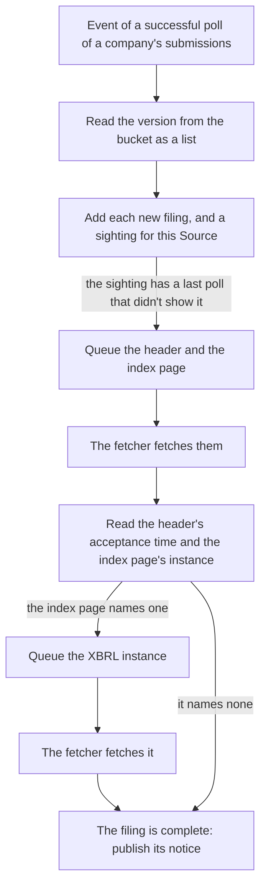
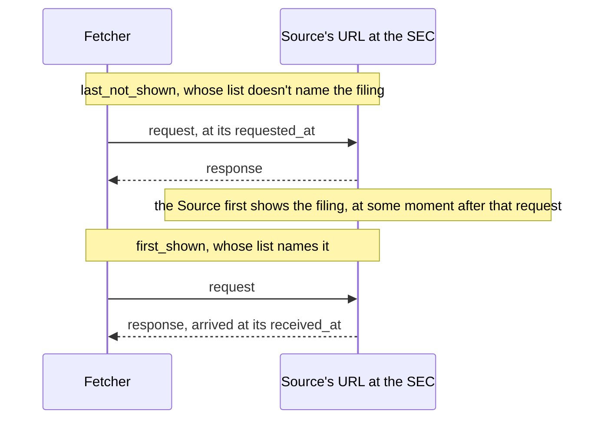
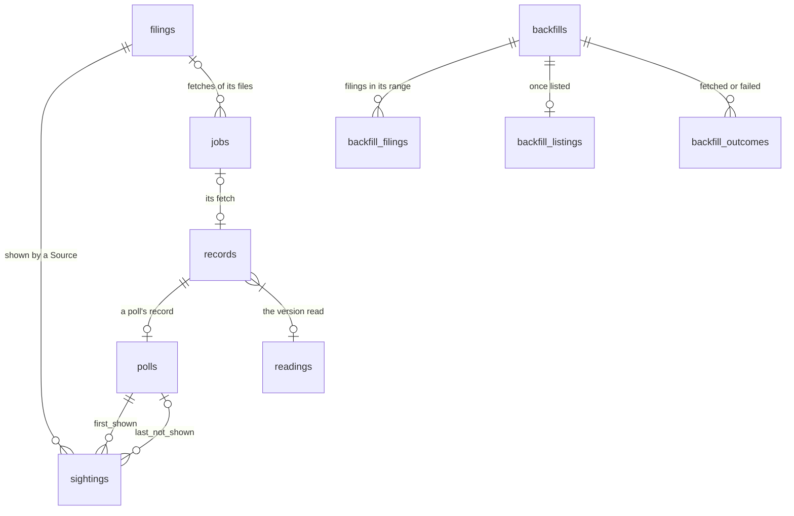

# The discoverer

<!-- status: Discoverer -->
**Status** ([status page](../status.md)): Discoverer: Decided; specified in part.
<!-- end status -->

The discoverer reads what the fetcher fetched and makes the record of
filings from it: which filings each Source showed, between which two of its
polls, with both acceptance times as given; each filing's files and their
fetches; each Source's coverage and gaps; and each Backfill's filings and
progress. This page explains how it does so, what it keeps, how it fails,
and the statements that govern it.

## What it does

The discoverer is a Python service ([0006]) that reads every event of the
stream `RECORDS` and every order of the stream `ORDERS` ([DISC-1]). From
them it does four things
([`spec/notices.md`][notices], [components][design-components]):

1. **It finds new filings.** It reads each new version of each company's
   `submissions` and records, for each Source, the two polls that bound
   when the Source first showed each filing
   ([§6 of the notices][notices-seen]).
2. **It fetches each new filing's files:** its header, its index page, and
   the XBRL instance the index page names. It queues their fetches, reads
   the header's acceptance time and the index page's instance, and
   publishes a notice once the filing is complete
   ([§7 of the notices][notices-files]).
3. **It records where each Source was looking.** It adds each poll to the
   record, from which a view gives each Source's coverage and gaps, and it
   publishes a notice when a gap opens or ends
   ([§5 of the notices][notices-gaps]).
4. **It works through each Backfill** the scheduler hands it: it lists the
   Backfill's filings, queues their fetches, and reports its progress
   ([§8 of the notices][notices-backfills]).

It never sends a request. It queues jobs, which the fetcher fetches, and
reads each body from the cluster store's bucket ([FETCH-18], [SEEN-1],
[FILE-3]).

## From a poll to a sighting

For each event of a successful poll of a company's `submissions`, the
discoverer reads the version from the bucket as a list, and adds its
reading, unless the record already holds a reading of that version
([SEEN-1]). A version is read as a list when its `filings.recent` holds
the columns `accessionNumber`, `form`, `filingDate`, and
`acceptanceDateTime`, each a list of strings, all of one length, and its
`filings.files` names the further files, each with a `name`, a
`filingFrom`, and a `filingTo` ([SEEN-1], [SRC-12]). A version that isn't
has a reading with its `error` set. Each company's `submissions` in the
baseline listed about 1,000 recent filings ([SRC-9]).

For each filing a read list names, the discoverer adds the filing, unless
the record has it already, with the `form`, `filingDate`, and
`acceptanceDateTime` the list gives it, as given, and the poll that listed
it ([SEEN-2]). Then, unless the record holds a sighting of the filing for
that Source and URL, it adds one ([SEEN-2]):

- **`first_shown`:** this poll, the first of the Source's polls whose list
  named the filing;
- **`last_not_shown`:** the latest of the Source's earlier polls of the
  URL whose version was read as a list without an error, or none.

The list of `last_not_shown` doesn't name the filing, and the list of
`first_shown` does. So the Source first showed the filing after
`last_not_shown`'s request was sent, and by the time `first_shown`'s
response arrived ([SEEN-3]).

These are the tightest bounds the record holds. A poll's event can reach
the discoverer after a later poll's of the same Source, as when the fetcher
publishes an event again after a restart ([JOB-6]); the bounds then still
hold, more loosely ([§6 of the notices][notices-seen]). A filing that a
Source shows at its first poll whose list is read has no
`last_not_shown`, since the record doesn't say how long the Source had
shown it.

Whether a gap lies between the two polls is part of each sighting's row in
the view `lags` ([LAG-1]). A filing first seen across a gap is bounded by
the polls on either side of it, and flagged, so the record doesn't imply a
tighter bound than it holds ([times][design-times]).

## A filing's files

When the discoverer adds a sighting that has a `last_not_shown`, and no
job of the filing exists yet, it queues the fetches of the filing's header
and its index page, as jobs of kind `filing` ([FILE-2], [JOB-3]). A filing
a Source shows with no `last_not_shown` isn't fetched for it: a Backfill
fetches it, when the owner asks for one ([FILE-2]). So a Source's first
poll whose list is read queues no fetches.

Each file of a filing has one URL, in the feed `filings`, made from the
company's CIK and the filing's accession number ([FILE-1], [SRC-21]):

| File | URL |
| --- | --- |
| Header | `https://www.sec.gov/Archives/edgar/data/CIK/NODASHES/ACCESSION-index-headers.html` |
| Index page | `https://www.sec.gov/Archives/edgar/data/CIK/NODASHES/ACCESSION-index.html` |
| XBRL instance | The URL its index page's reading names |

`CIK` is the CIK of the company whose list led to the fetch, without
leading zeros, so a filing whose accession number begins with another
filer's CIK, as Apple's 8-K/A's does, is found in a directory under the
company's own ([SRC-21], [SRC-2]).

For each event of a header's or an index page's job whose record names a
version, the discoverer reads the version from the bucket and adds its
reading, unless the record holds one of that version ([FILE-3]):

- **A header's reading** keeps the 14 digits of its
  `ACCEPTANCE-DATETIME`, as given, with no time zone ([SRC-1]), or has its
  `error` set if it gives none.
- **An index page's reading** keeps the URL that its row marked
  `EXTRACTED XBRL INSTANCE DOCUMENT` links, or none if no row is so
  marked. It has its `error` set if more than one row is, or if the link
  isn't a path in the filing's directory.

Only the index page marks the instance: the header lists the instance's file
with the same `TYPE` and `DESCRIPTION` as 4 to 115 other files of the same
filing, though both pages give the same acceptance time ([SRC-20]). When an
index page's reading names an instance the record doesn't hold, the
discoverer queues its fetch, of the same kind as the index page's job
([FILE-3]).

The discoverer queues each fetch whether or not requests are allowed.
While they aren't, the fetcher sends none, and the jobs wait
([§7 of the notices][notices-files], [ACCESS-1]). It doesn't queue a fetch
again because it ended without a version: the record shows the failure,
and a Backfill of the filing's date fetches the filing again ([FILE-4]).

A filing is complete when its header and index page are held, each read
without an error, and the instance its index page names, if any, is held.
When an event makes a filing complete, the discoverer publishes the
filing's notice ([FILE-5]). The notice gives the filing's `form`, its
filing date, both acceptance times as given, and each of its files with
its feed, URL, and SHA-256: what an import's manifest names an input by
([notice.schema.json], [IMP-2]). The parse workers read these notices
([§9 of the notices][notices-messages], [parse workers](parse-workers.md)).

## Coverage and gaps

For each event of a poll, the discoverer adds the poll to the table
`polls`, with its record and its job's Source, `queued_at`, and
`expires_at` ([GAP-1]). A job gives neither its due time nor its Source's
cadence, so a poll's window, from when its job was queued to when it
expired, stands for the cadence in force when it was queued
([§5 of the notices][notices-gaps]).

Taking a Source's successful polls of a URL in the order the fetcher added
them ([§5 of the notices][notices-gaps]):

- a successful poll **follows** the one before it when its job was queued
  less than its own window after the earlier one's job expired, so no slot
  passed between them without a successful poll;
- **coverage** is the time from each successful poll's request to the
  next one's, when the next follows it, and otherwise to when its job
  expired;
- a **gap** is the time from when the earlier one's job expired to the
  later one's request, when the later doesn't follow it;
- a gap is **open**, from when the latest successful poll's job expired,
  once that job has been expired for as long as its window with no later
  successful poll.

So a poll sent late in its slot, after retries, leaves no gap; a missed
poll leaves one of about a cadence; and a pause, a stop after a `403`, or a
fetcher's handover that misses a poll leaves one until polling resumes. A
lengthened cadence leaves none ([§5 of the notices][notices-gaps]).

The gaps are a view, `gaps`, not stored rows ([GAP-2]). A record that
arrives late changes what the view gives, and nothing stored
([§1 of the notices][notices-guarantees]). Within 10 seconds of a change
in a Source's open gap, the discoverer publishes a gap notice, with when
the gap began, or with none once it ends; when it starts, it publishes one
for each gap open then ([GAP-3]). The scheduler sets the Source's
`openGapSince` from these ([NOTICE-1]). At least every 10 seconds, the
discoverer also serves each open gap's start, and the first poll's expiry
of each Source and URL with no successful poll yet, as gauges that the
`SourceGap` alert reads ([METRIC-5], [ALERT-2]).

## Backfills

The scheduler doesn't read EDGAR's content ([0006]), and the discoverer
can't read Backfills ([RBAC-4]), so the scheduler hands each Backfill to
the discoverer in an order ([ORDER-1]). For an order whose Backfill it
hasn't seen, by `uid`, the discoverer queues the fetch of the company's
`submissions`, with the CIK padded to ten digits, as a job of kind
`backfill` ([LIST-1], [SRC-21]). Then, for each event of a Backfill's list
whose record names a version, it reads the list as it reads a poll's
([LIST-2]):

- From a company's `submissions`, it queues each further file whose
  `filingFrom` to `filingTo` overlaps the Backfill's range. A further file
  lists no filing from outside those dates, so the others hold none in the
  range ([SRC-12]).
- It adds each filing the list names with a `filingDate` in the range.
- For each such filing that's held already, it adds the outcome `fetched`.
  For each other, it queues the fetch of each of its files that isn't
  held, as jobs of kind `backfill`.

Once it has read each of a Backfill's lists, it records the Backfill as
listed ([LIST-3]). It adds one outcome for each of the Backfill's filings,
`failed` if a fetch of one of its files ended without a version, or
`fetched` once the filing is held ([LIST-4]). After each change, it
publishes a backfill notice with the Backfill's progress
([LIST-5], [LIST-6]), from which the scheduler sets the Backfill's status
([NOTICE-2]). Because held filings are skipped, a Backfill interrupted by a
restart continues where it stopped ([BACKFILL-1]). A Backfill removed from
the cluster isn't stopped: the jobs already queued for it are fetched, and
its rows stay ([§8 of the notices][notices-backfills]).

A backfill of every filing a company's `submissions` lists takes 4,671
requests for Apple's 2,264 filings, 6,166 for Microsoft's 3,004 in the
lists the scope holds, and 9,025 for Walmart's 4,421: 15.6, 20.6, and 30.1
minutes at 5 requests a second. Microsoft's second further file, outside the
scope, adds at least 3,042 requests more ([SRC-20]).

## Times and lags

The record keeps each time as its source gives it: each record's
`requested_at` and `received_at` by the fetcher's clock, each filing's
`acceptanceDateTime` as its list gives it, and the 14 digits of its
header's `ACCEPTANCE-DATETIME` ([§10 of the notices][notices-lags],
[0010]). The view `lags` reads them as instants, only there:

- `submissions`' `acceptanceDateTime` as the instant it states, in RFC 3339
  with a `Z` ([SRC-2]);
- the header's digits, which give no time zone ([SRC-1]), as US Eastern
  time, `America/New_York`. Read so, Microsoft's and Walmart's headers
  agree with their `submissions` ([SRC-2]), and all eight stored headers
  fall within EDGAR's hours ([SRC-13]). Each of Apple's three stored
  headers is then 4 hours earlier than its time in `submissions`
  ([SRC-2]), so Apple's lags from one of the two times show as outliers
  until a finding settles which is right ([0010]).

For each sighting, `lags` gives each lag, from each acceptance time to
when the Source first showed the filing, as a low bound and a high bound:
the request of `last_not_shown`, and the response of `first_shown`, less
the acceptance time ([LAG-1]). A lag is null when its times are, or when
its acceptance time names no instant. Grafana reads these through views
of its own, as distributions of each Source's lag
([§8 of telemetry][telemetry-views]).

## Processing and delivery

The discoverer reads poll events one at a time, in the order the stream
holds them, so each Source's in the order the fetcher published them. It
ignores an event of a job of kind `filing` or `backfill` that it didn't
queue, and acknowledges a message only once it has done with it what the
notices specification says, so a message it stopped on is delivered again
([DISC-1]).

For each message, it adds the rows the message calls for in one
transaction, leaving each row the record holds as it is. It then publishes
the jobs that message queued, unless the fetcher has recorded them; then
the message's notices; then it acknowledges the message ([DISC-2]). So a
message delivered again adds nothing twice, and the jobs its first delivery
queued are published again, with the same `id`s, until they're fetched.
The fetcher fetches a job once ([JOB-6]). A message that doesn't validate
against its schema is acknowledged without being acted on, and counted
([MSG-2], [METRIC-5]).

Each filing's trace continues through the discoverer: the reading of the
poll's list, the fetches of the filing's files, their readings, and the
filing's notice join the trace the poll started. A Backfill's filing gets a
trace of its own, linked to the list that named it, so a Backfill of
thousands of filings isn't one trace ([TRACE-3], [TRACE-4],
[§9 of telemetry][telemetry-traces]).

## The messages and resources it reads and writes

| | What | Where | Statements |
| --- | --- | --- | --- |
| Reads | Events of every kind ([event.schema.json]) | `RECORDS`, `edgar.records.*` | [DISC-1], [GAP-1], [SEEN-1], [FILE-3], [LIST-2], [LIST-4] |
| Reads | Orders ([order.schema.json]) | `ORDERS`, `edgar.orders.backfill` | [LIST-1] |
| Reads | Versions: lists, headers, and index pages | Garage, the bucket `snapshots`, with a key that may only read it | [SEEN-1], [FILE-3], [GARAGE-4] |
| Reads | Records: `SELECT` only | PostgreSQL, the table `records` | [LOG-3] |
| Writes | Rows of its tables: `INSERT` and `SELECT` only | PostgreSQL, the tables of `notices.sql` | [TABLE-1], [TABLE-2], [TABLE-3] |
| Publishes | Jobs of kinds `filing` and `backfill` ([job.schema.json]) | `JOBS`, `edgar.jobs.filing` and `edgar.jobs.backfill` | [JOB-3], [FILE-1], [LIST-1], [LIST-2] |
| Publishes | Filing, gap, and backfill notices ([notice.schema.json]) | `NOTICES`, `edgar.notices.*` | [FILE-5], [GAP-3], [LIST-5] |
| Serves | Its metrics | `/metrics`, on its port `metrics` | [METRIC-1], [METRIC-5] |
| Exports | Its spans, by OTLP | The endpoint `OTEL_EXPORTER_OTLP_ENDPOINT` gives | [TRACE-7] |

## The state it keeps, and where

The discoverer keeps what it finds in the pipeline's database, beside the
store's table `records`, in the tables and views that
[notices.sql] defines ([TABLE-1]):

| Table or view | One row for each |
| --- | --- |
| `polls` | Poll whose event it read |
| `readings` | Version it read, as a list, a header, or an index page |
| `filings` | Filing that a list it read names |
| `sightings` | Filing and Source whose polls showed it |
| `jobs` | Job it queued |
| `backfills`, `backfill_filings`, `backfill_listings`, `backfill_outcomes` | Backfill ordered, its filings, its listing, and each filing's outcome |
| `held_files`, a view | File of a filing that the record holds |
| `gaps`, a view | Gap in a Source's coverage, ended or open |
| `backfill_progress`, a view | Backfill, with its progress |
| `lags`, a view | Sighting, with its times and the bounds of each lag |

Rows are only added. The discoverer's database role may insert and select
them, every other service's may only select them, and none may update,
delete, or truncate them ([TABLE-3]). So each row says what the discoverer
found when it found it. A time it copies from a job or a record is as given
there; one it adds itself is by its own clock
([§4 of the notices][notices-record]). Each version's reading is kept once,
by the discoverer that first read it, whose `tool` names its image's
commit ([§6 of the notices][notices-seen]). Grafana reads none of these
tables, only views of its own made from them ([VIEW-3]).

Its place in `RECORDS` and `ORDERS` is kept by its durable consumers in
NATS, which task T38 specifies ([§12 of the notices][notices-left]).

## Replicas

The design gives the discoverer a Deployment, without a count
([components][design-components]). Each of its replicas is active
([§2 of telemetry][telemetry-terms]), and the `SourceGap` alert takes its
gauges at their greatest across them ([ALERT-2]). Its consumer of poll
events has one event unacknowledged at a time
([§12 of the notices][notices-left], [DISC-1]), so poll events are handled
one at a time however many replicas run. Its replica count isn't
specified: the deployment specification adds each service's replicas in a
later version ([§9 of deployment][deployment-later]).

## How it scales

Poll events are handled one at a time, in order ([DISC-1]), and the chart
holds the polls to 2.5 a second ([VAL-3]). At the starting cadence, three
companies every 10 seconds, that's 0.3 a second, and 25,920 polls a day
([0010]), each a list of about 1,000 recent filings ([SRC-9]). [DISC-1]
asks for order only of poll events.

The views `coverage` and `gaps` that Grafana reads read every poll, so each
read grows with the record: about 9.5 million polls a year at the starting
cadence ([open question 4 of telemetry][telemetry-open]). The discoverer
reads its own `gaps` at least every 10 seconds ([METRIC-5]). How fast the
views read is to be measured on kind, and a later version adds what they
need, such as an index or a stored summary of each day, if they slow
([open question 4 of telemetry][telemetry-open]). Task T42 estimates the
growth of its tables and the CPU and memory it needs
([plan][plan-documentation]).

## How it fails, and what the record shows

| Failure | What happens | What the record shows |
| --- | --- | --- |
| It stops in the middle of a message | The message's rows are added in one transaction, and the message is delivered again ([DISC-1], [DISC-2]) | Nothing twice; the jobs it had queued are published again with the same `id`s, and fetched once ([JOB-6]) |
| It's down | Events wait in `RECORDS` until each of its consumers acknowledges them, and orders in `ORDERS` ([jobs and events][snapshots-jobs], [§9 of the notices][notices-messages]) | The events are kept. A sighting's bounds are its polls' own times, so reading them late doesn't loosen them ([SEEN-3]). On starting, it publishes a gap notice for each gap open then ([GAP-3]) |
| A poll's event arrives after a later poll's | It's read in the order the stream holds it ([DISC-1]) | Sightings still bounded, more loosely ([§6 of the notices][notices-seen]) |
| A version can't be read as its kind | A reading with its `error` set ([SEEN-1], [FILE-3]) | The reading; a list with an error is never a `last_not_shown` ([SEEN-2]); counted in `edgar_discoverer_readings_total` ([METRIC-5]) |
| A fetch of a filing's file ends without a version | It isn't queued again ([FILE-4]) | The fetch's record; counted in `edgar_discoverer_jobs_failed_total`; a Backfill of the filing's date fetches it again |
| A Backfill's list can't be fetched or read | The Backfill is never listed ([LIST-3]) | The Backfill stays incomplete in its status ([BACKFILL-3]) |
| The database is unavailable | It acknowledges a message only once its rows are added, so messages wait in their streams ([DISC-1], [DISC-2], [0003]) | Nothing, until it's back |

A gap the pipeline didn't observe stays a gap: a version the SEC served and
replaced during it is lost to everyone, and the record says the gap was
there instead of implying that nothing changed
([what the pipeline keeps][design-keeps]).

## What it depends on

- **NATS JetStream:** `RECORDS` and `ORDERS`, which it reads, and `JOBS`
  and `NOTICES`, which it publishes to ([0003]). Each of its durable
  consumers must exist before what it reads is published: the consumer of
  every subject of `RECORDS`, with one poll event unacknowledged at a time,
  and the consumer of `ORDERS` ([§12 of the notices][notices-left]).
- **PostgreSQL:** its tables and views, made after the store's table, its
  own role, and `SELECT` on `records` ([§12 of the notices][notices-left],
  [LOG-3]).
- **Garage:** a key of its own that may only read the bucket `snapshots`
  ([GARAGE-4]).
- **`edgar-asof`,** pinned, through which it reads `submissions` and
  headers ([plan][plan-observing]).
- **Prometheus and an OTLP endpoint** for its telemetry ([SCRAPE-1],
  [TRACE-7]).

Its libraries are nats-py, psycopg, and boto3 ([0006]). Its deployment, the
streams `ORDERS` and `NOTICES` with their replicas, its tables and their
grants, its role, its key, and the durable consumers, is task T38
([plan][plan-observing]).

### Through `edgar-asof`

The pipeline's Python services read EDGAR's content through `edgar-asof`,
a public library in a repository of its own, at a pinned version ([0009]),
which [its own page](edgar-asof.md) explains.
In the cluster they give it bodies from the cluster store, and never use
its client or keep a cache of their own ([FETCH-18]). The discoverer waits
for the library's first release ([plan][plan-observing]), version 0.1.0,
which reads each body from its cache, or takes it from the caller with its
URL, as the pipeline's services give it bodies
([edgar-asof's plan][asof-plan]). That release isn't published yet
([edgar-asof's README][asof-readme]).

The library keeps acceptance times raw, as the discoverer's record does:
the header's 14 digits unchanged ([TIME-1]), and `submissions`'
`acceptanceDateTime` as the string given ([TIME-2]). It turns them into
instants only through an interpreter the caller passes, and has no default
([TIME-6], [TIME-9]); the pipeline's lags interpret them in the view `lags`
instead ([LAG-1]). Its specification at the named commit gives a caller
`read_facts` and its types ([§8 of its facts][asof-facts-types]); the names
of the functions that read a body the caller gives come with the next
versions of its fetching and times specifications, its tasks T2 and T3
([edgar-asof's plan][asof-plan]). The library's feeds are `submissions`,
`companyfacts`, and filings' headers ([§5 of its fetching][asof-feeds]);
the index page, which the discoverer reads for the instance's URL
([FILE-3]), isn't among them. Facts about `edgar-asof` on this page were
checked against its `main` on October 14, 2026, at commit `515bb0d`.

## The alternatives weighed

Decision 0010 chose each company's `submissions` as the notice source, with
each Source's cadence in its resource, and each lag measured from the
record ([0010]):

| Option | What decision 0010 says of it |
| --- | --- |
| Wait for the investigation, and choose the source and cadence after watching filings arrive | Notices wait for weeks of watching, and the watching measures only to its polling interval. |
| Each company's `submissions`, measured in the pipeline (chosen) | The baseline already shows what it holds and that it sends no validators ([SRC-2], [SRC-4]). Requests grow with the number of companies. |
| EDGAR's latest-filings feed | One request covers every company, but its URL isn't confirmed, the scope must be widened to it, it changes on nearly every poll, so the store keeps a body each time, and a poll that comes too late can miss filings in a busy burst. |
| The daily indexes | Complete and kept in the archive, but published around 10 PM ([SRC-5]), so a filing is first seen hours after its acceptance. |

Task T11 revisits the choice from the lags the record shows: whether to
keep each company's `submissions`, add the latest-filings feed once task T5
has recorded it, or change the cadence, in a decision record that
supersedes 0010 if anything changes ([plan][plan-observing]).

Decision 0006 put the discoverer in Python, with the other services that
read what EDGAR publishes, so a change in EDGAR's formats touches one
language. Dividing the services by stage instead would have had a Go
discoverer read `submissions` and headers, with knowledge of EDGAR's formats
in both languages ([0006]).

## What's still open

- **Whether a filing's files are in EDGAR's archive once its company's
  `submissions` lists it** (the investigation's Q4). If new filings' fetches
  end without a version, a later version queues them again after a delay
  ([open question 1 of the notices][notices-open]).
- **The header's time zone** ([SRC-1], [SRC-2], [SRC-13]). A finding that
  settles it changes how `lags` reads the header, in a new version of the
  notices, and nothing stored
  ([open question 2 of the notices][notices-open]).
- **Exact gaps.** A poll's due time in its job would let a later version
  count missed slots exactly ([open question 3 of the notices][notices-open]).
- **A version a later discoverer would read differently.** How a corrected
  reading is recorded is for a later version
  ([open question 4 of the notices][notices-open]).
- **What the parse workers do with a filing notice,** and how they find the
  complete filings whose notices they didn't read, which the facts
  specification says ([§12 of the notices][notices-left]).
- **Its deployment** (task T38), and `edgar-asof`'s first release, before
  task T24 builds it ([plan][plan-observing]).

## Where it's specified

| Statement | What it says of the discoverer |
| --- | --- |
| [TABLE-1], [TABLE-2], [TABLE-3] | Its tables and views, as `notices.sql` defines them, to which only it adds rows. |
| [GAP-1], [GAP-2], [GAP-3] | Each poll is recorded, `gaps` gives each gap, and a change in an open gap is published within 10 seconds. |
| [SEEN-1], [SEEN-2], [SEEN-3] | Each list is read, each filing recorded, and each sighting bounded by two polls. |
| [FILE-1] to [FILE-6] | A filing's files: their URLs, their fetches and readings, no retry, the filing notice, and `held_files`. |
| [LIST-1] to [LIST-6] | A Backfill's lists, filings, fetches, outcomes, notices, and progress. |
| [MSG-1], [MSG-2] | Orders and notices validate against their schemas; consumers refuse malformed ones. |
| [DISC-1], [DISC-2] | Every event and order is read, poll events in order, and a message delivered again adds nothing twice. |
| [LAG-1] | `lags` gives each sighting's times and the bounds of each lag. |
| [JOB-3], [FETCH-18] | It queues fetches as jobs, and reads bodies from the store, never fetching. |
| [BACKFILL-1] | A Backfill fetches its range's filings, except those already held. |
| [METRIC-1], [METRIC-2], [METRIC-5] | Its metrics, each open gap and each Source with no successful poll among them. |
| [TRACE-1], [TRACE-3], [TRACE-4], [TRACE-5], [TRACE-7], [TRACE-8] | Each filing's trace continues through it; a Backfill's filing gets its own. |

Task T24 builds the discoverer, once T16, T23, and T38 are done and
`edgar-asof`'s first release is published ([plan][plan-observing]). Most of
these statements' tests await it, and T28 and T29 its metrics' and traces'
([§3 of the notices][notices-ids], [§3 of telemetry][telemetry-ids]).

[0003]: ../decisions/0003-queue-work-in-nats-jetstream.md
[0006]: ../decisions/0006-write-the-services-in-go-and-python.md
[0009]: ../decisions/0009-read-edgar-through-a-public-point-in-time-library.md
[0010]: ../decisions/0010-poll-each-companys-submissions-and-measure-lag-from-the-record.md
[design-keeps]: ../design.md#what-the-pipeline-keeps
[design-times]: ../design.md#times
[design-components]: ../design.md#components
[plan-observing]: ../plan.md#observing-filings
[plan-documentation]: ../plan.md#documentation
[SRC-1]: ../../investigation/edgar.md#findings-so-far
[SRC-2]: ../../investigation/edgar.md#findings-so-far
[SRC-4]: ../../investigation/edgar.md#findings-so-far
[SRC-5]: ../../investigation/edgar.md#findings-so-far
[SRC-9]: ../../investigation/edgar.md#findings-so-far
[SRC-12]: ../../investigation/edgar.md#findings-so-far
[SRC-13]: ../../investigation/edgar.md#findings-so-far
[SRC-20]: ../../investigation/edgar.md#findings-so-far
[SRC-21]: ../../investigation/edgar.md#findings-so-far
[notices]: ../../spec/notices.md
[notices.sql]: ../../spec/schemas/notices.sql
[job.schema.json]: ../../spec/schemas/job.schema.json
[event.schema.json]: ../../spec/schemas/event.schema.json
[order.schema.json]: ../../spec/schemas/order.schema.json
[notice.schema.json]: ../../spec/schemas/notice.schema.json
[notices-guarantees]: ../../spec/notices.md#1-guarantees
[notices-ids]: ../../spec/notices.md#3-statement-ids
[notices-record]: ../../spec/notices.md#4-the-record-of-notices
[notices-gaps]: ../../spec/notices.md#5-polls-coverage-and-gaps
[notices-seen]: ../../spec/notices.md#6-when-each-source-first-showed-each-filing
[notices-files]: ../../spec/notices.md#7-a-filings-files
[notices-backfills]: ../../spec/notices.md#8-backfills
[notices-messages]: ../../spec/notices.md#9-messages-and-processing
[notices-lags]: ../../spec/notices.md#10-times-and-lags
[notices-open]: ../../spec/notices.md#12-open-questions
[notices-left]: ../../spec/notices.md#left-to-other-specifications
[TABLE-1]: ../../spec/notices.md#4-the-record-of-notices
[TABLE-2]: ../../spec/notices.md#4-the-record-of-notices
[TABLE-3]: ../../spec/notices.md#4-the-record-of-notices
[GAP-1]: ../../spec/notices.md#5-polls-coverage-and-gaps
[GAP-2]: ../../spec/notices.md#5-polls-coverage-and-gaps
[GAP-3]: ../../spec/notices.md#5-polls-coverage-and-gaps
[SEEN-1]: ../../spec/notices.md#6-when-each-source-first-showed-each-filing
[SEEN-2]: ../../spec/notices.md#6-when-each-source-first-showed-each-filing
[SEEN-3]: ../../spec/notices.md#6-when-each-source-first-showed-each-filing
[FILE-1]: ../../spec/notices.md#7-a-filings-files
[FILE-2]: ../../spec/notices.md#7-a-filings-files
[FILE-3]: ../../spec/notices.md#7-a-filings-files
[FILE-4]: ../../spec/notices.md#7-a-filings-files
[FILE-5]: ../../spec/notices.md#7-a-filings-files
[FILE-6]: ../../spec/notices.md#7-a-filings-files
[ORDER-1]: ../../spec/notices.md#8-backfills
[LIST-1]: ../../spec/notices.md#8-backfills
[LIST-2]: ../../spec/notices.md#8-backfills
[LIST-3]: ../../spec/notices.md#8-backfills
[LIST-4]: ../../spec/notices.md#8-backfills
[LIST-5]: ../../spec/notices.md#8-backfills
[LIST-6]: ../../spec/notices.md#8-backfills
[NOTICE-1]: ../../spec/notices.md#8-backfills
[NOTICE-2]: ../../spec/notices.md#8-backfills
[MSG-1]: ../../spec/notices.md#streams
[MSG-2]: ../../spec/notices.md#streams
[DISC-1]: ../../spec/notices.md#processing
[DISC-2]: ../../spec/notices.md#processing
[LAG-1]: ../../spec/notices.md#10-times-and-lags
[snapshots-jobs]: ../../spec/snapshots.md#jobs-and-events
[IMP-2]: ../../spec/snapshots.md#11-imports
[LOG-3]: ../../spec/snapshots.md#8-history
[FETCH-18]: ../../spec/snapshots.md#the-fetcher
[JOB-3]: ../../spec/snapshots.md#jobs-and-events
[JOB-6]: ../../spec/snapshots.md#jobs-and-events
[VAL-3]: ../../spec/controls.md#5-the-charts-values
[BACKFILL-1]: ../../spec/controls.md#7-backfill
[BACKFILL-3]: ../../spec/controls.md#7-backfill
[ACCESS-1]: ../../spec/controls.md#8-secaccess
[RBAC-4]: ../../spec/controls.md#9-who-may-change-what
[telemetry-terms]: ../../spec/telemetry.md#2-terms
[telemetry-ids]: ../../spec/telemetry.md#3-statement-ids
[telemetry-views]: ../../spec/telemetry.md#8-the-views-grafana-reads
[telemetry-traces]: ../../spec/telemetry.md#9-traces
[telemetry-open]: ../../spec/telemetry.md#11-open-questions
[METRIC-1]: ../../spec/telemetry.md#4-metrics
[METRIC-2]: ../../spec/telemetry.md#4-metrics
[METRIC-5]: ../../spec/telemetry.md#the-discoverer
[SCRAPE-1]: ../../spec/telemetry.md#6-scraping
[ALERT-2]: ../../spec/telemetry.md#7-alerts
[VIEW-3]: ../../spec/telemetry.md#8-the-views-grafana-reads
[TRACE-1]: ../../spec/telemetry.md#9-traces
[TRACE-3]: ../../spec/telemetry.md#9-traces
[TRACE-4]: ../../spec/telemetry.md#9-traces
[TRACE-5]: ../../spec/telemetry.md#9-traces
[TRACE-7]: ../../spec/telemetry.md#9-traces
[TRACE-8]: ../../spec/telemetry.md#9-traces
[deployment-later]: ../../spec/deployment.md#9-later-versions
[GARAGE-4]: ../../spec/deployment.md#garage
[asof-readme]: https://github.com/nslaughter/edgar-asof/blob/515bb0dc7af1b76a269413f29ba3edc390193e46/README.md
[asof-plan]: https://github.com/nslaughter/edgar-asof/blob/515bb0dc7af1b76a269413f29ba3edc390193e46/docs/plan.md#the-first-release
[asof-feeds]: https://github.com/nslaughter/edgar-asof/blob/515bb0dc7af1b76a269413f29ba3edc390193e46/spec/fetching.md#5-feeds
[asof-facts-types]: https://github.com/nslaughter/edgar-asof/blob/515bb0dc7af1b76a269413f29ba3edc390193e46/spec/facts.md#8-functions-and-types
[TIME-1]: https://github.com/nslaughter/edgar-asof/blob/515bb0dc7af1b76a269413f29ba3edc390193e46/spec/times.md#3-raw-times
[TIME-2]: https://github.com/nslaughter/edgar-asof/blob/515bb0dc7af1b76a269413f29ba3edc390193e46/spec/times.md#3-raw-times
[TIME-6]: https://github.com/nslaughter/edgar-asof/blob/515bb0dc7af1b76a269413f29ba3edc390193e46/spec/times.md#4-interpreters
[TIME-9]: https://github.com/nslaughter/edgar-asof/blob/515bb0dc7af1b76a269413f29ba3edc390193e46/spec/times.md#4-interpreters
