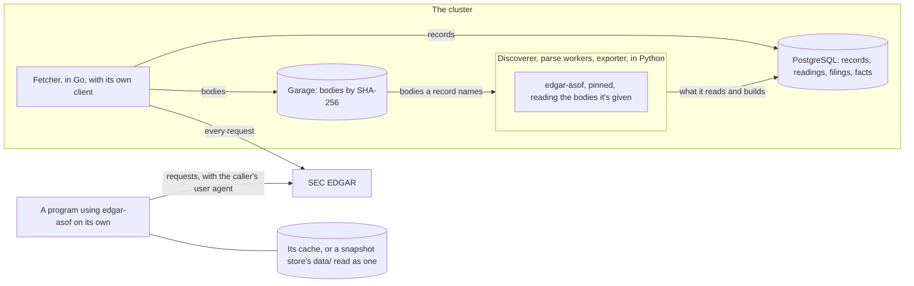

# `edgar-asof`

<!-- status: `edgar-asof` -->
**Status** ([status page](../status.md)): `edgar-asof`: Decided.
<!-- end status -->

`edgar-asof` is the public library that the pipeline's Python services read
EDGAR's content through. This page explains what it is, why it's a library
in a repository of its own, what its specifications define for the pipeline,
how the services use it, how the two come to answer "as of T" the same way,
and where its releases stand. Its facts about `edgar-asof` cite that
repository's documents at commit [`515bb0d`][asof-commit], and were checked
against its `main` on October 14, 2026.

## What the library is

`edgar-asof` is a Python library in a public repository of its own,
`nslaughter/edgar-asof`, to be released on PyPI under the same name, under
the MIT license ([0009]). It answers what a company reported to the SEC as
it was known at any past time ([its README][asof-readme]). Decision 0009
gives it five jobs:

- **It reads EDGAR's company feeds:** `submissions`, with the further files
  that list older filings; `companyfacts`; and each filing's header, for its
  acceptance time.
- **It keeps each reported value in two times:** its period, when the value
  was true, and the acceptance time of each filing that reported it, when it
  became known, as the pipeline's design does ([the design's times]).
- **It keeps each acceptance time raw,** as its source gives it, and turns
  raw times into instants in a separate step that a caller can replace.
- **It answers "as of T":** for a concept and a period, the value known at
  T, and the values that later filings reported for it.
- **It fetches for people who use it on its own,** under the SEC's rules for
  automated access, into a local cache that follows the pipeline's snapshot
  store.

It isn't released yet ([its README][asof-readme]). The pipeline's `uv.lock`
pins no release of it, so its status here is Decided, and it becomes Built
once `uv.lock` pins one ([STATUS-1], [status page]).

## Why a library, in a repository of its own

Decision [0009] records the choice. When it was made, this repository was
private, and the pipeline it plans was many tasks away, so none of the work
could be used or shown until the pipeline ran. The pipeline's core question,
what a company reported as known at a past time, is useful without a
cluster. The most used Python library for EDGAR, edgartools, mentions
neither point-in-time nor "as of" queries in its README, as read on October
10, 2026. And the pipeline already divided its services by whether they read
EDGAR's content: the discoverer, the parse workers, and the exporter read
it, in Python, and only the Go fetcher sends requests to the SEC ([0006],
[0005]).

The record weighed three options:

| Option | What the record says of it |
| --- | --- |
| A package in this repository | Specifications, decisions, and changes stay in one place, and a change that spans both lands in one pull request. But it's public only when the whole repository is, and it reads as a component of a Kubernetes project, not as a library. |
| A separate public repository that the pipeline depends on (chosen) | It can be public and usable after a few sessions, with its own releases, issues, and versions. A change the pipeline needs is released in the library first, then pinned here, and a local path dependency keeps that cheap while both change quickly. |
| No library | The pipeline stays the only artifact, private until it runs. |

The owner chose the separate repository, and its name, on October 10, 2026:
`edgar-asof` says what the library answers, and doesn't suggest that the SEC
endorses it. The owner also decided that the investigation's findings stay
in this repository, made public, so that the library's specifications cite
them by link instead of restating them; and that both repositories are under
the MIT license, with Apache-2.0, which adds an explicit patent grant, as
the alternative ([0009]).

The record names the cost. A public library implies releases and some
upkeep, and keeping it to `submissions`, `companyfacts`, and headers keeps
that light, since those feeds change less often than filing formats and
taxonomies ([0009]). Tasks in this repository's plan that need the library
wait on a published release of it, not on its tasks
([the plan][plan-works]).

## What its specifications define for the pipeline

The library has three specifications, each a draft at version 0.1.0:
[`spec/facts.md`][asof-facts], the fact model and what "as of T" returns;
[`spec/times.md`][asof-times], raw acceptance times and the interpreters
that make them instants; and [`spec/fetching.md`][asof-fetching], its client
and its cache. Their statement areas, `FACT`, `ASOF`, `TIME`, `CLIENT`, and
`CACHE`, aren't used in this repository, so an ID names one statement across
both ([its statement IDs][asof-facts-ids]).

### The fact model

- **A fact is one value that a company's `companyfacts` gives,** with its
  key and its filing. Every value becomes one fact, and none is dropped,
  merged with another, or replaced by another filing's value for the same
  key ([FACT-6]). `companyfacts` itself keeps each filing's value beside
  every other filing's ([SRC-14]).
- **A key is a company, a concept, a unit, and a period:** the CIK; the
  concept written as its taxonomy and name, such as `us-gaap:Revenues`; the
  unit; and the value's `start`, if it has one, and its `end` ([FACT-7]). A
  value without a `start` isn't taken for an instant, since a duration that
  starts and ends on the same day has no `start` either ([SRC-11]).
- **A value is kept exactly as written,** as an integer or a decimal, never
  as a binary floating-point number ([FACT-8]).
- **`form`, `filed`, `fy`, `fp`, and `frame` are kept as given** ([FACT-9]),
  and none of them decides an answer ([ASOF-4]). `fy` and `fp` describe the
  filing that reported a value, not the value ([SRC-6]), and a `frame` is a
  calendar period that only a key's latest-filed value carries, so it
  follows the version of `companyfacts` read, not what was known at any time
  ([SRC-8], [SRC-17]).
- **A fact's filing is the one its `accn` names.** Its raw acceptance time
  from `submissions` comes from the list that holds that accession number
  ([FACT-10]); every value of the three companies the investigation studied
  joins to a filing this way ([SRC-9], [SRC-12]). When the caller asks for
  headers, each such filing's header gives a second raw time, kept beside
  the first ([FACT-11]). A filing that no list holds has no raw time from
  `submissions`, and its facts are kept all the same ([FACT-12]).
- **A read of facts is for one company, and reads every body before it makes
  any fact:** `companyfacts`, `submissions`, the further files whose dates
  hold its values' filing dates, and headers if the caller asks ([FACT-1]).
  It takes them from a cache, or from bodies the caller gives, from which it
  fetches nothing ([FACT-2]). Its facts record each body's URL and SHA-256
  as their inputs ([FACT-5]).

The pipeline's design names dimensions in a fact's key too
([the design's times]). No `companyfacts` value has dimensions ([SRC-14]),
so the library's keys have none. Facts read from XBRL instances, whose keys
may need them, are for a later version of its facts specification
([left to other specifications][asof-facts-left]).

### What "as of T" returns

The design describes the answer to "as of T" as the value from the latest
filing accepted at or before T, with a restated value appearing from its
filing's acceptance on ([the design's times]). Decision 0009 gives the
library's specification the definition, and it spells the answer out.

An answer is for one key, an instant T, and an interpreter, all three of
which the caller passes ([ASOF-1]). The library gives the interpreter each
filing of the key's facts once, with its raw times, and places each fact at
the instant the interpreter gives its filing, or leaves it unplaced
([ASOF-2]). The answer then puts each fact of the key in exactly one of four
parts ([ASOF-3]):

| Part | Its facts |
| --- | --- |
| `known` | Those placed at the latest instant at or before T. More than one only when they share that instant: the library doesn't choose among them. |
| `earlier` | The others placed at or before T. |
| `later` | Those placed after T. |
| `unplaced` | Those whose filing the interpreter gave no instant. |

Only T and the instants decide which part a fact is in ([ASOF-4]). So an
amendment is known from its own acceptance, as any filing is ([SRC-16]), and
two filings of one day are ordered by their instants, not by their filing
date, which doesn't order them ([SRC-10]). Each part has a fixed order:
`earlier` and `later` by instant and then accession number, `known` and
`unplaced` by accession number, and then by further fields, which order
facts only so that an answer is repeatable ([ASOF-5]). An answer also gives
its key, T, its interpreter, and its inputs ([ASOF-6]), so the same bodies,
key, T, and interpreter give the same answer
([its guarantees][asof-facts-guarantees]).

The library's specification works through one key
([as of T][asof-facts-asof]): Apple's `us-gaap:OtherAssetsNoncurrent` in
`USD` at 2025-09-27, as of 2026-03-01T00:00:00Z, through the interpreter
that reads `submissions`' times ([TIME-7]).

| Filing that reported it | Value | Part |
| --- | --- | --- |
| The 10-K for the year ending 2025-09-27 | 83,727,000,000 | `earlier` |
| The 10-Q of 2026-01-30 | 83,727,000,000 | `known` |
| The 10-Q of 2026-05-01 | 72,634,000,000 | `later` |
| The 10-Q of 2026-07-31 | 72,634,000,000 | `later` |

An answer doesn't say whether a value restates an earlier one or reports it
again, rounded or unchanged. `companyfacts` marks no change and gives no
`decimals`, so a changed value can be either, and comparing them is for the
caller ([as of T][asof-facts-asof], [SRC-15]).

### Raw acceptance times and the interpreters that make them instants

EDGAR gives a filing's acceptance time in two places, and they disagree. A
filing's header gives 14 digits with no time zone ([SRC-1]). `submissions`
gives a time in RFC 3339 with a `Z`, 4 or 5 hours later than the header's
digits for Microsoft's and Walmart's filings, as converting US Eastern time
to UTC would make it, and 8 hours later for all three of Apple's stored
filings ([SRC-2]). Read as UTC, `submissions`' times put most of Apple's
filings outside the hours the SEC gives for EDGAR ([SRC-13]).

So the library never settles which is right:

- **It keeps each raw time unchanged:** the header's 14 digits ([TIME-1]),
  and `submissions`' string ([TIME-2]), each with its source, its filing,
  and the body it was read from ([TIME-3]). It keeps both when it has both
  ([TIME-4]), and compares, orders, or converts raw times only through an
  interpreter ([TIME-5]).
- **An interpreter turns a filing's raw times into one instant, or nothing**
  ([TIME-6]). The library provides two. One reads `submissions`' time as the
  UTC instant it states ([TIME-7]). The other reads the header's digits as
  local time in a time zone the caller names, such as `America/New_York`,
  and takes the earlier instant when a local time occurs twice ([TIME-8]).
- **There is no default.** Wherever the library turns acceptance times into
  instants, the caller passes an interpreter, or the library raises an error
  ([TIME-9]). Whether the header's digits read as Eastern time become the
  default waits on a finding that compares more headers with `submissions`
  ([its plan's T12][asof-plan-later]).

The pipeline keeps the same rule. It records every time raw and interprets
time zones in queries, so that the library's "as of T" and the pipeline's
lag queries agree ([0009], [0010]). Each filing keeps both its acceptance
times as given ([SEEN-2], [FILE-3]), and the view `lags` reads them only
when it's queried: `submissions`' time as the instant it states, and the
header's digits as US Eastern time, with a lag from each, side by side
([LAG-1]). Where the library leaves the choice to its caller, the view makes
one for each source and shows both. A finding that settles the header's zone
changes the view, and nothing stored
([notices' open questions][the notices' open questions]).

### The cache, and where it departs from the snapshot store

The library's cache follows the pipeline's snapshot store, as 0009 asks:
each body stored once by its SHA-256, each fetch a record, and nothing
overwritten ([`fetching.md`][asof-fetching]). A cache has the store's
layout, objects, and records, as the store's version 0.2.0 gives them,
without its scope and imports, and with a lock file ([CACHE-1]). Objects are
written to a temporary file and renamed into place ([CACHE-2]), and records
are only appended and objects only added ([CACHE-3]). The library reads a
store's `data/` as a cache, and never fetches into a directory that holds a
`scope.json`, so it can't break a store's scope ([CACHE-5]). Its client
keeps the store's fetching rules, nearly statement for statement: the SEC's
two hosts over `https` only, gzip, conditional requests, a 60-second
timeout, at most 5 requests a second from a process, the same retries, a
stop on a `403`, and one record per fetch, after its object ([CLIENT-1] to
[CLIENT-14]).

Its specification lists where the cache departs from the store, and why
([where the cache departs][asof-fetching-departs]):

| The snapshot store | The library's cache |
| --- | --- |
| Holds a declared scope, `data/scope.json`, reviewed before anything it covers is fetched ([scope][store-scope]) | Has no scope: it holds what its caller reads, from the library's three feeds only ([CLIENT-1]) |
| Has imports, each with a manifest ([imports][store-imports]) | Has no imports: what an answer records about its inputs is the facts specification's ([FACT-5]) |
| `snapshot.py` reads `SEC_USER_AGENT` from the environment or `.env.dev` ([FETCH-15]) | The caller passes the user agent, and the library reads none from the environment or any file ([CLIENT-2]) |
| A failed fetch sets a run's exit status, and a `403` stops the run ([FETCH-9], [FETCH-10]) | A failure is an error to the caller, and a `403` stops the process's requests ([CLIENT-9], [CLIENT-10]) |
| One process fetches at a time, which the operator keeps ([FETCH-7]) | A lock enforces it ([CACHE-6]) |
| Its history is checked against git ([LOG-1], [LOG-2]) | Keeping it unchanged is a rule the library follows ([CACHE-3]) |
| `tool` names a script or the fetcher, with a commit ([records][store-records]) | `tool` names the library and its version ([CACHE-4]) |

The reasons it gives are the library's situation: the store keeps a small,
reviewed scope because it's committed to git, and a cache isn't, so it has
no scope and no history there; the library's reads aren't the pipeline's
programs, so they aren't imports; and the library is called from programs
its caller writes, so the user agent is an argument.

From the store's side, its version 1.0.0 keeps what the cache relies on: the
layout, the objects, and every field of a record with its meaning
([readers outside the pipeline][store-readers]). It adds `received_at` and
`date`, which a reader that doesn't know them ignores ([REC-9]), and widens
`tool` to name the fetcher, whose records the transfer brings into `data/`.
So `data/` stays readable as a cache, and only a reader that holds `tool` to
version 0.2.0's form refuses the fetcher's records, until the library's
specification cites version 1.0.0.

## What it leaves to the pipeline

Decision 0009 keeps two things out of the library ([0009]):

- **Filing documents and forms in general,** which edgartools reads.
- **Anything at scale:** scheduling, queues, object storage, the database,
  and monitoring.

And the pipeline keeps these for itself:

- **Every request from the cluster.** The Go fetcher keeps its own client
  under decision [0005]. The library's client serves people who run the
  library without the pipeline, and follows the same rules ([0009]).
- **What the pipeline observed:** each poll, when each Source first showed
  each filing, and the gaps in its coverage, which
  [the notices specification][notices] defines.
- **How facts are stored.** This repository's facts specification,
  `spec/facts.md`, is to cite a version of the library's, and add the fact
  table ([0009], [T17]).

## How the pipeline's services use it

The Python services import a pinned version of the library to read EDGAR's
content and to build facts ([0009]). The discoverer reads `submissions` and
headers through it ([T24]), the parse workers build facts through it
([T25]), and the exporter writes the facts through it ([T27]).

In the cluster, the library never fetches. Only the active fetcher sends
requests to the SEC, and the services that read EDGAR's content through
`edgar-asof` give it bodies from the cluster store, and never use its client
or keep a cache of their own ([FETCH-18]). The discoverer reads each list,
header, and index page from the bucket ([SEEN-1], [FILE-3]), and an import
in the cluster, such as a parse worker's, reads its inputs only from the
bucket, never from the live source ([IMP-3]).

The library's facts specification provides for this. A read of facts takes
its bodies from a cache, or from bodies the caller gives, each with its URL.
From given bodies it fetches nothing, and a read that needs a URL it wasn't
given fails, with an error that names the URL ([FACT-2]). A fresh read from
given bodies fails before reading anything, since it can't fetch ([FACT-3]).
The library's first release takes bodies from the caller as the pipeline's
services give them, and its T2 specifies the interface for it, with what
given bodies change in its fetching guarantees, which hold every body read
to a recorded fetch ([its plan][asof-plan-first]).

## How both come to answer "as of T" the same way

Three things tie the pipeline's answers to the library's:

1. **One definition.** Decision 0009 gives the library's specification the
   fact model and what "as of T" returns. This repository's `spec/facts.md`
   cites a version of it and adds how facts are stored, and its task, T17,
   waits on a release of the library that specifies the fact model ([0009],
   [T17]).
2. **The same times.** Both keep acceptance times raw and read time zones
   only in queries ([0009], [0010]), as the section on times above
   describes.
3. **Published cases.** The query API is written in Go ([0006]), and the
   library in Python. The query API is tested against cases the library
   publishes, with their inputs and answers, so that both answer the same
   way ([0009], [T26]). The library's plan has these cases as its T10, after
   its first release, split when it's next into a minor version of its facts
   specification, a building task, and a release that publishes them, which
   the pipeline's T26 waits on ([its later tasks][asof-plan-later]). The
   pipeline's plan has T26 tested against the cases, and names no release of
   the library among T26's dependencies ([T26]).

Both sides also name their inputs the same way. An answer names each body it
was read from by URL and SHA-256 ([FACT-5], [ASOF-6]); an import in the
pipeline names each input by its SHA-256 in its manifest ([IMP-2]); and each
filing notice gives the SHA-256 of each of the filing's files, as a manifest
names them ([notices' messages][notices-streams]). The design's rebuild,
which drops the facts and imports them again from stored bodies, compares
the "as of" answers with the originals ([the design's testing on kind]).

## Releases and their state

Each release of the library that a task in this repository's plan waits on,
with what it holds, as the two plans give them:

| Release | What it holds | The library's tasks | Tasks here that wait on it |
| --- | --- | --- | --- |
| 0.1.0, the first | Reads `companyfacts` and joins each value to the acceptance time of the filing that reported it, through `submissions`, from its cache or from bodies the caller gives; its specifications of facts, fetching, and times, with their interfaces; the client, the cache, the interpreters, and facts; on PyPI, with the library's documentation site ([the first release][asof-plan-first]) | T1 to T9, and T13 | [T24], which reads `submissions` and headers through it. [T17] waits on a release that specifies the fact model, and the library's plan puts its facts specification, T1, and facts, T8, in this release. |
| Published cases for "as of T" | Cases with their inputs and answers ([later tasks][asof-plan-later]) | T10, split when it's next | [T26], by the library's plan |
| XBRL instances | Every fact a filing reports, read from its XBRL instance with the parser that this repository's T12 chooses ([later tasks][asof-plan-later]) | T11, split when it's next | [T25], which waits on a release that reads XBRL instances |

The first release's facts rest on this repository's investigation: decision
0009 made the release depend on whether each `companyfacts` value joins to
an acceptance time ([T1]), and every value of the three companies does
([SRC-12]). After it, the library's T12 settles whether a default
interpreter is added, in a minor version of `times.md`, and no task here
waits on that ([later tasks][asof-plan-later]).

Its state, as its plan and specifications gave it on October 14, 2026:

- **Its plan has one task done:** T1, the facts specification, version
  0.1.0, on October 14, 2026, whose tests its T8 writes. The next is T2, the
  interface of fetching. Its building begins with T4, the project, and T5,
  the cache ([its plan][asof-plan-first]).
- **Its facts specification has two open questions**
  ([open questions][asof-facts-open]). Whether `companyfacts` can give a new
  filing's values before `submissions` lists the filing waits on how soon
  each feed shows a filing, which this repository's record is to measure;
  until then nothing is inferred, a default the owner kept on October 14,
  2026. And the parts of the feeds' layout that no finding records yet, such
        as how `companyfacts` nests its values, wait on a finding in this
        repository, which the owner deferred until the library's T8, which
        depends on it.
- **In this repository,** `uv.lock` pins no release of it, and three tasks
  wait on its releases: T17, T24, and T25, with T26 by the library's plan
  ([status page]).

[asof-commit]: https://github.com/nslaughter/edgar-asof/tree/515bb0dc7af1b76a269413f29ba3edc390193e46
[asof-readme]: https://github.com/nslaughter/edgar-asof/blob/515bb0dc7af1b76a269413f29ba3edc390193e46/README.md
[asof-plan-first]: https://github.com/nslaughter/edgar-asof/blob/515bb0dc7af1b76a269413f29ba3edc390193e46/docs/plan.md#the-first-release
[asof-plan-later]: https://github.com/nslaughter/edgar-asof/blob/515bb0dc7af1b76a269413f29ba3edc390193e46/docs/plan.md#later
[asof-facts]: https://github.com/nslaughter/edgar-asof/blob/515bb0dc7af1b76a269413f29ba3edc390193e46/spec/facts.md
[asof-facts-guarantees]: https://github.com/nslaughter/edgar-asof/blob/515bb0dc7af1b76a269413f29ba3edc390193e46/spec/facts.md#1-guarantees
[asof-facts-ids]: https://github.com/nslaughter/edgar-asof/blob/515bb0dc7af1b76a269413f29ba3edc390193e46/spec/facts.md#3-statement-ids
[asof-facts-asof]: https://github.com/nslaughter/edgar-asof/blob/515bb0dc7af1b76a269413f29ba3edc390193e46/spec/facts.md#7-as-of-t
[asof-facts-open]: https://github.com/nslaughter/edgar-asof/blob/515bb0dc7af1b76a269413f29ba3edc390193e46/spec/facts.md#10-open-questions
[asof-facts-left]: https://github.com/nslaughter/edgar-asof/blob/515bb0dc7af1b76a269413f29ba3edc390193e46/spec/facts.md#left-to-other-specifications
[asof-times]: https://github.com/nslaughter/edgar-asof/blob/515bb0dc7af1b76a269413f29ba3edc390193e46/spec/times.md
[asof-fetching]: https://github.com/nslaughter/edgar-asof/blob/515bb0dc7af1b76a269413f29ba3edc390193e46/spec/fetching.md
[asof-fetching-departs]: https://github.com/nslaughter/edgar-asof/blob/515bb0dc7af1b76a269413f29ba3edc390193e46/spec/fetching.md#7-where-the-cache-departs-from-the-store
[FACT-1]: https://github.com/nslaughter/edgar-asof/blob/515bb0dc7af1b76a269413f29ba3edc390193e46/spec/facts.md#4-reading-a-companys-facts
[FACT-2]: https://github.com/nslaughter/edgar-asof/blob/515bb0dc7af1b76a269413f29ba3edc390193e46/spec/facts.md#4-reading-a-companys-facts
[FACT-3]: https://github.com/nslaughter/edgar-asof/blob/515bb0dc7af1b76a269413f29ba3edc390193e46/spec/facts.md#4-reading-a-companys-facts
[FACT-5]: https://github.com/nslaughter/edgar-asof/blob/515bb0dc7af1b76a269413f29ba3edc390193e46/spec/facts.md#4-reading-a-companys-facts
[FACT-6]: https://github.com/nslaughter/edgar-asof/blob/515bb0dc7af1b76a269413f29ba3edc390193e46/spec/facts.md#5-facts
[FACT-7]: https://github.com/nslaughter/edgar-asof/blob/515bb0dc7af1b76a269413f29ba3edc390193e46/spec/facts.md#5-facts
[FACT-8]: https://github.com/nslaughter/edgar-asof/blob/515bb0dc7af1b76a269413f29ba3edc390193e46/spec/facts.md#5-facts
[FACT-9]: https://github.com/nslaughter/edgar-asof/blob/515bb0dc7af1b76a269413f29ba3edc390193e46/spec/facts.md#5-facts
[FACT-10]: https://github.com/nslaughter/edgar-asof/blob/515bb0dc7af1b76a269413f29ba3edc390193e46/spec/facts.md#6-filings-and-their-acceptance-times
[FACT-11]: https://github.com/nslaughter/edgar-asof/blob/515bb0dc7af1b76a269413f29ba3edc390193e46/spec/facts.md#6-filings-and-their-acceptance-times
[FACT-12]: https://github.com/nslaughter/edgar-asof/blob/515bb0dc7af1b76a269413f29ba3edc390193e46/spec/facts.md#6-filings-and-their-acceptance-times
[ASOF-1]: https://github.com/nslaughter/edgar-asof/blob/515bb0dc7af1b76a269413f29ba3edc390193e46/spec/facts.md#7-as-of-t
[ASOF-2]: https://github.com/nslaughter/edgar-asof/blob/515bb0dc7af1b76a269413f29ba3edc390193e46/spec/facts.md#7-as-of-t
[ASOF-3]: https://github.com/nslaughter/edgar-asof/blob/515bb0dc7af1b76a269413f29ba3edc390193e46/spec/facts.md#7-as-of-t
[ASOF-4]: https://github.com/nslaughter/edgar-asof/blob/515bb0dc7af1b76a269413f29ba3edc390193e46/spec/facts.md#7-as-of-t
[ASOF-5]: https://github.com/nslaughter/edgar-asof/blob/515bb0dc7af1b76a269413f29ba3edc390193e46/spec/facts.md#7-as-of-t
[ASOF-6]: https://github.com/nslaughter/edgar-asof/blob/515bb0dc7af1b76a269413f29ba3edc390193e46/spec/facts.md#7-as-of-t
[TIME-1]: https://github.com/nslaughter/edgar-asof/blob/515bb0dc7af1b76a269413f29ba3edc390193e46/spec/times.md#3-raw-times
[TIME-2]: https://github.com/nslaughter/edgar-asof/blob/515bb0dc7af1b76a269413f29ba3edc390193e46/spec/times.md#3-raw-times
[TIME-3]: https://github.com/nslaughter/edgar-asof/blob/515bb0dc7af1b76a269413f29ba3edc390193e46/spec/times.md#3-raw-times
[TIME-4]: https://github.com/nslaughter/edgar-asof/blob/515bb0dc7af1b76a269413f29ba3edc390193e46/spec/times.md#3-raw-times
[TIME-5]: https://github.com/nslaughter/edgar-asof/blob/515bb0dc7af1b76a269413f29ba3edc390193e46/spec/times.md#3-raw-times
[TIME-6]: https://github.com/nslaughter/edgar-asof/blob/515bb0dc7af1b76a269413f29ba3edc390193e46/spec/times.md#4-interpreters
[TIME-7]: https://github.com/nslaughter/edgar-asof/blob/515bb0dc7af1b76a269413f29ba3edc390193e46/spec/times.md#4-interpreters
[TIME-8]: https://github.com/nslaughter/edgar-asof/blob/515bb0dc7af1b76a269413f29ba3edc390193e46/spec/times.md#4-interpreters
[TIME-9]: https://github.com/nslaughter/edgar-asof/blob/515bb0dc7af1b76a269413f29ba3edc390193e46/spec/times.md#4-interpreters
[CLIENT-1]: https://github.com/nslaughter/edgar-asof/blob/515bb0dc7af1b76a269413f29ba3edc390193e46/spec/fetching.md#4-requests
[CLIENT-2]: https://github.com/nslaughter/edgar-asof/blob/515bb0dc7af1b76a269413f29ba3edc390193e46/spec/fetching.md#4-requests
[CLIENT-9]: https://github.com/nslaughter/edgar-asof/blob/515bb0dc7af1b76a269413f29ba3edc390193e46/spec/fetching.md#4-requests
[CLIENT-10]: https://github.com/nslaughter/edgar-asof/blob/515bb0dc7af1b76a269413f29ba3edc390193e46/spec/fetching.md#4-requests
[CLIENT-14]: https://github.com/nslaughter/edgar-asof/blob/515bb0dc7af1b76a269413f29ba3edc390193e46/spec/fetching.md#4-requests
[CACHE-1]: https://github.com/nslaughter/edgar-asof/blob/515bb0dc7af1b76a269413f29ba3edc390193e46/spec/fetching.md#6-the-cache
[CACHE-2]: https://github.com/nslaughter/edgar-asof/blob/515bb0dc7af1b76a269413f29ba3edc390193e46/spec/fetching.md#6-the-cache
[CACHE-3]: https://github.com/nslaughter/edgar-asof/blob/515bb0dc7af1b76a269413f29ba3edc390193e46/spec/fetching.md#6-the-cache
[CACHE-4]: https://github.com/nslaughter/edgar-asof/blob/515bb0dc7af1b76a269413f29ba3edc390193e46/spec/fetching.md#6-the-cache
[CACHE-5]: https://github.com/nslaughter/edgar-asof/blob/515bb0dc7af1b76a269413f29ba3edc390193e46/spec/fetching.md#6-the-cache
[CACHE-6]: https://github.com/nslaughter/edgar-asof/blob/515bb0dc7af1b76a269413f29ba3edc390193e46/spec/fetching.md#6-the-cache
[0005]: ../decisions/0005-send-sec-requests-through-one-active-fetcher.md
[0006]: ../decisions/0006-write-the-services-in-go-and-python.md
[0009]: ../decisions/0009-read-edgar-through-a-public-point-in-time-library.md
[0010]: ../decisions/0010-poll-each-companys-submissions-and-measure-lag-from-the-record.md
[the design's times]: ../design.md#times
[the design's testing on kind]: ../design.md#testing-on-kind
[plan-works]: ../plan.md#how-the-plan-works
[T1]: ../plan.md#investigation
[T17]: ../plan.md#facts
[T24]: ../plan.md#observing-filings
[T25]: ../plan.md#facts
[T26]: ../plan.md#facts
[T27]: ../plan.md#facts
[status page]: ../status.md
[STATUS-1]: ../../spec/site.md#6-status
[SRC-1]: ../../investigation/edgar.md#findings-so-far
[SRC-2]: ../../investigation/edgar.md#findings-so-far
[SRC-6]: ../../investigation/edgar.md#findings-so-far
[SRC-8]: ../../investigation/edgar.md#findings-so-far
[SRC-9]: ../../investigation/edgar.md#findings-so-far
[SRC-10]: ../../investigation/edgar.md#findings-so-far
[SRC-11]: ../../investigation/edgar.md#findings-so-far
[SRC-12]: ../../investigation/edgar.md#findings-so-far
[SRC-13]: ../../investigation/edgar.md#findings-so-far
[SRC-14]: ../../investigation/edgar.md#findings-so-far
[SRC-15]: ../../investigation/edgar.md#findings-so-far
[SRC-16]: ../../investigation/edgar.md#findings-so-far
[SRC-17]: ../../investigation/edgar.md#findings-so-far
[store-readers]: ../../spec/snapshots.md#readers-outside-the-pipeline
[store-records]: ../../spec/snapshots.md#6-records
[store-scope]: ../../spec/snapshots.md#9-scope
[store-imports]: ../../spec/snapshots.md#11-imports
[REC-9]: ../../spec/snapshots.md#6-records
[LOG-1]: ../../spec/snapshots.md#8-history
[LOG-2]: ../../spec/snapshots.md#8-history
[FETCH-7]: ../../spec/snapshots.md#10-fetching
[FETCH-9]: ../../spec/snapshots.md#10-fetching
[FETCH-10]: ../../spec/snapshots.md#10-fetching
[FETCH-15]: ../../spec/snapshots.md#10-fetching
[FETCH-18]: ../../spec/snapshots.md#the-fetcher
[IMP-2]: ../../spec/snapshots.md#11-imports
[IMP-3]: ../../spec/snapshots.md#11-imports
[notices]: ../../spec/notices.md
[the notices' open questions]: ../../spec/notices.md#12-open-questions
[notices-streams]: ../../spec/notices.md#streams
[SEEN-1]: ../../spec/notices.md#6-when-each-source-first-showed-each-filing
[SEEN-2]: ../../spec/notices.md#6-when-each-source-first-showed-each-filing
[FILE-3]: ../../spec/notices.md#7-a-filings-files
[LAG-1]: ../../spec/notices.md#10-times-and-lags
