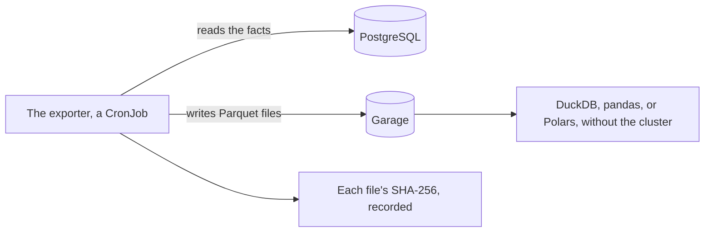

# The exporter

<!-- status: Exporter -->
**Status** ([status page](../status.md)): Exporter: Decided.
<!-- end status -->

The exporter writes the pipeline's facts to Parquet files in Garage,
deterministically, and records each file's SHA-256. Its role is decided,
and no specification governs it yet. This page says what's decided and
why, which statements already bind it, and what's still open, with the task
that settles each.

## What's decided

The design gives the exporter one job: to write the facts to Parquet in
Garage, deterministically, and record each file's SHA-256. It's written in
Python, and runs as a Kubernetes CronJob ([components][design-components]).
Its libraries are pyarrow, psycopg, and boto3, and pyarrow is pinned, since
the export's bytes, and so its hashes, depend on the writer's version
([0006]). It writes the export through a pinned `edgar-asof`
([plan][plan-facts]).

### What the export is for

The export serves two purposes, both from decision 0004 ([0004]):

- **It makes the dataset portable.** Anyone can query the export with
  DuckDB, pandas, or Polars, without the cluster. The record and the facts
  stay in PostgreSQL; the export is a copy of the facts, written from it.
- **It's how a rerun is compared with the original.** An import reads only
  stored objects, named by their SHA-256 in its manifest, so a rerun with
  the same inputs and the same `tool` commit reads the same bytes
  ([IMP-3]). What an import's output is, and how two outputs are compared,
  the store leaves to the pipeline's specification
  ([open question 3 of the store][snapshots-open]). Hashed, the export is
  how a rerun of an import is compared with the original, and the export's
  specification answers the question
  ([0004], [what the specifications must say][design-must-say]).

The design's rebuild uses both: it drops the facts, imports them again from
stored bodies, and compares the "as of" answers and the export's hashes
with the originals ([testing on kind][design-testing]). The drills include
it, task T31 ([plan][plan-drills]).

Garage holds the exports beside the bodies and the database's backups
([0002], [components][design-components]). It can't prevent an object from
being overwritten or deleted, so the store's guarantees rest on detecting a
change, not on preventing one ([0002]).

## The rules that already bind it

No statement names the exporter yet, but those that govern every service
apply to it:

- **Garage.** Each service that uses the store's bucket, `snapshots`, has
  a key of its own, which may only read it; only the fetcher's may write
  it; and no key has Garage's `owner` permission on any bucket
  ([GARAGE-4], [LOG-4]). The buckets the deployment specification's
  version 1.1.0 lists are `database-backups` and `snapshots`
  ([GARAGE-2]); the bucket the export is written to isn't specified yet.
- **PostgreSQL.** Each service connects as a role of its own, whose
  password is a value of the umbrella chart, and every service's role but
  the fetcher's may only select the store's records ([PG-7], [SECRET-1],
  [LOG-3]). Each other service's role comes with it, in a later version of
  the deployment specification ([§9 of deployment][deployment-later]).
- **`edgar-asof`.** A service that reads EDGAR's content through the
  library gives it bodies from the cluster store, and never uses its
  client or keeps a cache ([FETCH-18]).
- **Its image** is tagged with the commit it's built from, and loaded into
  kind, never pulled from a registry ([IMG-1], [IMG-2]).

## What's still open

| What's open | The task that settles it | It waits on |
| --- | --- | --- |
| The export's format, its determinism, and its hashes, answering the store's open question 3 | T18, `spec/export.md` | T17, the facts specification |
| The fact table the export reads, and the facts' times | T17, `spec/facts.md` | T12, T16, and an `edgar-asof` release that specifies the fact model |
| Its metrics and traces | T32, a minor version of the telemetry specification ([§11 of telemetry][telemetry-left]) | T17, T18, T19 |
| Building it | T27 | T18, T25 |
| A page of the site for people who read the export, `docs/export.md` | T43 ([PAGE-1]) | T18, T40 |

No document yet gives the CronJob's schedule, the bucket the export goes
to, where each file's SHA-256 is recorded, or what part `edgar-asof` plays
in writing it. The tasks are in the plan's facts and documentation
sections ([plan][plan-facts], [plan][plan-documentation]).

> **Analysis.** No task, decision record, or specification covers this.
> A Parquet file's bytes depend on more than its rows and the writer's
> version: on the rows' order, the size of each row group, the compression
> codec and its level, whether columns are dictionary-encoded and carry
> statistics, and the key-value metadata in the file's footer, such as a
> timestamp an application adds. An export could be deterministic by
> fixing each of these, such as ordering rows by each fact's key and its
> filing's accession number, and writing no time of the run into a file.
> Its specification could also say whether the hash covers each file, as
> the design has it, or a manifest that lists every file with its hash.

## State, replicas, and scaling

The exporter reads the facts from PostgreSQL and writes the export to
Garage ([components][design-components], [0004]). As a CronJob, it runs on
a schedule, rather than as a Deployment of long-running replicas. The
export grows with the facts. The [estimates](estimates.md#the-export)
assume 20 to 60 bytes a fact, so a year of the default scope's facts is 0.1
to 3.7 MB, until the export's specification, task T18, gives its format.

## How it fails

No document yet says how the exporter fails, or what a failed run leaves
in Garage or the record. Task T18 specifies the export, and T32 its
telemetry ([plan][plan-facts]).

> **Analysis.** No task, decision record, or specification covers this.
> A CronJob whose run fails is retried up to its Job's limit, and runs
> again at its next scheduled time. An export that writes each run's files
> under a new name, and records their hashes only once every file is
> written, would leave the last complete export in place when a run fails
> partway; one that replaces files in place would not.

## What it depends on

- **PostgreSQL 18,** for the facts ([0004]).
- **Garage,** for the export ([0002]).
- **`edgar-asof`,** at a pinned release ([plan][plan-facts]).
- **pyarrow, pinned,** psycopg, and boto3 ([0006]).

## The alternatives weighed

Decision 0004 weighed where the facts are kept, and so whether Parquet is
the store or an export of it ([0004]):

| Option | What decision 0004 says of it |
| --- | --- |
| PostgreSQL alone (chosen) | One transactional store, whose writes are checked as they happen: by constraints, by a role that can insert but not update or delete, and, from version 18, by temporal keys. A deterministic Parquet export of the facts makes the dataset portable. |
| DuckDB alone | Facts as write-once Parquet files in Garage, records in a NATS stream, and DuckDB embedded in the query service. The lightest option, but integrity is checked after the fact rather than enforced, and records and facts are joined across files. |
| Both: PostgreSQL for records, Parquet and DuckDB for facts | Rejected: each of its benefits comes more cheaply from one engine, and it adds queries across two stores, reconciliation between them, and two of every backup, migration, and metric. |

So the Parquet files are an export, written from PostgreSQL, and not a
second store to reconcile with it.

Decision 0002 chose Garage, which holds the exports, over MinIO, no longer
maintained, and SeaweedFS, which offers object versioning and object lock
but runs as several processes, and used about 500 MB in one stress test,
where Garage stayed under 200 MB. Garage has neither versioning nor object
lock ([0002]).

## Where it's decided and specified

| Document | What it gives the exporter |
| --- | --- |
| [The design's components][design-components] | Its role, its language, and a CronJob. |
| [0004] | A deterministic Parquet export of the facts, and its hashes as the comparison of a rerun. |
| [0002] | Garage holds the exports. |
| [0006] | Python, with pyarrow pinned. |
| [IMP-3], [open question 3 of the store][snapshots-open] | The question the export's hashes answer. |
| [GARAGE-4], [LOG-3], [LOG-4], [PG-7], [FETCH-18] | What every service's key and role may do, and that `edgar-asof` reads only stored bodies. |

The status page names its decision records, 0002 and 0006; tasks T18 and
T32, which specify it; and T27, which builds it ([status page][status]).

[0002]: ../decisions/0002-store-bodies-in-garage.md
[0004]: ../decisions/0004-keep-the-record-in-postgresql-18.md
[0006]: ../decisions/0006-write-the-services-in-go-and-python.md
[status]: ../status.md
[design-components]: ../design.md#components
[design-testing]: ../design.md#testing-on-kind
[design-must-say]: ../design.md#what-the-specifications-must-say
[plan-documentation]: ../plan.md#documentation
[plan-facts]: ../plan.md#facts
[plan-drills]: ../plan.md#traces-logs-and-drills
[snapshots-open]: ../../spec/snapshots.md#13-open-questions
[IMP-3]: ../../spec/snapshots.md#11-imports
[LOG-3]: ../../spec/snapshots.md#8-history
[LOG-4]: ../../spec/snapshots.md#8-history
[FETCH-18]: ../../spec/snapshots.md#the-fetcher
[telemetry-left]: ../../spec/telemetry.md#left-to-other-specifications
[deployment-later]: ../../spec/deployment.md#9-later-versions
[GARAGE-2]: ../../spec/deployment.md#garage
[GARAGE-4]: ../../spec/deployment.md#garage
[PG-7]: ../../spec/deployment.md#the-stores-database
[SECRET-1]: ../../spec/deployment.md#credentials
[IMG-1]: ../../spec/deployment.md#the-pipelines-own-images
[IMG-2]: ../../spec/deployment.md#the-pipelines-own-images
[PAGE-1]: ../../spec/site.md#7-the-pages-written-for-the-site
