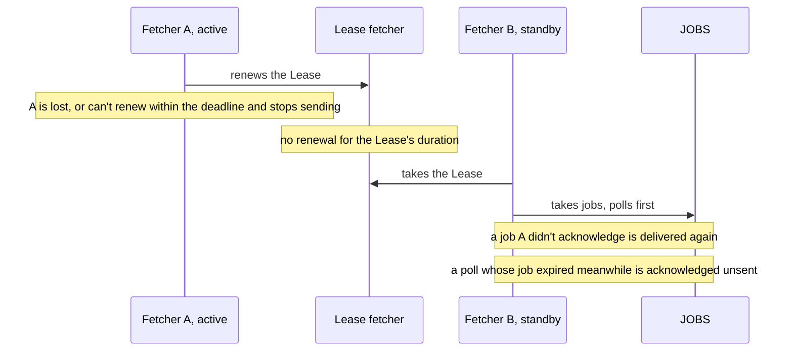
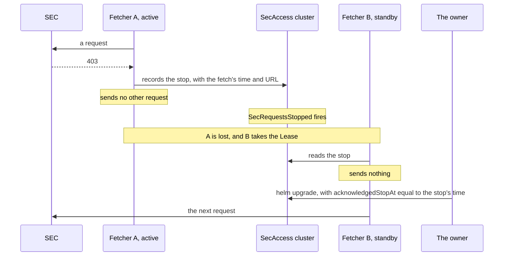

# Failures and recovery

<!-- status: Scheduler; Fetcher; Discoverer; NATS JetStream; Garage; PostgreSQL 18; The controls; Monitoring: metrics, alerts, and dashboards; The drills -->
**Status** ([status page](../status.md)): Scheduler: Specified. Fetcher: Specified. Discoverer: Specified. NATS JetStream: Specified. Garage: Specified. PostgreSQL 18: Specified. The controls: Specified. Monitoring: metrics, alerts, and dashboards: Decided; specified in part. The drills: Planned.
<!-- end status -->

For each failure that the design and the specifications consider: what
stops, what's kept, how the pipeline recovers, and what the record shows
afterward. The drills that cause these failures on kind are planned, in T31,
and haven't run, so this page describes the design, not anything observed.

## What the record shows after any failure

The pipeline doesn't recover what it didn't observe. A version that the SEC
served and replaced during a gap is lost to everyone, and the record says
the gap was there, instead of implying that nothing changed
([what the pipeline keeps][keeps]). So every failure comes down to what it
does to coverage, and the record keeps coverage by one definition
([coverage and gaps]):

- **Coverage** runs from each successful poll of a Source to the next, when
  the next follows it: when its job was queued less than its own window
  after the earlier one's job expired. A poll's window is from its job's
  queuing to its expiry, when the Source's next poll is due.
- **A gap** runs from when the earlier poll's job expired to the later
  poll's request, when the later one doesn't follow. So a missed poll leaves
  a gap of about a cadence; a pause, a stop after a `403`, or a fetcher's
  handover that misses a poll leaves a gap until polling resumes; and a poll
  sent late in its slot, after retries, leaves none.
- **A gap is open** once the latest successful poll's job has been expired
  for as long as its window, with no later successful poll, and it runs
  from when that job expired. The Source's status gives when it began
  ([SOURCE-5]), and the view `gaps` gives every gap, ended or open
  ([GAP-2]).

EDGAR's lists are cumulative, so an outage loses no filing that's still
listed when polling resumes. Each company's `submissions` in the baseline
listed about 1,000 recent filings ([SRC-9]), and the pipeline catches up
from them after an outage
([outages and recovery][the design's outages and recovery]). Each filing
first shown by the poll after a gap gets a sighting whose bounds are the
last poll before the gap and the first after it, and the view `lags` says a
gap lies between them ([SEEN-2], [SEEN-3], [LAG-1]). Its files are then
fetched like any new filing's ([FILE-2]).

The times keep their meaning through an outage ([the design's times]). A
filing's acceptance time is read from the filing whenever it's fetched, so
an outage doesn't touch it. Its first-seen time is bounded by the polls on
either side of the gap, and flagged as a gap. The time of recovery is never
put in place of the SEC's. And since gaps and lags are views, a record that
arrives late changes what they give, and nothing stored
([the notices' guarantees]).

## Each failure at a glance

Each component's own page explains how it fails in its own terms: the
[scheduler](scheduler.md), the [fetcher](fetcher.md), the
[discoverer](discoverer.md), [NATS JetStream](nats-jetstream.md),
[Garage](garage.md), and [PostgreSQL 18](postgresql.md). This page follows
each failure across them.

| Failure | What stops | What's kept | Alert |
| --- | --- | --- | --- |
| [A pod of a service](#losing-a-pod) | That pod's work | Every message it hadn't acknowledged | None of its own |
| [The active fetcher](#losing-the-active-fetcher) | Every request to the SEC, for up to the Lease's duration | The jobs, and any stop after a `403` | None; `edgar_fetcher_leader` shows which pod holds the Lease |
| [The active scheduler](#losing-the-active-scheduler) | Queuing polls and orders, and setting status | The controls, in the API server | None; `edgar_scheduler_leader` shows the active replica |
| [A worker node](#losing-a-worker-node) | The pods on it | A replica of each stream, every object, and the database, on each other worker node | None of its own |
| [The database's primary](#losing-the-databases-primary) | The discoverer's writes, and parsing; the fetcher's records, not yet specified | Every message not acknowledged, and the archive and backups in Garage | `DatabaseBackupStale`, if backups stop |
| [All of NATS](#losing-nats) | Every hand-off between services | The streams, in files | `SourceGap`, once a gap is long enough |
| [All of Garage](#losing-garage) | Storing and reading bodies, and the database's backups | The objects, on the nodes' volumes | `DatabaseBackupStale`, if backups stop for over a day |
| [A `403` from the SEC](#a-403-from-the-sec) | Every request, until the owner acknowledges the stop | The stop, in the `SecAccess`'s status | `SecRequestsStopped` |
| [An outage of the SEC](#an-outage-of-the-sec) | Successful fetches | A record of each fetch, with its attempts | `SourceGap` |
| [A paused Source, or paused requests](#a-paused-source-or-paused-requests) | Its polls, or every request | The control, in the chart's values and the API server | None, by design |
| [An outage of the pipeline](#an-outage-of-the-pipeline) | Everything | Streams, objects, and the database's backups, in a directory of the host | None of its own |

## Losing a pod

Queued work survives restarts, and work that isn't acknowledged is delivered
again ([the design's outages and recovery], [0003]). Each consumer
acknowledges a message only once it's done with it, and each step is safe to
repeat, as [delivery and consistency](delivery-and-consistency.md) explains.

- **The discoverer.** Each of its replicas is active
  ([telemetry terms][telemetry-terms]). A message it stopped on is delivered
  again ([DISC-1]), and its rows are added once ([DISC-2]). Events wait in
  `RECORDS` until it acknowledges them ([the store's jobs and events]), and
  the fetcher goes on recording polls meanwhile. So once it has read them,
  the record shows no gap from its absence: gaps are a view of the polls,
  and a record that arrives late changes what the view gives
  ([the notices' guarantees]). When it starts, it publishes a gap notice for
  each gap open then ([GAP-3]). While no discoverer runs, it serves neither
  of the gauges that `SourceGap` reads, so no gap alert fires ([ALERT-2],
  [METRIC-5]).
- **The parse workers.** Filing notices wait in `NOTICES` until each of the
  stream's consumers acknowledges them ([the notices' streams]), and the
  parse workers' durable consumer exists before the first is published
  ([NATS-5]). What the parse workers do with them is for the facts
  specification ([the notices, left to other specifications]).
- **The query API** is a stateless Deployment, and **the exporter** a
  CronJob ([the design's components]).

## Losing the active fetcher

The fetcher runs two replicas, and the one holding the Lease `fetcher` sends
every request ([0005], [FETCH-16]). A replica stops leading when it can't
renew the Lease within its renewal deadline, which is shorter than the
Lease's duration, and another takes the Lease over only once the duration
has passed without a renewal, so the two never send at once
([the fetcher's Lease][lease]). By default the duration is 15 seconds, the
renewal deadline 10, and the retry period 2, and the chart refuses timings
that client-go's leader election refuses ([LEASE-1]).

- **What stops:** every request to the SEC, for up to the Lease's duration
  after the active replica is lost ([the fetcher's Lease][lease]).
- **What's kept:** the jobs, which wait in `JOBS` until the fetcher
  acknowledges them ([the store's jobs and events]). A job the lost replica
  was fetching is delivered again, and fetched again only if its fetch
  wasn't recorded ([JOB-6]). A stop after a `403` is in the `SecAccess`'s
  status, so it carries over ([ACCESS-3]).
- **How it recovers:** the new holder takes the jobs, polls first ([JOB-4]).
  A poll whose job expired during the handover is acknowledged without a
  request ([JOB-5]); the jobs of filings and Backfills don't expire, so
  they're fetched after it ([JOB-3]).
- **What the record shows:** decision 0005 records every handover as a gap
  like any other, and the deployment's specification a handover after the
  active replica is lost ([0005], [lease]); the notices' specification gives
  a gap only where the handover misses a poll ([coverage and gaps]). The
  gauge `edgar_fetcher_leader` is 1 on the replica that holds the Lease
  ([the fetcher's metrics]).

## Losing the active scheduler

The scheduler runs two replicas, one active through controller-runtime's
leader election, which also uses a Lease ([0007],
[the design's components]).

- **What stops:** queuing polls and orders, and setting the resources'
  status. Polls due while no replica is active are neither queued nor
  counted: a replica counts only the polls it skipped itself
  ([the scheduler's metrics]), and the new active replica begins with each
  Source's first poll ([SOURCE-2]). Only the record's gaps show them.
- **What's kept:** the controls themselves, which the API server keeps
  through restarts ([the controls' guarantees]), and the jobs already
  queued.
- **How it recovers:** when a replica becomes the active one, it queues each
  Source's first poll ([SOURCE-2]), and sends an order again for each
  Backfill that hasn't started ([ORDER-1]). It sets each Source's open gap
  from the latest gap notice ([NOTICE-1]), which the discoverer publishes
  whatever the scheduler is doing ([GAP-3]).
- **What the record shows:** a gap for each slot that passed without a
  successful poll ([coverage and gaps]).

## Losing a worker node

The kind cluster has one control-plane node and three worker nodes
([KIND-1]). NATS, Garage, and the database each run three replicas, one on
each worker node ([PLACE-1], [PLACE-2]), so each keeps running when one
worker node is lost: NATS keeps a copy of every stream and every durable
consumer on each, Garage a copy of every object, and the database an
instance ([deployment guarantees][the deployment's guarantees], [NATS-3],
[NATS-5], [GARAGE-3], [PG-3]). Where the pipeline's own services run is for
a later version of the deployment specification ([later
versions][deployment-later]).

A lost node that ran the active fetcher, the active scheduler, or the
database's primary fails as the sections on each say. kind runs every node
as a container on one machine ([the kind cluster][kind]), so losing that
machine is an outage of the whole pipeline.

## Losing the database's primary

The database runs three instances, one on each worker node, under
CloudNativePG, with which failover, point-in-time recovery, and backups to
Garage can be shown ([PG-3], [PLACE-1], [0004]).

- **What stops:** decision 0003 and the design have a failover pause
  parsing, not fetching. Parse jobs wait in their stream, and are delivered
  when the database is back ([0003], [the design's outages and recovery]). A
  discoverer that can't add a message's rows doesn't acknowledge it, so the
  message is delivered again ([DISC-1], [DISC-2]). The fetcher adds each
  fetch's record before it publishes the event and acknowledges the job
  ([JOB-6]), and what it does while the database can't take a record isn't
  specified yet (see the analysis below).
- **What's kept:** every message not yet acknowledged, and the database's
  archive: its WAL, and a base backup at least once a day, in Garage's
  `database-backups` bucket ([PG-4]).
- **How it recovers:** the database fails over to another of its instances,
  and the messages that waited are delivered ([0003],
  [the design's outages and recovery]). Whether its replicas confirm a
  commit before the primary does isn't specified. The database's replication
  lag and failovers are metrics of a later version of the telemetry
  specification ([telemetry, left to other specifications]).
- **If the backups stop,** `DatabaseBackupStale` fires once the latest base
  backup has been more than a day old for an hour ([ALERT-3]). The backup
  plugin has been tested against MinIO, not Garage, so a restore from these
  backups is shown on kind before they're relied on ([0002],
  [instances and backups]).

## Losing NATS

NATS runs three servers with JetStream, each keeping its streams in files on
a claim of its own ([NATS-1]), and each of the four streams is replicated on
all three, so each keeps its messages and its leader through the loss of one
([the deployment's NATS], [NATS-3]). So is each durable consumer, which
keeps its place in its stream ([NATS-5]).

With all three down, nothing passes between the services:

- **What stops:** the scheduler can't queue polls, and a poll it can't queue
  before the next is due is skipped ([SOURCE-2]). The fetcher has no jobs to
  take. A fetch it recorded but whose event it couldn't publish isn't
  acknowledged, so its job is delivered again, and the event published from
  the record, without a request ([JOB-6]). The discoverer reads nothing.
- **What's kept:** the streams, in files on volumes whose data is kept in a
  directory of the host ([VOL-2], [VOL-3], [KIND-2]).
- **How it recovers:** queued work survives the restart, and work not
  acknowledged is delivered again ([the design's outages and recovery],
  [0003]).
- **What the record shows:** a gap for each poll skipped
  ([coverage and gaps]). `SourceGap` fires once a polling Source's open gap
  is longer than its cadence, for 2 minutes ([ALERT-2]). NATS's own metrics,
  its streams, consumers, and redeliveries, are for a later version of the
  telemetry specification ([telemetry, left to other specifications]).

## Losing Garage

Garage runs three nodes with a replication factor of 3, each node holding a
copy of every object, so it keeps running when one is lost ([GARAGE-1],
[GARAGE-3], [the deployment's guarantees]).

With all three down:

- **What stops:** the fetcher can't store a body, which it does before
  adding its record ([OBJ-4], [FETCH-14]); what it does then isn't specified
  yet (see the analysis below). The discoverer can't read versions from the
  bucket ([SEEN-1], [FILE-3]), so it doesn't acknowledge the events that
  need them, and they're delivered again ([DISC-1]). The database can't
  archive its WAL or take its backups there ([PG-4]).
- **What's kept:** the objects, on volumes whose data is kept in a directory
  of the host ([VOL-2], [VOL-3]).
- **What the record shows:** if backups stop for long enough,
  `DatabaseBackupStale` fires ([ALERT-3]). Tempo and Loki keep their data on
  their own volumes, not in Garage, so an outage of Garage can still be
  observed ([0008]).

Garage can't refuse a change to an object, so the store's guarantee rests on
detection: an object must hash to its name, and every record must find its
object ([0002], [OBJ-1], [STORE-3]). How often that check runs in operation
is still open ([telemetry's open questions]).

## A 403 from the SEC

The SEC returns a `403` to clients over its limit. The fetcher records the
fetch, and no other request follows it ([FETCH-9]). It records the stop in
the `SecAccess`'s status before it sends another request, and sends none
until the owner acknowledges the stop; a fetcher that takes over the Lease
reads the stop there, and sends nothing either ([ACCESS-3]). The stop
doesn't clear itself: after a `403`, the fetcher waits for the operator
([0005]).

- **What stops:** every request to the SEC. While requests aren't allowed,
  the scheduler queues no poll and nothing for a Backfill ([ACCESS-2]), and
  orders no Backfill ([ORDER-1]); each Source's `Polling` condition is
  `False`, with the reason `RequestsStopped` ([SOURCE-1]). The discoverer
  still queues the fetches of filings' files, and the jobs wait
  ([a filing's files][notices-files]).
- **What's kept:** the stop, in the `SecAccess`'s status, with when the
  fetch was sent and its URL, through restarts and handovers
  ([the controls' guarantees], [SecAccess][controls-secaccess]). The fetch
  that got the `403` is recorded like any other ([FETCH-9]). What happens if
  the active fetcher is lost after the `403` and before the stop reaches the
  status isn't specified yet.
- **How it recovers:** the owner acknowledges the stop by copying its `at`
  into the chart's values, as `controls.secAccess.acknowledgedStopAt`, and
  running `helm upgrade`. An acknowledgement names one stop, so a later
  `403` stops requests again ([SecAccess][controls-secaccess]). Once
  requests are allowed, the scheduler queues each Source's first poll
  ([SOURCE-2]).
- **What the record shows:** each Source's gap, from its last successful
  poll's job's expiry until its first poll after the acknowledgement
  ([coverage and gaps]). `SecRequestsStopped`, a `critical` alert with no
  `for`, fires from the stop until the acknowledgement, comparing the two by
  their timestamps to the millisecond ([ALERT-1], [the alerts]). `SourceGap`
  stays silent for a Source that a stop keeps from polling, since the stop
  has its own alert ([the alerts]).

The pipeline as a whole is capped at 5 requests a second, half the SEC's
stated maximum of 10 ([FETCH-6], [0005]).

## An outage of the SEC

- **What stops:** successful fetches. An attempt with no response within 60
  seconds counts as none ([FETCH-5]). No response, a `429`, or a `500`,
  `502`, `503`, or `504` is retried, up to 4 attempts in all, after the
  response's `Retry-After`, or else 2 to the power of the attempt number in
  seconds, either capped at 60 ([FETCH-8]). Any other status is recorded
  without a retry ([FETCH-10]).
- **What's kept:** one record of each fetch, describing its final attempt,
  with its status, or an error when no response arrived ([FETCH-14],
  [REC-7]). A poll succeeds only when its record names a version
  ([the controls' terms]).
- **How it recovers:** the next successful poll ends each Source's gap, and
  lists the filings accepted during it ([SRC-9],
  [the design's outages and recovery]). A fetch of a filing's file that
  ended without a version isn't queued again by the discoverer. The record
  shows the failure, and a Backfill of the filing's date fetches it again
  ([FILE-4]); the discoverer counts such fetches
  ([the discoverer's metrics]).
- **What the record shows:** a gap for each Source, and the bounds of when
  it first showed each filing listed after it ([coverage and gaps],
  [SEEN-3]). `SourceGap` fires for each polling Source whose open gap is
  longer than its cadence, for 2 minutes. It also fires for a Source none of
  whose polls has succeeded, such as one in a cluster that can't reach the
  SEC, once its first poll's job expired longer than its cadence ago
  ([ALERT-2], [the alerts]).

Whether a filing's files are in EDGAR's archive as soon as its company's
`submissions` lists it is still open. If new filings' fetches end without a
version, a later version of the notices specification queues them again
after a delay; until then, a Backfill fetches them
([the notices' open questions]).

## A paused Source, or paused requests

A pause is a control, not a failure, but the record treats the time the same
way: a pause is a gap ([0007]).

- **What stops:** a paused Source's polls, with its `Polling` condition
  `False` and the reason `Paused`; while the `SecAccess` is paused, every
  Source's, with the reason `RequestsPaused` ([SOURCE-1]). While requests
  are paused, the scheduler queues nothing, and the fetcher sends nothing
  ([ACCESS-1], [ACCESS-2]). The discoverer still queues the fetches of
  filings' files, and the jobs wait ([a filing's files][notices-files]).
- **What's kept:** the control, as the owner set it in the chart's values,
  which the API server keeps ([the controls' guarantees], [RBAC-6]). The
  chart's default values pause the `SecAccess`, so a new install sends
  nothing until the owner allows it ([VAL-4]).
- **How it recovers:** a Source's first poll is queued when it's unpaused,
  or when requests are allowed again ([SOURCE-2]).
- **What the record shows:** a gap until polling resumes
  ([coverage and gaps], [the design's controls]). `SourceGap` is silent for
  a Source the owner paused, or that paused requests keep from polling; the
  record still shows each such gap ([the alerts]).

Pausing the `SecAccess` is also how the owner makes way for
`scripts/snapshot.py`, since only one process fetches from the SEC at a
time, across every checkout and cluster ([FETCH-7]).

## An outage of the pipeline

An outage of part of the pipeline, such as the scheduler scaled to zero,
leaves every Source a gap until polling resumes
([the design's outages and recovery], [coverage and gaps]).

An outage of the whole cluster loses less than it might. Garage's objects,
the database's backups among them, NATS's streams, and Prometheus's and
Alertmanager's data are kept in a directory of the host, where a cluster
recreated with it finds them ([the deployment's guarantees], [KIND-2],
[VOL-1], [VOL-3]). The database's own volumes aren't, since a data directory
left by an earlier cluster would stop a new one from initializing: what
outlives the cluster for the database is its backups in Garage, from which
it can be restored ([volumes], [PG-4]). A new cluster archives under a
server name of its own, so the earlier cluster's archive stays as it was
([PG-10], [instances and backups]). A kind cluster is disposable, and the
git store remains the reproducible sample outside it ([0001]).

Once the pipeline runs again, it catches up from EDGAR's lists, and each
filing first seen after the outage carries the gap's bounds
([the design's outages and recovery]). A Backfill, which the owner adds,
fetches a company's filings over a range of filing dates, from its
`submissions` and the further files that list older filings, except those
the record already holds, so one interrupted by a restart continues where it
stopped ([BACKFILL-1], [the notices' Backfills]).

## The drills

The drills cause these failures on kind on purpose, and check that the
record shows each gap and lost nothing. T31 plans them: delete the active
fetcher, fail over the database, block the SEC, rebuild the facts from
stored bodies, and restore the database from its backups in Garage ([T31]).
The design adds scaling the scheduler to zero and pausing a Source, and
blocks the SEC with a NetworkPolicy ([the design's outages and recovery],
[the design's testing on kind]). The drills are planned, not run
([status page]), so this page claims no outcome of them.

> **Analysis.** No task, decision record, or specification covers this.
>
> Five questions above are still open in the specifications. The pipeline
> could settle each in a later version:
>
> - **A fetcher lost between a `403` and recording the stop.** The fetcher
>   could record the stop in the `SecAccess`'s status before it adds the
>   fetch's record, or a new holder of the Lease could look in the table for
>   a `403` later than the last acknowledged stop before its first request.
> - **The fetcher while the database fails over.** It could hold its next
>   request until the database takes records again, so that it sends no
>   request whose fetch it can't record.
> - **The fetcher while Garage is down.** It could record each fetch with
>   `error` set and no version, as a body it can't store, or hold its next
>   request until Garage is back.
> - **Commits lost in a failover.** The database's `Cluster` could require a
>   synchronous replica, so that a failover loses no record whose event was
>   published.
> - **The discoverer down.** An alert on the discoverer's scrape target, or
>   on the absence of its gauges, could cover the time `SourceGap` can't.

[0001]: ../decisions/0001-deploy-on-kubernetes-with-helm-on-kind.md
[0002]: ../decisions/0002-store-bodies-in-garage.md
[0003]: ../decisions/0003-queue-work-in-nats-jetstream.md
[0004]: ../decisions/0004-keep-the-record-in-postgresql-18.md
[0005]: ../decisions/0005-send-sec-requests-through-one-active-fetcher.md
[0007]: ../decisions/0007-control-the-pipeline-through-custom-resources.md
[0008]: ../decisions/0008-monitor-with-prometheus-and-grafana-then-tempo-and-loki.md
[keeps]: ../design.md#what-the-pipeline-keeps
[the design's times]: ../design.md#times
[the design's components]: ../design.md#components
[the design's controls]: ../design.md#controls
[the design's outages and recovery]: ../design.md#outages-and-recovery
[the design's testing on kind]: ../design.md#testing-on-kind
[T31]: ../plan.md#traces-logs-and-drills
[status page]: ../status.md
[SRC-9]: ../../investigation/edgar.md#findings-so-far
[the store's jobs and events]: ../../spec/snapshots.md#jobs-and-events
[STORE-3]: ../../spec/snapshots.md#the-cluster-store
[OBJ-1]: ../../spec/snapshots.md#5-objects
[OBJ-4]: ../../spec/snapshots.md#5-objects
[REC-7]: ../../spec/snapshots.md#6-records
[FETCH-5]: ../../spec/snapshots.md#10-fetching
[FETCH-6]: ../../spec/snapshots.md#10-fetching
[FETCH-7]: ../../spec/snapshots.md#10-fetching
[FETCH-8]: ../../spec/snapshots.md#10-fetching
[FETCH-9]: ../../spec/snapshots.md#10-fetching
[FETCH-10]: ../../spec/snapshots.md#10-fetching
[FETCH-14]: ../../spec/snapshots.md#10-fetching
[FETCH-16]: ../../spec/snapshots.md#the-fetcher
[JOB-3]: ../../spec/snapshots.md#jobs-and-events
[JOB-4]: ../../spec/snapshots.md#jobs-and-events
[JOB-5]: ../../spec/snapshots.md#jobs-and-events
[JOB-6]: ../../spec/snapshots.md#jobs-and-events
[the deployment's guarantees]: ../../spec/deployment.md#1-guarantees
[kind]: ../../spec/deployment.md#the-kind-cluster
[KIND-1]: ../../spec/deployment.md#the-kind-cluster
[KIND-2]: ../../spec/deployment.md#the-kind-cluster
[volumes]: ../../spec/deployment.md#volumes
[VOL-1]: ../../spec/deployment.md#volumes
[VOL-2]: ../../spec/deployment.md#volumes
[VOL-3]: ../../spec/deployment.md#volumes
[PLACE-1]: ../../spec/deployment.md#placement
[PLACE-2]: ../../spec/deployment.md#placement
[the deployment's NATS]: ../../spec/deployment.md#nats
[NATS-1]: ../../spec/deployment.md#nats
[NATS-3]: ../../spec/deployment.md#nats
[NATS-5]: ../../spec/deployment.md#durable-consumers
[GARAGE-1]: ../../spec/deployment.md#garage
[GARAGE-3]: ../../spec/deployment.md#garage
[lease]: ../../spec/deployment.md#the-fetchers-lease
[LEASE-1]: ../../spec/deployment.md#the-fetchers-lease
[instances and backups]: ../../spec/deployment.md#instances-and-backups
[PG-3]: ../../spec/deployment.md#instances-and-backups
[PG-4]: ../../spec/deployment.md#instances-and-backups
[PG-10]: ../../spec/deployment.md#instances-and-backups
[deployment-later]: ../../spec/deployment.md#9-later-versions
[the controls' guarantees]: ../../spec/controls.md#1-guarantees
[the controls' terms]: ../../spec/controls.md#2-terms
[VAL-4]: ../../spec/controls.md#5-the-charts-values
[SOURCE-1]: ../../spec/controls.md#6-source
[SOURCE-2]: ../../spec/controls.md#6-source
[SOURCE-5]: ../../spec/controls.md#6-source
[BACKFILL-1]: ../../spec/controls.md#7-backfill
[controls-secaccess]: ../../spec/controls.md#8-secaccess
[ACCESS-1]: ../../spec/controls.md#8-secaccess
[ACCESS-2]: ../../spec/controls.md#8-secaccess
[ACCESS-3]: ../../spec/controls.md#8-secaccess
[RBAC-6]: ../../spec/controls.md#9-who-may-change-what
[the notices' guarantees]: ../../spec/notices.md#1-guarantees
[coverage and gaps]: ../../spec/notices.md#5-polls-coverage-and-gaps
[GAP-2]: ../../spec/notices.md#5-polls-coverage-and-gaps
[GAP-3]: ../../spec/notices.md#5-polls-coverage-and-gaps
[SEEN-1]: ../../spec/notices.md#6-when-each-source-first-showed-each-filing
[SEEN-2]: ../../spec/notices.md#6-when-each-source-first-showed-each-filing
[SEEN-3]: ../../spec/notices.md#6-when-each-source-first-showed-each-filing
[notices-files]: ../../spec/notices.md#7-a-filings-files
[FILE-2]: ../../spec/notices.md#7-a-filings-files
[FILE-3]: ../../spec/notices.md#7-a-filings-files
[FILE-4]: ../../spec/notices.md#7-a-filings-files
[the notices' Backfills]: ../../spec/notices.md#8-backfills
[ORDER-1]: ../../spec/notices.md#8-backfills
[NOTICE-1]: ../../spec/notices.md#8-backfills
[the notices' streams]: ../../spec/notices.md#streams
[DISC-1]: ../../spec/notices.md#processing
[DISC-2]: ../../spec/notices.md#processing
[LAG-1]: ../../spec/notices.md#10-times-and-lags
[the notices' open questions]: ../../spec/notices.md#12-open-questions
[the notices, left to other specifications]: ../../spec/notices.md#left-to-other-specifications
[telemetry-terms]: ../../spec/telemetry.md#2-terms
[the scheduler's metrics]: ../../spec/telemetry.md#the-scheduler
[the fetcher's metrics]: ../../spec/telemetry.md#the-fetcher
[the discoverer's metrics]: ../../spec/telemetry.md#the-discoverer
[METRIC-5]: ../../spec/telemetry.md#the-discoverer
[the alerts]: ../../spec/telemetry.md#7-alerts
[ALERT-1]: ../../spec/telemetry.md#7-alerts
[ALERT-2]: ../../spec/telemetry.md#7-alerts
[ALERT-3]: ../../spec/telemetry.md#7-alerts
[telemetry's open questions]: ../../spec/telemetry.md#11-open-questions
[telemetry, left to other specifications]: ../../spec/telemetry.md#left-to-other-specifications
