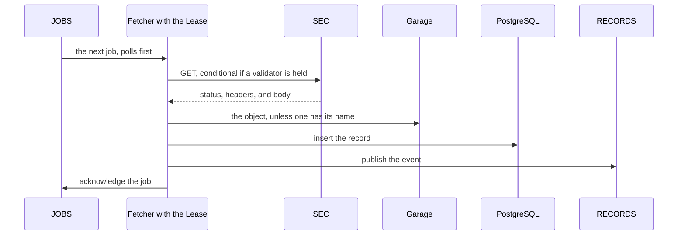
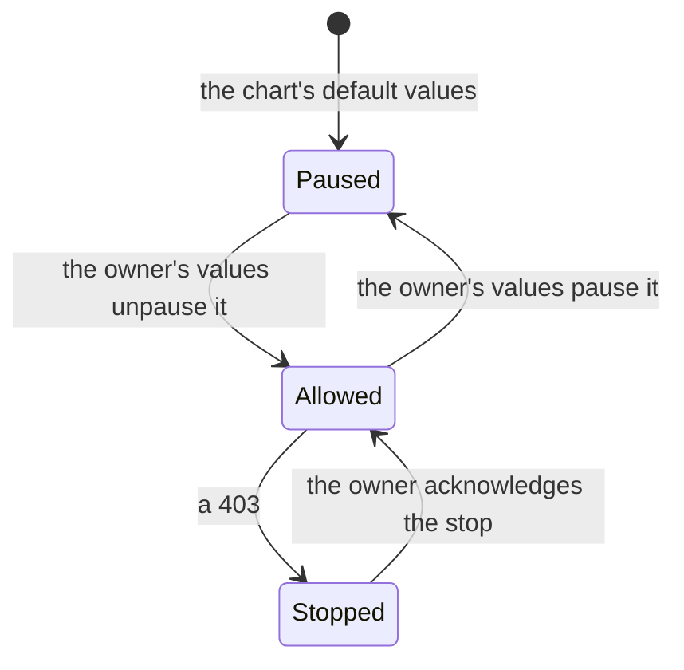
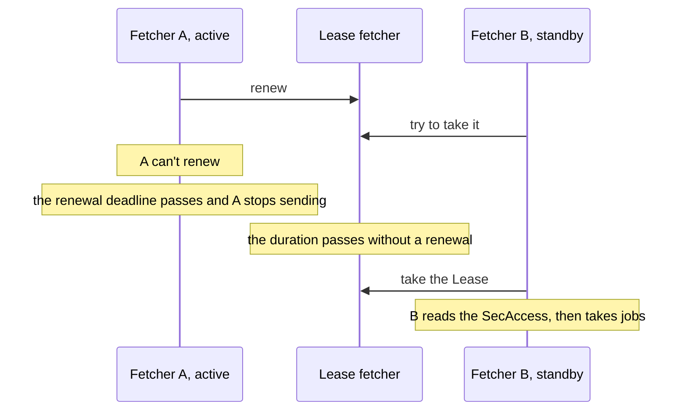

# The fetcher

<!-- status: Fetcher; The snapshot store in the cluster -->
**Status** ([status page](../status.md)): Fetcher: Built. The snapshot store in the cluster: Built.
<!-- end status -->

The fetcher is the only component that sends requests to the SEC, and the
only one that writes the snapshot store in the cluster. This page explains
how it keeps the SEC's rules across a cluster, what it writes, how a
handover and a `403` work, how it fails and what the record shows
afterward, and the statements that govern it.

## What it does

In the cluster, only the active fetcher sends requests to the SEC
([FETCH-18]). A component that needs something from EDGAR queues a job.
The fetcher holding the Lease takes each job, fetches its URL within the
SEC's rules, stores the body in Garage if it's new, adds a record of the
fetch to PostgreSQL, publishes an event that announces the record, and
acknowledges the job ([0005], [JOB-6]). It's written in Go ([0006]).

### Which job comes next

Before each request, the fetcher takes the job queued first of the first
kind that has one waiting: `poll`, then `filing`, then `backfill`
([JOB-4]). Jobs of kind `poll` come from the [scheduler](scheduler.md),
one for each poll of a Source; those of kind `filing` from the
[discoverer](discoverer.md), for each new filing's files; and those of kind
`backfill` from the discoverer too, for a Backfill ([JOB-2], [JOB-3]). The
chart holds the polls to half the fetcher's limit ([VAL-3]), so the other
half is left to the rest, and a Backfill's fetches wait for every other:
a backfill never delays the record of new filings ([BACKFILL-2]).

The order holds between a fetch's attempts too, as the owner decided
([T23][plan-observing]). During the wait before a retry, and again once
it's over, the fetcher takes each job waiting of a kind before the fetch's
own, and works it to its end before it sends the retry, which still waits
at least as long as [FETCH-8] says. So a Backfill's retries don't delay
polls or new filings' fetches, and a filing's retries don't delay polls.
A job taken during a wait takes only the kinds before its own between its
own attempts, so a poll's takes none, and the fetch it was taken during
goes on once it has ended. Meanwhile the fetcher holds each of those jobs
in progress ([FETCHER-10]). A job taken during a wait can be for the
fetch's own URL, as a filing's and a Backfill's can be for the same file,
so the retry sends the validators of the URL's latest version as the wait
ends, which a `304` to it names ([FETCH-4], [REC-5]).

A poll's job expires when its Source's next poll is due, and the other
kinds don't expire ([JOB-2], [JOB-3]). The fetcher acknowledges an expired
job without a request or a record, unless the table already holds its
record ([JOB-5]). It does the same with a job that doesn't validate against
[job.schema.json], or whose `kind` isn't its subject's ([JOB-7]).

### The rules for talking to the SEC

The fetcher keeps the rules that `scripts/snapshot.py`, the other writer of
the snapshot store, keeps
([§10 of the store][snapshots-fetching], [0006]):

| Rule | What the fetcher does | Statements |
| --- | --- | --- |
| Hosts | Fetches only `https` URLs on `www.sec.gov` and `data.sec.gov`. | [FETCH-1] |
| User agent | Sends the owner's own, which must contain an `@`, from `SEC_USER_AGENT` in its environment, set from a Secret. Without one it sends nothing. | [FETCH-2], [FETCH-17], [ID-2] |
| Headers kept | Keeps no request header in a record, a job, or an event, and sends no trace context to the SEC. | [ID-1], [TRACE-6] |
| Encoding | Asks for gzip; decodes `gzip` and `x-gzip` before hashing; stores nothing of any other encoding. | [FETCH-3], [FETCH-11], [FETCH-12] |
| Conditional requests | Sends the latest version's `ETag` as `If-None-Match` and its `Last-Modified` as `If-Modified-Since`, when they're set. | [FETCH-4] |
| Timeouts | Counts an attempt without a response after 60 seconds as no response. | [FETCH-5] |
| Rate | Starts requests at least 0.2 seconds apart, across all of a cluster's fetchers: at most 5 a second, half the SEC's stated maximum of 10. | [FETCH-6] |
| One process | Sends only while it holds the Lease. The owner runs `snapshot.py` only while no installed chart allows requests. | [FETCH-7], [FETCH-16] |
| Retries | Retries no response, a `429`, `500`, `502`, `503`, or `504`, and a body cut short, up to 4 attempts in all. It waits the response's `Retry-After`, or else 2 to the power of the attempt number, in seconds, capped at 60. | [FETCH-8], [FETCH-13] |
| A `403` | Records it, sends nothing more, and keeps the stop in the SecAccess until the owner acknowledges it. | [FETCH-9], [ACCESS-3] |
| Other statuses | Records each without a retry, and goes on with its next job. | [FETCH-10] |
| Permission | Sends only while requests are allowed, and takes no job while they aren't. A fetch waiting to retry when they stop being allowed makes its next attempt once they are again, as the owner decided ([T23][plan-observing]). | [ACCESS-1] |

The user agent is in one Secret, rendered from the value
`fetcher.secUserAgent`, which no committed values file sets; the owner
keeps it in a values file git ignores, and only the fetcher's containers
read it ([ID-2]). The fetcher is the only pod with that Secret ([0005],
[components][design-components]). The chart requires the value, with an
`@` in it, so it never installs a fetcher that can't fetch ([FETCHER-5]).

### Conditional requests and validators

Which validators EDGAR sends depends on the kind of URL. In the baseline's
`200`s ([SRC-4]):

| URL | `ETag` | `Last-Modified` |
| --- | --- | --- |
| A company's `submissions`, its `companyfacts`, and a filing's directory listing | No | No |
| A filing's index page and its header | No | Yes |
| An XBRL instance, the daily index listing, and a daily master index | Yes | Yes |

A request can be conditional only where the latest version held came with
a validator ([FETCH-4]). So each poll of a company's `submissions`
downloads the whole body, 20 to 27 KB compressed ([0010], [SRC-18]).
Whether a conditional request gets a `304` at all is for the
investigation's first refetch, task T4, to show ([SRC-4],
[plan][plan-investigation]). A `304`'s record names the version its
request asked about, and a `304` to a request that sent no validators
names nothing and records an error ([REC-5]).

The URLs in the jobs are made from a company's CIK and each filing's
accession number, as [SRC-21] shows them: a company's `submissions` at
`https://data.sec.gov/submissions/CIK##########.json`, and a filing's
header and index page in its directory under
`https://www.sec.gov/Archives/edgar/data/` ([FILE-1], [LIST-1]). Each of
these URLs returned a `200` in the investigation ([SRC-21]).
`data/scope.json` limits what the git store holds, not what the cluster
fetches, which is what the owner's values ask for through the controls
([the scope and the cluster][snapshots-scope-cluster]).

## What it writes

For each fetch, the fetcher adds exactly one record, which describes its
final attempt, once the object it names is in place ([FETCH-14]).

- **The object.** The body, after any gzip encoding is removed, as
  `objects/AA/SHA256.gz` in the bucket `snapshots`: gzip data whose
  decompressed bytes have the SHA-256 in its name ([OBJ-1], [GARAGE-4]).
  The fetcher stores it only if no object has that name, since the same
  name means the same body ([OBJ-4]), so a body is stored once however
  often it's fetched.
- **The record.** A row of the table `records`, in the database `edgar`,
  with the fields of [§6 of the store][snapshots-records], an `id` that
  numbers the records in the order they're added, and `job`, the `id` of
  the job the fetch was made for, which no two records share ([STORE-1],
  [PG-6]). It keeps each header's value as the response gave it, and its
  own times in UTC, by the fetcher's clock ([0010]):
  - `requested_at`, when the final attempt was sent;
  - `received_at`, when its response's status and headers had arrived, or
    null if none did;
  - `date`, `etag`, `last_modified`, and `content_type`, as received;
  - `tool`, `fetcher@` and the 40-character commit its image was built
    from ([IMG-1]).
- **The event.** A message on the stream `RECORDS`, under the subject that
  ends in the job's kind, with the record's `id`, the job, and the record
  ([jobs and events][snapshots-jobs], [event.schema.json]).

The database refuses a row that isn't a well-formed record ([STORE-2]).
The fetcher's database role may insert and select records; every other
service's may only select them; and none may update, delete, or truncate
them ([LOG-3], [PG-8], [PG-9]). Only the fetcher's Garage key may write to
the bucket, and the fetcher never deletes or replaces an object ([LOG-4],
[GARAGE-4]). Garage can't refuse a change to an object, so the store relies
on the pipeline making none, and on a check that an object hashes to its
name, which finds any other ([§1 of the store][snapshots-guarantees],
[0002]).

### The order of the writes

The fetcher adds the record, then publishes its event, then acknowledges
the job, each once the step before has succeeded. Given a job whose record
the table already holds, as after a redelivery, it publishes that record's
event again and acknowledges the job, without a request ([JOB-6]). So a
job is fetched again only if its fetch wasn't recorded. Wherever the
fetcher stops, what it leaves is recoverable:

| The fetcher stops | What's left | When the job is delivered again |
| --- | --- | --- |
| After storing the object, before adding the record | An object no record names ([OBJ-4]) | The job is fetched again, and a fetch of the same body names the object. |
| After adding the record, before publishing the event | A record no event has announced | The event is published, without a request ([JOB-6]). |
| After publishing the event, before the acknowledgement | An event already published | It's published again with the same `id` ([JOB-6]), which its consumers recognize ([DISC-2]). |

The cluster store then meets the git store's invariants of objects and
records: every object hashes to its name, and every record is well formed
and names an object that exists ([STORE-3]).

## The stop on a 403

The SEC returns a `403` to clients over its limit ([FETCH-9]). After one,
the fetcher records the fetch, and the stop in the SecAccess's `status`, in
place of any earlier stop, before it sends another request, and sends none
until the owner acknowledges it ([ACCESS-3]). The stop gives
the fetch's `requested_at` as `stop.at`, and its URL
([§8 of the controls][controls-secaccess]). The owner acknowledges it by
copying `stop.at` into the chart's values, as
`controls.secAccess.acknowledgedStopAt`, and running `helm upgrade`. An
acknowledgement names one stop, so a later `403` stops requests again.

The stop is kept in the API server, not in the fetcher, so a replica that
takes over the Lease reads it there and sends nothing either ([ACCESS-3],
[0007]). While requests aren't allowed, the scheduler queues no poll and
nothing for a Backfill ([ACCESS-2]), and the discoverer's jobs wait in the
queue ([§7 of the notices][notices-files]). `SecRequestsStopped`, a
critical alert with no delay, fires from the stop until the owner
acknowledges it, comparing the two times to the millisecond ([ALERT-1],
[§7 of telemetry][telemetry-alerts]). The fetcher doesn't resume on its own
([0005]).

The chart's default values pause the SecAccess, so a chart installed with
them sends nothing to the SEC until the owner's values allow it ([VAL-4]).

## The Lease and a handover

The fetcher runs two replicas, of which the one holding the Lease
`fetcher`, in the release namespace, is active
([the fetcher in the store][snapshots-fetcher], [LEASE-1], [0005]). The
Lease's timings are values of the umbrella chart, by default those that
Kubernetes's own controllers and controller-runtime's leader election use
([the fetcher's Lease][deployment-lease]):

| Value | Default |
| --- | --- |
| `fetcher.lease.durationSeconds` | 15 |
| `fetcher.lease.renewDeadlineSeconds` | 10 |
| `fetcher.lease.retryPeriodSeconds` | 2 |

The fetcher's leader election is client-go's ([0006]). The chart refuses
the timings client-go refuses: any below a second, a renewal deadline that
isn't shorter than the duration, a retry period that isn't shorter than the
renewal deadline, and a renewal deadline that isn't more than 1.2 times the
retry period ([LEASE-1]). The active replica stops sending when it can't
renew within the renewal deadline, which is shorter than the duration, and
another replica takes the Lease only once a duration has passed without a
renewal. So the two never send at once ([FETCH-16]).

A handover after the active replica is lost takes up to the Lease's
duration, which decision 0005 and the deployment's specification record as a
gap ([the fetcher's Lease][deployment-lease], [0005]); the notices'
specification gives a gap only where the handover misses a poll ([§5 of the
notices][notices-gaps]).

So does a handover after Kubernetes stops the active replica, as in an
upgrade or a drain: unlike the scheduler's, a fetcher replica doesn't
release the Lease when it's stopped, and the next replica takes it over
only once its duration has passed ([FETCHER-3]). Releasing it would end the
pause sooner, but the replica would have to stop sending first, and release
it no sooner than 0.2 seconds after its last request, or the next replica
could send too soon after it, against the SEC's limit ([FETCH-6],
[FETCH-7]). A mistake in the scheduler's handover would at worst queue
polls twice, which the fetcher still sends within its limit
([the fetcher in the deployment][deployment-fetcher]). Jobs the lost replica didn't acknowledge are
delivered again ([outages and recovery][design-outages]), and those it had
recorded are announced again, not fetched again ([JOB-6]). The chart grants
the fetcher's ServiceAccount `create` on Leases, and `get` and `update` on
the Lease `fetcher` only ([LEASE-1]). Each replica serves
`edgar_fetcher_leader`, 1 while it holds the Lease ([METRIC-4]).

## The fetcher's clock

Each lag the record gives is measured by the fetcher's clock ([0010]), so
the fetcher checks its clock against each response's `Date`. A server
stamps `Date` with the second in which it generated the response, at some
moment after the request was sent and before the response arrived. If `D`
is the start of that second, the fetcher's clock was ahead of the server's
by more than `requested_at − D − 1` seconds and by at most
`received_at − D`. The fetcher serves the value of that range nearest zero
as `edgar_fetcher_clock_skew_seconds`:
`max(requested_at − D − 1, min(0, received_at − D))`, positive when its
clock is ahead, negative when it's behind, and zero when the response
allows clocks that agree
([METRIC-4], [the fetcher's clock][telemetry-clock]).

For example, a request sent at 12:00:03.300 by the fetcher's clock, whose
response arrived at 12:00:03.500 with a `Date` of 12:00:00, shows the
fetcher's clock ahead by more than 2.3 seconds and by at most 3.5, and
gives a skew of `max(2.3, min(0, 3.5))`, 2.3 seconds.

A cache may serve a response with the `Date` of when it was first
generated, which the skew would read as the fetcher's clock running ahead.
So the skew is shown and not alerted on, until a finding shows whether the
SEC's `Date` is when it generated each response
([open question 1 of telemetry][telemetry-open]). The records keep each
`date` beside its `requested_at` and `received_at`, so a finding can show
it ([REC-10]).

## The messages and resources it reads and writes

| | What | Where | Statements |
| --- | --- | --- | --- |
| Reads | Jobs of kinds `poll`, `filing`, and `backfill` ([job.schema.json]) | `JOBS`, through `fetcher-polls`, `fetcher-filings`, and `fetcher-backfills` | [JOB-4], [JOB-5], [JOB-6], [JOB-7], [FETCHER-9], [FETCHER-10] |
| Reads | The SecAccess `cluster`: `get`, `list`, `watch` | The API server, by a ClusterRole | [RBAC-2], [ACCESS-1], [FETCHER-4] |
| Writes | The SecAccess's `status`: `update`, `patch` | The API server, by a ClusterRole | [RBAC-2], [ACCESS-3], [FETCHER-4] |
| Holds | The Lease `fetcher`: `create`, `get`, `update` | The API server, by a Role | [LEASE-1], [FETCH-16], [FETCHER-4] |
| Reads | Its user agent, as `SEC_USER_AGENT`, its Garage key, and its role's password | Its environment, each from its Secret | [FETCH-17], [ID-2], [FETCHER-5] |
| Sends | Requests | `www.sec.gov`, `data.sec.gov`, or the fake EDGAR where CI installs it | [FETCH-1] to [FETCH-13], [FETCHER-13] |
| Writes | Objects | Garage, the bucket `snapshots`, at `http://garage:3900` | [OBJ-4], [LOG-4], [GARAGE-4], [FETCHER-6] |
| Writes and reads | Records: `INSERT` and `SELECT`, as the role `fetcher` | PostgreSQL, the table `records`, through `postgres-rw`, verifying the server | [FETCH-14], [LOG-3], [PG-7], [PG-8], [FETCHER-7] |
| Publishes | Events ([event.schema.json]) | `RECORDS`, `edgar.records.*` | [JOB-6] |
| Serves | Its metrics | `/metrics`, on its port `metrics` | [METRIC-1], [METRIC-4] |
| Exports | Its spans, by OTLP | The endpoint `OTEL_EXPORTER_OTLP_ENDPOINT` gives | [TRACE-3], [TRACE-7] |

Its metrics count the requests it sent by kind and status, the records it
added by kind and outcome, each Source's polls, the jobs that expired and
those it refused, and, from the active replica only, the jobs `JOBS` holds
of each kind ([METRIC-4]). Retries are the requests less the records
([the fetcher's metrics][telemetry-fetcher]).

## The state it keeps, and where

The fetcher keeps what it fetched in the cluster store: objects in Garage
and records in PostgreSQL ([§4 of the store][snapshots-cluster]). What a
standby needs to take over is outside the fetcher too: the stop, in the
SecAccess's status ([ACCESS-3]); the jobs, in `JOBS`, kept as a work queue
until the fetcher acknowledges each ([jobs and events][snapshots-jobs]);
and the records, whose presence tells it that a job delivered again was
already fetched ([JOB-6]).

## Replicas

The fetcher runs two replicas, of which one is active, through the Lease
([0005], [the fetcher in the store][snapshots-fetcher]). The standby takes
over if the active replica is lost, and one Lease holder is how "one
process at a time" holds across a cluster, which a test on kind can show
by deleting the active pod ([0005]). The deployment specification's version
1.0.0 gives the Lease and its timings ([LEASE-1], [LEASE-2]), and its
version 1.4.0 the rest of the fetcher's deployment
([the fetcher in the deployment][deployment-fetcher]):

- **A Deployment `fetcher` of two replicas** of its image, `edgar/fetcher`,
  as the ServiceAccount `fetcher`, claiming no volume, and given the commit
  its image is tagged with, which its records name as `tool` ([FETCHER-1]).
- **Each replica on a worker node of its own** ([FETCHER-2]). On kind, the
  two run on two worker nodes, and when the pod that holds the Lease is
  deleted, the other takes it over, but not before the Lease's duration has
  passed since its last renewal ([FETCHER-3]).
- **Grants:** [RBAC-2]'s on the SecAccess and its status, by a ClusterRole,
  and its Lease's, by a Role, and no others ([FETCHER-4]).
- **Credentials:** its Garage key, its role's password, and its user agent,
  read in its environment from their Secrets ([FETCHER-5]).
- **Its stores:** the bucket `snapshots` through Garage's S3 API, and the
  database's primary, whose certificate it checks against the `Cluster`'s
  authority ([FETCHER-6], [FETCHER-7]).
- **NATS:** its address, without a credential, and three consumers of
  `JOBS`, one for each kind of job, which only the active replica reads
  ([FETCHER-8] to [FETCHER-11]). [What it depends on](#what-it-depends-on)
  says why.
- **The fake EDGAR's authority,** which it trusts alone where CI installs
  the fake EDGAR ([FETCHER-12], [FETCHER-13]).

Their resource requests and limits, their probes, and the fetcher's NATS
credentials wait for the later versions that give each component's
([§9 of deployment][deployment-later]).

## How it scales

The fetcher doesn't scale out. The whole pipeline is capped at 5 requests
a second, half the SEC's limit ([0005], [FETCH-6]), and the polls take at
most half of that ([VAL-3]). At 10 seconds, that half covers about 25
companies' `submissions` ([0010]).

The other half serves new filings' fetches first, then backfills
([JOB-4]). A backfill of every filing a company's `submissions` lists takes
from 15.6 minutes for Apple to at least 30.7 for Microsoft at 5 requests a
second, and one of only its XBRL 10-Ks, 10-Qs, and amendments about 40
seconds ([SRC-20]). Behind the polls, the largest takes about an hour
([open question 4 of the store][snapshots-open]). The largest bodies are
`companyfacts` and the XBRL instances of 10-Ks and 10-Qs, from 0.9 MB to
10.9 MB each ([SRC-18]). At the default scope, the fetcher fetches 4.1 to
4.8 GB of bodies a day, nearly all of them polls
([estimates](estimates.md#bytes-fetched-a-day)). The
[estimates](estimates.md#cpu-memory-and-storage) assume 50 to 150 MB of
memory a replica, until it's measured on kind.

## How it fails, and what the record shows

Every fetch the fetcher makes leaves one record, whether or not it stored a
body ([FETCH-14]). A failure is a record that names no version, with its
status, or with `error` set when no response arrived ([REC-6], [REC-7]).
Time when no poll succeeded shows as a gap in each Source's coverage
([§5 of the notices][notices-gaps]).

| Failure | What stops | What the record shows | How it recovers |
| --- | --- | --- | --- |
| The active replica is lost | Every request, for up to the Lease's duration, 15 seconds by default | A gap for each Source whose slot passed without a successful poll; no record of the polls whose jobs expired meanwhile ([JOB-5]) | The standby takes the Lease; unacknowledged jobs are delivered again, and those recorded are announced, not fetched ([JOB-6]) |
| A `403` | Every request | The `403`'s record, the stop in the SecAccess, and gaps; `SecRequestsStopped` fires ([ALERT-1]) | The owner acknowledges the stop ([ACCESS-3]) |
| No response, a `429`, `500`, `502`, `503`, or `504`, or a body cut short | That fetch, for up to 4 attempts ([FETCH-8]), between which the jobs of kinds before its own go, as the owner decided ([T23][plan-observing]) | One record, of the final attempt: its status, or none and an error | The next job |
| Any other status, such as a `404` | Nothing ([FETCH-10]) | A record that names no version ([REC-6]) | The next job; the discoverer doesn't queue a failed file again ([FILE-4]) |
| A poll's job expires before the fetcher takes it | That poll | No record, but `edgar_fetcher_jobs_expired_total` counts it, and its slot has no successful poll ([JOB-5]) | The next poll |
| The database, Garage, the API server, or NATS can't take a fetch's write | Every request, until the write succeeds | Nothing new until then, and gaps for the Sources whose slots pass meanwhile | The fetcher tries the write again until it succeeds, then goes on, as the owner decided ([T23][plan-observing]) |
| The active replica stops, or can't renew the Lease, in the middle of a fetch | Each fetch in progress, a fetch waiting between its attempts among them, and every request until another replica takes the Lease | No record of any of them | Each of their jobs is delivered again, and fetched again, as the owner decided ([T23][plan-observing], [JOB-6]) |

NATS, Garage, and the database each keep running when one worker node is
lost: each runs three replicas, one on each worker node
([§1 of deployment][deployment-guarantees]). The store's specification has
the fetcher store each object before adding its record, and add the record
before it publishes the event and acknowledges the job ([FETCH-14],
[JOB-6]). The owner decided that while one of those writes can't be made,
the fetcher holds the fetch it has made, tries the write again until it
succeeds, and sends no other request meanwhile, so nothing fetched is lost
unless the replica is too; a later version of the store's specification
states it, with the owner's decisions on a fetch between attempts while
requests aren't allowed and on one in progress when its replica stops
([T23][plan-observing]). So a database failover pauses fetching
as well as parsing, for as long as it lasts, and the record shows each
Source's slots that passed meanwhile as gaps
([outages and recovery][design-outages]).

The drills delete the active fetcher, fail over the database, and block the
SEC, then check that the record shows each gap and lost nothing
([testing on kind][design-testing], task T31 in the
[plan][plan-drills]).

## What it depends on

- **The SEC,** and a user agent the owner supplies ([FETCH-2]).
- **The Kubernetes API server,** for the Lease and the SecAccess.
- **NATS JetStream,** for `JOBS` and `RECORDS`, each kept in files on all
  three NATS servers ([NATS-3]). `RECORDS` keeps an event only for the
  consumers it has when the event is published, so the Job makes the
  stream's consumers as soon as it has made the stream, and makes `JOBS`
  last: the fetcher publishes an event only for a job, so none comes before
  them ([NATS-5]). `JOBS` keeps each job until a consumer acknowledges it,
  so the fetcher's consumers come with it ([FETCHER-9]). It has one for each
  kind of job, `fetcher-polls`, `fetcher-filings`, and `fetcher-backfills`,
  and asks the polls' first: a consumer delivers jobs in the order the
  stream holds them, whatever their kind, so one consumer of all three
  would deliver a Backfill's job queued before a poll's ahead of it, against
  [JOB-4]. A fetch can outlast the 30 seconds JetStream waits for an
  acknowledgement, so while it works on a job, the active replica tells
  JetStream the job is in progress, and the job isn't delivered again
  meanwhile ([FETCHER-10]). The fetcher makes no stream or consumer itself,
  and waits for those it reads ([FETCHER-11]).
- **Garage and PostgreSQL,** for the bucket `snapshots` and the table
  `records`, which a Job of the umbrella chart creates, granting the
  fetcher's role its privileges ([GARAGE-2], [PG-8]).
- **Prometheus and an OTLP endpoint,** for its telemetry ([SCRAPE-1],
  [TRACE-7]).

Its libraries are client-go's leader election, `golang.org/x/time/rate`,
nats.go, the AWS SDK for Go v2 for Garage, and pgx ([0006]).

It doesn't use `edgar-asof`. The Go fetcher keeps its own client, and the
library's client serves people who run the library without the pipeline
([0009]): it starts each process's requests at least 0.2 seconds apart and
stops a process's requests after a `403`, as the store's rules do
([CLIENT-7], [CLIENT-9]). In the cluster, the services that read EDGAR's
content through the library give it bodies from the cluster store, and
never use its client ([FETCH-18]). Facts about `edgar-asof` on this page
were checked against its `main` on October 14, 2026, at commit `515bb0d`.

The fetching rules have two implementations, `snapshot.py` for the git
store and the fetcher for the cluster. A fake EDGAR in the cluster serves
stored versions and records every request its server receives, so one set
of checks on those requests, of the user agent, the rate, and nothing after
a `403`, runs against both ([0006], [testing on kind][design-testing]). The
transfer copies the cluster's records of the git store's scope into
`data/`, reading only the cluster store, never the SEC ([XFER-1]).

## The alternatives weighed

Decision 0005 chose one active fetcher, held by a Lease, over these
([0005]):

| Option | Why it wasn't chosen |
| --- | --- |
| A limit per pod, 5 divided by the number of replicas | It breaks when the replica count changes, and a `403` still needs coordination. |
| A shared token bucket, in NATS's key-value store or PostgreSQL, from which every worker takes a token before each request | More moving parts, harder to test, and a `403` becomes a shared flag every worker must check. |
| An egress proxy with a global rate-limit service, such as Envoy's | Realistic for many upstreams; heavy for one. |

The choice caps the whole pipeline at 5 requests a second, and makes a
handover a short pause in fetching, recorded as a gap ([0005]), which the
notices' specification gives only where the handover misses a poll
([§5 of the notices][notices-gaps]).

Decision 0006 put the fetcher in Go. The alternative was a Python fetcher
built from `snapshot.py`, which would implement the fetching rules once,
but put the Lease and the rate limit in Python, where leader election by
Lease is much less used ([0006]). Decision 0007 put the stop after a `403`
in the SecAccess: kept in the active fetcher's memory, it would be
forgotten when the standby took over ([0007]).

## What's still open

- **Whether a conditional request gets a `304`** from EDGAR, for the first
  refetch, task T4, to show ([SRC-4], [plan][plan-investigation]).
- **Whether the SEC's `Date` is when it generated each response,** before
  the clock's skew is alerted on
  ([open question 1 of telemetry][telemetry-open]).
- **A version of the store's specification that states what the fetcher
  does while a write can't be made,** between attempts while requests
  aren't allowed, and when its replica stops, as the owner decided, with a
  decision record that supersedes [0003]'s consequence that fetching
  continues while PostgreSQL fails over ([T23][plan-observing]).
- **An alert on a Source with no poll at all,** such as on a new install
  whose fetcher never fetches, which `SourceGap` doesn't cover. It waits
  for a later version of the telemetry specification
  ([§7 of telemetry][telemetry-alerts]).
- **How often the cluster store is checked against [STORE-3] in
  operation,** and the alert on a problem
  ([open question 2 of telemetry][telemetry-open]).

## Where it's specified

| Statement | What it says of the fetcher |
| --- | --- |
| [FETCH-1] to [FETCH-14] | The rules both writers keep: hosts, user agent, encodings, validators, timeouts, rate, one process, retries, the `403`, and one record per fetch. |
| [FETCH-16], [FETCH-17], [FETCH-18] | Only the Lease holder sends; its user agent comes from its Secret; only it sends from the cluster. |
| [ID-1], [ID-2] | No request header is stored or sent in a message; the user agent is in one Secret, read only by the fetcher. |
| [OBJ-1], [OBJ-4] | Each body is stored once, under its SHA-256. |
| [REC-9], [REC-10], [STORE-1], [STORE-2], [STORE-3] | Each record has every field, in a table that refuses a malformed one, and meets the git store's invariants. |
| [LOG-3], [LOG-4] | Only the fetcher adds records and objects, and none is changed. |
| [JOB-1], [JOB-4] to [JOB-7] | The jobs and events; which job comes next; expired and malformed jobs; record, then event, then acknowledgement. |
| [ACCESS-1], [ACCESS-3], [BACKFILL-2], [RBAC-2] | It sends only while requests are allowed, records a stop, serves Backfills last, and may change only the SecAccess's status. |
| [LEASE-1], [LEASE-2] | Its Lease, its timings, and their checks. |
| [FETCHER-1] to [FETCHER-13] | Its Deployment, its replicas' placement and handover, its grants, credentials, and stores, its consumers of jobs, and its trust of the fake EDGAR's authority. |
| [GARAGE-4], [PG-6] to [PG-9], [SECRET-1], [IMG-1] | Its bucket, database, role, and credentials, and its image. |
| [METRIC-1], [METRIC-2], [METRIC-4] | Its metrics, its clock's skew among them. |
| [ALERT-1] | The alert while requests are stopped. |
| [TRACE-1], [TRACE-3], [TRACE-5], [TRACE-6], [TRACE-7] | Its spans, and no trace context sent to the SEC. |

Task T49 specified the fetcher's deployment, and task T23 built the
fetcher, in `cmd/fetcher/` and `internal/fetcher/`, with its Deployment,
Lease, grants, credentials, consumers of jobs, and trust of the fake
EDGAR's authority in the umbrella chart, and the checks on its requests
against the fake EDGAR on kind ([plan][plan-observing]). The rules it
shares with `snapshot.py`, [FETCH-1] to [FETCH-14] but [FETCH-7], which the
owner keeps, have tests of both writers: `snapshot.py`'s and `verify.py`'s,
and the fetcher's Go tests, which run it against a local server that
answers as the SEC's hosts. The schemas' statements, [STORE-1] and [JOB-1],
have tests, and so do those of its bucket, database role, and credentials,
which T20 wrote with the charts ([GARAGE-4], [PG-6] to [PG-9],
[SECRET-1]). T23 wrote the tests of what it built: its Lease, its jobs, its
writes, and its deployment, by rendering the chart and on kind, where the
tests also check the cluster store it writes ([STORE-2], [STORE-3],
[OBJ-4], [LOG-3], [LOG-4]). The others' tests await the tasks that build
what they describe: T24 [FETCH-18]; and T28 and T29 its metrics, its alert,
and its traces ([§3 of the store][snapshots-ids], [§3 of the
controls][controls-ids], [§3 of deployment][deployment-ids], [§3 of
telemetry][telemetry-ids]).

[0002]: ../decisions/0002-store-bodies-in-garage.md
[0003]: ../decisions/0003-queue-work-in-nats-jetstream.md
[0005]: ../decisions/0005-send-sec-requests-through-one-active-fetcher.md
[0006]: ../decisions/0006-write-the-services-in-go-and-python.md
[0007]: ../decisions/0007-control-the-pipeline-through-custom-resources.md
[0009]: ../decisions/0009-read-edgar-through-a-public-point-in-time-library.md
[0010]: ../decisions/0010-poll-each-companys-submissions-and-measure-lag-from-the-record.md
[design-components]: ../design.md#components
[design-outages]: ../design.md#outages-and-recovery
[design-testing]: ../design.md#testing-on-kind
[plan-investigation]: ../plan.md#investigation
[plan-observing]: ../plan.md#observing-filings
[plan-drills]: ../plan.md#traces-logs-and-drills
[SRC-4]: ../../investigation/edgar.md#findings-so-far
[SRC-18]: ../../investigation/edgar.md#findings-so-far
[SRC-20]: ../../investigation/edgar.md#findings-so-far
[SRC-21]: ../../investigation/edgar.md#findings-so-far
[job.schema.json]: ../../spec/schemas/job.schema.json
[event.schema.json]: ../../spec/schemas/event.schema.json
[snapshots-guarantees]: ../../spec/snapshots.md#1-guarantees
[snapshots-ids]: ../../spec/snapshots.md#3-statement-ids
[snapshots-cluster]: ../../spec/snapshots.md#the-cluster-store
[snapshots-records]: ../../spec/snapshots.md#6-records
[snapshots-scope-cluster]: ../../spec/snapshots.md#the-scope-and-the-cluster
[snapshots-fetching]: ../../spec/snapshots.md#10-fetching
[snapshots-fetcher]: ../../spec/snapshots.md#the-fetcher
[snapshots-jobs]: ../../spec/snapshots.md#jobs-and-events
[snapshots-open]: ../../spec/snapshots.md#13-open-questions
[OBJ-1]: ../../spec/snapshots.md#5-objects
[OBJ-4]: ../../spec/snapshots.md#5-objects
[REC-5]: ../../spec/snapshots.md#6-records
[REC-6]: ../../spec/snapshots.md#6-records
[REC-7]: ../../spec/snapshots.md#6-records
[REC-9]: ../../spec/snapshots.md#6-records
[REC-10]: ../../spec/snapshots.md#6-records
[STORE-1]: ../../spec/snapshots.md#the-cluster-store
[STORE-2]: ../../spec/snapshots.md#the-cluster-store
[STORE-3]: ../../spec/snapshots.md#the-cluster-store
[LOG-3]: ../../spec/snapshots.md#8-history
[LOG-4]: ../../spec/snapshots.md#8-history
[XFER-1]: ../../spec/snapshots.md#records-the-cluster-made
[FETCH-1]: ../../spec/snapshots.md#10-fetching
[FETCH-2]: ../../spec/snapshots.md#10-fetching
[FETCH-3]: ../../spec/snapshots.md#10-fetching
[FETCH-4]: ../../spec/snapshots.md#10-fetching
[FETCH-5]: ../../spec/snapshots.md#10-fetching
[FETCH-6]: ../../spec/snapshots.md#10-fetching
[FETCH-7]: ../../spec/snapshots.md#10-fetching
[FETCH-8]: ../../spec/snapshots.md#10-fetching
[FETCH-9]: ../../spec/snapshots.md#10-fetching
[FETCH-10]: ../../spec/snapshots.md#10-fetching
[FETCH-11]: ../../spec/snapshots.md#10-fetching
[FETCH-12]: ../../spec/snapshots.md#10-fetching
[FETCH-13]: ../../spec/snapshots.md#10-fetching
[FETCH-14]: ../../spec/snapshots.md#10-fetching
[ID-1]: ../../spec/snapshots.md#10-fetching
[FETCH-16]: ../../spec/snapshots.md#the-fetcher
[FETCH-17]: ../../spec/snapshots.md#the-fetcher
[FETCH-18]: ../../spec/snapshots.md#the-fetcher
[ID-2]: ../../spec/snapshots.md#the-fetcher
[JOB-1]: ../../spec/snapshots.md#jobs-and-events
[JOB-2]: ../../spec/snapshots.md#jobs-and-events
[JOB-3]: ../../spec/snapshots.md#jobs-and-events
[JOB-4]: ../../spec/snapshots.md#jobs-and-events
[JOB-5]: ../../spec/snapshots.md#jobs-and-events
[JOB-6]: ../../spec/snapshots.md#jobs-and-events
[JOB-7]: ../../spec/snapshots.md#jobs-and-events
[controls-ids]: ../../spec/controls.md#3-statement-ids
[controls-secaccess]: ../../spec/controls.md#8-secaccess
[VAL-3]: ../../spec/controls.md#5-the-charts-values
[VAL-4]: ../../spec/controls.md#5-the-charts-values
[BACKFILL-2]: ../../spec/controls.md#7-backfill
[ACCESS-1]: ../../spec/controls.md#8-secaccess
[ACCESS-2]: ../../spec/controls.md#8-secaccess
[ACCESS-3]: ../../spec/controls.md#8-secaccess
[RBAC-2]: ../../spec/controls.md#9-who-may-change-what
[notices-gaps]: ../../spec/notices.md#5-polls-coverage-and-gaps
[notices-files]: ../../spec/notices.md#7-a-filings-files
[FILE-1]: ../../spec/notices.md#7-a-filings-files
[FILE-4]: ../../spec/notices.md#7-a-filings-files
[LIST-1]: ../../spec/notices.md#8-backfills
[DISC-2]: ../../spec/notices.md#processing
[telemetry-ids]: ../../spec/telemetry.md#3-statement-ids
[telemetry-fetcher]: ../../spec/telemetry.md#the-fetcher
[telemetry-clock]: ../../spec/telemetry.md#the-fetchers-clock
[telemetry-alerts]: ../../spec/telemetry.md#7-alerts
[telemetry-open]: ../../spec/telemetry.md#11-open-questions
[METRIC-1]: ../../spec/telemetry.md#4-metrics
[METRIC-2]: ../../spec/telemetry.md#4-metrics
[METRIC-4]: ../../spec/telemetry.md#the-fetchers-clock
[SCRAPE-1]: ../../spec/telemetry.md#6-scraping
[ALERT-1]: ../../spec/telemetry.md#7-alerts
[TRACE-1]: ../../spec/telemetry.md#9-traces
[TRACE-3]: ../../spec/telemetry.md#9-traces
[TRACE-5]: ../../spec/telemetry.md#9-traces
[TRACE-6]: ../../spec/telemetry.md#9-traces
[TRACE-7]: ../../spec/telemetry.md#9-traces
[deployment-guarantees]: ../../spec/deployment.md#1-guarantees
[deployment-ids]: ../../spec/deployment.md#3-statement-ids
[deployment-lease]: ../../spec/deployment.md#the-fetchers-lease
[deployment-fetcher]: ../../spec/deployment.md#the-fetcher
[deployment-later]: ../../spec/deployment.md#9-later-versions
[LEASE-1]: ../../spec/deployment.md#the-fetchers-lease
[LEASE-2]: ../../spec/deployment.md#the-fetchers-lease
[FETCHER-1]: ../../spec/deployment.md#the-fetcher
[FETCHER-2]: ../../spec/deployment.md#the-fetcher
[FETCHER-3]: ../../spec/deployment.md#the-fetcher
[FETCHER-4]: ../../spec/deployment.md#the-fetchers-grants
[FETCHER-5]: ../../spec/deployment.md#the-fetchers-credentials-and-stores
[FETCHER-6]: ../../spec/deployment.md#the-fetchers-credentials-and-stores
[FETCHER-7]: ../../spec/deployment.md#the-fetchers-credentials-and-stores
[FETCHER-8]: ../../spec/deployment.md#the-fetchers-access-to-nats
[FETCHER-9]: ../../spec/deployment.md#the-fetchers-access-to-nats
[FETCHER-10]: ../../spec/deployment.md#the-fetchers-access-to-nats
[FETCHER-11]: ../../spec/deployment.md#the-fetchers-access-to-nats
[FETCHER-12]: ../../spec/deployment.md#the-fetcher-and-the-fake-edgar
[FETCHER-13]: ../../spec/deployment.md#the-fetcher-and-the-fake-edgar
[NATS-3]: ../../spec/deployment.md#nats
[NATS-5]: ../../spec/deployment.md#durable-consumers
[GARAGE-2]: ../../spec/deployment.md#garage
[GARAGE-4]: ../../spec/deployment.md#garage
[PG-6]: ../../spec/deployment.md#the-stores-database
[PG-7]: ../../spec/deployment.md#the-stores-database
[PG-8]: ../../spec/deployment.md#the-stores-database
[PG-9]: ../../spec/deployment.md#the-stores-database
[SECRET-1]: ../../spec/deployment.md#credentials
[IMG-1]: ../../spec/deployment.md#the-pipelines-own-images
[CLIENT-7]: https://github.com/nslaughter/edgar-asof/blob/515bb0dc7af1b76a269413f29ba3edc390193e46/spec/fetching.md#4-requests
[CLIENT-9]: https://github.com/nslaughter/edgar-asof/blob/515bb0dc7af1b76a269413f29ba3edc390193e46/spec/fetching.md#4-requests
