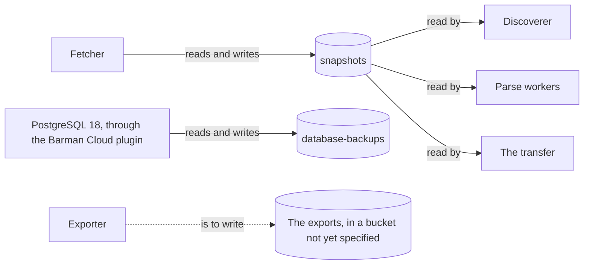

# Garage

<!-- status: Garage; The snapshot store in the cluster -->
**Status** ([status page](../status.md)): Garage: Specified. The snapshot store in the cluster: Specified.
<!-- end status -->

Garage is the pipeline's object store, which holds every body the fetcher
stores, named by its SHA-256, and the database's backups, and with the
records in PostgreSQL makes up the snapshot store in the cluster. This page
explains what it keeps and how, how it's deployed and set up, how it fails,
and why it was chosen over MinIO and SeaweedFS.

## What it does for the pipeline

In continuous operation the store outgrows what git should hold, so bodies
move to an object store in the cluster, named by SHA-256 as they are under
`data/objects/` ([0002]). Garage holds three things ([components]):

- **The cluster store's objects:** each distinct body the fetcher receives,
  stored once ([OBJ-4]).
- **The database's backups:** its write-ahead log and its base backups
  ([PG-4]; [PostgreSQL 18](postgresql.md#backups-to-garage)).
- **The facts' exports,** as Parquet, each file with its SHA-256
  ([components]). The export's format and its bucket aren't specified yet:
  its specification is task T18, and the exporter T27 ([plan][plan-facts]).

## The snapshot store in the cluster

The snapshot store's specification governs two stores. The git store is
everything under `data/`; the cluster store is objects in Garage and
records in PostgreSQL, in the cluster that the umbrella chart installs
([snapshots, §2][terms]):

```text
Garage, the store's bucket:
  objects/AA/SHA256.gz          one object per distinct body
PostgreSQL, the pipeline's database:
  records                       one row per fetch
```

An object has the same name in both stores, and a record's `object` names
its object in its own store ([the cluster store][STORE-1]). So the
transfer, which the owner runs, can copy a record and its object from the
cluster into `data/` unchanged, for a finding to cite ([XFER-1], [XFER-2]).
Only the fetcher writes to the cluster store, and no service can change a
record ([deployment, §1][dep-guarantees]): the database refuses a change to
a row ([LOG-3]), and the bucket's keys keep every service but the fetcher
from writing ([LOG-4]). The cluster store meets the git store's invariants
of objects and records ([STORE-3]). The records and the table that holds
them are on [PostgreSQL 18](postgresql.md#the-stores-table-records).

## Objects named by their SHA-256

An object at `objects/AA/SHA256.gz` is gzip data whose decompressed bytes
have the SHA-256 in its name, and `AA` is that hash's first two characters.
The compressed bytes may differ between writers; the identity is the
decompressed bytes ([OBJ-1]). The fetcher stores a body only if no object
has its name, since the same name means the same body. A fetcher that stops
between storing an object and adding its record leaves the object unnamed,
and a later fetch of the same body names it ([OBJ-4]).

A URL's versions are the distinct bodies among its records ([VER-1]). A
poll whose body is the one the URL returned before adds a record, not an
object. Each poll of a company's `submissions` downloads the whole body,
since `submissions` sends no validators ([SRC-4]; [0010]), but Garage grows
only by the bodies that differ.

The investigation measured bodies of each kind the cluster fetches, as
`snapshot.py` stored them in the git store ([SRC-18]). The cluster fetches
each Source's URL, a Backfill's lists, and the files of each filing the
discoverer finds: its header, its index page, and its XBRL instance ([scope
and the cluster][scope-cluster], [FILE-1], [LIST-2]):

| Body | Bytes | Stored, gzip |
| --- | --- | --- |
| A company's `submissions` | 157,326 to 185,250 | 19,732 to 27,325 |
| `submissions`' further files | 204,857 to 313,914 | 30,455 to 36,978 |
| A filing's header | 5,470 to 28,732 | 1,601 to 3,297 |
| A filing's index page | 10,028 to 15,117 | 2,967 to 3,350 |
| The XBRL instance of a 10-K or 10-Q | 904,157 to 10,948,157 | 37,609 to 310,130 |
| The XBRL instance of an 8-K/A | 9,836 to 11,695 | 1,381 to 2,165 |

The fetcher's gzip may differ from `snapshot.py`'s ([OBJ-1]), so these are
the git store's sizes, not the cluster's. The
[estimates](estimates.md#objects-in-garage) put the bucket's growth at the
default scope at 14 MB to 259 GB a year, depending on whether each
company's `submissions` changes only with a new filing or at each poll,
which the investigation's refetches will show. The database's backups,
which nothing removes, grow faster still
([estimates](estimates.md#the-databases-archive)).

## Kept, not locked

Garage has no object versioning and no object lock ([0002]), so it can't
prevent an object from being overwritten or deleted. The store's guarantee
that nothing stored is changed rests on three things instead ([snapshots,
§1][store-guarantees]):

1. **Permissions.** Only the fetcher's key may write to the bucket, and the
   fetcher never deletes or replaces an object; each other service's key
   may only read it ([LOG-4]). No key has Garage's `owner` permission on
   any bucket, which would let it change the bucket's configuration
   ([GARAGE-4]).
2. **Content addressing.** An object must hash to its name, and every
   record must find its object ([OBJ-1], [REC-3]), so a change to an object
   shows.
3. **A check.** The cluster store meets the git store's invariants
   ([STORE-3]). How often it's checked in operation, and the alert on a
   problem, are still open: no component checks it yet ([telemetry, open
   question 2][telemetry-questions]).

The git store's history shows that nothing was changed ([LOG-1], [LOG-2]),
and the database refuses a change to a record ([LOG-3]). Garage is the one
place where the pipeline detects a change rather than refusing it.

## Buckets and keys



| Bucket | Holds | Keys | Specified by |
| --- | --- | --- | --- |
| `snapshots` | The cluster store's objects | The fetcher's, which may read and write it; each other service's, which may only read it, and no other bucket | [GARAGE-4], [LOG-4] |
| `database-backups` | The database's write-ahead log and base backups, under each cluster's server name | One, which may read and write only that bucket | [GARAGE-2], [PG-4] |

In the deployment's version 1.1.0, the values list two keys for
`snapshots`: the fetcher's, and the discoverer's, which may only read it.
Each other service's comes with that service ([GARAGE-4],
[deployment, §9][later]).

The discoverer reads each list, header, and index page from the bucket
([SEEN-1], [FILE-3]). The parse workers will read each XBRL instance from
it, as an import in the cluster reads its inputs: from the bucket, over
Garage's S3 API, under a manifest written first, and never from the live
source ([IMP-3]). The services that read EDGAR's content through
[`edgar-asof`](edgar-asof.md) give it bodies from the cluster store, and
the library never fetches or keeps a cache there ([FETCH-18]). The Go
fetcher reaches Garage through the AWS SDK for Go v2, and the Python
services through boto3 ([0006]).

## Three nodes, three copies

Garage runs as a StatefulSet of three, with a replication factor of 3, each
node keeping its metadata and its data on claims of its own ([GARAGE-1]),
of the class `edgar-retained` ([VOL-2]). Each node needs a worker node of
its own ([PLACE-1]), so the three run one on each ([PLACE-2]). Its layout
puts each node in a zone of its own, and each node holds a copy of every
object ([GARAGE-3]). So the store keeps running, with every object, when
one worker node is lost ([deployment, §1][dep-guarantees]), which is why
there are three: so the loss of a node can be shown ([0002]). Every object
is stored three times.

On kind, the three nodes are containers on one machine ([the kind
cluster][KIND-1]), and every volume's data is kept in one directory of that
machine ([KIND-2]). The three copies guard against losing a node, not
against losing that machine's disk. A kind cluster is disposable, and the
git store remains the reproducible sample outside it ([0001]).

Garage finds its peers through Kubernetes. It would create its own custom
resource definition for that at startup, through a ClusterRole that may
create any definition ([0011]). Instead, its chart's values
`garage.kubernetesSkipCrd` and `garage.noClusterRole` are `true`, so it
creates no definition and holds only a Role in its namespace ([GARAGE-1]),
and the operators' chart installs Garage's definition, from Garage's source
tree at the tag of Garage's chart ([CRD-2], [CRD-5]).

No chart repository publishes Garage's chart, so it's committed unchanged
from `script/helm/garage` in Garage's source tree at a release tag
([PIN-3]), and upgraded deliberately ([0002]).

## The setup Job

A Helm install yields a working store ([0002]): a Job, run by Helm after
each install and upgrade, sets Garage up as the umbrella chart's values
describe ([GARAGE-2]). It:

1. assigns each of the three nodes a zone of its own and a capacity in the
   layout, and applies it;
2. imports each key, with the ID and secret the values give it;
3. creates each bucket;
4. grants each key its buckets.

It reaches Garage's admin API with the admin token, and succeeds when what
it would create already exists, so it can run again ([GARAGE-2],
[GARAGE-3]).

The keys are imported, not generated. Every credential the umbrella chart's
components use, but those an operator generates in the cluster, is a value
the chart requires and no committed values file sets ([SECRET-1]), and
nothing the charts render is generated as they render it ([SECRET-2]).
Garage's credentials are its RPC secret, its admin token, and each key's ID
and secret ([SECRET-1]). Each appears in what the charts render only in a
Secret ([SECRET-3]), CI generates new ones for each cluster it creates, and
the owner keeps theirs in a values file git ignores ([SECRET-4]).

## How it scales

- **Objects grow with distinct bodies,** not with fetches ([OBJ-4],
  [VER-1]), and each is stored on all three nodes ([GARAGE-3]).
- **Writes are bounded by the fetcher,** which sends at most 5 requests a
  second ([FETCH-6]) and is the only writer of `snapshots` ([LOG-4]).
- **Memory mattered most in choosing it,** since kind's nodes share one
  machine ([0002]). The figures the decision record cites are from others'
  tests, not from kind ([below](#the-alternatives-decision-0002-weighed)).
  Each component's requests and limits are measured on kind, and given in a
  later version of the deployment ([deployment, §9][later]).

## How it fails

| What fails | What happens |
| --- | --- |
| One node, or its worker node | The other two hold a copy of every object, and the store keeps running ([GARAGE-3], [deployment, §1][dep-guarantees]). |
| An object is overwritten or deleted | Garage can't refuse it ([0002]). Its hash no longer matches its name, or a record no longer finds it, which the check of [STORE-3] finds; how often that check runs is still open ([telemetry, open question 2][telemetry-questions]). |
| The database can't archive to Garage | Its backups stop. `DatabaseBackupStale` fires once the latest base backup has been more than a day old for an hour ([ALERT-3]; [Observability](observability.md#the-alerts)). |
| Garage as a whole | The discoverer reads each version from the bucket ([SEEN-1]) and acknowledges an event only once it has done what the event asks ([DISC-1]), so its events wait in `RECORDS`. Tempo and Loki are to keep their data on volumes of their own, not in Garage, so the outage can still be observed ([0008]). |
| The cluster, recreated with the same host directory | Each claim of `edgar-retained` finds its data ([VOL-3]), so Garage's objects, the database's backups among them, outlive the cluster ([deployment, §1][dep-guarantees]), and the setup Job, run again, finds what it would create ([GARAGE-2]). |

A record has room for a body that couldn't be stored: its `error` says why
nothing was stored when the status doesn't, and such a record names no
version ([§6 of the store][records], [REC-6]). No statement says more about
what the fetcher does while Garage can't take an object.

The database's backups go to Garage through CloudNativePG's Barman Cloud
plugin, which has been tested against MinIO, not Garage. So a restore from
them is shown on kind before they're relied on ([0002]), by the drills of
task T31 ([PostgreSQL 18](postgresql.md#backups-to-garage);
[plan][plan-drills]).

## What it depends on

- **Three worker nodes,** one for each node ([KIND-1], [PLACE-1]), and the
  class `edgar-retained`, which keeps each volume in the host directory
  ([VOL-1], [KIND-2]).
- **The operators' chart,** the third release, which installs Garage's
  definition before the umbrella chart installs Garage
  ([Deployment](deployment.md#the-four-charts-and-their-order)).
- **Its credentials,** as values of the umbrella chart ([SECRET-1]).

The fetcher writes to `snapshots`; the discoverer, the parse workers, and
the transfer read it; the exporter is to write the facts' exports to
Garage; and the database backs up to it. It uses no other component of the
pipeline.

## Where it's specified

| Statement | What it says | Checked by |
| --- | --- | --- |
| [GARAGE-1] | Three nodes, a replication factor of 3, on claims, with no definition or ClusterRole of its own. | tests |
| [GARAGE-2] | A hook Job sets the layout, keys, buckets, and grants, and can run again. | tests |
| [GARAGE-3] | The layout, buckets, keys, and grants are as the values say, with a copy of every object on each node. | kind |
| [GARAGE-4] | The store's bucket is `snapshots`; only the fetcher's key may write it, and no key owns a bucket. | tests |
| [PLACE-1], [PLACE-2] | Each node needs a worker node of its own, and runs on one. | tests, kind |
| [VOL-2], [VOL-3] | Its claims are of `edgar-retained`, whose data a new claim of the same name finds. | tests, kind |
| [PIN-3] | Its chart is committed unchanged from a release tag. | tests, review |
| [CRD-2], [CRD-5], [CRD-6] | The operators' chart renders its definition, from the same tag; no component creates one. | tests, review, kind |
| [SECRET-1] to [SECRET-4] | Its credentials are required values, only in Secrets, never generated as the chart renders. | tests, review, operator |
| [OBJ-1], [OBJ-4] | An object's name is its body's SHA-256, and the fetcher stores it once. | verify, kind |
| [REC-3], [STORE-3] | Every record finds its object, and the cluster store meets the git store's invariants. | verify, kind |
| [LOG-4] | Only the fetcher writes to the bucket, and never deletes or replaces an object. | kind |
| [IMP-3], [FETCH-18] | Imports and `edgar-asof` read only stored objects. | first import, kind |
| [PG-4] | The database's backups go to `database-backups`. | tests |

Garage and its setup Job are built by task T20, and the fetcher, which
writes the store, by T23; neither is done ([plan][plan-observing]).

## The alternatives decision 0002 weighed

| Option | What the record says of it | Outcome |
| --- | --- | --- |
| MinIO | Under AGPLv3, which would be fine, but no longer maintained: it stopped publishing binaries and images in October 2025, went into maintenance mode in December 2025, and its repository has since been archived. | Ruled out. |
| SeaweedFS | Apache 2.0, with fuller S3 support, including versioning and object lock. It runs as several processes (master, volume server, filer, S3 gateway), used about 500 MB in one stress test, and its volume servers keep an index in memory that grows with the number of objects. | Rejected. |
| Garage | AGPLv3; one Rust binary that replicates across nodes. It idled under 20 MB and stayed under 200 MB in one stress test; another guide puts it at 100 to 200 MB idle. It has no object versioning and no object lock. | Chosen, with three replicas across kind's worker nodes and a replication factor of 3. |

The record names what the choice costs. Storage can't prevent an object
from being overwritten or deleted, so the store's guarantees rest on
detecting it. Garage's chart is vendored and upgraded deliberately. Run
unmodified and reached over the S3 API, Garage places no AGPL obligations
on the pipeline's code, and a client whose policy forbids AGPL software
would use SeaweedFS, which also offers object lock ([0002]).

[0001]: ../decisions/0001-deploy-on-kubernetes-with-helm-on-kind.md
[0002]: ../decisions/0002-store-bodies-in-garage.md
[0006]: ../decisions/0006-write-the-services-in-go-and-python.md
[0008]: ../decisions/0008-monitor-with-prometheus-and-grafana-then-tempo-and-loki.md
[0010]: ../decisions/0010-poll-each-companys-submissions-and-measure-lag-from-the-record.md
[0011]: ../decisions/0011-install-the-definitions-and-operators-before-the-umbrella-chart.md
[components]: ../design.md#components
[plan-drills]: ../plan.md#traces-logs-and-drills
[plan-facts]: ../plan.md#facts
[plan-observing]: ../plan.md#observing-filings
[SRC-4]: ../../investigation/edgar.md#findings-so-far
[SRC-18]: ../../investigation/edgar.md#findings-so-far
[CRD-2]: ../../spec/deployment.md#definitions
[CRD-5]: ../../spec/deployment.md#definitions
[CRD-6]: ../../spec/deployment.md#definitions
[dep-guarantees]: ../../spec/deployment.md#1-guarantees
[GARAGE-1]: ../../spec/deployment.md#garage
[GARAGE-2]: ../../spec/deployment.md#garage
[GARAGE-3]: ../../spec/deployment.md#garage
[GARAGE-4]: ../../spec/deployment.md#garage
[KIND-1]: ../../spec/deployment.md#the-kind-cluster
[KIND-2]: ../../spec/deployment.md#the-kind-cluster
[later]: ../../spec/deployment.md#9-later-versions
[PG-4]: ../../spec/deployment.md#instances-and-backups
[PIN-3]: ../../spec/deployment.md#6-pins
[PLACE-1]: ../../spec/deployment.md#placement
[PLACE-2]: ../../spec/deployment.md#placement
[SECRET-1]: ../../spec/deployment.md#credentials
[SECRET-2]: ../../spec/deployment.md#credentials
[SECRET-3]: ../../spec/deployment.md#credentials
[SECRET-4]: ../../spec/deployment.md#credentials
[VOL-1]: ../../spec/deployment.md#volumes
[VOL-2]: ../../spec/deployment.md#volumes
[VOL-3]: ../../spec/deployment.md#volumes
[DISC-1]: ../../spec/notices.md#processing
[FILE-1]: ../../spec/notices.md#7-a-filings-files
[FILE-3]: ../../spec/notices.md#7-a-filings-files
[LIST-2]: ../../spec/notices.md#8-backfills
[SEEN-1]: ../../spec/notices.md#6-when-each-source-first-showed-each-filing
[FETCH-6]: ../../spec/snapshots.md#10-fetching
[FETCH-18]: ../../spec/snapshots.md#the-fetcher
[IMP-3]: ../../spec/snapshots.md#11-imports
[LOG-1]: ../../spec/snapshots.md#8-history
[LOG-2]: ../../spec/snapshots.md#8-history
[LOG-3]: ../../spec/snapshots.md#8-history
[LOG-4]: ../../spec/snapshots.md#8-history
[OBJ-1]: ../../spec/snapshots.md#5-objects
[OBJ-4]: ../../spec/snapshots.md#5-objects
[REC-3]: ../../spec/snapshots.md#6-records
[REC-6]: ../../spec/snapshots.md#6-records
[records]: ../../spec/snapshots.md#6-records
[scope-cluster]: ../../spec/snapshots.md#the-scope-and-the-cluster
[STORE-1]: ../../spec/snapshots.md#the-cluster-store
[STORE-3]: ../../spec/snapshots.md#the-cluster-store
[store-guarantees]: ../../spec/snapshots.md#1-guarantees
[terms]: ../../spec/snapshots.md#2-terms
[VER-1]: ../../spec/snapshots.md#7-versions
[XFER-1]: ../../spec/snapshots.md#records-the-cluster-made
[XFER-2]: ../../spec/snapshots.md#records-the-cluster-made
[ALERT-3]: ../../spec/telemetry.md#7-alerts
[telemetry-questions]: ../../spec/telemetry.md#11-open-questions
