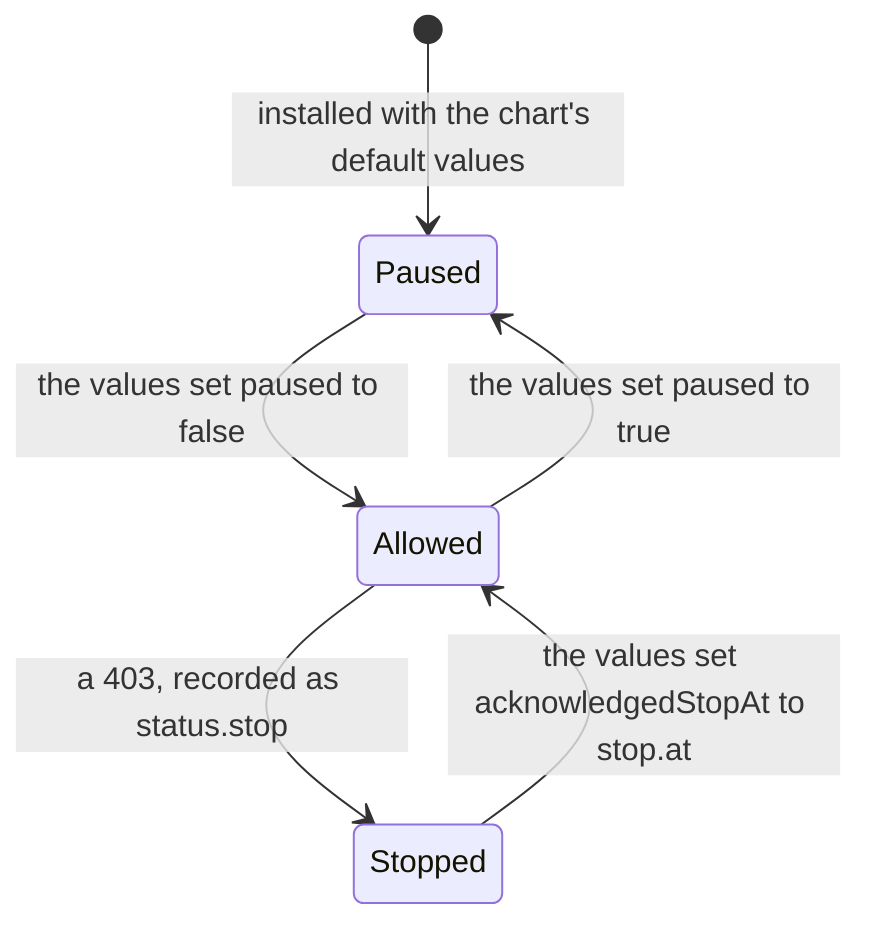
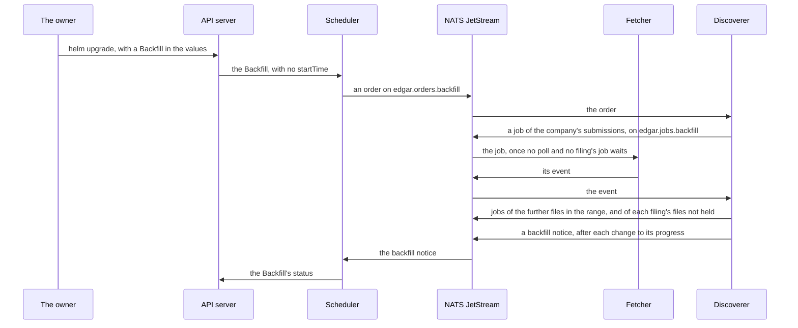

# The interfaces

<!-- status: The controls; Scheduler; Fetcher; Discoverer; Parse workers; NATS JetStream; Query API; `edgar-asof` -->
**Status** ([status page](../status.md)): The controls: Specified; built in part. Scheduler: Specified; built in part. Fetcher: Decided; specified in part. Discoverer: Specified. Parse workers: Decided. NATS JetStream: Built. Query API: Decided. `edgar-asof`: Decided.
<!-- end status -->

This page covers the pipeline's three interfaces: the custom resources the
owner controls it through, the messages the services pass each other with
their schemas, and the query API, which is decided but not yet specified.
Facts about `edgar-asof` here were checked against its `main`, at commit
`515bb0d`, on October 14, 2026.

## The custom resources

The pipeline's controls are three custom resources, in the API group
`edgar.nathanslaughter.com`, at version `v1alpha1`, each with a status
subresource ([0007], [API-1]):

| Kind | Scope | One for each | Definition | Its `spec` is set by | Its `status` is set by |
| --- | --- | --- | --- | --- | --- |
| `Source` | Namespaced | URL the pipeline polls | [`sources.yaml`][sources-yaml] | The owner, through the chart's values | The scheduler |
| `Backfill` | Namespaced | Range of a company's past filings to fetch once | [`backfills.yaml`][backfills-yaml] | The owner, through the chart's values | The scheduler |
| `SecAccess` | Cluster | Cluster, named `cluster` | [`secaccesses.yaml`][secaccesses-yaml] | The owner, through the chart's values | The fetcher |

The definitions are written in `spec/schemas/` first, and the scheduler's Go
types are written to generate the same ([API-2]). They're installed by the
third of the four charts, before the umbrella chart renders any resource of
their kinds, and upgraded with it ([CRD-2], [0011]). `SecAccess` is
cluster-scoped because one fetcher sends every request, so whether it may
is a fact about the cluster; a second release of the chart would render a
second `SecAccess` named `cluster`, which Helm refuses ([§4 of the
controls][controls-resources]).

### How the owner changes them

The owner sets every control in the umbrella chart's values and applies it
with `helm upgrade`; `kubectl` is for reading them ([RBAC-6], [0010]). The
values hold `controls.secAccess`, and one entry under `controls.sources` and
`controls.backfills` for each Source and Backfill, keyed by its name. The
chart renders exactly those resources, in the release namespace, with no
`status` ([VAL-1]). The chart checks the values before anything reaches the
cluster:

- It refuses values that would render a resource the API server refuses
  ([VAL-2]). The definitions refuse a resource without a `spec` or a
  required field, a Source whose `cadenceSeconds` is less than 1, a
  Backfill whose range ends before it starts, and a `SecAccess` named
  anything but `cluster` ([API-3]).
- It refuses Sources not paused whose sum of `1 / cadenceSeconds` is more
  than 2.5, half the fetcher's limit: 25 Sources at 10 seconds pass, and 26
  fail ([VAL-3]).
- Its default values pause the `SecAccess`, so the chart installed with them
  sends nothing to the SEC until the owner's values allow it ([VAL-4]).

Helm runs one operation on a release at a time, so two changes can't each
pass the budget's check and together exceed it, and since nothing reaches
the cluster another way, no admission webhook checks the resources
([§5 of the controls][controls-values]). A webhook is added if something
other than the chart comes to create or change Sources ([0010]). One check
the chart can't make: it renders without the cluster, so it can't see that a
Backfill's `spec` differs from the one the cluster holds. The API server
refuses that change, so `helm upgrade` fails, though `helm template` passes
([§5 of the controls][controls-values]).

### `Source`

One URL the pipeline polls, such as one company's `submissions`
([§6 of the controls][controls-source]).

| Part | Fields |
| --- | --- |
| `spec` | `feed`, the feed its polls are recorded under; `url`, on `www.sec.gov` or `data.sec.gov`; `cadenceSeconds`, the seconds from one poll to the next, at least 1, which each Source must state; and `paused`, `false` if absent |
| `status` | `lastPollTime` and `lastSuccessfulPollTime`, from the polls' records' `requested_at`; `openGapSince`, only while the record holds an open gap; and the conditions `Polling` and `WithinBudget` |

`Polling` is `True` while the scheduler queues the Source's polls. When it's
`False`, its reason is the first of these that applies: `NoSecAccess`,
`RequestsStopped`, `RequestsPaused`, then `Paused`, so the causes that hold
for the whole cluster come before the Source's own ([SOURCE-1]).
`WithinBudget` is `False`, with the total in its message, while the Sources
not paused together exceed the budget, which the chart's check keeps from
happening for the Sources it renders ([VAL-3]). Over the budget, the
scheduler polls them anyway, and the fetcher's limit still holds
([SOURCE-3]). `kubectl get sources` shows each one's feed, cadence, whether
it's paused and polling, and its last successful poll
([`sources.yaml`][sources-yaml]).

The scheduler sets `lastPollTime` and `lastSuccessfulPollTime` from the
polls' records ([SOURCE-4]), and `openGapSince` from the discoverer's gap
notices ([NOTICE-1], [SOURCE-5]). It reads the polls' records in their
events, through a durable consumer of its own, `scheduler-polls`, of
`edgar.records.poll` on `RECORDS`, and the notices through
`scheduler-notices` ([SCHED-8], [NATS-5]).

### `Backfill`

A company's past filings over a range of filing dates, fetched once
([§7 of the controls][controls-backfill]).

| Part | Fields |
| --- | --- |
| `spec` | `cik`; `filingDateFrom`; and `filingDateTo`, not before `filingDateFrom`. It can't change once the Backfill is created; another range is another Backfill. |
| `status` | `filings`, once they're listed; `filingsFetched` and `filingsFailed`; `startTime` and `completionTime`; and the condition `Complete`, `True` once the filings are listed and each is fetched or failed |

The pipeline fetches each filing the company's `submissions` and further
files list with a filing date in the range, as it fetches a new filing,
except one whose fetches the record already holds, so a Backfill interrupted
by a restart continues where it stopped ([BACKFILL-1]). A Backfill's fetches
wait for every other fetch ([BACKFILL-2]). A Backfill removed from the
cluster isn't stopped: its queued jobs are fetched, and its rows stay
([§8 of the notices][notices-backfills]).

### `SecAccess`

Whether the pipeline may send requests to the SEC at all
([§8 of the controls][controls-secaccess]). Its `spec` holds `paused`, and
`acknowledgedStopAt`, the `at` of the stop the owner acknowledges. Its
`status`, which the fetcher sets, holds `stop`: the `at` and `url` of the
last fetch that got a `403`. Requests are allowed while the `SecAccess`
exists, isn't paused, and has no stop, or one whose `at` the owner has
acknowledged, and the fetcher sends only then ([§8 of the
controls][controls-secaccess], [ACCESS-1]).

An acknowledgement names one stop, so a later `403` stops requests again
until the owner acknowledges that one too. A replica that takes over the
Lease reads the stop from the `SecAccess`, so the stop survives a handover
([ACCESS-3]). While requests aren't allowed, the scheduler queues no poll
and nothing for a Backfill ([ACCESS-2]), and the discoverer's jobs wait in
their stream ([§7 of the notices][notices-files]).

### Who may change what

| ServiceAccount | Sources and Backfills | Their `status` | The `SecAccess` | Its `status` |
| --- | --- | --- | --- | --- |
| The scheduler's | `get`, `list`, `watch` | `update`, `patch` | `get`, `list`, `watch` | None |
| The fetcher's | None | None | `get`, `list`, `watch` | `update`, `patch` |
| kube-state-metrics' | `get`, `list`, `watch` | None | `get`, `list`, `watch` | None |

No other role in the four charts grants any verb on the three resources,
and none lets a service create, change, or delete a resource itself
([RBAC-1] to [RBAC-5]). So "only when the owner asks" is a permission in
the cluster ([0007]). [Security and access](security-and-access.md) covers
the credentials and what each service may read and write. kube-state-metrics exports each resource's fields as
metrics ([STATE-1]), which the alerts on a stop after a `403` and on a gap
read ([ALERT-1], [ALERT-2]).

## The messages between the services

The services pass work to each other as JSON messages in NATS JetStream
([0003]). Each kind of message has a JSON Schema, and each message's
subject ends in its kind
([jobs and events][store-jobs], [§9 of the notices][notices-messages]):

| Stream | Subjects | Messages | Published by | Read by | Kept |
| --- | --- | --- | --- | --- | --- |
| `JOBS` | `edgar.jobs.poll`, `edgar.jobs.filing`, `edgar.jobs.backfill` | Jobs, [`job.schema.json`][job-schema] | The scheduler, polls; the discoverer, filings' and Backfills' | The fetcher | As a work queue, until the fetcher acknowledges the job |
| `RECORDS` | `edgar.records.poll`, `edgar.records.filing`, `edgar.records.backfill` | Events, [`event.schema.json`][event-schema] | The fetcher | The discoverer | Until each of the stream's consumers acknowledges the event |
| `ORDERS` | `edgar.orders.backfill` | Orders, [`order.schema.json`][order-schema] | The scheduler | The discoverer | As a work queue, until the discoverer acknowledges the order |
| `NOTICES` | `edgar.notices.filing`, `edgar.notices.gap`, `edgar.notices.backfill` | Notices, [`notice.schema.json`][notice-schema] | The discoverer | The scheduler, gap and backfill notices; the parse workers, filing notices | Until each of the stream's consumers acknowledges the notice |

The deployment's version 1.1.0 installs all four, each kept in files and
replicated on all three NATS servers ([NATS-3]). A stream kept by interest
keeps a message only for the consumers it has when the message is
published, so the same Job makes the durable consumers of the discoverer,
the scheduler, and the parse workers, each right after its stream, with
`NOTICES` first and `JOBS` last, and gives a stream kept by interest its
subjects only once its consumers exist, so it accepts a message only then
([NATS-5]). The fetcher's consumer of `JOBS` comes with the fetcher
([§9 of deployment][deployment-later]).

### Jobs and events

A **job** asks the fetcher for one fetch ([jobs and events][store-jobs]):

| Field | Holds |
| --- | --- |
| `id` | A UUID, which the record of the fetch keeps as `job` |
| `kind` | `poll`, `filing`, or `backfill`: what asked for the fetch |
| `feed`, `url` | The feed the fetch is recorded under, and the URL, on `www.sec.gov` or `data.sec.gov` |
| `source` | In a poll only: the Source polled |
| `backfill` | In a Backfill's job only: the Backfill |
| `queued_at` | When it was queued |
| `expires_at` | In a poll: when the next poll is due ([JOB-2]). Filings' and Backfills' jobs don't expire ([JOB-3]). |

Before each request, the fetcher takes the job queued first of the first
kind that has one waiting: `poll`, then `filing`, then `backfill` ([JOB-4]).
It acknowledges an expired job without a request ([JOB-5]).

An **event** announces the record of a fetch: the record's `id` in the
table, the `job` it was made for, and the `record` itself, with every field,
`received_at` and `date` among them ([JOB-1]).

### Orders and notices

An **order** hands a Backfill to the discoverer: its name, its
`metadata.uid`, which tells it from an earlier Backfill of the same name,
its `cik` and range, and `ordered_at`. The scheduler publishes one for each
Backfill whose status has no `startTime`, while requests are allowed, and
again each time it becomes the active replica or requests are allowed again,
until the Backfill has one ([ORDER-1]). The discoverer adds the Backfill
and its first job for the first order of each `uid` ([LIST-1]). A later
order of the same `uid` adds no row, but the discoverer publishes the
Backfill's first job again, unless its record is held, so an order whose
first delivery stopped before the job was published still starts the
Backfill ([DISC-2]).

A **notice** is one of three kinds, each with its own required fields, and
none of another kind's ([MSG-1]):

| Kind | Fields | Published when |
| --- | --- | --- |
| `filing` | `accession_number`, `form`, `filing_date`; `listed_acceptance` and `header_acceptance`, each as given; and `files`, each file's `feed`, `url`, and `sha256`, as an import's manifest names an input | A filing is complete ([FILE-5]) |
| `gap` | `source`, `url`, and `open_since`, null when the gap has ended | Within 10 seconds of a change in a Source's open gap, and for each open gap when the discoverer starts ([GAP-3]) |
| `backfill` | `backfill`, `uid`, and its progress: `started_at`, `filings`, `fetched`, `failed`, and `completed_at` | After each change to the Backfill's rows ([LIST-5]) |

Each carries `at`, when the discoverer published it. The scheduler sets
each Source's `openGapSince` from the latest gap notice, by `at`, of its name
and URL, and each Backfill's status from the latest backfill notice of its
`uid` ([NOTICE-1], [NOTICE-2]).

A Backfill passes through every stream:

### Delivery, order, and repeats

A message can be delivered more than once ([0003]), and each consumer is
written so that a repeat does no harm. [Delivery and
consistency](delivery-and-consistency.md) covers what each stream
guarantees in more depth.

- **The fetcher** adds the record, then publishes the event, then
  acknowledges the job. Given a job whose record the table already holds, it
  publishes that record's event again and acknowledges the job, without a
  request. So a job is fetched again only if its fetch wasn't recorded, and
  an event can arrive twice, with the same `id` ([JOB-6]).
- **The discoverer** reads poll events one at a time, in the order the
  stream holds them ([DISC-1]). For each message it adds every row in one
  transaction, then publishes the jobs and notices that follow from it, then
  acknowledges it. So a message delivered again adds nothing twice, and the
  jobs its first delivery queued are published again, with their `id`s,
  until fetched ([DISC-2]).

### Validation and change

Every consumer ignores fields it doesn't know, so a later version can add
one without breaking a reader. A message that doesn't validate against its
schema, or whose kind isn't its subject's, is acknowledged without being
acted on; the scheduler, the fetcher, and the discoverer each count such
messages in a metric ([JOB-7], [MSG-2], [§4 of
telemetry][telemetry-metrics]). Each schema is part of its specification,
so changing one is a change to the specification, versioned as it says
([§14 of the store][store-changes], [§13 of the notices][notices-changes]).

### Trace context

Each message carries the trace context of the span that published it in its
NATS headers, not in its body, so the messages are as their schemas have
them ([TRACE-1]). The fetcher sends the SEC no trace context ([TRACE-6]).

## Tables and objects the services share

Beside the messages, the services share stored data, each with a schema and
narrow grants:

| What | Schema | Written by | Read by |
| --- | --- | --- | --- |
| The table `records` | [`records.sql`][records-sql] | The fetcher only, inserts only ([LOG-3]) | Every other service's role, select only |
| The notices' tables and views | [`notices.sql`][notices-sql] | The discoverer only, inserts only ([TABLE-3], [PG-12]) | Every other service's role, select only |
| The views in the schema `dashboards` | [`dashboards.sql`][dashboards-sql] | Nothing: they're views | Grafana's role, `grafana`, which can't read the tables and views beneath them ([VIEW-3], [PG-13]) |
| Objects in the bucket `snapshots` | Their names, by SHA-256 ([OBJ-1]) | The fetcher's key only ([GARAGE-4]) | Every other service's key, read only |

The Python services hand the bodies they read from the bucket to
`edgar-asof`, which in the cluster reads only what it's given, and never
sends a request or keeps a cache ([FETCH-18]). The library's facts
specification lets a caller give the bodies, each with its URL, and the
library then fetches nothing ([`edgar-asof`'s facts specification,
§4][asof-facts-4]).

## The query API

The query API answers "as of T" ([components][design-components]). What's
decided:

- **It's written in Go,** with `net/http` and pgx, since it moves bytes and
  doesn't read EDGAR's content ([0006]).
- **It runs as a stateless Deployment** that reads PostgreSQL
  ([components][design-components]).
- **It answers as `edgar-asof` does.** The library's specification defines
  the fact model and what "as of T" returns, and the query API is tested
  against cases the library publishes, so both answer the same way ([0009],
  task T26 in the [plan][plan-facts]).

What isn't specified: its endpoints, parameters, and formats. The pipeline's
facts specification, task T17, which defines the fact table and cites a
version of `edgar-asof`'s specification, isn't written; task T26 builds the
API after it, and task T32 specifies its metrics and traces
([plan][plan-facts]). The cases it's tested against await a release of
`edgar-asof` that publishes them ([`edgar-asof`'s plan][asof-plan-later]).

What the library's specification already fixes, for an answer of its own
([`edgar-asof`'s facts specification, §7 and §8][asof-facts-7]):

- An answer is for one key, one instant T, and one interpreter of
  acceptance times, all passed by the caller, and the library has no default
  interpreter ([ASOF-1], [TIME-9]).
- It gives each fact of the key in one of four parts, `known`, `earlier`,
  `later`, and `unplaced`, in a fixed order, with its key, T, interpreter,
  and inputs ([ASOF-3], [ASOF-5], [ASOF-6]).

> **Analysis.** No task, decision record, or specification covers this.
> Since `edgar-asof` has no default interpreter, the query API could take
> the interpreter as a parameter of each query, as the library does, or fix
> one for the pipeline and name it in each answer. It could return the four
> parts of the library's answer, which would let its tests compare whole
> answers with the published cases, or only `known`, which would leave the
> history of later values to another query.

[0003]: ../decisions/0003-queue-work-in-nats-jetstream.md
[0006]: ../decisions/0006-write-the-services-in-go-and-python.md
[0007]: ../decisions/0007-control-the-pipeline-through-custom-resources.md
[0009]: ../decisions/0009-read-edgar-through-a-public-point-in-time-library.md
[0010]: ../decisions/0010-poll-each-companys-submissions-and-measure-lag-from-the-record.md
[0011]: ../decisions/0011-install-the-definitions-and-operators-before-the-umbrella-chart.md
[ACCESS-1]: ../../spec/controls.md#8-secaccess
[ACCESS-2]: ../../spec/controls.md#8-secaccess
[ACCESS-3]: ../../spec/controls.md#8-secaccess
[ALERT-1]: ../../spec/telemetry.md#7-alerts
[ALERT-2]: ../../spec/telemetry.md#7-alerts
[API-1]: ../../spec/controls.md#4-the-resources
[API-2]: ../../spec/controls.md#4-the-resources
[API-3]: ../../spec/controls.md#4-the-resources
[ASOF-1]: https://github.com/nslaughter/edgar-asof/blob/515bb0dc7af1b76a269413f29ba3edc390193e46/spec/facts.md#7-as-of-t
[ASOF-3]: https://github.com/nslaughter/edgar-asof/blob/515bb0dc7af1b76a269413f29ba3edc390193e46/spec/facts.md#7-as-of-t
[ASOF-5]: https://github.com/nslaughter/edgar-asof/blob/515bb0dc7af1b76a269413f29ba3edc390193e46/spec/facts.md#7-as-of-t
[ASOF-6]: https://github.com/nslaughter/edgar-asof/blob/515bb0dc7af1b76a269413f29ba3edc390193e46/spec/facts.md#7-as-of-t
[asof-facts-4]: https://github.com/nslaughter/edgar-asof/blob/515bb0dc7af1b76a269413f29ba3edc390193e46/spec/facts.md#4-reading-a-companys-facts
[asof-facts-7]: https://github.com/nslaughter/edgar-asof/blob/515bb0dc7af1b76a269413f29ba3edc390193e46/spec/facts.md#7-as-of-t
[asof-plan-later]: https://github.com/nslaughter/edgar-asof/blob/515bb0dc7af1b76a269413f29ba3edc390193e46/docs/plan.md#later
[BACKFILL-1]: ../../spec/controls.md#7-backfill
[BACKFILL-2]: ../../spec/controls.md#7-backfill
[backfills-yaml]: ../../spec/schemas/backfills.yaml
[controls-backfill]: ../../spec/controls.md#7-backfill
[controls-resources]: ../../spec/controls.md#4-the-resources
[controls-secaccess]: ../../spec/controls.md#8-secaccess
[controls-source]: ../../spec/controls.md#6-source
[controls-values]: ../../spec/controls.md#5-the-charts-values
[CRD-2]: ../../spec/deployment.md#definitions
[dashboards-sql]: ../../spec/schemas/dashboards.sql
[deployment-later]: ../../spec/deployment.md#9-later-versions
[design-components]: ../design.md#components
[DISC-1]: ../../spec/notices.md#processing
[DISC-2]: ../../spec/notices.md#processing
[event-schema]: ../../spec/schemas/event.schema.json
[FETCH-18]: ../../spec/snapshots.md#the-fetcher
[FILE-5]: ../../spec/notices.md#7-a-filings-files
[GAP-3]: ../../spec/notices.md#5-polls-coverage-and-gaps
[GARAGE-4]: ../../spec/deployment.md#garage
[JOB-1]: ../../spec/snapshots.md#jobs-and-events
[JOB-2]: ../../spec/snapshots.md#jobs-and-events
[JOB-3]: ../../spec/snapshots.md#jobs-and-events
[JOB-4]: ../../spec/snapshots.md#jobs-and-events
[JOB-5]: ../../spec/snapshots.md#jobs-and-events
[JOB-6]: ../../spec/snapshots.md#jobs-and-events
[JOB-7]: ../../spec/snapshots.md#jobs-and-events
[job-schema]: ../../spec/schemas/job.schema.json
[LIST-1]: ../../spec/notices.md#8-backfills
[LIST-5]: ../../spec/notices.md#8-backfills
[LOG-3]: ../../spec/snapshots.md#8-history
[MSG-1]: ../../spec/notices.md#streams
[MSG-2]: ../../spec/notices.md#streams
[NATS-3]: ../../spec/deployment.md#nats
[NATS-5]: ../../spec/deployment.md#durable-consumers
[NOTICE-1]: ../../spec/notices.md#8-backfills
[NOTICE-2]: ../../spec/notices.md#8-backfills
[notice-schema]: ../../spec/schemas/notice.schema.json
[notices-backfills]: ../../spec/notices.md#8-backfills
[notices-changes]: ../../spec/notices.md#13-changes-to-this-document
[notices-files]: ../../spec/notices.md#7-a-filings-files
[notices-messages]: ../../spec/notices.md#9-messages-and-processing
[notices-sql]: ../../spec/schemas/notices.sql
[OBJ-1]: ../../spec/snapshots.md#5-objects
[ORDER-1]: ../../spec/notices.md#8-backfills
[order-schema]: ../../spec/schemas/order.schema.json
[PG-12]: ../../spec/deployment.md#the-notices-and-the-dashboards
[PG-13]: ../../spec/deployment.md#the-notices-and-the-dashboards
[plan-facts]: ../plan.md#facts
[RBAC-1]: ../../spec/controls.md#9-who-may-change-what
[RBAC-5]: ../../spec/controls.md#9-who-may-change-what
[RBAC-6]: ../../spec/controls.md#9-who-may-change-what
[records-sql]: ../../spec/schemas/records.sql
[secaccesses-yaml]: ../../spec/schemas/secaccesses.yaml
[SOURCE-1]: ../../spec/controls.md#6-source
[SOURCE-3]: ../../spec/controls.md#6-source
[SOURCE-4]: ../../spec/controls.md#6-source
[SOURCE-5]: ../../spec/controls.md#6-source
[sources-yaml]: ../../spec/schemas/sources.yaml
[STATE-1]: ../../spec/telemetry.md#5-metrics-of-the-controls
[store-changes]: ../../spec/snapshots.md#14-changes-to-this-document
[store-jobs]: ../../spec/snapshots.md#jobs-and-events
[TABLE-3]: ../../spec/notices.md#4-the-record-of-notices
[telemetry-metrics]: ../../spec/telemetry.md#4-metrics
[TIME-9]: https://github.com/nslaughter/edgar-asof/blob/515bb0dc7af1b76a269413f29ba3edc390193e46/spec/times.md#4-interpreters
[TRACE-1]: ../../spec/telemetry.md#9-traces
[TRACE-6]: ../../spec/telemetry.md#9-traces
[VAL-1]: ../../spec/controls.md#5-the-charts-values
[VAL-2]: ../../spec/controls.md#5-the-charts-values
[VAL-3]: ../../spec/controls.md#5-the-charts-values
[VAL-4]: ../../spec/controls.md#5-the-charts-values
[VIEW-3]: ../../spec/telemetry.md#8-the-views-grafana-reads
[SCHED-8]: ../../spec/deployment.md#its-access-to-nats
