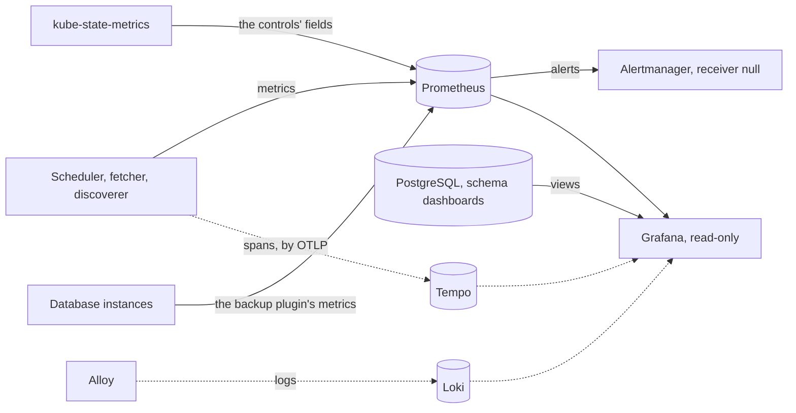

# Monitoring

<!-- status: Monitoring: metrics, alerts, and dashboards; Monitoring: traces; Monitoring: logs -->
**Status** ([status page](../status.md)): Monitoring: metrics, alerts, and dashboards: Decided; specified in part. Monitoring: traces: Specified. Monitoring: logs: Decided.
<!-- end status -->

Monitoring collects what the pipeline reports about itself, evaluates its
alerts, and shows it in dashboards, read-only; traces and logs come after.
This page explains its parts, how they're deployed and configured, what
they keep, how they fail, and why kube-prometheus-stack, then Tempo and
Loki, were chosen; what the pipeline reports through them, and the question
each signal answers, is on [Observability](observability.md).

## What it does for the pipeline

The design lists what the pipeline must report: each source's polls, the
delay from acceptance to first seen, open gaps, queue depth and
redeliveries, the fetcher's requests and `403`s and which pod holds the
Lease, and the database's replication and backups. A dashboard must also
show the record itself: coverage over time with its gaps, and each filing's
times ([0008], [monitoring]). Monitoring is installed as it would be in
production, and memory is the scarce resource on kind ([0008], [0001]).

It comes in three parts, which the status page tracks apart, in the order
they're built ([0008]):

1. **Metrics, alerts, and dashboards,** from kube-prometheus-stack: the
   Prometheus operator, Prometheus, Alertmanager, Grafana,
   kube-state-metrics, and node-exporter ([0008]).
2. **Traces,** in Tempo, next.
3. **Logs,** in Loki, fed by Grafana Alloy, last.

The dotted parts come later: Tempo with task T29, and Loki and Alloy with
T30 ([plan][plan-traces]).

## kube-prometheus-stack

The umbrella chart installs kube-prometheus-stack, from the Prometheus
community's repository ([CHART-2]), without its custom resource
definitions. Those come from the first of the four releases, the chart
`prometheus-operator-crds`, which renders them as templates, so Helm
upgrades them, as it never upgrades a chart's `crds/` directory ([0011],
[CRD-2]). Helm keeps each release in a Secret, which can hold 1 MiB; the
four operators' definitions come to about 940 KiB there, the Prometheus
operator's alone about 610 KiB, so they can't all be templates of one
release ([0011]). Since the two are pinned apart, their versions must
agree: the definitions chart's `appVersion` is the tag of the operator's
image that kube-prometheus-stack renders, which a chart test checks
([CRD-5]).

Each component's monitors and alert rules live in the umbrella chart beside
the component, as resources the Prometheus operator reads: a `PodMonitor`
for each service and one for the database's instances ([SCRAPE-1]), and
`PrometheusRule` resources for the alerts ([ALERT-4]). The chart's
Prometheus selects each. The umbrella chart is installed last, once every
definition exists, so the operators' monitors can live there too ([0011]).
Nothing is scraped that kind doesn't expose: the chart renders no monitor
or rule group for the controller manager, Kubernetes's own scheduler, etcd,
or kube-proxy ([MON-1]).

kube-state-metrics exports the controls' state as metrics: each Source's
cadence, pause, latest polls, open gap, and conditions, each Backfill's
progress, and the SecAccess's stop and its acknowledgement ([STATE-1]). For
that it may `get`, `list`, and `watch` the three resources, and change none
of them ([RBAC-3]). Its access to their definitions is left to the
deployment ([telemetry, left to other specifications][telemetry-left]).

## Grafana, read-only

Every control of the pipeline is a custom resource, never the dashboard
([0007]), so Grafana is read-only ([0008]). It admits anonymous viewers
with the `Viewer` role only, with its login form, basic authentication, and
sign-up turned off, so no one signs in to change anything. Its data sources
come only from Grafana's own `datasources` value, which its configuration
checksum covers, so a change to them restarts Grafana. Its sidecar
provisions dashboards only, which Grafana reads again from their files on
its own, so no reload needs a sign-in. Its dashboards come only from the
charts, and a provisioned dashboard can't be saved from its interface
([MON-2]). Its admin password is still a credential, a required value of
the umbrella chart ([SECRET-1]).

It has two data sources ([0008]):

- **Prometheus,** for the pipeline's metrics and the controls' state.
- **PostgreSQL,** for the record itself, through a role that may read only
  the views made for the dashboards, in the schema `dashboards` ([VIEW-3];
  [PostgreSQL 18](postgresql.md#the-views-grafana-reads)). Grafana's role,
  its password, and this data source are task T38's ([telemetry, left to
  other specifications][telemetry-left]).

The dashboards of coverage, gaps, and each source's lag are task T28's, and
that of each filing's times from acceptance to facts available, T33's
([plan][plan-observing]).

Decision 0007 weighed putting controls in the dashboard, as buttons in
Grafana or a web page of the project's own, and rejected it: they would
need their own login, permissions, and audit trail, and would put writes
beside a view that is shared and left open ([0007]).

## Alertmanager, with no receiver outside the cluster

Alertmanager's configuration has one receiver, `null`, with no integration,
so it sends nothing outside the cluster ([MON-3]). Alerts show in Grafana
and Alertmanager, and a receiver outside the cluster waits until the owner
asks for one ([0008]). No alert pages anyone: the owner sees one by
looking.

The alert rules are three, on a stop after a `403`, on a gap longer than a
Source's cadence, and on a backup more than a day old ([ALERT-4]), each
tested with `promtool test rules` in CI ([0008]). When each fires, and why,
is on [Observability](observability.md#the-alerts).

## Replicas and storage

| Part | Replicas | Keeps | Specified by |
| --- | --- | --- | --- |
| Prometheus | 1 | Its data, on a claim of `edgar-retained` | [MON-4], [VOL-2] |
| Alertmanager | 1 | Its data, on a claim of `edgar-retained` | [MON-4], [VOL-2] |
| Grafana | 1 | Nothing: what it shows is provisioned | [MON-4] |
| Tempo | Not yet specified | Its data, on a volume of its own, not in Garage | [0008] |
| Loki, with Alloy | Not yet specified | Its data, on a volume of its own, not in Garage | [0008] |

The class `edgar-retained` keeps a volume's data in the host directory when
its claim is deleted, and a new claim of the same namespace and name finds
it there, so Prometheus's and Alertmanager's data outlive a cluster
recreated with the same host directory ([VOL-1], [VOL-3], [deployment,
§1][dep-guarantees]). Tempo and Loki are to keep their data out of Garage
so that an outage of Garage can still be observed ([0008]).

The deployment gives each one replica ([MON-4]) and states no reason. What
the documents weigh is memory, the scarce resource on kind: the decision
record estimates about 1 GB for kube-prometheus-stack, most of it
Prometheus, and a few hundred MB each for Tempo and for Loki with Alloy,
each to be measured on kind before its limits are set ([0008], [0001]). An
alert fires only when Prometheus evaluates its rule ([telemetry,
§2][telemetry-terms]), so while the one Prometheus is down, no alert fires.

> **Analysis.** No task, decision record, or specification covers this. The
> pipeline could run Prometheus and Alertmanager with two replicas each, on
> different worker nodes, so that an alert could still fire while one is
> lost, at about twice their memory. On kind, where the nodes share one
> machine, that would weigh against the memory the decision record
> estimates for them.

## Traces: Tempo, next

The services send traces by OTLP, and carry each trace through NATS in
message headers, so one trace follows a filing from its poll to its facts,
across Go and Python ([0008], [0006]). The telemetry's version 0.1.0
specifies the traces of the scheduler, the fetcher, and the discoverer ([§9
of the telemetry][traces]), so traces are specified before Tempo is. A
service exports its spans to the endpoint `OTEL_EXPORTER_OTLP_ENDPOINT`
gives it, and none while that's unset, carrying trace context all the same
([TRACE-7]). Tempo itself, with that endpoint, is left to a later version
of the deployment ([deployment, §9][later], [telemetry, left to other
specifications][telemetry-left]), and is built by task T29
([plan][plan-traces]).

The services speak OTLP, so a collector can be put between them and Tempo
without changing them ([0008]), as a later version would to sample traces
if Tempo's volume calls for it ([telemetry, open question
3][telemetry-questions]).

## Logs: Loki with Alloy, last

Logs are JSON and carry the filing's accession number, and Loki, fed by
Grafana Alloy, keeps them, so every service's logs can be searched for one
filing ([0008]). Alloy was chosen rather than Promtail, which reached end
of life in March 2026 ([0008]). Logs have no specification yet: the
telemetry leaves them to a later version ([telemetry, left to other
specifications][telemetry-left]), and task T30 builds them, after T29
([plan][plan-traces]).

## How it scales

- **Series are bounded.** Every label takes values from a small set, and
  none carries an accession number, a job's or a record's `id`, or a URL
  other than a Source's ([METRIC-2]). So the number of series grows with
  the Sources and Backfills, not with the filings.
- **Traces grow with polls.** Every trace is sampled, and at the cadence
  each company's Source starts at, the polls start 25,920 traces a day,
  most of which find no filing ([telemetry, open question
  3][telemetry-questions]).
- **The dashboards' views grow with the record.** `coverage` and `gaps`
  read every poll, about 9.5 million a year at the starting cadence
  ([telemetry, open question 4][telemetry-questions]).

How fast Prometheus's series and storage grow is the estimates' to say
([PAGE-5]), in task T42.

## How it fails

| What fails | What happens |
| --- | --- |
| Prometheus | Its data is on a claim, kept through a restart ([MON-4], [VOL-3]). While it's down, no alert fires ([telemetry, §2][telemetry-terms]). |
| Grafana | It keeps no data, since what it shows is provisioned from the charts ([MON-4], [MON-2]). |
| Alertmanager | Its data is on a claim, kept through a restart ([MON-4], [VOL-3]). It sends nothing outside the cluster in any case ([MON-3]). |
| Garage | Tempo and Loki are to keep their data out of Garage, so the outage can be observed ([0008]). |
| Monitoring as a whole | The record doesn't depend on it. Coverage and gaps follow from the polls alone ([GAP-2]), and a control's status is a summary of the record, which stays authoritative ([0007]), so the views show what happened whatever Prometheus saw. |

## What it depends on

- **The first release,** `prometheus-crds`, for the Prometheus operator's
  definitions, and the umbrella chart, the fourth, for everything else
  ([Deployment](deployment.md#the-four-charts-and-their-order)).
- **The class `edgar-retained`,** for Prometheus's and Alertmanager's data
  ([VOL-2]).
- **What it watches:** each service's port named `metrics` ([METRIC-1]),
  the database instances' metrics port ([SCRAPE-1]), and the three
  resources, which kube-state-metrics reads ([RBAC-3]).
- **PostgreSQL,** for the views Grafana reads ([VIEW-3]).

## Where it's specified

| Statement | What it says | Checked by |
| --- | --- | --- |
| [MON-1] | Nothing kind doesn't expose is scraped. | tests |
| [MON-2] | Grafana is read-only, its data sources from its own value, its dashboards from the charts. | tests |
| [MON-3] | Alertmanager sends nothing outside the cluster. | tests |
| [MON-4] | Prometheus, Alertmanager, and Grafana run one replica each; the first two keep their data on claims. | tests |
| [VOL-2], [VOL-3] | Prometheus's and Alertmanager's claims are of `edgar-retained`, whose data a new claim of the same name finds. | tests, kind |
| [CHART-2], [CRD-2], [CRD-5] | kube-prometheus-stack and the operator's definitions, each from its chart, in versions that agree. | tests, review |
| [SCRAPE-1], [SCRAPE-2] | A `PodMonitor` for each service and the database's instances, and every target scraped. | tests, kind |
| [STATE-1], [RBAC-3] | kube-state-metrics exports the controls' fields, and may only read the resources. | kind, tests |
| [ALERT-4] | The chart renders the three alerts, and no other of its own. | tests |
| [VIEW-3] | Grafana's role may read only the views in `dashboards`. | kind |
| [TRACE-7] | Spans are exported by OTLP to the endpoint given, and none without one. | tests |
| [SECRET-1] | Grafana's admin password is a required value, in a Secret. | tests |

The umbrella chart, with kube-prometheus-stack, is task T20's; the
monitoring of observing filings, with its dashboards and rules, T28's;
Tempo, T29's; and Loki, T30's. Grafana's role, its data source, and the
views it reads are specified by T38, a version of the deployment's
specification ([plan][plan-observing], [plan][plan-traces]).

## The alternatives decision 0008 weighed

| Option | What the record says of it | Outcome |
| --- | --- | --- |
| kube-prometheus-stack | The Prometheus community's chart: the Prometheus operator, Prometheus, Alertmanager, Grafana, kube-state-metrics, and node-exporter. Each part of the umbrella chart declares its own scraping and alert rules as resources. | Chosen, with the defaults kind doesn't need turned off. |
| Prometheus and Grafana without the operator | One pod fewer, but every scrape target and rule is written by hand in one central configuration, instead of beside the component it watches. | Rejected. |
| VictoriaMetrics, with its operator | Less memory and disk than Prometheus, and its operator converts the Prometheus operator's resources, so charts that ship them still work. Less familiar to the teams the project addresses. | Rejected. |
| Grafana's all-in-one image, `grafana/otel-lgtm` | Metrics, logs, and traces in one container, but its project says it is meant for development, demos, and testing, so it doesn't model production. | Rejected. |
| For traces, Tempo or Jaeger | Both work with OpenTelemetry. Tempo is built to be queried from Grafana, linked from metrics and logs; Jaeger would bring a second interface. | Tempo. |
| For logs, Loki or none | `kubectl logs` is enough on kind, but it loses a deleted pod's logs and can't search every service for one accession number. | Loki, fed by Alloy. |

[0001]: ../decisions/0001-deploy-on-kubernetes-with-helm-on-kind.md
[0006]: ../decisions/0006-write-the-services-in-go-and-python.md
[0007]: ../decisions/0007-control-the-pipeline-through-custom-resources.md
[0008]: ../decisions/0008-monitor-with-prometheus-and-grafana-then-tempo-and-loki.md
[0011]: ../decisions/0011-install-the-definitions-and-operators-before-the-umbrella-chart.md
[monitoring]: ../design.md#monitoring
[plan-observing]: ../plan.md#observing-filings
[plan-traces]: ../plan.md#traces-logs-and-drills
[RBAC-3]: ../../spec/controls.md#9-who-may-change-what
[CHART-2]: ../../spec/deployment.md#5-dependencies
[CRD-2]: ../../spec/deployment.md#definitions
[CRD-5]: ../../spec/deployment.md#definitions
[dep-guarantees]: ../../spec/deployment.md#1-guarantees
[later]: ../../spec/deployment.md#9-later-versions
[MON-1]: ../../spec/deployment.md#monitoring
[MON-2]: ../../spec/deployment.md#monitoring
[MON-3]: ../../spec/deployment.md#monitoring
[MON-4]: ../../spec/deployment.md#monitoring
[SECRET-1]: ../../spec/deployment.md#credentials
[VOL-1]: ../../spec/deployment.md#volumes
[VOL-2]: ../../spec/deployment.md#volumes
[VOL-3]: ../../spec/deployment.md#volumes
[GAP-2]: ../../spec/notices.md#5-polls-coverage-and-gaps
[PAGE-5]: ../../spec/site.md#7-the-pages-written-for-the-site
[ALERT-4]: ../../spec/telemetry.md#7-alerts
[METRIC-1]: ../../spec/telemetry.md#4-metrics
[METRIC-2]: ../../spec/telemetry.md#4-metrics
[SCRAPE-1]: ../../spec/telemetry.md#6-scraping
[SCRAPE-2]: ../../spec/telemetry.md#6-scraping
[STATE-1]: ../../spec/telemetry.md#5-metrics-of-the-controls
[telemetry-left]: ../../spec/telemetry.md#left-to-other-specifications
[telemetry-questions]: ../../spec/telemetry.md#11-open-questions
[telemetry-terms]: ../../spec/telemetry.md#2-terms
[TRACE-7]: ../../spec/telemetry.md#9-traces
[traces]: ../../spec/telemetry.md#9-traces
[VIEW-3]: ../../spec/telemetry.md#8-the-views-grafana-reads
