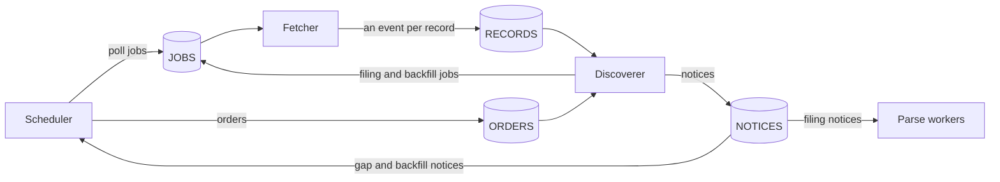
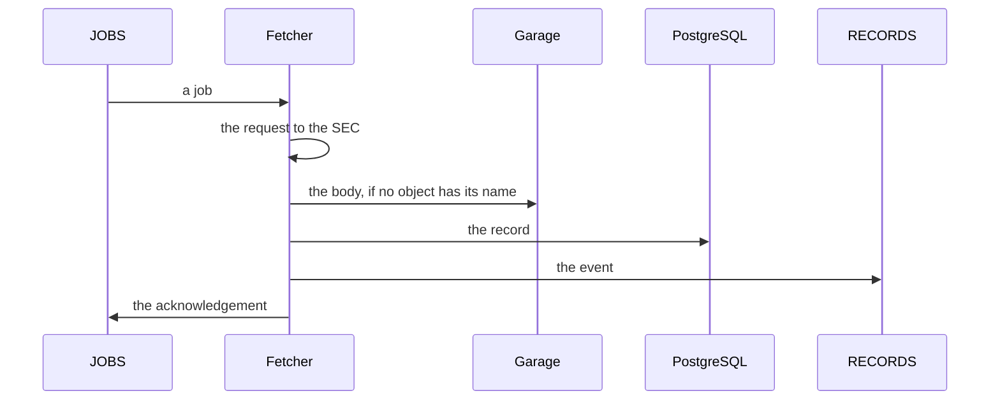

# NATS JetStream

<!-- status: NATS JetStream -->
**Status** ([status page](../status.md)): NATS JetStream: Specified.
<!-- end status -->

NATS JetStream carries the work the pipeline's services hand each other:
the jobs that ask the fetcher for a fetch, the events that announce each
record it adds, and the discoverer's orders and notices. This page explains
what each stream keeps and for how long, how a message is delivered and
acknowledged, how the three servers are deployed, how they fail, and why
JetStream was chosen.

## What it does for the pipeline

The services hand each other work as JSON messages in streams: each
publishes to a stream and reads the streams it needs, so work survives a
crashed pod or a restart, is acknowledged when it's done, and is delivered
again if a worker dies partway ([0003]). The pipeline's Go and Python
services meet only at these messages, the database's tables, and Garage's
objects, and each is a schema in `spec/schemas/` ([0006]): a job and an
event ([JOB-1]), an order and a notice ([MSG-1]).

The scheduler queues each Source's polls ([JOB-2]) and hands each Backfill
to the discoverer in an order ([ORDER-1]). The fetcher fetches what each
job asks for and announces each record with an event ([JOB-6]). The
discoverer reads every event and every order ([DISC-1]), queues the fetches
of each filing's files and each Backfill's lists ([FILE-2], [LIST-1]), and
publishes notices of filings, gaps, and Backfills' progress ([FILE-5],
[GAP-3], [LIST-5]). The scheduler reads the gap and backfill notices, and
sets each Source's and Backfill's status from them ([NOTICE-1],
[NOTICE-2]); the parse workers will read the filing notices, as the facts
specification will say ([notices, §9][streams]).

Each message carries its trace context in its NATS headers, not in its
body, so one trace follows a filing across the services without changing
any message's schema ([TRACE-1]; [Observability](observability.md#traces)).

## The streams and their retention

| Stream | Subjects | Published by | Read by | Kept |
| --- | --- | --- | --- | --- |
| `JOBS` | `edgar.jobs.poll`, `edgar.jobs.filing`, `edgar.jobs.backfill` | The scheduler, each poll ([JOB-2]); the discoverer, each fetch of a filing's files or a Backfill's ([JOB-3]) | The fetcher | As a work queue: until the fetcher acknowledges the job |
| `RECORDS` | `edgar.records.poll`, `edgar.records.filing`, `edgar.records.backfill` | The fetcher, an event for each record ([JOB-6]) | The discoverer ([DISC-1]) | Until each of the stream's consumers acknowledges the event |
| `ORDERS` | `edgar.orders.backfill` | The scheduler ([ORDER-1]) | The discoverer ([LIST-1]) | As a work queue: until the discoverer acknowledges the order |
| `NOTICES` | `edgar.notices.filing`, `edgar.notices.gap`, `edgar.notices.backfill` | The discoverer | The scheduler, gap and backfill notices; the parse workers, filing notices | Until each of the stream's consumers acknowledges the notice |

The first two streams are the snapshot store's ([jobs and events][JOB-1]);
the last two are the notices' ([notices, §9][streams]). A job's subject,
and its event's, end in the job's `kind`, and a notice's in its `kind`.

The two kinds of retention fit the two kinds of message. A job or an order
asks one service to do one thing, so it's kept until that service has done
it, and then dropped. An event or a notice tells whoever reads the stream
what happened, so it's kept until each consumer has read it. Either way a
stream holds only what some consumer hasn't acknowledged: it stays small
while its consumers keep up, and holds a backlog while one is stopped.

An interest stream keeps a message only for the consumers it has when the
message is published, and none for a consumer made later. So each service
that reads one needs its durable consumer before what it should see is
published ([durable consumers]). The notices list each consumer that has
to exist first ([notices, left to other specifications][notices-left]), and
the deployment makes them before any of the services that read them is
built ([NATS-5]). How the parse workers find the complete filings whose
notices they didn't read is left to the facts specification
([notices, left to other specifications][notices-left]).

### What the deployment specifies

The deployment's version 1.1.0 specifies the four streams, each kept in
files and replicated on all three servers ([NATS-3]):

| Stream | Retention | Storage | Replicas |
| --- | --- | --- | --- |
| `JOBS` | Work queue | File | 3 |
| `RECORDS` | Interest | File | 3 |
| `ORDERS` | Work queue | File | 3 |
| `NOTICES` | Interest | File | 3 |

It also specifies five durable consumers, which the same Job makes
([NATS-5]):

| Consumer | Stream | Subjects | Read by | Unacknowledged at most |
| --- | --- | --- | --- | --- |
| `discoverer-polls` | `RECORDS` | `edgar.records.poll` | The discoverer, poll events one at a time, in the stream's order ([DISC-1]) | 1 |
| `discoverer-jobs` | `RECORDS` | `edgar.records.filing`, `edgar.records.backfill` | The discoverer, the events of the jobs it queued ([DISC-1]) | JetStream's default |
| `discoverer-orders` | `ORDERS` | `edgar.orders.backfill` | The discoverer, the scheduler's orders ([LIST-1]) | JetStream's default |
| `scheduler-notices` | `NOTICES` | `edgar.notices.gap`, `edgar.notices.backfill` | The scheduler, gap and backfill notices ([NOTICE-1], [NOTICE-2]) | JetStream's default |
| `parse-workers-notices` | `NOTICES` | `edgar.notices.filing` | The parse workers, filing notices, as the facts specification will say | JetStream's default |

Each is a pull consumer, which every replica of its service reads from.
Each message it delivers is acknowledged on its own, and one not
acknowledged in time is delivered again, with no limit on how often, so a
service that stops partway through a message gets it again. Delivery
begins at the stream's first message, and each consumer has three
replicas, as its stream has, so its place in the stream survives the loss
of a node ([NATS-5], [NATS-6]).

Helm creates the umbrella chart's services, and waits for them to be ready,
before its hook Jobs run ([CHART-4]), so a service may publish before the
Job has made what it publishes to. JetStream refuses a message that no
stream's subjects take, so its publisher knows it wasn't kept; but an
interest stream accepts a message it has no consumer for, and keeps it for
none. So the Job makes each stream's consumers as soon as it has made the
stream, and gives an interest stream its subjects only once its consumers
exist. It makes the stream with only its name as its subject, then its
consumers, which may filter subjects their stream doesn't yet take, and
then gives the stream its subjects, so a message published to them sooner
is refused ([NATS-5]). That covers a gap notice the discoverer publishes,
when it starts, from polls the record already holds, which follows no
message ([GAP-3]): a new install has such polls when its database was
restored while NATS's data wasn't kept ([durable consumers]).

The Job also makes the streams in the order `NOTICES`, `RECORDS`, `ORDERS`,
`JOBS`. An event follows a job, and a notice follows an event or an order,
so neither an event nor a notice that follows a message is published
before its stream takes it, and neither is refused ([NATS-5]).

The fetcher's consumer of `JOBS` comes with the fetcher, in a later
version. `JOBS` is a work queue, which keeps a job until it's acknowledged,
so its consumer can come with its service ([deployment, §9][later]).

### Jobs that expire, and jobs that wait

A poll's job carries an `expires_at`, when its Source's next poll is due,
the time after which the fetch is no longer worth making ([JOB-2]). The
fetcher acknowledges a job that has expired when it takes it, without a
request or a record ([JOB-5]), and the record shows the missed slot as a
gap ([notices, §5][gaps]). A filing's and a Backfill's jobs have no
`expires_at` ([JOB-3]), so they wait however long fetching is paused or
stopped: the discoverer queues them whether or not requests are allowed,
and the fetcher sends none until they are ([notices, §7][files]).

The fetcher takes the job queued first of the first kind that has one
waiting: polls, then filings' fetches, then Backfills' ([JOB-4]). So a
Backfill never delays the record of new filings ([BACKFILL-2]), and the
polls, which the chart holds to half the fetcher's limit ([VAL-3]), leave
the other half to the rest.

## Delivery and acknowledgement

JetStream delivers a message again when its consumer doesn't acknowledge
it, so a message can arrive more than once, and every step is safe to
repeat ([0003]). Each consumer acknowledges a message only after it has
done all the message asks, in an order chosen so that a repeat does no
harm.

The fetcher stores the body, adds the record, publishes the event, and only
then acknowledges the job, each once the step before has succeeded
([JOB-6], [FETCH-14]):

Given a job whose record the table already holds, as after a redelivery,
the fetcher publishes that record's event again and acknowledges the job,
without a request, even if the job has expired ([JOB-6]). So a job is
fetched again only if its fetch wasn't recorded, and an event can arrive
twice, with the same `id`. The table holds each job's record once, since no
two records share a `job` ([STORE-1]).

The discoverer, for each message, adds the rows it calls for in one
transaction, leaving each row the record already holds as it is; then
publishes the jobs that message led to, unless their records exist; then
its notices; then acknowledges the message ([DISC-2]). A message delivered
again therefore adds nothing twice, and the jobs its first delivery queued
are published again, with the same `id`s, until they're fetched; the
fetcher fetches each once. It reads poll events one at a time, in the order
the stream holds them, so each Source's polls in the order the fetcher
published them ([DISC-1]). An event published again after a restart can
still arrive after a later poll's, and the bounds it gives a filing's first
sighting are then looser, though still bounds ([notices, §6][sightings]).

Beyond the order of steps, a repeat is harmless because of what things are
named by: bodies by their SHA-256, and filings by their accession numbers
([one filing, end to end][end-to-end]).

A consumer ignores fields it doesn't know, so a later version can add one
without breaking readers. It acknowledges a message that doesn't validate
against its schema, or whose `kind` isn't its subject's, without acting on
it ([JOB-7], [MSG-2]), and each service counts those it refuses
([Observability](observability.md#the-metrics-each-service-serves)).

What a reader of the record can rely on, across the streams and the
database together, is on [Delivery and
consistency](delivery-and-consistency.md).

## Three servers, each on a node of its own

NATS runs as one cluster of three servers with JetStream, each keeping
JetStream's file store on a claim of its own ([NATS-1]). The three need a
worker node each ([PLACE-1]), and the kind cluster has three ([KIND-1]), so
they run one on each ([PLACE-2]). The three form one cluster, and JetStream
reports all three in its meta group, with a leader ([NATS-2]). Each stream
is replicated on all three, so it keeps its messages and its leader through
the loss of a node ([NATS](../../spec/deployment.md#nats)), and so is each
durable consumer, so it keeps its place in its stream ([NATS-5]). That is
the reason for three: so the loss of a node can be shown ([the kind
cluster][KIND-1]).

A Job, run by Helm after each install and upgrade, creates each stream and
each durable consumer the umbrella chart's values list, or updates it to
their configuration, through JetStream's API. It waits until JetStream
accepts its requests, and succeeds when each stream and consumer already is
as the values say ([NATS-3], [NATS-5]), so running it again changes nothing
([NATS-4], [NATS-6]).

NATS comes from the chart its project maintains, `nats`, from
`https://nats-io.github.io/k8s/helm/charts/` ([CHART-2]), committed as a
package at an exact version ([PIN-1], [PIN-2]), with its images named by
digest ([PIN-4]). The umbrella chart installs it, last of the four releases
([Deployment](deployment.md#the-four-charts-and-their-order)).

The claims are of the umbrella chart's class `edgar-retained` ([VOL-2]),
which keeps a volume's data in the host directory when its claim is deleted
and names its directory after the claim ([VOL-1]). A new claim of the same
namespace and name finds the data, in the same cluster or in one recreated
with the same host directory ([VOL-3]), so the streams outlive the cluster
([deployment, §1][dep-guarantees]).

Of the credentials the umbrella chart's components use, the deployment's
version 1.1.0 lists none for NATS ([SECRET-1]), and no statement says which
service may publish or read which subject. Garage's keys and the database's
roles, by contrast, each let a service do only what its specification needs
([GARAGE-4], [PG-7]; [Security and access](security-and-access.md)).

> **Analysis.** No task, decision record, or specification covers this.
> NATS could give each service a user of its own, allowed to publish and
> subscribe only to the subjects its specification names, so that only the
> scheduler could queue a poll, and only the fetcher announce a record.

## How it scales

Records are bounded by the fetcher. The pipeline sends at most 5 requests a
second ([FETCH-6]), and each job leads to at most one record ([JOB-6]).
Events can outnumber records: a job delivered again whose record is held has
its event published again, with the same `id`, without a request ([JOB-6]),
so `RECORDS` can hold more events than there are records, by the
redeliveries. At the cadence each company's Source starts at, 10 seconds,
the three companies' polls are 0.3 requests a second and 25,920 records a
day ([0010]): as many poll jobs in `JOBS`, and as many events in `RECORDS`,
besides those published again. An event carries the record, not the body
([jobs and events][JOB-1]), which stays in Garage, so a message's size
doesn't grow with what was fetched.

Jobs can be queued faster than the fetcher sends them. The discoverer
queues the fetches of a Backfill's filings as it reads each list
([LIST-2]), and at 5 requests a second a backfill of every filing a
company's `submissions` lists takes from 15.6 minutes for Apple to at least
30.7 for Microsoft ([SRC-20]). Those jobs wait in `JOBS`, behind the polls
and new filings' fetches ([JOB-4]). While their consumers keep up, the
streams hold a few messages; while one is down, they grow by what it would
have taken, such as 29 to 36 MB of events a day while the discoverer is
down, at the default scope ([estimates](estimates.md#the-queues-streams)).

The consumers scale differently. The fetcher can't scale out: one replica
is active, through a Lease, so that the limit holds across the cluster
([0005]). The discoverer reads poll events one at a time ([DISC-1]). The
parse workers are to scale by their queue's depth ([components]), and how
they do is a decision record still to come, task T10 ([plan][plan-facts]).
Queue depth, redeliveries, and consumer lag are the metrics the workers are
scaled by ([0003]). Of these, telemetry's version 0.1.0 gives the jobs
`JOBS` holds of each kind, which the active fetcher serves ([METRIC-4]);
NATS's own metrics of its streams and consumers come in a later version
([telemetry, left to other specifications][telemetry-left]).

## How it fails

How each failure plays out across the whole pipeline is on [Failures and
recovery](failures-and-recovery.md). For the streams:

| What fails | What happens |
| --- | --- |
| One server, or its node | The other two keep each replicated stream, with its messages and a leader, and the pipeline goes on ([deployment, §1][dep-guarantees]). |
| A consumer's pod, partway through a message | The message isn't acknowledged, so it's delivered again, and the steps above make the repeat harmless ([DISC-1], [DISC-2], [JOB-6]). |
| The active fetcher | Jobs wait in `JOBS` until the standby takes the Lease over. Poll jobs that expire meanwhile are acknowledged without a request ([JOB-5]). Decision 0005 records every handover as a gap ([0005]); the notices' specification gives a gap only where the handover misses a poll ([notices, §5][gaps]). |
| JetStream, for the scheduler | A poll that can't be queued before the next one is due is skipped ([SOURCE-2]) and counted ([METRIC-3]); its slot holds no successful poll, so the record shows a gap ([notices, §5][gaps]). |
| All three servers, restarted | The streams are kept in files on retained claims ([NATS-1], [VOL-3]), so queued work survives the restart ([outages and recovery][outages]). |
| A consumer that doesn't exist yet | An interest stream would keep nothing for it, which is why the Job makes each stream's durable consumers right after the stream, and gives an interest stream its subjects only once they exist, so a message published sooner is refused, not lost ([NATS-5], [NATS-6]). |
| A malformed message | It's acknowledged without being acted on, and counted ([JOB-7], [MSG-2]). |

Decision 0003 expects fetching to go on while PostgreSQL fails over, with
the parse workers' work waiting in its stream until the database is back
([0003]). The fetcher's own steps pass through the database, though: it
adds each record before it publishes the event and acknowledges the job
([JOB-6]), and no statement yet says what it does while the database can't
take a record.

## What it depends on

- **Three worker nodes,** one for each server ([KIND-1], [PLACE-1]), and
  the class `edgar-retained`, which keeps each server's file store in the
  host directory ([VOL-1], [KIND-2]).
- **The umbrella chart,** which installs NATS and runs the Job that creates
  the streams and their durable consumers ([NATS-3], [NATS-5]).
- **Nothing else of the pipeline's.** The scheduler, the fetcher, the
  discoverer, and the parse workers depend on it; it depends on none of
  them.

## Where it's specified

| Statement | What it says | Checked by |
| --- | --- | --- |
| [NATS-1] | NATS is a cluster of three servers, with JetStream's file store on claims. | tests |
| [NATS-2] | The three form one JetStream cluster, with a leader. | kind |
| [NATS-3] | A hook Job creates or updates `JOBS`, `RECORDS`, `ORDERS`, and `NOTICES`, each in files with three replicas. | tests |
| [NATS-4] | Each stream is as the values say, on all three servers, and the Job can run again. | kind |
| [NATS-5] | The Job creates or updates the five durable consumers, each right after its stream and before a stream kept by interest takes its subjects, with `NOTICES` first and `JOBS` last. | tests |
| [NATS-6] | Each consumer is as the values say, on all three servers, and the Job can run again; a stream kept by interest refuses a message, or keeps it for each consumer, while the Job makes it. | kind |
| [PLACE-1], [PLACE-2] | Each server needs a worker node of its own, and runs on one. | tests, kind |
| [VOL-2], [VOL-3] | Its claims are of `edgar-retained`, whose data a new claim of the same name finds. | tests, kind |
| [CHART-2], [PIN-1], [PIN-2], [PIN-4] | NATS's chart, from its project's repository, at an exact version, committed, with its images by digest. | tests |
| [JOB-1] | The schemas of a job and an event. | tests |
| [JOB-2], [JOB-3] | Which service queues which jobs, and which expire. | tests |
| [JOB-4] | The fetcher takes polls first, then filings' fetches, then Backfills'. | kind |
| [JOB-5] | An expired job without a record is acknowledged without a request. | kind |
| [JOB-6] | The record, then the event, then the acknowledgement; a recorded job isn't fetched again. | kind |
| [JOB-7], [MSG-2] | Consumers ignore unknown fields, and acknowledge a malformed message without acting on it. | kind, tests |
| [MSG-1] | The schemas of an order and a notice. | tests |
| [DISC-1], [DISC-2] | The discoverer reads every event and order, poll events in order, and acknowledges each once its rows, jobs, and notices are done. | tests |
| [TRACE-1] | Each message carries its trace context in its headers. | tests |

The charts and their tests are task T20's, which isn't done
([plan][plan-observing]).

## The alternatives decision 0003 weighed

| Option | What the record says of it | Outcome |
| --- | --- | --- |
| NATS JetStream | One small Go binary, with durable streams, acknowledgements and redelivery, work-queue retention, and a key-value store; its project maintains a Helm chart. Apache 2.0, in the CNCF: in 2025 its steward, Synadia, sought to take it out of the CNCF and relicense it, and the dispute was settled in May 2025 with NATS staying in the CNCF under Apache 2.0. | Chosen, with three replicas and its streams on persistent volumes. |
| Kafka or Redpanda | Durable logs built for far larger volumes; heavier to run, with more memory than the pipeline needs. | Rejected. |
| RabbitMQ | Quorum queues, on the Erlang VM, with more memory than NATS. | Rejected. |
| A queue in PostgreSQL, with `SELECT ... FOR UPDATE SKIP LOCKED` | No new component, but fetching would stop whenever the database fails over or is down, and the database would carry the polling load. | Rejected. |

Memory weighed in each, since kind's nodes share one machine ([0001],
[0003]). The record's consequences are fetching that continues while
PostgreSQL fails over, queue depth, redeliveries, and consumer lag as the
metrics workers scale by, and steps that are safe to repeat ([0003]).

[0001]: ../decisions/0001-deploy-on-kubernetes-with-helm-on-kind.md
[0003]: ../decisions/0003-queue-work-in-nats-jetstream.md
[0005]: ../decisions/0005-send-sec-requests-through-one-active-fetcher.md
[0006]: ../decisions/0006-write-the-services-in-go-and-python.md
[0010]: ../decisions/0010-poll-each-companys-submissions-and-measure-lag-from-the-record.md
[components]: ../design.md#components
[end-to-end]: ../design.md#one-filing-end-to-end
[outages]: ../design.md#outages-and-recovery
[plan-observing]: ../plan.md#observing-filings
[plan-facts]: ../plan.md#facts
[SRC-20]: ../../investigation/edgar.md#findings-so-far
[BACKFILL-2]: ../../spec/controls.md#7-backfill
[SOURCE-2]: ../../spec/controls.md#6-source
[VAL-3]: ../../spec/controls.md#5-the-charts-values
[CHART-2]: ../../spec/deployment.md#5-dependencies
[CHART-4]: ../../spec/deployment.md#5-dependencies
[dep-guarantees]: ../../spec/deployment.md#1-guarantees
[durable consumers]: ../../spec/deployment.md#durable-consumers
[GARAGE-4]: ../../spec/deployment.md#garage
[KIND-1]: ../../spec/deployment.md#the-kind-cluster
[KIND-2]: ../../spec/deployment.md#the-kind-cluster
[later]: ../../spec/deployment.md#9-later-versions
[NATS-1]: ../../spec/deployment.md#nats
[NATS-2]: ../../spec/deployment.md#nats
[NATS-3]: ../../spec/deployment.md#nats
[NATS-4]: ../../spec/deployment.md#nats
[NATS-5]: ../../spec/deployment.md#durable-consumers
[NATS-6]: ../../spec/deployment.md#durable-consumers
[PG-7]: ../../spec/deployment.md#the-stores-database
[PIN-1]: ../../spec/deployment.md#6-pins
[PIN-2]: ../../spec/deployment.md#6-pins
[PIN-4]: ../../spec/deployment.md#6-pins
[PLACE-1]: ../../spec/deployment.md#placement
[PLACE-2]: ../../spec/deployment.md#placement
[SECRET-1]: ../../spec/deployment.md#credentials
[VOL-1]: ../../spec/deployment.md#volumes
[VOL-2]: ../../spec/deployment.md#volumes
[VOL-3]: ../../spec/deployment.md#volumes
[DISC-1]: ../../spec/notices.md#processing
[DISC-2]: ../../spec/notices.md#processing
[FILE-2]: ../../spec/notices.md#7-a-filings-files
[FILE-5]: ../../spec/notices.md#7-a-filings-files
[files]: ../../spec/notices.md#7-a-filings-files
[GAP-3]: ../../spec/notices.md#5-polls-coverage-and-gaps
[gaps]: ../../spec/notices.md#5-polls-coverage-and-gaps
[LIST-1]: ../../spec/notices.md#8-backfills
[LIST-2]: ../../spec/notices.md#8-backfills
[LIST-5]: ../../spec/notices.md#8-backfills
[MSG-1]: ../../spec/notices.md#streams
[MSG-2]: ../../spec/notices.md#streams
[NOTICE-1]: ../../spec/notices.md#8-backfills
[NOTICE-2]: ../../spec/notices.md#8-backfills
[notices-left]: ../../spec/notices.md#left-to-other-specifications
[ORDER-1]: ../../spec/notices.md#8-backfills
[sightings]: ../../spec/notices.md#6-when-each-source-first-showed-each-filing
[streams]: ../../spec/notices.md#streams
[FETCH-6]: ../../spec/snapshots.md#10-fetching
[FETCH-14]: ../../spec/snapshots.md#10-fetching
[JOB-1]: ../../spec/snapshots.md#jobs-and-events
[JOB-2]: ../../spec/snapshots.md#jobs-and-events
[JOB-3]: ../../spec/snapshots.md#jobs-and-events
[JOB-4]: ../../spec/snapshots.md#jobs-and-events
[JOB-5]: ../../spec/snapshots.md#jobs-and-events
[JOB-6]: ../../spec/snapshots.md#jobs-and-events
[JOB-7]: ../../spec/snapshots.md#jobs-and-events
[STORE-1]: ../../spec/snapshots.md#the-cluster-store
[METRIC-3]: ../../spec/telemetry.md#the-scheduler
[METRIC-4]: ../../spec/telemetry.md#the-fetchers-clock
[telemetry-left]: ../../spec/telemetry.md#left-to-other-specifications
[TRACE-1]: ../../spec/telemetry.md#9-traces
