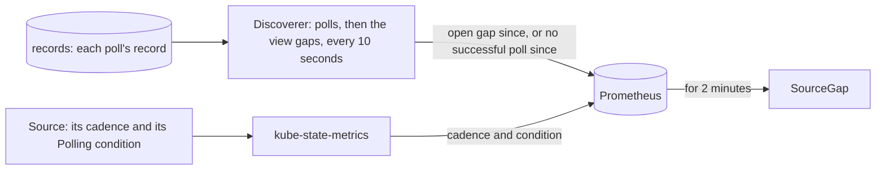
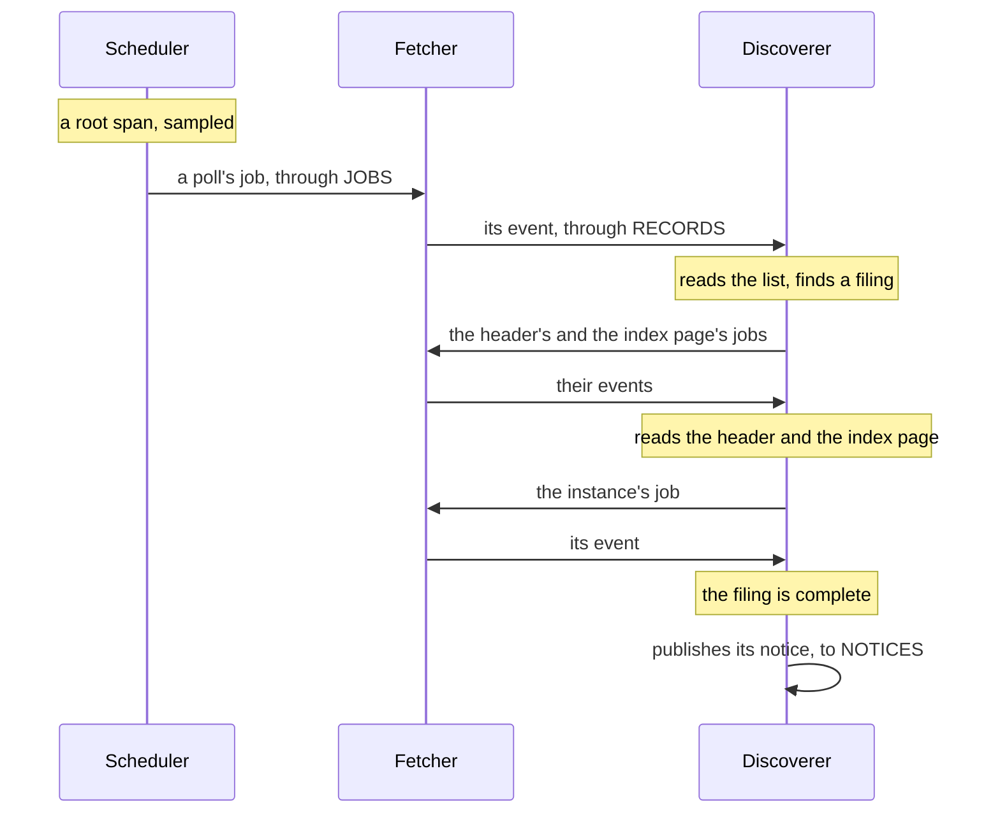

# Observability

<!-- status: Monitoring: metrics, alerts, and dashboards; Monitoring: traces -->
**Status** ([status page](../status.md)): Monitoring: metrics, alerts, and dashboards: Decided; specified in part; built in part. Monitoring: traces: Specified.
<!-- end status -->

This page explains what the pipeline reports about itself while it observes
filings: the metrics each service serves, the controls' state that
kube-state-metrics exports, the alerts, the views of the record that
Grafana reads, and the traces carried through NATS, each with the question
it answers. The stack that collects them is on [Monitoring](monitoring.md).

## What the pipeline reports, and what's still to come

The design lists what the pipeline reports ([monitoring]). The telemetry's
version 0.1.0 specifies the part that concerns observing filings: the
scheduler, the fetcher, and the discoverer, and the record they keep
([telemetry]). The rest waits for later versions.

| The design asks for | Where it's served | Specified by |
| --- | --- | --- |
| For each source, polls that succeeded and failed, and the time since the last success | `edgar_fetcher_polls_total`, by outcome; each Source's `edgar_source_last_successful_poll_time_seconds` | [METRIC-4], [STATE-1] |
| For each filing and each source, the delay from acceptance to first seen | The view `lags` | [VIEW-6] |
| Open gaps and their lengths | `edgar_discoverer_open_gap_since_seconds`; each Source's `edgar_source_open_gap_since_seconds`; the view `gaps` | [METRIC-5], [STATE-1], [VIEW-5] |
| Queue depth, redeliveries, and consumer lag | The jobs `JOBS` holds of each kind, `edgar_fetcher_jobs_held`. NATS's own metrics of its streams and consumers come later. | [METRIC-4]; [later versions][telemetry-left] |
| The fetcher's request rate, retries, `403`s, and which pod holds the Lease | `edgar_fetcher_requests_total`, by status; `edgar_fetcher_fetches_total`; `edgar_fetcher_leader` | [METRIC-4] |
| The database's replication lag, failovers, and the age of its last backup | The latest base backup's time, from the Barman Cloud plugin's metrics. Replication and failovers come later. | [ALERT-3]; [later versions][telemetry-left] |
| Each Source's status and each Backfill's progress | kube-state-metrics | [STATE-1] |
| Each filing's times from acceptance to facts available | A view still to come, with the parse workers', the query API's, and the exporter's metrics and traces | Task T32 ([facts][telemetry-left]) |

Telemetry carries no secret and adds nothing to the requests sent to the
SEC: no credential, user agent, or request header in a label or a span, and
no trace context in a request ([telemetry, §1][telemetry-guarantees]).

## The metrics each service serves

Every replica of each service serves its metrics in Prometheus's text
format, at `/metrics` on its container port named `metrics`, from when it
starts, whether or not it's the active replica ([METRIC-1]). Each replica
counts only what it did itself since it started, so a dashboard sums a
counter's rates over the replicas ([§4 of the telemetry][metrics]). A
metric's name begins `edgar_` and the service's name, a counter's ends
`_total`, and a time is in seconds.

Each label takes only values from a small set: a Source's name or URL, a
Backfill's name, a stream's subject, an HTTP status, and a few values a
metric names. No label carries an accession number, a job's or a record's
`id`, a URL other than a Source's, the user agent, a credential, or a
request header ([METRIC-2]). So the number of series grows with the
Sources, not with the filings, and nothing secret reaches Prometheus.

### The scheduler

| Metric | The question it answers |
| --- | --- |
| `edgar_scheduler_leader` | Which replica is active? 1 while this one is, and 0 otherwise. |
| `edgar_scheduler_polls_queued_total`, by `source` | Is each Source being polled? Its rate is about one poll a cadence. |
| `edgar_scheduler_polls_skipped_total`, by `source` | Are polls missed because the scheduler couldn't queue one before the next was due ([SOURCE-2])? |
| `edgar_scheduler_orders_total` | Has the scheduler handed each Backfill to the discoverer ([ORDER-1])? |
| `edgar_scheduler_messages_refused_total`, by `subject` | Has it received notices it couldn't act on, because they didn't validate ([MSG-2])? |

The scheduler serves these ([METRIC-3]).

### The fetcher

| Metric | The question it answers |
| --- | --- |
| `edgar_fetcher_leader` | Which pod holds the fetcher's Lease ([FETCH-16])? |
| `edgar_fetcher_requests_total`, by `kind` and `code` | How fast is the pipeline asking the SEC, and how does the SEC answer? Each attempt of each fetch ([FETCH-8]), by its job's kind and the response's status, or `none` if no response arrived. Its rate is at most 5 a second ([FETCH-6]), and `403`s and `429`s show by code. |
| `edgar_fetcher_fetches_total`, by `kind` and `outcome` | How many fetches named a version, and how many didn't? One for each record added ([FETCH-14]). |
| `edgar_fetcher_polls_total`, by `source` and `outcome` | Of those, is each Source's poll succeeding? |
| `edgar_fetcher_jobs_expired_total` | How many jobs had expired when the fetcher took them, and were acknowledged without a request ([JOB-5])? |
| `edgar_fetcher_jobs_held`, by `kind` | How deep is the queue? The jobs of each kind that `JOBS` holds, waiting or being fetched, as JetStream counted them at most 10 seconds before. Only the active replica serves it. |
| `edgar_fetcher_clock_skew_seconds` | How far is the fetcher's clock from the SEC's? [Below](#the-fetchers-clock). |
| `edgar_fetcher_messages_refused_total`, by `subject` | How many jobs didn't validate, or had a kind other than their subject's ([JOB-7])? |

Each fetch adds one record, so its retries are its requests less one, and
the rate of retries is the rate of requests less the rate of fetches ([§4
of the telemetry][fetcher-metrics]). The fetcher serves these ([METRIC-4]).

### The fetcher's clock

Every lag is measured by the fetcher's clock ([0010]), so the fetcher
checks its clock against each response's `Date`. A server stamps `Date`
with the second in which it generated the response, at some moment after
the request was sent and before the response arrived. If `D` is the start
of that second, the fetcher's clock was ahead of the server's by more than
`requested_at − D − 1` seconds, and by at most `received_at − D`. The skew
is the value of that range nearest zero ([METRIC-4]):

`max(requested_at − D − 1, min(0, received_at − D))`

For a request sent at 12:00:00.300 by the fetcher's clock, whose response
arrived at 12:00:00.500:

| `Date` | The range | The skew |
| --- | --- | --- |
| 12:00:00 | More than −0.7, at most 0.5 | 0: the clocks may agree |
| 11:59:58 | More than 1.3, at most 2.5 | 1.3: the fetcher's clock is ahead |
| 12:00:02 | More than −2.7, at most −1.5 | −1.5: the fetcher's clock is behind |

The metric is absent until the fetcher receives a response with a `Date`.
Whether the SEC's `Date` is when it generated each response is still to be
shown: a cache could serve an older `Date`, which would read as the
fetcher's clock running ahead. So the skew is shown and not alerted on,
until a finding shows it ([telemetry, open question 1][questions]).

### The discoverer

| Metric | The question it answers |
| --- | --- |
| `edgar_discoverer_messages_total`, by `subject` | Is it keeping up with the events and orders it acts on ([DISC-1])? |
| `edgar_discoverer_messages_refused_total`, by `subject` | How many did it acknowledge without acting on them, because they didn't validate ([MSG-2])? |
| `edgar_discoverer_readings_total`, by `kind` and `outcome` | Can it read what was fetched? Readings of lists, headers, and index pages, and how many had an error ([SEEN-1], [FILE-3], [LIST-2]). |
| `edgar_discoverer_sightings_total`, by `source` and `bounded` | How many filings did each Source show, and of those, how many with a poll before that didn't show them, so that their lag is bounded ([SEEN-2])? |
| `edgar_discoverer_jobs_queued_total`, by `kind` and `file` | Which fetches did it queue: headers, index pages, instances, and Backfills' lists? |
| `edgar_discoverer_jobs_failed_total`, by `kind` and `file` | How many fetches of filings' files, or of Backfills' lists, ended without a version ([FILE-4], [LIST-3])? |
| `edgar_discoverer_notices_total`, by `kind` | How many notices of filings, gaps, and Backfills' progress did it publish? |
| `edgar_discoverer_open_gap_since_seconds`, by `source` and `url` | Since when has each Source and URL had an open gap ([GAP-2])? Absent for one with none. |
| `edgar_discoverer_no_successful_poll_since_seconds`, by `source` and `url` | For a Source and URL none of whose polls has succeeded, since when has it been failing? When its first poll's job expired ([GAP-1]). Absent once a poll succeeds. |

At least every 10 seconds, the discoverer reads the open gaps from the view
`gaps`, and the Sources and URLs without a successful poll, and sets the
last two gauges from what it reads ([METRIC-5]). The second gauge exists
because a gap begins only after a successful poll ([GAP-2]): a Source whose
URL fails from its first poll, or a cluster that can't reach the SEC, has
no gap to report ([§7 of the telemetry][alerts]).

## The controls' metrics

kube-state-metrics exports the state of the three resources from their
fields, each as a gauge, with timestamps as Unix time, to the second
([STATE-1]). A condition's metric is 1 while its status is `True`.

| Resource | Metrics | The questions they answer |
| --- | --- | --- |
| Source, by `namespace`, `source`, and `url` | `edgar_source_cadence_seconds`, `edgar_source_paused`, `edgar_source_last_poll_time_seconds`, `edgar_source_last_successful_poll_time_seconds`, `edgar_source_open_gap_since_seconds`, `edgar_source_condition` | What cadence does each Source hold, and is it paused? When was it last polled, and last polled successfully? Since when has it had an open gap? Is it polling, and if not, why: no SecAccess, requests stopped, requests paused, or the Source paused? Are the Sources together within the budget ([SOURCE-1], [SOURCE-3])? |
| Backfill, by `namespace` and `backfill` | `edgar_backfill_filings`, `edgar_backfill_filings_fetched`, `edgar_backfill_filings_failed`, `edgar_backfill_start_time_seconds`, `edgar_backfill_completion_time_seconds`, `edgar_backfill_condition` | How many filings are in its range, and how many fetched or failed? When did it start, and is it complete ([BACKFILL-3])? |
| SecAccess, by `secaccess` | `edgar_secaccess_paused`, `edgar_secaccess_stop_time_seconds`, `edgar_secaccess_acknowledged_stop_time_seconds` | Are requests to the SEC paused? Has a `403` stopped them, and has the owner acknowledged that stop ([ACCESS-3])? |

The stop and its acknowledgement also carry their time as the label `at`,
to the millisecond, as the SecAccess holds it. Each timestamp has one form,
so the two are the same instant exactly when their `at` labels are equal,
though their values, to the second, can be equal when they aren't ([§5 of
the telemetry][state]).

A status is a summary for people; the record in PostgreSQL stays
authoritative ([0007]).

## What Prometheus scrapes

The umbrella chart renders a `PodMonitor` for each service, which scrapes
`/metrics` on its pods' port named `metrics`, and one for the database's
instances, each of which serves the Barman Cloud plugin's metrics
([SCRAPE-1]). kube-prometheus-stack already scrapes kube-state-metrics. On
kind, every replica of each service, every instance of the database, and
kube-state-metrics are scraped, and each target is up ([SCRAPE-2]).

## The alerts

| Alert | `severity` | Fires | `for` |
| --- | --- | --- | --- |
| `SecRequestsStopped` | `critical` | While the SecAccess has a stop the owner hasn't acknowledged | None |
| `SourceGap` | `warning` | For each Source that's polling, while its URL has an open gap longer than its cadence, or no successful poll though its first poll's job expired more than its cadence ago | 2 minutes |
| `DatabaseBackupStale` | `warning` | While the database's latest base backup is more than a day old, or it has none | 1 hour |

The umbrella chart renders these three in `PrometheusRule` resources, and
no other alert of its own ([ALERT-4]), and each is tested with
`promtool test rules` ([0008]). Alertmanager sends nothing outside the
cluster, so each shows in Grafana and Alertmanager
([Monitoring](monitoring.md#alertmanager-with-no-receiver-outside-the-cluster)).

### `SecRequestsStopped`: requests stopped after a `403`

A `403` stops every request to the SEC until the owner acknowledges it
([ACCESS-3]), so the alert fires from the stop until the acknowledgement,
not only at the `403`. It fires while `edgar_secaccess_stop_time_seconds`
is served and no `edgar_secaccess_acknowledged_stop_time_seconds` with the
same `at` is ([ALERT-1]), so an acknowledgement that differs from the stop
only in its milliseconds leaves it firing. The owner acknowledges a stop by
copying its `at` into the chart's values, as
`controls.secAccess.acknowledgedStopAt`, and running `helm upgrade` ([§8 of
the controls][secaccess]).

### `SourceGap`: a Source that isn't covered

`SourceGap` fires for a Source and URL once, for 2 minutes, its open gap
has begun longer ago than the Source's cadence, or, where it has no gap,
its first poll's job expired longer ago than that without a successful
poll, while the Source's `Polling` condition is true. Each gauge is taken
at its greatest across the discoverer's replicas ([ALERT-2]).

What it doesn't cover, and why ([§7 of the telemetry][alerts]):

- **A Source that isn't polling,** because the owner paused it or requests
  are paused or stopped. The record still shows each such gap, and a stop
  has its own alert.
- **The moments after polling resumes,** before the first poll closes the
  gap, which the 2 minutes cover.
- **A gap that ended before the rule found it open.** It shows in the views
  and the dashboards.
- **A Source and URL with no poll at all,** such as a new Source, a
  Source's new URL, or a new install whose fetcher never fetches. Its jobs
  expire unfetched without records ([JOB-5]), so the discoverer serves
  neither gauge for it. An alert on it waits for a later version of the
  telemetry, once the owner adds a task for it.

### `DatabaseBackupStale`: no recent backup

It fires once, for an hour, the latest base backup in Garage, as the
greatest `barman_cloud_cloudnative_pg_io_last_available_backup_timestamp`
the database's instances serve, or 0 before the first, has been more than
86,400 seconds old ([ALERT-3]). A daily base backup finishes some minutes
after the one before it turns a day old, and the hour lets it ([PG-4], [§7
of the telemetry][alerts]).

## The views Grafana reads

Grafana reads the record from PostgreSQL, through its own role, `grafana`,
which may read only the views made for the dashboards ([VIEW-3], [PG-11]),
from the database's replicas ([MON-5]). They're in the schema
`dashboards`, and they read the notices' tables and views, so a dashboard
shows what the record holds by the same definitions the notices use
([VIEW-1], [VIEW-2]). Each time is as the record holds it, and each length
is in seconds.

| View | One row for each | The question it answers |
| --- | --- | --- |
| `coverage` | Stretch of a Source's coverage of a URL, between its gaps | When was the pipeline looking? |
| `gaps` | Gap in a Source's coverage of a URL, ended or open, with its length | When wasn't it, and for how long? |
| `lags` | Sighting whose lag the record bounds | How soon after acceptance did each Source show each filing? |

**Coverage and gaps.** A stretch of coverage begins at the request of a
Source's first successful poll of a URL, or of the poll that ended a gap,
and ends where the next gap began, or, with none after it, when the job of
its latest successful poll expired ([VIEW-4]). A gap runs from when a
successful poll's job expired to the request of the next successful poll,
when that one doesn't follow it; an open gap's length runs to when the view
is read ([VIEW-5]). Both follow one definition, the notices' ([GAP-2]): a
missed poll leaves a gap of about a cadence, and a pause, a stop after a
`403`, or a fetcher's handover that misses a poll leaves a gap until
polling resumes ([§5 of the notices][notices-gaps]).

**Lags.** A Source first showed a filing after the request of its last poll
that didn't show it was sent, and by the time the response of the first
that did arrived ([SEEN-3]). So each lag, from an acceptance time to when
the Source first showed the filing, is more than its low bound and at most
its high bound ([§10 of the notices][notices-lags]):

| Bound | From |
| --- | --- |
| Low | The `requested_at` of the last poll that didn't show it, less the acceptance time |
| High | The `received_at` of the first poll that did, less the acceptance time |

The view gives both bounds from each of the filing's two acceptance times
([VIEW-6]):

- **From `submissions`' `acceptanceDateTime`,** read as the instant it
  states ([SRC-25]): `listed_lag_low_seconds` and `listed_lag_high_seconds`.
- **From the header's `ACCEPTANCE-DATETIME`,** 14 digits that give no time
  zone ([SRC-1]), read as US Eastern time: `header_lag_low_seconds` and
  `header_lag_high_seconds`.

Read so, each of the three companies' `submissions` gives a filing's time
later than its header's by the Eastern offset on its date, 4 hours in
daylight time and 5 in standard time ([SRC-25]). So a filing's lags from
`submissions`' time are shorter than those from its header by that offset,
until a finding settles which is right ([§10 of the notices][notices-lags]).
The lags can settle it: a filing is public only once it's accepted, so a
time from which a lag's high bound falls below zero isn't when the filing
was accepted ([open question 2 of the notices][notices-open]).

The view also says whether a gap lies between the two polls, which widens
the bounds. It gives only the sightings with a last poll that didn't show
the filing: a filing a Source shows at its first poll whose list is read
has no low bound, since the record doesn't say how long the Source had
shown it ([VIEW-6], [§6 of the notices][notices-sightings]).

The dashboards over these views are task T28's ([plan][plan-observing]).

## Traces

One trace follows each filing ([0008]). A Source's poll starts a trace,
which its fetch, the discoverer's reading of the list, and each filing the
list first shows join: the fetches of the filing's files, their readings,
and the filing's notice. Two filings a poll first shows share its trace
([§9 of the telemetry][traces]).

Each message carries its trace context in its NATS headers, `traceparent`,
and `tracestate` if the span has one, not in its body, so jobs, events,
orders, and notices are as their schemas have them. Each is published by a
span of its own, which publishes no other message and acts on none
([TRACE-1]). A service that acts on a message makes its span a child of the
context the message carries, or a sampled root if it carries none, and
publishes the messages that follow from it by children of that span
([TRACE-3]).

A trace starts wherever a message is published while acting on no other:
each poll and each order the scheduler publishes ([TRACE-2]), and each gap
notice the discoverer publishes from its reading of `gaps` or when it
starts ([TRACE-8]). A Backfill's order starts a trace for its lists, and
each of its filings gets a trace of its own, linked to the span of the
list's event that named it, so a Backfill of thousands of filings isn't one
trace. When the list's event is delivered again and the discoverer
publishes the filing's jobs again, the filing gets another trace, linked to
the same list, so its fetches can be split across two traces ([TRACE-4]).

Each span that publishes or acts on a message carries the message's
identity ([TRACE-5]):

| Attribute | Value |
| --- | --- |
| `edgar.job.id`, `edgar.job.kind` | A job's `id` and `kind`, or an event's job's |
| `edgar.source` | A job's Source, an event's job's, or a gap notice's |
| `edgar.backfill` | A job's Backfill, an event's job's, an order's, or a backfill notice's |
| `edgar.record.id` | An event's `id` |
| `edgar.accession_number` | A filing notice's filing; and on the discoverer's spans of a job of a filing's file, and of its event, that filing |

No span carries the user agent, a credential, or a request header
([TRACE-5]), and the fetcher sends the SEC no trace context: none of its
requests has a `traceparent`, `tracestate`, or `baggage` header
([TRACE-6]). A service exports its spans by OTLP to the endpoint
`OTEL_EXPORTER_OTLP_ENDPOINT` gives, and none while it's unset, carrying
trace context all the same ([TRACE-7]), so traces are carried before Tempo
is installed ([Monitoring](monitoring.md#traces-tempo-next)). The parse
workers will continue each filing's trace to its facts, as the facts
specification will say ([§9 of the telemetry][traces]).

## Open questions

The telemetry's own ([§11 of the telemetry][questions]):

1. **Whether the SEC's `Date` is when it generated each response.** Until a
   finding shows it, the fetcher's clock skew is shown and not alerted on;
   once one does, a minor version adds an alert on it. The records of the
   investigation's refetches keep each `date` beside its `requested_at` and
   `received_at`, so a finding can show it ([REC-10]).
2. **How often the cluster store is checked against [STORE-3] in operation,
   and the alert on a problem.** No component checks it yet. A later
   version specifies the check, such as a CronJob that reads the bucket and
   the table, its metrics, and its alert.
3. **Sampling.** Every trace is sampled. At the cadence each company's
   Source starts at, the polls start 25,920 traces a day, most of which
   find no filing. If Tempo's volume calls for it, a later version samples
   them, through a collector between the services and Tempo.
4. **The views' cost.** `coverage` and `gaps` read every poll, about 9.5
   million a year at the starting cadence. How fast the dashboards read
   them is measured on kind, and a later version adds an index or a stored
   summary of each day, if they slow.

Left to later versions and other specifications ([§11 of the
telemetry][telemetry-left]): the platform's own metrics, NATS's streams and
consumers, Garage's, and the database's replication and failovers, with
their alerts; an alert on a Source and URL with no poll at all; logs, in
Loki; the facts' metrics, traces, and view; and, for the deployment,
kube-state-metrics' access to the definitions, and Tempo, which later
versions of the deployment add ([§9 of the deployment][deployment-later]).
The deployment's version 1.1.0 gives the rest it left to the deployment:
Grafana's database role and data source, and the views' grants ([PG-11],
[PG-13], [MON-5]).

## Where it's specified

| Statement | What it says | Checked by |
| --- | --- | --- |
| [METRIC-1], [METRIC-2] | Every replica serves its metrics; labels take only their listed values. | tests |
| [METRIC-3], [METRIC-4], [METRIC-5] | The scheduler's, the fetcher's, and the discoverer's metrics. | tests |
| [STATE-1] | kube-state-metrics exports the controls' fields, and nothing else under their names. | kind |
| [SCRAPE-1], [SCRAPE-2] | A `PodMonitor` for each service and the database's instances; every target scraped. | tests, kind |
| [ALERT-1], [ALERT-2], [ALERT-3] | When each alert fires. | tests |
| [ALERT-4] | The chart renders the three alerts, and no other of its own. | tests |
| [VIEW-1], [VIEW-2], [VIEW-3] | `dashboards.sql` defines the views; the database holds them; Grafana reads only them. | tests, kind |
| [VIEW-4], [VIEW-5], [VIEW-6] | What `coverage`, `gaps`, and `lags` give. | kind |
| [TRACE-1] to [TRACE-8] | Trace context in headers, where traces start, links for Backfills, attributes, nothing to the SEC, and export. | tests, kind |

[VIEW-1]'s tests come with the telemetry's version 0.1.0. The trace
statements' tests are task T29's, and the others' T28's, which brings the
monitoring of observing filings ([§3 of the telemetry][ids];
[plan][plan-observing]).

[0007]: ../decisions/0007-control-the-pipeline-through-custom-resources.md
[0008]: ../decisions/0008-monitor-with-prometheus-and-grafana-then-tempo-and-loki.md
[0010]: ../decisions/0010-poll-each-companys-submissions-and-measure-lag-from-the-record.md
[monitoring]: ../design.md#monitoring
[plan-observing]: ../plan.md#observing-filings
[SRC-1]: ../../investigation/edgar.md#findings-so-far
[SRC-25]: ../../investigation/edgar.md#findings-so-far
[ACCESS-3]: ../../spec/controls.md#8-secaccess
[BACKFILL-3]: ../../spec/controls.md#7-backfill
[secaccess]: ../../spec/controls.md#8-secaccess
[SOURCE-1]: ../../spec/controls.md#6-source
[SOURCE-2]: ../../spec/controls.md#6-source
[SOURCE-3]: ../../spec/controls.md#6-source
[deployment-later]: ../../spec/deployment.md#9-later-versions
[MON-5]: ../../spec/deployment.md#monitoring
[PG-4]: ../../spec/deployment.md#instances-and-backups
[PG-11]: ../../spec/deployment.md#the-notices-and-the-dashboards
[PG-13]: ../../spec/deployment.md#the-notices-and-the-dashboards
[DISC-1]: ../../spec/notices.md#processing
[FILE-3]: ../../spec/notices.md#7-a-filings-files
[FILE-4]: ../../spec/notices.md#7-a-filings-files
[GAP-1]: ../../spec/notices.md#5-polls-coverage-and-gaps
[GAP-2]: ../../spec/notices.md#5-polls-coverage-and-gaps
[LIST-2]: ../../spec/notices.md#8-backfills
[LIST-3]: ../../spec/notices.md#8-backfills
[MSG-2]: ../../spec/notices.md#streams
[notices-gaps]: ../../spec/notices.md#5-polls-coverage-and-gaps
[notices-lags]: ../../spec/notices.md#10-times-and-lags
[notices-open]: ../../spec/notices.md#12-open-questions
[notices-sightings]: ../../spec/notices.md#6-when-each-source-first-showed-each-filing
[ORDER-1]: ../../spec/notices.md#8-backfills
[SEEN-1]: ../../spec/notices.md#6-when-each-source-first-showed-each-filing
[SEEN-2]: ../../spec/notices.md#6-when-each-source-first-showed-each-filing
[SEEN-3]: ../../spec/notices.md#6-when-each-source-first-showed-each-filing
[FETCH-6]: ../../spec/snapshots.md#10-fetching
[FETCH-8]: ../../spec/snapshots.md#10-fetching
[FETCH-14]: ../../spec/snapshots.md#10-fetching
[FETCH-16]: ../../spec/snapshots.md#the-fetcher
[JOB-5]: ../../spec/snapshots.md#jobs-and-events
[JOB-7]: ../../spec/snapshots.md#jobs-and-events
[REC-10]: ../../spec/snapshots.md#6-records
[STORE-3]: ../../spec/snapshots.md#the-cluster-store
[telemetry]: ../../spec/telemetry.md
[ALERT-1]: ../../spec/telemetry.md#7-alerts
[ALERT-2]: ../../spec/telemetry.md#7-alerts
[ALERT-3]: ../../spec/telemetry.md#7-alerts
[ALERT-4]: ../../spec/telemetry.md#7-alerts
[alerts]: ../../spec/telemetry.md#7-alerts
[fetcher-metrics]: ../../spec/telemetry.md#the-fetcher
[ids]: ../../spec/telemetry.md#3-statement-ids
[METRIC-1]: ../../spec/telemetry.md#4-metrics
[METRIC-2]: ../../spec/telemetry.md#4-metrics
[METRIC-3]: ../../spec/telemetry.md#the-scheduler
[METRIC-4]: ../../spec/telemetry.md#the-fetchers-clock
[METRIC-5]: ../../spec/telemetry.md#the-discoverer
[metrics]: ../../spec/telemetry.md#4-metrics
[questions]: ../../spec/telemetry.md#11-open-questions
[SCRAPE-1]: ../../spec/telemetry.md#6-scraping
[SCRAPE-2]: ../../spec/telemetry.md#6-scraping
[STATE-1]: ../../spec/telemetry.md#5-metrics-of-the-controls
[state]: ../../spec/telemetry.md#5-metrics-of-the-controls
[telemetry-guarantees]: ../../spec/telemetry.md#1-guarantees
[telemetry-left]: ../../spec/telemetry.md#left-to-other-specifications
[TRACE-1]: ../../spec/telemetry.md#9-traces
[TRACE-2]: ../../spec/telemetry.md#9-traces
[TRACE-3]: ../../spec/telemetry.md#9-traces
[TRACE-4]: ../../spec/telemetry.md#9-traces
[TRACE-5]: ../../spec/telemetry.md#9-traces
[TRACE-6]: ../../spec/telemetry.md#9-traces
[TRACE-7]: ../../spec/telemetry.md#9-traces
[TRACE-8]: ../../spec/telemetry.md#9-traces
[traces]: ../../spec/telemetry.md#9-traces
[VIEW-1]: ../../spec/telemetry.md#8-the-views-grafana-reads
[VIEW-2]: ../../spec/telemetry.md#8-the-views-grafana-reads
[VIEW-3]: ../../spec/telemetry.md#8-the-views-grafana-reads
[VIEW-4]: ../../spec/telemetry.md#8-the-views-grafana-reads
[VIEW-5]: ../../spec/telemetry.md#8-the-views-grafana-reads
[VIEW-6]: ../../spec/telemetry.md#8-the-views-grafana-reads
