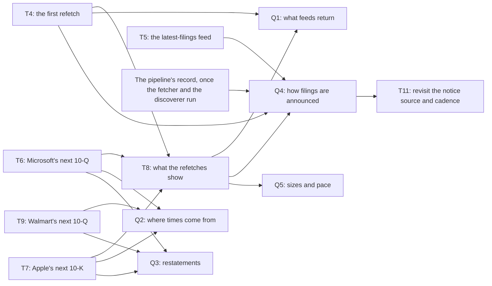
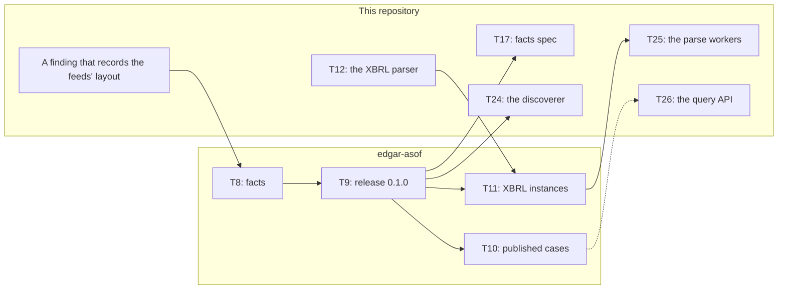

# Open questions and risks

<!-- status: all -->
**What's built,** as the [status page](../status.md) gives it:

- **Built:** Fetcher; NATS JetStream; Garage; PostgreSQL 18; The snapshot store in git; The snapshot store in the cluster; The charts; The fake EDGAR.
- **Specified:** Scheduler (built in part); Discoverer; Monitoring: traces; The transfer from the cluster to git; The controls (built in part); The documentation site (built in part).
- **Decided:** Parse workers; Exporter; Query API; Monitoring: metrics, alerts, and dashboards (specified in part; built in part); Monitoring: logs; `edgar-asof`.
- **Planned:** The drills.
<!-- end status -->

What the design still waits on, and what could undo it: the investigation's
open questions and the tasks that answer them, the releases of `edgar-asof`
that tasks wait on, the assumptions not yet shown, each specification's open
questions, and the risks the documents name. The facts about `edgar-asof`
here were checked against its `main` on October 14, 2026, at commit
`515bb0d`.

## What waits on the investigation

The specifications depend on how EDGAR behaves only through the
investigation's findings, and the investigation is done when every question
has findings the specifications can cite
([questions][inv-questions], [where documents go][agents-where]). [T1],
[T2], and [T3] answered Q2, Q3, and Q5 in part, from the baseline fetched
on October 7, 2026, and some of its findings bear on Q1 and Q4 too. [T4],
the first refetch, on October 16, answered Q1 and Q4 in part, and changed
what Q2's findings show of `submissions`' times ([SRC-22] to [SRC-25]).
What's still open needs newer versions of EDGAR's feeds, or the pipeline's
own record, so each remaining task is a run against the SEC, and a run
happens only when the owner asks for it ([rules][agents-rules],
[how the plan works][plan-how]). The
investigation's daily refetches aren't tasks either: each is a run the
owner asks for ([method][inv-method], step 2).

| Question | Settled by findings | Still open | Answered by | Decides |
| --- | --- | --- | --- | --- |
| **Q1.** What each feed returns and how it changes | Which validators each kind of URL sends ([SRC-4]); the URLs of a company's lists and of a filing's files ([SRC-21]); a `304` for a conditional request whose body hasn't changed ([SRC-22]); `submissions` changing a filing it already lists ([SRC-24]) | How often each feed changes, and whether a URL returns to an earlier body; whether a filing's archived files ever change | [T8] | Which feeds the pipeline reads, and how often |
| **Q2.** Where each time comes from | The two acceptance times and how they differ ([SRC-1], [SRC-24], [SRC-25]); fiscal years and periods, and how each value joins to its filing ([SRC-3], [SRC-6] to [SRC-12]) | Which acceptance time is right for each company's filings, and the header's time zone | [T6], [T7], [T9] | The time model |
| **Q3.** How restatements and amendments appear | Every filing's value kept beside the others, restatements, amendments, and frames ([SRC-14] to [SRC-17]) | Whether a frame moves to a later filing's value when that filing appears; how the next reports' values appear | [T6], [T7], [T9] | What a query as of a past date returns |
| **Q4.** How new filings are announced | When the daily index files are written ([SRC-5]); that a published day's master index didn't change ([SRC-23]); what the latest-filings feed holds, and how far back its latest 100 entries reached on a Sunday ([SRC-26] to [SRC-28]) | How soon each feed shows a new filing; when each day's index appears | [T8], and the pipeline's record | Whether to keep the notice source, and how often to poll ([0010], [T11]) |
| **Q5.** Sizes and pace | Bytes per URL and per filing, and the pace of a backfill ([SRC-18] to [SRC-20]) | Growth per refetch | [T8] | The store's budget, and whether the pace suits backfills |

The questions and what each decides are the investigation's
([questions][inv-questions]); the tasks that answer each are the plan's
([investigation][plan-investigation], [status][status-investigation]).

An arrow from a task to a task is a dependency; one from a task to a
question is what the task answers. Each task in the diagram but [T11] sends
requests to the SEC, and [T5] also widened the scope, once the owner had
confirmed the feed's URL ([investigation][plan-investigation]). [T11] waits
for the monitoring that shows the lags, [T28], and for the owner.

### Q1: what each feed returns and how it changes

The baseline shows which validators each kind of URL sends: `submissions`,
`companyfacts`, and directory listings send none, so each refetch of them
downloads the whole body ([SRC-4]). The first refetch, [T4], showed that a
conditional request gets a `304` when the body hasn't changed, and that
`submissions` and `companyfacts` still send no validators, so it received
their whole bodies again ([SRC-22]). It also showed that `submissions` can
change a filing it already lists: between October 7 and 16, Microsoft's
and Walmart's moved the `acceptanceDateTime` of every filing their
`filings.recent` listed on both dates later by the US Eastern offset on its
date ([SRC-24]). How often each feed's content changes, and whether a URL
returns to an earlier body, come from the daily refetches, in [T8]. [T8]
also refetches the baseline's eight filings, to see whether any archived
file changed, which the pipeline's record assumes none does
([below](#assumptions-not-yet-shown)).

### Q2: where each time comes from

A filing's header gives its acceptance time as 14 digits with no time zone
([SRC-1]). `submissions` gives it in UTC. Since the first refetch, on
October 16, each of the three companies' `submissions` gives it later than
the header's digits read as US Eastern time, by the Eastern offset from UTC
on its date ([SRC-25]). On October 7, only Apple's did; Microsoft's and
Walmart's were later than the header's digits only as converting US
Eastern time to UTC would make them ([SRC-2]), until `submissions` moved
them later by that offset ([SRC-24]). Read as UTC, `submissions`' times put
most of Apple's filings outside the hours the SEC gives for EDGAR
([SRC-13]), and since the change, 735 of Microsoft's 1,000 filings in
`filings.recent` and 341 of Walmart's 1,005 too ([SRC-25]). The stored
versions don't show which time is right for any of the three ([SRC-25]).
[T6], [T7], and [T9] each record whether a new report's header and
`submissions` agree, and [T7] whether Apple's still differ by 8 hours
([investigation][plan-investigation]).

Two things wait on the answer. The view of lags reads `submissions`' times
as the instants they state, and the header's digits as US Eastern time, so
a filing's two lags differ by the Eastern offset until a finding settles
which is right ([§10 of the notices][notices-lags]). The lags can settle it
themselves: a filing is public only once it's accepted, so a time from
which a lag's high bound falls below zero isn't when the filing was
accepted. Such a finding changes how the view reads that time, in
`notices.sql`, in a new version of the notices specification, and nothing
stored: one function, or, since `submissions` can change how it gives a
filing's time ([SRC-24]), a reading of the time by when the filing's list
was fetched. A database that already holds the view takes the change
through a migration ([notices' open question 2][notices-questions],
[`deployment.md`, §9][deployment-later]). And
`edgar-asof` has no default interpreter of acceptance times ([TIME-9]):
whether the header's digits read as Eastern time become its default waits
on a finding that compares more headers with `submissions` than [SRC-2] and
[SRC-13] do ([`edgar-asof`'s plan, T12][asof-later]).

### Q3: how restatements and amendments appear

`companyfacts` keeps each filing's value for a concept, unit, and period
beside every other filing's ([SRC-14]); a restated value differs from one
reported again only in its `val`, with no field that marks the change
([SRC-15]); and an amendment is a filing of its own ([SRC-16]). Only the
latest-filed value of a key has a `frame`, but the baseline holds one
version of each company's `companyfacts`, so it doesn't show a frame moving
to a later filing's value when that filing appears; the daily refetches
through each company's next report can ([SRC-17]). [T6], [T7], and [T9]
record how each new report's values appear, and [T7] how a 10-K reports
earlier years' values again ([investigation][plan-investigation]).

### Q4: how new filings are announced

How soon each feed shows a new filing is measured from the pipeline's
record, once its fetcher and discoverer run, not from the investigation's
tasks ([0010], [method][inv-method], step 3). The record keeps every time
raw, and each lag is a query over it ([LAG-1]). So Q4 is answered only
after the pipeline's first part runs, and the investigation finishes after
it ([0010]). The first refetch, [T4], showed that a published day's
master index didn't change: the four stored on October 7 were unchanged 9
to 14 days after their `Last-Modified` ([SRC-23]). The daily refetches,
which [T8] reads, show when each day's index appears. [T5] recorded what
the latest-filings feed holds, so that [T11] can weigh it as a second
notice source: one entry for each of a filing's parties, newest first,
with a time to the second, in a body made for each request that sends no
validators ([SRC-26], [SRC-27]). Fetched on a Sunday, its latest 100
entries held 50 filings from the last 2 hours and 48 minutes of Friday
evening; at the average pace of the stored master indexes, counting each
filing's CIKs once, they would span about 14 to 31 minutes of a business
day ([SRC-28]).

Two of the specifications' open questions are parts of Q4: whether a
filing's files are in EDGAR's archive once its company's `submissions`
lists it ([notices' open question 1][notices-questions]), and whether
`companyfacts` can give a new filing's values before `submissions` lists
the filing ([`facts.md`'s open question 1][asof-facts-questions]).

### Q5: sizes and pace

The baseline gives the sizes of each kind of body ([SRC-18]) and of every
filing a company lists ([SRC-19]), and the pace of a backfill: at 5
requests a second, from 15.6 minutes for Apple's filings to at least 30.7
for Microsoft's, and about 40 seconds for only a company's XBRL 10-Ks,
10-Qs, and amendments ([SRC-20]). So the store's open question 4 is
answered: the pace suits backfills ([store's open questions][store-questions]).
Growth per refetch waits for [T8].

## What waits on `edgar-asof`'s releases

The pipeline's Python services read EDGAR's content through a pinned
`edgar-asof` ([0009]). A task that needs the library waits on a release of
it, not on its tasks, and is ready once that release is published
([how the plan works][plan-how]). No release is published yet: the
library's README at the named commit says it's not yet released
([README][asof-readme]), and `uv.lock` pins none ([status][status-parts]).
The page on [`edgar-asof`](edgar-asof.md) explains what each release
holds.

| Task here | The release it waits on, in this repository's plan | In `edgar-asof`'s plan |
| --- | --- | --- |
| [T24], the discoverer, which reads `submissions` and headers through the library | Its first release | Release 0.1.0 is its T9, after its T2 to T8 and T13, when the owner asks ([first release][asof-first-release]) |
| [T17], the facts specification, which cites a version of the library's for the fact model and "as of T" | A release that specifies the fact model | Its T1, done October 14, 2026, wrote [`facts.md`][asof-facts] version 0.1.0, which defines both. Its plan puts T1, and T8, which builds the facts, in its first release, 0.1.0, which its T9 publishes ([first release][asof-first-release]); it isn't published yet |
| [T25], the parse workers, which build facts through the library | A release that reads XBRL instances | Its T11, after its first release, this repository's [T12], the XBRL parser, and the owner ([later][asof-later]) |
| [T26], the query API, tested against the cases the library publishes | None named: its dependencies are [T17] and [T25] | Its T10 publishes the cases, after its first release, in a release it names as one [T26] waits on ([later][asof-later]) |
| [T27], the exporter, through a pinned `edgar-asof` | None named: its dependencies are [T18] and [T25] | No release named |

The two plans describe [T26] differently: `edgar-asof`'s plan says [T26]
waits on the release that publishes the cases, while this repository's
plan lists only [T17] and [T25] as its dependencies, though its row says
it's tested against those cases.

The dashed arrow is the dependency only `edgar-asof`'s plan names. The
arrow from release 0.1.0 to T17 joins the two plans: this repository's
names a release that specifies the fact model ([T17]), and the library's
puts its facts specification in release 0.1.0
([first release][asof-first-release]).

### A finding no task here names yet

The library's first release waits on this repository. Its T8, which builds
the facts, depends on a finding here that records the parts of the feeds'
layout no finding records yet: how `companyfacts` nests its values, the
column `accessionNumber` that holds a list's accession numbers, and what
`filings.files` is for a company with no further file. The owner deferred
that finding until the library's T8, on October 14, 2026
([`facts.md`'s open question 2][asof-facts-questions],
[`edgar-asof`'s plan][asof-first-release]). No task in this repository's
[plan][plan-investigation] names it. So the discoverer, [T24], waits
through the library's T9 and T8 on a finding that no task here schedules.

### How the library reads the store

The library's cache follows the snapshot store at its version 0.2.0, and it
reads a store's `data/` as a cache ([`fetching.md`, §6][asof-cache]). The
store's version 1.0.0 keeps what that relies on, adds two fields a reader
ignores, and widens `tool` to name the fetcher, so only a reader that holds
`tool` to version 0.2.0's form refuses the fetcher's records, until the
library's specification cites version 1.0.0
([readers outside the pipeline][store-readers]). In the cluster, the
library never fetches: the services give it bodies from the cluster store
([FETCH-18]), and its facts can be read from bodies the caller gives,
from which it fetches nothing ([FACT-2][asof-facts-reading]).

## Assumptions not yet shown

The design rests on a few things that no finding or record shows yet. Each
names what would show it.

| Assumption | What rests on it | What would show it |
| --- | --- | --- |
| A filing's archived files never change after acceptance (Q1) | The record itself: what was known on a date follows from the filings accepted by then ([what the pipeline keeps][design-keeps]). Each of a filing's files is held by the first record that names a version of it, and a filing already held isn't fetched again ([FILE-2], [FILE-6], [LIST-2]). | [T8], which refetches the baseline's eight filings |
| A header's acceptance time is US Eastern time | Each lag from the header's time ([§10 of the notices][notices-lags]) | A finding that settles the zone ([notices' open question 2][notices-questions]) |
| The SEC's `Date` is when it generated each response | The fetcher's check of its own clock, by which every lag is measured ([the fetcher's clock][telemetry-clock]) | A finding from the refetches' records, which keep each `date` beside `requested_at` and `received_at` ([telemetry's open question 1][telemetry-questions]) |
| A filing's files are in EDGAR's archive once `submissions` lists it | The discoverer's fetches of each new filing's files, which it doesn't queue again when they fail ([FILE-4]) | The record, which shows each fetch that ends without a version ([notices' open question 1][notices-questions]) |
| `companyfacts` doesn't give a new filing's values before `submissions` lists the filing | `edgar-asof`'s facts, which would otherwise have no time from `submissions` and stay unplaced until a later read | A finding from the pipeline's record; the owner kept that default on October 14, 2026 ([`facts.md`'s open question 1][asof-facts-questions]) |
| `submissions` shows a filing within about a second of its dissemination, as the SEC's documentation says, which isn't a finding | How soon the pipeline sees a filing: within about a cadence, 10 seconds at the start, plus the source's own delay ([0010]) | The lags the record shows (Q4), which [T11] weighs |
| The database's backups to Garage restore | Recovery of the database, whose volumes don't outlive the cluster ([§4 of the deployment][deployment-volumes]) | The restore drill on kind, since the backup plugin was tested against MinIO, not Garage ([0002], [T31]) |
| Every component fits on kind's one machine | Each component's requests and limits, still to be measured ([0001], [§9 of the deployment][deployment-later]) | Measurements on kind |

## Each specification's open questions

### The snapshot store

[`snapshots.md`'s §13][store-questions] has four, and its version 1.1.0
adds none. That version states the transfer's grants, as the owner decided
on October 28, 2026: a role and a key of the transfer's own, which may only
read the cluster store ([LOG-5]), and which it leaves to the deployment to
give. Which feeds and
companies the store holds is for the investigation to decide. How large
the scope may grow is answered by a budget, no file over 50 MiB and at most
1 GB in all ([SCOPE-4], [SCOPE-5]); if the store would outgrow it, objects
move to Git LFS or release assets, and a log nearing 50 MiB needs a new
layout, each in a major version. What an import's output is, and how a
rerun is compared with it, is for the export's specification, [T18]
([what the specifications must say][design-specs]). Whether the pace suits
backfills is answered (Q5).

### Deployment

[`deployment.md`][deployment] has no section of open questions. Since its
version 1.1.0, it deploys what the notices and the telemetry left to it: the
streams `ORDERS` and `NOTICES`, and the durable consumers of the
discoverer, the scheduler, and the parse workers ([NATS-3], [NATS-5]); the
discoverer's role and key ([PG-7], [GARAGE-4]); Grafana's role and its
data source ([PG-11], [MON-5]); and the notices' tables and views and the
dashboards' views, with their grants ([PG-12], [PG-13]). A stream kept
by interest takes its subjects only once its consumers exist, so a notice
published before `NOTICES` has its consumers is refused rather than kept
for none. One such notice can still miss the scheduler: the gap notice the
discoverer publishes when it starts, on a new install whose database was
restored while NATS's data wasn't kept. It follows no message, so nothing
delivers it again, and the notices don't yet say that the discoverer
publishes a refused notice again ([GAP-3],
[durable consumers][deployment-consumers]). The owner decided on October
15, 2026 that a version of the notices of its own says so ([T38]).

Its version 1.2.0 adds the fake EDGAR, for CI ([§10][deployment-from-1.1.0]).
The umbrella chart renders it only when `fakeEdgar.enabled` is `true`,
which no committed values file sets, so the owner's installations never
include it ([FAKE-1], [FAKE-2]). It answers for `www.sec.gov` and
`data.sec.gov` over HTTPS, with a certificate from an authority that the
release makes through cert-manager, and CI first points kind's CoreDNS at
it for those names, so no pod of the installed charts reaches the SEC
([FAKE-3] to [FAKE-5]). The same version says how the pipeline's images are
built: from their commit's files and from base images named by digest, the
fake EDGAR's holding `data/` ([IMG-5]). The details it settles are listed
with the fake EDGAR's, and the owner confirmed them
([below](#the-fake-edgar)).

Its version 1.3.0 deploys the scheduler, before [T22] built it
([§10][deployment-from-1.2.0]): two replicas, each on a worker node of its
own, one active through its Lease, `scheduler`; [RBAC-1]'s grants and its
Lease's, and no others; NATS's address, without a credential; and a durable
consumer of poll events of its own, `scheduler-polls`, on `RECORDS`, made
before the fetcher publishes any ([SCHED-1] to [SCHED-9]). The owner
confirmed on October 22, 2026 each of the details it settles, keeping each
default; these are listed with their alternatives:

1. **A stopped replica releases the Lease** once it has stopped acting,
   within its pod's termination grace period, so an upgrade or a drain
   hands over at another replica's next try ([SCHED-4]).
   Waiting out the Lease's duration, as the fetcher does, would take up to
   15 seconds by default, longer than the cadence the Sources start at, and
   could leave a gap at each upgrade.
2. **Its two replicas on two worker nodes** ([SCHED-2]), so the loss of a
   node leaves the standby running. Without it, both could share a node.
3. **No grant but [RBAC-1]'s and its Lease's** ([SCHED-6]), so it records
   no Kubernetes Events. A grant to create Events would let
   controller-runtime record each change of leader, which the Lease and
   `edgar_scheduler_leader` already show.
4. **No NATS credential** ([SCHED-7]). NATS asks none of any service yet,
   and a later version gives each its own
   ([§9][deployment-later], item 7). Credentials now would be the first,
   and every other client of NATS would need its own at once.
5. **JetStream's default for `scheduler-polls`' unacknowledged events**
   ([SCHED-8]). An event can arrive after a later poll's ([JOB-6]), so one
   at a time, in the stream's order, wouldn't put the polls in order.
6. **The scheduler makes no stream or consumer, and waits for those it
   reads** ([SCHED-9]), since the Job makes them only once the release's
   resources are ready. Making its own would leave two places that set a
   consumer's configuration.

One gap remains, like the gap notice's above. On a new install whose
values allow requests from the start, an order the scheduler publishes
before the Job has made `ORDERS` is refused, and [ORDER-1] publishes it
again only when the scheduler next becomes the active replica or requests
are allowed again
([the scheduler's access to NATS][deployment-scheduler-nats]). The chart's
default values pause requests, so an install with them has no such order
([VAL-4]). The owner decided on October 22, 2026 that the version of the
notices that publishes a refused notice again also has the scheduler
publish a refused order again until JetStream accepts it ([T48]).

Its version 1.4.0 deploys the fetcher, which [T23] built
([§10][deployment-from-1.3.0]): two replicas, each on a worker node of its
own, one active through the Lease `fetcher`; [RBAC-2]'s grants and its
Lease's, and no others; its Garage key, its role's password, and its user
agent, read from their Secrets; the bucket, and the database's primary,
verified against the `Cluster`'s authority; NATS's address, without a
credential; three durable consumers of `JOBS`, one for each kind of job;
and, where CI installs the fake EDGAR, trust of that authority alone
([FETCHER-1] to [FETCHER-13]). The owner confirmed on October 25, 2026
each of the details it settles, keeping each default; these are listed
with their alternatives:

1. **A stopped replica waits out the Lease** ([FETCHER-3]). A replica that
   Kubernetes stops doesn't release it, so an upgrade or a drain that stops
   the active fetcher pauses fetching for up to 15 seconds by default, and
   can leave a gap. Releasing it, as the scheduler does, would end the pause
   sooner, but a replica that released it while it still sent, or within
   0.2 seconds of its last request, would let the next one break the SEC's
   limit ([FETCH-6], [FETCH-7]).
2. **Its two replicas on two worker nodes** ([FETCHER-2]), as the
   scheduler's, so the loss of a node leaves the standby running. A
   preference would let both share a node; required, a rollout's extra pod
   needs a third worker node, which kind's three provide.
3. **No grant but [RBAC-2]'s and its Lease's** ([FETCHER-4]), so it reads
   no Source or Backfill and records no Kubernetes Events. A grant to
   create Events would let client-go record each change of leader, which
   the Lease and `edgar_fetcher_leader` already show.
4. **The user agent a required value** ([FETCHER-5]), with an `@` in it,
   so the chart never installs a fetcher that can't fetch. Optional, the
   chart would install one that sends nothing ([FETCH-17]).
5. **The database's server verified** against the `Cluster`'s authority
   ([FETCHER-7]), as Grafana's is. TLS without the check would need no
   certificate mounted, but would write the records to anything that
   answered as the database.
6. **A consumer for each kind of job** ([FETCHER-9]): `fetcher-polls`,
   `fetcher-filings`, and `fetcher-backfills`, where the plan and the
   deployment's §9 named one. One consumer of all three would deliver jobs
   in the order `JOBS` holds them, a Backfill's before a later poll's,
   against [JOB-4].
7. **JetStream's default for their unacknowledged jobs** ([FETCHER-9]).
   With one at most, a job a lost replica held would hold back each later
   job of its kind until it was delivered again, 30 seconds after the
   replica last said it was at work on it, by when, at the 10 seconds each
   company's Source starts at, a poll's job has expired.
8. **A word of progress while a fetch runs** ([FETCHER-10]): the active
   replica tells JetStream a job is in progress, so a fetch longer than 30
   seconds isn't delivered again meanwhile. The alternative is a longer
   wait for an acknowledgement on its consumers, longer than the longest
   fetch, about 7 minutes: no word needed, but a job a lost replica held
   would wait that long to be delivered again.
9. **The fetcher makes no stream or consumer, and waits for those it
   reads** ([FETCHER-11]), as the scheduler does. Making its own would
   start it sooner on a new install, but leave two places that set a
   consumer's configuration.
10. **The fake EDGAR's authority trusted alone** ([FETCHER-12],
    [FETCHER-13]), in place of the roots the fetcher's image holds, so a
    request from CI's cluster that reached the SEC would fail before its
    user agent was sent. Trusted beside them, a request that reached the
    SEC would go through.
11. **The commit from the chart** ([FETCHER-1]): the chart gives the
    fetcher `images.commit`, its image's tag, for its records' `tool`. The
    alternative is the commit built into the fetcher when its image is
    built, which [IMG-2]'s command would then have to pass.
12. **The names:** the Deployment and ServiceAccount `fetcher`, the value
    `fetcher.image`, the consumers above, and the area `FETCHER`, apart
    from the store's `FETCH`. A shorter area wouldn't read as close to
    `FETCH`, but wouldn't name the fetcher as plainly.

Its version 2.0.0 gives the transfer, which the owner runs outside the
cluster, its access to the cluster store, before [T36] builds it
([§10][deployment-from-1.4.0]): a database role and a Garage key of its
own, `transfer`, each of which may only read, with their credentials in
Secrets that no service reads; and, since nothing exposes the database or
Garage outside the cluster, a way in through the API server of the cluster
the owner names ([PG-15], [GARAGE-5], [TRANSFER-1] to [TRANSFER-5]). It
settles these details, each with a default the owner hasn't yet confirmed
or changed, listed with their alternatives:

1. **A major version** ([PG-8]). [PG-8]'s Job now grants the transfer's
   role `SELECT` on `records`, where it granted no role but the services'
   and the owner's, which changes the statement's meaning. As a minor
   version, 1.5.0, the grant would count as a list that lengthens, as
   version 1.1.0's lists did, though [PG-8] doesn't give its list for a
   version.
2. **Credentials from the cluster** ([TRANSFER-4]): the transfer reads its
   role's password and its key from their Secrets, through the API server,
   so the owner's values file stays their one copy. Read from the
   environment or `.env.dev`, as `snapshot.py` reads its user agent, they
   would be a second copy, kept in step by hand.
3. **Port-forwards through the API server** ([TRANSFER-2],
   [TRANSFER-5]), which work on any cluster the owner's context reaches.
   Ports of kind's nodes mapped to the host would need no API server, but
   would leave the database and Garage listening on the host, on kind
   alone.
4. **The database's primary, not its replicas** ([TRANSFER-5]). The
   primary holds each record once it's committed. The replicas follow it
   asynchronously, so a range read from one, as Grafana reads them, could
   miss records the primary holds, and [XFER-1] would copy the range
   without them. Reading the replicas would spare the primary the range's
   reads, but the transfer would first have to read the primary's position
   in its WAL, wait until its replica had replayed it, and copy nothing if
   the replica didn't within a limit.
5. **Channel binding, not the server's certificate** ([TRANSFER-5]).
   Checking the certificate against the `Cluster`'s authority would mean
   reading the Secret that holds it, which holds the authority's key too.
6. **A context named on every run** ([TRANSFER-3]). Falling back to the
   kubeconfig's current context would save an argument, but could copy
   from a test cluster's store, whose bodies the fake EDGAR served, into
   `data/`, which never removes a record ([LOG-1]).
7. **The owner's context, not an identity of the transfer's own.** The
   transfer acts on the API server with the context the owner names. A
   ServiceAccount of its own, limited to its Secrets and its port-forwards,
   would need a token the owner took from the cluster with that context
   anyway.
8. **The names:** the role and the key `transfer`, and the area
   `TRANSFER`, apart from the store's `XFER`. Without an area of its own,
   the transfer's statements would be in `PG`, `GARAGE`, and `SECRET`,
   though most are about the transfer rather than the database or Garage.
9. **An invariant that nothing exposes the database or Garage**
   ([TRANSFER-2]), checked by rendering the charts, each Service that would
   select their pods among them, and reading `deploy/kind.yaml`, so that a
   later change can't open another way in unnoticed. Without it, the reason the transfer goes through the API
   server would hold only while nothing else changed.

Its [§9][deployment-later] lists what later versions add: the pipeline's
other services, with their replicas, credentials, and placement;
migrations for later versions of the record's tables and views; each
component's requests, limits, and probes, measured on kind; Tempo, Loki,
and Alloy; kube-state-metrics' access to the definitions of the
pipeline's resources; and NATS's credentials, each service's own, limited
to its subjects.

### Controls

[`controls.md`][controls] has no section of open questions. What it left
to other specifications ([§11][controls-other]), the store's version 1.0.0,
the notices, and the telemetry now give. One choice waits on a condition:
no admission webhook checks the Sources until something other than the
chart creates or changes them ([0010], owner's decision 5).

### Notices

[`notices.md`'s §12][notices-questions] has four:

1. **Whether a filing's files are in EDGAR's archive once `submissions`
   lists it** (Q4). If new filings' fetches end without a version, a later
   version queues them again after a delay; until then, a Backfill fetches
   them again.
2. **Which acceptance time is right, and the header's time zone.** The
   lags read `submissions`' time as the instant it states and the header's
   digits as US Eastern time, and the two differ by the Eastern offset
   ([SRC-25]). A time from which a filing's lag has a high bound below zero
   isn't when it was accepted, so the lags can settle it. A finding that
   does changes how the view reads that time, and nothing stored: one
   function, or, since `submissions` can change how it gives a filing's
   time ([SRC-24]), a reading by when the filing's list was fetched. A
   database that already holds the view takes the change through a
   migration ([`deployment.md`, §9][deployment-later]).
3. **Exact gaps.** A job gives neither its due time nor its Source's
   cadence, so each poll's window stands in for the cadence. A shortened
   cadence can hide a poll missed at the change, and a lengthened one can
   show an open gap until the first poll at the new cadence. A poll's due
   time in its job would let a later version count missed slots exactly.
4. **A version that a later discoverer would read differently.** Each
   version's reading is kept once, by the discoverer that first read it;
   how a corrected reading is recorded is for a later version.

### Telemetry

[`telemetry.md`'s §11][telemetry-questions] has four:

1. **Whether the SEC's `Date` is when it generated each response.** Until a
   finding shows it, the fetcher's clock skew is shown and not alerted on.
2. **How often the cluster store is checked against [STORE-3] in
   operation,** and the alert on a problem. No component checks it yet.
3. **Sampling.** Every trace is sampled; at the starting cadence, the polls
   start 25,920 traces a day, most of which find no filing.
4. **The views' cost.** `coverage` and `gaps` read every poll, about 9.5
   million a year at the starting cadence, so how fast the dashboards read
   them is measured on kind.

It also leaves to later versions the platform's own metrics and alerts,
such as NATS's redeliveries and the database's replication; an alert on a
Source with no poll at all, which `SourceGap` doesn't cover, once the owner
adds a task for it ([alerts][telemetry-alerts]); and logs.

### The documentation site

[`site.md`'s §9][site-questions] has none open. The site shows `main`, with
no version per release of the pipeline, which is revisited when the
pipeline has releases.

### The fake EDGAR

[`fake-edgar.md`'s §10][fake-edgar-questions] has none open. The owner
confirmed on October 19, 2026 each of the ten details that its version
0.1.0 and the deployment's version 1.2.0 settle, keeping each default:

1. **Which version it serves:** each URL's latest, an earlier one on cue, a
   `304` as RFC 9110 gives it, and a `404` for a URL not stored
   ([SERVE-2] to [SERVE-4]).
2. **Failures on cue,** through its admin port, each response given once,
   in order: a status, an earlier version, a body cut short, or no
   response ([CUE-1], [CUE-2]). No cue delays a response or sends a body
   that isn't UTF-8 text, so neither [FETCH-5]'s timeout nor a body encoded
   `x-gzip` that decodes ([FETCH-11]) can be cued. A kind of response for
   each would be a minor version ([§12][fake-edgar-changes]).
3. **Its log of requests,** kept in memory and read through its admin port,
   with one request answered at a time, so the log's order is the
   requests' ([REQ-1], [REQ-2], [ADMIN-1]).
4. **How requests reach it:** in the cluster, over HTTPS as the SEC's
   hosts, with kind's DNS answering their names with it; on one machine,
   over plain HTTP ([SERVE-5], [FAKE-3], [FAKE-4]).
5. **The checks' allowance:** 20 milliseconds less than [FETCH-6]'s 0.2
   seconds, by when each request arrives ([CHECK-1]).
6. **How it's installed:** by the umbrella chart, only when
   `fakeEdgar.enabled` is `true`, which CI sets and no committed values file
   does, as one replica behind a Service ([FAKE-1], [FAKE-2]).
7. **How `data/` reaches it:** in its image, which holds `data/` as the
   commit it's built from has it ([IMG-5]).
8. **The base images, by digest,** of each of the pipeline's images, so the
   same commit builds the same software ([IMG-5]).
9. **No metrics or traces,** since it's not one of the services the
   telemetry observes, and its log shows what its server receives
   ([§11][fake-edgar-other]).
10. **A request without `Accept-Encoding`** gets the body itself, without a
    `Content-Encoding` ([SERVE-3]).

What it leaves to other specifications ([§11][fake-edgar-other]), the
deployment's version 1.2.0 gives ([above](#deployment)), and its version
1.4.0 how the fetcher trusts the fake EDGAR's certificate authority
([FETCHER-12], [FETCHER-13]).

### `edgar-asof`'s specifications

[`facts.md`'s §10][asof-facts-questions] has two, each with a default the
owner kept or deferred on October 14, 2026: whether `companyfacts` can give
a new filing's values before `submissions` lists it, and the finding that
records the feeds' layout ([above](#a-finding-no-task-here-names-yet)).
`fetching.md` and `times.md` have none; their next versions name the
functions and types a caller uses ([`edgar-asof`'s plan, T2 and
T3][asof-first-release]).

### What isn't written yet

Two specifications: the facts ([T17]) and the export ([T18]), with a minor
version of the telemetry for them ([T32]). Two decision records: how the
parse workers scale with their queue's depth ([T10]), and which XBRL parser
reads the instances, a narrow parser on lxml or Arelle ([T12]). And one
revisit: whether to keep each company's `submissions` as the notice source
([T11]). And a version of the snapshot store's specification that states
what the fetcher does while a write can't be made, as the owner decided
with [T23]: it holds the fetch and tries the write again, sending nothing
else meanwhile. The owner decided that the same version states that a
fetch between attempts waits while requests aren't allowed, and that a
fetch in progress when its replica stops is abandoned without a record,
and that a decision record proposed with it supersedes [0003]'s
consequence that fetching continues while PostgreSQL fails over.

## Risks the documents name

### To the record's completeness and integrity

- **What the pipeline didn't observe is lost.** A version the SEC served
  and replaced during a gap is lost to everyone; the record says the gap
  was there rather than implying nothing changed
  ([what the pipeline keeps][design-keeps]).
- **Storage can't refuse a change to an object.** Garage has no object lock,
  so the store detects an overwrite or a deletion rather than preventing
  it ([0002], [STORE-3]), and how often the cluster store is checked in
  operation is open ([telemetry's open question 2][telemetry-questions]).
- **A filing a Source already shows at its first poll isn't fetched for
  it.** The record doesn't say how long the Source had shown it, so a
  Backfill fetches it, when the owner asks for one ([FILE-2],
  [§6 of the notices][notices-seen]).
- **The git store's budget.** At the starting cadence, a log of every poll
  would pass GitHub's warning at 50 MiB within four days, so the transfer
  copies only the ranges the owner names ([records the cluster
  made][store-transfer]).

### To the times

- **The header's time zone is unsettled** ([0010]), and since the first
  refetch, on October 16, 2026, `submissions`' times for all three
  companies' filings, not only Apple's, are later than their headers'
  digits read as Eastern time, by the Eastern offset on each date
  ([SRC-2], [SRC-25]). `submissions` can also change a filing's time after
  it lists it ([SRC-24]). The lags read the time from the list a filing was
  first added from, so a filing's two lags differ by that offset until a
  finding settles which is right ([§10 of the notices][notices-lags]).
- **A lag is only as good as its clocks.** The fetcher checks its clock
  against each response's `Date` ([0010], [METRIC-4]), which rests on an
  assumption ([above](#assumptions-not-yet-shown)).
- **Gaps and first sightings are bounded, not exact.** A changed cadence
  can hide or show a gap for one window
  ([notices' open question 3][notices-questions]), and a poll's event that
  arrives after a later one's loosens a sighting's bounds
  ([§6 of the notices][notices-seen]).
- **The earliest records' times.** A record that `snapshot.py` wrote
  before commit `8de33cd` can give a `requested_at` up to 0.2 seconds
  early; no finding relies on a record's time to within a second
  ([§14 of the store][store-changes], [records cited][inv-records]).

### To capacity

- **The rate limit.** Every request goes through one fetcher, capped at 5
  a second, half the SEC's stated maximum ([0005]), and the Sources share
  half of that, 2.5 a second ([VAL-3]). At 10 seconds, that covers about
  25 companies ([0010]).
- **Every poll downloads the whole body,** since `submissions` sends no
  validators ([SRC-4]).
- **Memory on one machine.** kind's nodes share one machine ([0001]). The
  database's three instances and its operator are the design's largest
  steady memory cost ([0004]), and kube-prometheus-stack takes an
  estimated 1 GB ([0008]).
- **The record's growth.** The dashboards' views read every poll, about
  9.5 million a year at the starting cadence, and the polls start 25,920
  traces a day ([telemetry's open questions][telemetry-questions]).

### To operation

- **A handover can leave a gap.** A new fetcher takes the Lease only once
  its duration has passed without a renewal, 15 seconds by default
  ([LEASE-1]). Decision 0005 records every handover as a gap ([0005]); the
  notices' specification gives a gap only where the handover misses a poll
  ([§5 of the notices][notices-gaps]). A replica that Kubernetes stops
  doesn't release the Lease either, so an upgrade or a drain that stops the
  active fetcher pauses fetching as long ([FETCHER-3]).
- **An outage of the database, Garage, or NATS pauses fetching.** The
  fetcher holds a fetch whose writes can't be made, and sends no other
  request until they can, as the owner decided ([T23]), so a Source's slots
  that pass meanwhile show as gaps.
- **A `403` stops everything until the owner acts.** The stop survives
  restarts and handovers, and holds until the owner acknowledges it
  ([ACCESS-3]); `SecRequestsStopped` fires meanwhile ([ALERT-1]).
- **Alerts stay in the cluster.** Alertmanager has no receiver outside the
  cluster unless the owner asks for one, so alerts show in Grafana and
  Alertmanager ([0008], [MON-3]).
- **A Source that never polls raises no alert.** `SourceGap` doesn't cover
  a Source and URL with no poll at all, as when no fetcher runs from the
  start ([alerts][telemetry-alerts]).
- **Single replicas.** The operators run one replica each, and while one
  restarts its resources wait in the API server
  ([§5 of the deployment][deployment-dependencies]); Prometheus,
  Alertmanager, and Grafana run one each ([MON-4]).
- **Definitions outlive their releases.** Every definition is kept when its
  release is uninstalled, and with it every resource of its kind, so
  removing one is a deliberate step; the Prometheus operator's definitions
  and kube-prometheus-stack are pinned apart, and must agree ([0011],
  [CRD-4], [CRD-5]).

### From the software the pipeline depends on

- **Zensical is alpha,** so its version is locked and each upgrade is a
  change of its own ([0012]).
- **Garage's chart isn't published to a chart repository,** so it's
  committed at a pinned release and upgraded deliberately ([0002],
  [PIN-3]).
- **The records weighed projects that changed under them:** MinIO's end of
  maintenance ([0002]), Bitnami's reduced catalog ([0001]), the 2025
  dispute over NATS's license, settled with NATS in the CNCF under Apache
  2.0 ([0003]), Promtail's end of life ([0008]), and Material for MkDocs's
  maintenance mode ([0012]).

### To the project

- **Two implementations of the fetching rules,** `snapshot.py` and the Go
  fetcher, kept together by one set of checks through the fake EDGAR
  ([0006], [testing](testing-and-verification.md#the-fake-edgar)).
- **A library in a repository of its own** implies releases and upkeep,
  and a change the pipeline needs is released there first ([0009]); the
  tasks that wait on it are [above](#what-waits-on-edgar-asofs-releases).

### Beyond what the documents name

> **Analysis.** No task, decision record, or specification covers this.
> Every worker node is a container on one machine ([0001]), and every
> volume of NATS, Garage, Prometheus, and Alertmanager is kept in one
> directory of that machine ([KIND-2], [VOL-2]), as are the database's
> backups, which go to Garage ([PG-4]). So the replicas that survive the
> loss of a node don't survive the loss of that disk. What the documents
> place outside the cluster is the git store ([0001]), with the records the
> transfer has copied into it ([XFER-1]). The pipeline could keep a copy of
> the backups, or of the bucket, on a second machine.

[0001]: ../decisions/0001-deploy-on-kubernetes-with-helm-on-kind.md
[0002]: ../decisions/0002-store-bodies-in-garage.md
[0003]: ../decisions/0003-queue-work-in-nats-jetstream.md
[0004]: ../decisions/0004-keep-the-record-in-postgresql-18.md
[0005]: ../decisions/0005-send-sec-requests-through-one-active-fetcher.md
[0006]: ../decisions/0006-write-the-services-in-go-and-python.md
[0008]: ../decisions/0008-monitor-with-prometheus-and-grafana-then-tempo-and-loki.md
[0009]: ../decisions/0009-read-edgar-through-a-public-point-in-time-library.md
[0010]: ../decisions/0010-poll-each-companys-submissions-and-measure-lag-from-the-record.md
[0011]: ../decisions/0011-install-the-definitions-and-operators-before-the-umbrella-chart.md
[0012]: ../decisions/0012-publish-the-documents-as-a-site-built-with-zensical.md
[design-keeps]: ../design.md#what-the-pipeline-keeps
[design-specs]: ../design.md#what-the-specifications-must-say
[status-parts]: ../status.md#the-parts
[status-investigation]: ../status.md#the-investigation
[plan-how]: ../plan.md#how-the-plan-works
[plan-investigation]: ../plan.md#investigation
[T1]: ../plan.md#investigation
[T2]: ../plan.md#investigation
[T3]: ../plan.md#investigation
[T4]: ../plan.md#investigation
[T5]: ../plan.md#investigation
[T6]: ../plan.md#investigation
[T7]: ../plan.md#investigation
[T8]: ../plan.md#investigation
[T9]: ../plan.md#investigation
[T10]: ../plan.md#facts
[T11]: ../plan.md#observing-filings
[T12]: ../plan.md#facts
[T17]: ../plan.md#facts
[T18]: ../plan.md#facts
[T24]: ../plan.md#observing-filings
[T25]: ../plan.md#facts
[T26]: ../plan.md#facts
[T27]: ../plan.md#facts
[T28]: ../plan.md#observing-filings
[T31]: ../plan.md#traces-logs-and-drills
[T32]: ../plan.md#facts
[T36]: ../plan.md#observing-filings
[T38]: ../plan.md#observing-filings
[T48]: ../plan.md#observing-filings
[agents-rules]: ../../AGENTS.md#rules
[agents-where]: ../../AGENTS.md#where-documents-go
[inv-questions]: ../../investigation/edgar.md#questions
[inv-method]: ../../investigation/edgar.md#method
[inv-records]: ../../investigation/edgar.md#records-cited
[store-questions]: ../../spec/snapshots.md#13-open-questions
[store-readers]: ../../spec/snapshots.md#readers-outside-the-pipeline
[store-transfer]: ../../spec/snapshots.md#records-the-cluster-made
[store-changes]: ../../spec/snapshots.md#14-changes-to-this-document
[deployment]: ../../spec/deployment.md
[deployment-volumes]: ../../spec/deployment.md#volumes
[deployment-dependencies]: ../../spec/deployment.md#5-dependencies
[deployment-later]: ../../spec/deployment.md#9-later-versions
[deployment-consumers]: ../../spec/deployment.md#durable-consumers
[deployment-from-1.2.0]: ../../spec/deployment.md#from-version-120
[deployment-from-1.3.0]: ../../spec/deployment.md#from-version-130
[deployment-from-1.4.0]: ../../spec/deployment.md#from-version-140
[deployment-scheduler-nats]: ../../spec/deployment.md#its-access-to-nats
[deployment-from-1.1.0]: ../../spec/deployment.md#from-version-110
[controls]: ../../spec/controls.md
[controls-other]: ../../spec/controls.md#11-other-specifications
[notices-questions]: ../../spec/notices.md#12-open-questions
[notices-seen]: ../../spec/notices.md#6-when-each-source-first-showed-each-filing
[notices-gaps]: ../../spec/notices.md#5-polls-coverage-and-gaps
[notices-lags]: ../../spec/notices.md#10-times-and-lags
[telemetry-questions]: ../../spec/telemetry.md#11-open-questions
[telemetry-clock]: ../../spec/telemetry.md#the-fetchers-clock
[telemetry-alerts]: ../../spec/telemetry.md#7-alerts
[site-questions]: ../../spec/site.md#9-open-questions
[fake-edgar-questions]: ../../spec/fake-edgar.md#10-open-questions
[fake-edgar-other]: ../../spec/fake-edgar.md#11-left-to-other-specifications
[fake-edgar-changes]: ../../spec/fake-edgar.md#12-changes-to-this-document
[asof-readme]: https://github.com/nslaughter/edgar-asof/blob/515bb0dc7af1b76a269413f29ba3edc390193e46/README.md
[asof-facts]: https://github.com/nslaughter/edgar-asof/blob/515bb0dc7af1b76a269413f29ba3edc390193e46/spec/facts.md
[asof-facts-reading]: https://github.com/nslaughter/edgar-asof/blob/515bb0dc7af1b76a269413f29ba3edc390193e46/spec/facts.md#4-reading-a-companys-facts
[asof-facts-questions]: https://github.com/nslaughter/edgar-asof/blob/515bb0dc7af1b76a269413f29ba3edc390193e46/spec/facts.md#10-open-questions
[asof-cache]: https://github.com/nslaughter/edgar-asof/blob/515bb0dc7af1b76a269413f29ba3edc390193e46/spec/fetching.md#6-the-cache
[asof-first-release]: https://github.com/nslaughter/edgar-asof/blob/515bb0dc7af1b76a269413f29ba3edc390193e46/docs/plan.md#the-first-release
[asof-later]: https://github.com/nslaughter/edgar-asof/blob/515bb0dc7af1b76a269413f29ba3edc390193e46/docs/plan.md#later
[TIME-9]: https://github.com/nslaughter/edgar-asof/blob/515bb0dc7af1b76a269413f29ba3edc390193e46/spec/times.md#4-interpreters
[SRC-1]: ../../investigation/edgar.md#findings-so-far
[SRC-2]: ../../investigation/edgar.md#findings-so-far
[SRC-3]: ../../investigation/edgar.md#findings-so-far
[SRC-4]: ../../investigation/edgar.md#findings-so-far
[SRC-5]: ../../investigation/edgar.md#findings-so-far
[SRC-6]: ../../investigation/edgar.md#findings-so-far
[SRC-12]: ../../investigation/edgar.md#findings-so-far
[SRC-13]: ../../investigation/edgar.md#findings-so-far
[SRC-14]: ../../investigation/edgar.md#findings-so-far
[SRC-15]: ../../investigation/edgar.md#findings-so-far
[SRC-16]: ../../investigation/edgar.md#findings-so-far
[SRC-17]: ../../investigation/edgar.md#findings-so-far
[SRC-18]: ../../investigation/edgar.md#findings-so-far
[SRC-19]: ../../investigation/edgar.md#findings-so-far
[SRC-20]: ../../investigation/edgar.md#findings-so-far
[SRC-21]: ../../investigation/edgar.md#findings-so-far
[SRC-22]: ../../investigation/edgar.md#findings-so-far
[SRC-23]: ../../investigation/edgar.md#findings-so-far
[SRC-24]: ../../investigation/edgar.md#findings-so-far
[SRC-25]: ../../investigation/edgar.md#findings-so-far
[SRC-26]: ../../investigation/edgar.md#findings-so-far
[SRC-27]: ../../investigation/edgar.md#findings-so-far
[SRC-28]: ../../investigation/edgar.md#findings-so-far
[STORE-3]: ../../spec/snapshots.md#the-cluster-store
[SCOPE-4]: ../../spec/snapshots.md#9-scope
[SCOPE-5]: ../../spec/snapshots.md#9-scope
[XFER-1]: ../../spec/snapshots.md#records-the-cluster-made
[LOG-1]: ../../spec/snapshots.md#8-history
[LOG-5]: ../../spec/snapshots.md#8-history
[FETCH-5]: ../../spec/snapshots.md#10-fetching
[FETCH-6]: ../../spec/snapshots.md#10-fetching
[FETCH-7]: ../../spec/snapshots.md#10-fetching
[FETCH-11]: ../../spec/snapshots.md#10-fetching
[FETCH-18]: ../../spec/snapshots.md#the-fetcher
[FETCH-17]: ../../spec/snapshots.md#the-fetcher
[VAL-3]: ../../spec/controls.md#5-the-charts-values
[ACCESS-3]: ../../spec/controls.md#8-secaccess
[KIND-2]: ../../spec/deployment.md#the-kind-cluster
[VOL-2]: ../../spec/deployment.md#volumes
[GARAGE-4]: ../../spec/deployment.md#garage
[GARAGE-5]: ../../spec/deployment.md#garage
[PG-4]: ../../spec/deployment.md#instances-and-backups
[PG-7]: ../../spec/deployment.md#the-stores-database
[PG-8]: ../../spec/deployment.md#the-stores-database
[PG-15]: ../../spec/deployment.md#the-stores-database
[TRANSFER-1]: ../../spec/deployment.md#the-transfer
[TRANSFER-2]: ../../spec/deployment.md#the-transfer
[TRANSFER-3]: ../../spec/deployment.md#the-transfer
[TRANSFER-4]: ../../spec/deployment.md#the-transfer
[TRANSFER-5]: ../../spec/deployment.md#the-transfer
[PIN-3]: ../../spec/deployment.md#6-pins
[IMG-5]: ../../spec/deployment.md#the-pipelines-own-images
[IMG-2]: ../../spec/deployment.md#the-pipelines-own-images
[CRD-4]: ../../spec/deployment.md#definitions
[CRD-5]: ../../spec/deployment.md#definitions
[MON-3]: ../../spec/deployment.md#monitoring
[MON-4]: ../../spec/deployment.md#monitoring
[MON-5]: ../../spec/deployment.md#monitoring
[NATS-3]: ../../spec/deployment.md#nats
[NATS-5]: ../../spec/deployment.md#durable-consumers
[PG-11]: ../../spec/deployment.md#the-notices-and-the-dashboards
[PG-12]: ../../spec/deployment.md#the-notices-and-the-dashboards
[PG-13]: ../../spec/deployment.md#the-notices-and-the-dashboards
[LEASE-1]: ../../spec/deployment.md#the-fetchers-lease
[FETCHER-1]: ../../spec/deployment.md#the-fetcher
[FETCHER-2]: ../../spec/deployment.md#the-fetcher
[FETCHER-3]: ../../spec/deployment.md#the-fetcher
[FETCHER-4]: ../../spec/deployment.md#the-fetchers-grants
[FETCHER-5]: ../../spec/deployment.md#the-fetchers-credentials-and-stores
[FETCHER-7]: ../../spec/deployment.md#the-fetchers-credentials-and-stores
[FETCHER-9]: ../../spec/deployment.md#the-fetchers-access-to-nats
[FETCHER-10]: ../../spec/deployment.md#the-fetchers-access-to-nats
[FETCHER-11]: ../../spec/deployment.md#the-fetchers-access-to-nats
[FETCHER-12]: ../../spec/deployment.md#the-fetcher-and-the-fake-edgar
[FETCHER-13]: ../../spec/deployment.md#the-fetcher-and-the-fake-edgar
[FAKE-1]: ../../spec/deployment.md#the-fake-edgar
[FAKE-2]: ../../spec/deployment.md#the-fake-edgar
[FAKE-3]: ../../spec/deployment.md#the-fake-edgar
[FAKE-4]: ../../spec/deployment.md#the-fake-edgar
[FAKE-5]: ../../spec/deployment.md#the-fake-edgar
[FILE-2]: ../../spec/notices.md#7-a-filings-files
[FILE-4]: ../../spec/notices.md#7-a-filings-files
[FILE-6]: ../../spec/notices.md#7-a-filings-files
[GAP-3]: ../../spec/notices.md#5-polls-coverage-and-gaps
[LIST-2]: ../../spec/notices.md#8-backfills
[LAG-1]: ../../spec/notices.md#10-times-and-lags
[METRIC-4]: ../../spec/telemetry.md#the-fetchers-clock
[ALERT-1]: ../../spec/telemetry.md#7-alerts
[SERVE-2]: ../../spec/fake-edgar.md#4-what-it-serves
[SERVE-3]: ../../spec/fake-edgar.md#4-what-it-serves
[SERVE-4]: ../../spec/fake-edgar.md#4-what-it-serves
[SERVE-5]: ../../spec/fake-edgar.md#4-what-it-serves
[CUE-1]: ../../spec/fake-edgar.md#5-cues
[CUE-2]: ../../spec/fake-edgar.md#5-cues
[REQ-1]: ../../spec/fake-edgar.md#6-the-request-log
[REQ-2]: ../../spec/fake-edgar.md#6-the-request-log
[ADMIN-1]: ../../spec/fake-edgar.md#7-the-admin-port
[CHECK-1]: ../../spec/fake-edgar.md#8-the-checks
[T22]: ../plan.md#observing-filings
[T23]: ../plan.md#observing-filings
[JOB-6]: ../../spec/snapshots.md#jobs-and-events
[JOB-4]: ../../spec/snapshots.md#jobs-and-events
[ORDER-1]: ../../spec/notices.md#8-backfills
[RBAC-1]: ../../spec/controls.md#9-who-may-change-what
[RBAC-2]: ../../spec/controls.md#9-who-may-change-what
[VAL-4]: ../../spec/controls.md#5-the-charts-values
[SCHED-1]: ../../spec/deployment.md#the-scheduler
[SCHED-2]: ../../spec/deployment.md#the-scheduler
[SCHED-4]: ../../spec/deployment.md#its-lease
[SCHED-6]: ../../spec/deployment.md#its-grants
[SCHED-7]: ../../spec/deployment.md#its-access-to-nats
[SCHED-8]: ../../spec/deployment.md#its-access-to-nats
[SCHED-9]: ../../spec/deployment.md#its-access-to-nats
