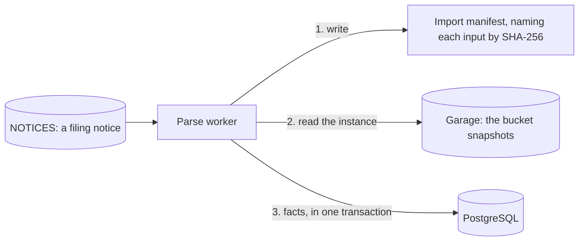

# The parse workers

<!-- status: Parse workers -->
**Status** ([status page](../status.md)): Parse workers: Planned; decided in part.
<!-- end status -->

The parse workers turn each filing's stored XBRL instance into facts, each
kept with its filing's acceptance time. Their role is decided, and no
specification governs them yet. This page says what's decided, which
statements already bind them, and what's still open, with the task that
settles each.

## What's decided

The design gives the parse workers one job: to read a stored XBRL instance
and write its facts with the filing's acceptance time, under an import
manifest. They're written in Python, and run as a Deployment scaled by the
depth of their queue ([components][design-components]). For one filing
([one filing, end to end][design-filing]):

1. A parse worker writes an import manifest, which names each input by its
   SHA-256.
2. It reads the filing's XBRL instance from Garage.
3. It inserts the facts in one transaction, with the filing's acceptance
   time.

From then on, "as of" queries for any time at or after the acceptance
include the facts ([one filing, end to end][design-filing]).

### Why the XBRL instance

The pipeline keeps the SEC's summaries, such as `companyfacts`, as evidence
of what the SEC published, not as the source of the facts: it parses facts
from each filing's XBRL instance
([what the pipeline keeps][design-keeps]). An instance gives every fact its
filing reports ([0009]). `companyfacts` gives a filing's facts of `us-gaap`
and `dei` concepts that have a unit, no dimensions, and aren't nil; facts
of a company's own concepts, facts with dimensions, and nil facts don't
appear in it ([SRC-14]).

### Their times

A fact has two times. Its valid time is the fiscal period or instant it
describes, and its transaction time is the acceptance time of the filing
that reported it, read from the filing, never the database's write time
([times][design-times], [0004]). A restated value appears from its own
filing's acceptance on, and earlier answers stay reproducible
([times][design-times]). How fiscal periods map to facts, and how
restatements appear, wait on the investigation's Q2 and Q3
([what waits on the investigation][design-waits]).

### Their input

The parse workers read filing notices, as the facts specification will say
([§9 of the notices][notices-messages]). The discoverer publishes a filing's
notice once its header and index page are held and read, and the XBRL
instance the index page names, if it names one, is held ([FILE-5]). The
notice gives each file with its feed, its URL, and its SHA-256, which is
what an import's manifest names an input by ([notice.schema.json], [IMP-2]).

### Through `edgar-asof`

The parse workers build facts through a pinned version of `edgar-asof`
([plan][plan-facts], [0009]), which [its own page](edgar-asof.md)
explains. In the cluster they give the library bodies
from the cluster store, and never use its client or keep a cache of their
own ([FETCH-18]).

The library's specification defines the fact model and what "as of T"
returns, and the pipeline's facts specification is to cite a version of it
([0009]). At its version 0.1.0, it reads facts from `companyfacts`, not
from XBRL instances ([edgar-asof's facts][asof-facts]). A fact's key is the
company's CIK, the concept as its taxonomy and name, the unit, and the
value's `start`, if it has one, and its `end` ([FACT-7]). Its value is kept
exactly, as an integer or a decimal, never as a binary floating-point
number ([FACT-8]). Each value becomes one fact, and none replaces another
filing's value for its key ([FACT-6]). Each fact's filing keeps its raw
acceptance time from `submissions`, and its header's beside it when the
caller asks for headers ([FACT-10], [FACT-11]).

Reading XBRL instances is the library's later task T11, with the parser the
pipeline's T12 chooses, ending in a release that the pipeline's T25 waits
on ([edgar-asof's plan][asof-plan-later], [plan][plan-facts]). Facts read
from instances may need dimensions in their keys, which no `companyfacts`
value has ([what edgar-asof's facts leave to later versions][asof-facts-left],
[SRC-14]). Facts
about `edgar-asof` on this page were checked against its `main` on October
14, 2026, at commit `515bb0d`.

## The rules that already bind them

The parse workers aren't specified, but statements that govern every import
and every service already apply to them.

- **Their manifests.** An import writes its manifest before it reads its
  inputs ([IMP-3]). A manifest gives the import's name, when it started,
  the tool, and its inputs ([IMP-1]), and each input names a feed, a URL,
  and a SHA-256 that a record of that feed and URL holds ([IMP-2]). An
  import reads its inputs only from its store's objects, in the cluster
  from the bucket over Garage's S3 API, never from the live source, so a
  rerun with the same inputs and the same `tool` commit reads the same
  bytes ([IMP-3], [§11 of the store][snapshots-imports]). Where an import
  in the cluster keeps its manifest is the facts specification's to say
  ([§11 of the store][snapshots-imports],
  [§13 of the store][snapshots-left]).
- **What they may read and write.** Their database role may only select
  the store's records and the discoverer's tables ([LOG-3], [TABLE-3]).
  Their Garage key may only read the bucket ([LOG-4], [GARAGE-4]). Each
  comes with them, in a later version of the deployment specification
  ([PG-7], [§9 of deployment][deployment-later]).
- **The notices they read.** A consumer of notices ignores fields it
  doesn't know, and acknowledges a notice that doesn't validate against its
  schema, or whose `kind` isn't its subject's, without acting on it
  ([MSG-2]). Their durable consumer of filing notices,
  `parse-workers-notices`, is made as soon as `NOTICES` is, before the
  first filing notice is published and before they're built ([NATS-5]).
- **Their image** is tagged with the commit it's built from, and loaded
  into kind, never pulled from a registry ([IMG-1], [IMG-2]).

## What's still open

| What's open | The task that settles it | It waits on |
| --- | --- | --- |
| How the parse workers scale with their queue's depth on kind | [0014], a decision record that T10 proposed ([0003]) | The owner's acceptance |
| Their deployment: KEDA in the operators' chart, their Deployment, and the `ScaledObject` that scales it | A version of the deployment specification, before T25 ([0014]) | A task the plan doesn't yet have, and 0014's acceptance |
| The XBRL parser: a narrow parser on lxml, or Arelle, an open-source XBRL processor whose plugins include the SEC's EDGAR Renderer ([0006]) | T12, a decision record; `edgar-asof` reads XBRL instances with the same parser | T1 and T2, both done |
| How facts are stored, and their times: the fact table, citing a version of `edgar-asof`'s specification for the fact model and what "as of T" returns | T17, `spec/facts.md` | T12, T16, and an `edgar-asof` release that specifies the fact model |
| What the parse workers do with a filing notice, and how they find the complete filings whose notices they didn't read | T17 ([§12 of the notices][notices-left]) | As above |
| Where an import in the cluster keeps its manifest | T17 ([§13 of the store][snapshots-left]) | As above |
| What an import's output is, and how a rerun is compared with the original | T18, the export ([open question 3 of the store][snapshots-open]) | T17 |
| Their metrics and traces, and the view of each filing's times from acceptance to facts available | T32, a minor version of the telemetry specification ([§11 of telemetry][telemetry-left]) | T17, T18, T19 |
| Building them | T25 | T17, T24, and an `edgar-asof` release that reads XBRL instances |

The tasks are in the plan's facts section ([plan][plan-facts]). The design
lists the XBRL parser as a decision still to come, T12, and how workers
scale by queue depth as proposed in [0014]
([decisions][design-decisions]).

## State, replicas, and scaling

The parse workers write facts to PostgreSQL, in the same database as the
records, filings, and coverage ([0004]), and read stored instances from
Garage ([IMP-3]). Decision 0004 has one transaction record a filing, its
parse, and its facts, so they can't disagree ([0004]). The notices'
specification records the filing apart from its parse: the discoverer adds
it to `filings` when a poll's list names it, in that message's own
transaction, before any parse ([SEEN-2], [DISC-2]). How the facts are
written is the facts specification's to say ([T17]).

They run as a Deployment scaled by queue depth
([components][design-components]). Queue depth, redeliveries, and consumer
lag are metrics, and what workers are scaled by ([0003]).

Decision record [0014], which T10 proposed and the owner hasn't yet
accepted, has KEDA scale the Deployment by their consumer's backlog: the
filing notices that `parse-workers-notices` hasn't delivered yet, with
those it has delivered that aren't acknowledged ([NATS-5]). KEDA reads the
backlog from NATS's monitoring port every 10 seconds. A notice in it starts
one worker, the workers grow to one for each 10 notices, up to three, and
they return to zero 5 minutes after the backlog last held one. Between
filings no worker runs, so the first filing after an idle spell waits for
KEDA's next check and a pod's start. Redeliveries are counted while they
await acknowledgment, but their count isn't an input; it stays a metric.
The backlog counts notices, not instances, so a burst of notices with
nothing to parse, such as a Backfill's Form 4s, can start all three
workers for the 5 minutes before the autoscaler scales them down
([0014]).

The work comes in two kinds. New filings arrive at the pace companies
file: the three companies filed 126 times in the 13 weeks to October 7,
2026, mostly Form 4s ([0010]). A Backfill brings many at once: every
filing its company's lists name in its range of dates, whatever its form
([BACKFILL-1]). Over the three companies' listed history, that's 9,689
filings, of which 484 have an instance, and 208 of those are their XBRL
10-Ks, 10-Qs, and amendments ([SRC-19], [SRC-20]). Each filing gets a
notice, whether or not it has an instance ([FILE-5]).
The six stored XBRL instances of 10-Ks and 10-Qs are from 0.9 MB to
10.9 MB each ([SRC-18]). The
[estimates](estimates.md#cpu-memory-and-storage) assume 150 to 250 MB of
memory a worker with lxml, or 0.5 to 2 GB with Arelle, and 0.5 to 2
seconds an instance with lxml, until the parser is chosen, task T12, and
the workers are measured. Under [0014], three workers parse 1.5 to 6
instances a second at that rate. Notices with an instance can come
faster. The fetcher's limit of 5 requests a second ([FETCH-6]) holds them
to about 1.7 a second on average, at three requests each: the header, the
index page, and the instance ([FILE-1]). But once a Backfill's headers and
index pages are fetched, each request for an instance that waited behind
them completes a filing, so they can come at up to 5 a second ([FILE-3],
[JOB-4]). A burst waits in the backlog until the workers drain it: three
take 1.3 to 5.4 minutes for the 484 instances at the estimated rate
([0014]).

## How they fail

The documents say this much now:

- **A database failover pauses parsing.** The parse workers' work waits in
  its stream and is delivered when the database is back ([0003],
  [outages and recovery][design-outages]). Decision 0003 has fetching go
  on meanwhile, but the store's specification has the fetcher add each
  record before it acknowledges its job ([JOB-6]), and the owner decided
  that it holds a fetch the database can't take the record of, sending
  nothing else meanwhile, so a failover pauses fetching too. A decision
  record that supersedes 0003's consequence comes with the version of the
  store's specification that states the held fetch, as the owner also
  decided
  ([Failures and recovery](failures-and-recovery.md#losing-the-databases-primary)).
- **A worker stopped partway adds nothing,** under [0014] as proposed.
  When the autoscaler removes a replica in the middle of a parse, its
  notice isn't acknowledged and is delivered again after 30 seconds
  ([NATS-5]), and its facts' transaction isn't committed. While no worker
  runs and KEDA can't read the backlog, notices wait in `NOTICES`. A notice
  whose parse always fails is delivered again without limit, so it keeps
  one worker running; what a worker does with a parse that fails is the
  facts specification's to say ([0014], [T17]).
- **A message delivered twice repeats its step harmlessly,** since filings
  are named by their accession numbers and bodies by their SHA-256
  ([one filing, end to end][design-filing], [0003]).
- **The facts can be rebuilt.** A rebuild drops the facts and imports them
  again from stored bodies, and the "as of" answers and the export's hashes
  are then compared with the originals ([testing on kind][design-testing]).
  Because an import reads only stored objects, named in its manifest, a
  rerun with the same inputs and the same `tool` commit reads the same
  bytes ([IMP-3]). The drills include the rebuild, task T31
  ([plan][plan-drills]).

No document yet says what the record shows of a parse that fails. How the
parse workers find the complete filings whose notices they didn't read is
the facts specification's, task T17
([§12 of the notices][notices-left]).

## What they depend on

- **NATS JetStream,** for the filing notices on `NOTICES` ([0003]), read
  through their durable consumer ([NATS-5]).
- **Garage,** for the stored instances, read over its S3 API ([IMP-3]).
- **PostgreSQL 18,** for the facts ([0004]).
- **KEDA,** which scales them by their consumer's backlog, reading it from
  NATS's monitoring port, under [0014] as proposed.
- **`edgar-asof`,** at a pinned release that reads XBRL instances, and the
  XBRL parser that task T12 chooses ([plan][plan-facts]).
- **Their libraries:** nats-py, psycopg, boto3, and the parser ([0006]).

## The alternatives weighed

- **Where facts are kept** ([0004]). PostgreSQL 18 holds them, since its
  constraints, an insert-only role, and from version 18 its temporal keys
  check each write as it happens. DuckDB alone, with facts as Parquet in
  Garage, was the lightest option, but checks integrity after the fact, and
  joins records and facts across files. Both, PostgreSQL for records and
  DuckDB for facts, was rejected: each benefit comes more cheaply from one
  engine. A natively bitemporal database, such as XTDB, takes its
  transaction time from when it received a write, where the pipeline's is
  when the SEC accepted the filing.
- **How work reaches them** ([0003]). A queue in PostgreSQL, with
  `SELECT ... FOR UPDATE SKIP LOCKED`, needs no new component, but fetching
  would stop whenever the database failed over or was down, and the
  database would carry the polling load. In NATS JetStream, their work
  waits through a failover.
- **The parser** ([0006]): a narrow parser on lxml, or Arelle; task T12
  decides.
- **How they scale** ([0014], proposed). A HorizontalPodAutoscaler on an
  external metric served from Prometheus, through prometheus-adapter,
  needs no new definitions, but stops scaling while Prometheus is down,
  and can't scale to zero on kind's Kubernetes 1.36. The scheduler could
  scale them, with code to write that KEDA already has. A
  HorizontalPodAutoscaler on CPU follows work already running, and can't
  scale from zero. A fixed number of replicas wouldn't scale by queue
  depth, as the design and [0003] have them.
- **Building facts in a library** ([0009]): a package in this repository,
  a separate public library, or none. The owner chose `edgar-asof`, a
  separate public repository, which can be public and usable before the
  pipeline runs.

## Where they're decided and specified

| Document | What it gives the parse workers |
| --- | --- |
| [The design's components][design-components] | Their role, their language, and a Deployment scaled by queue depth. |
| [0006] | Python, and the parser's two candidates. |
| [0009] | Facts built through a pinned `edgar-asof`, whose specification defines the fact model. |
| [0003], [0004] | Their queue, which they're scaled by, and the database their facts are kept in. |
| [0014], proposed | How they scale: KEDA, from zero to three, by their consumer's backlog. |
| [IMP-1], [IMP-2], [IMP-3] | Their manifests, and reading only stored objects. |
| [FETCH-18] | `edgar-asof` reads bodies from the store, never fetching. |
| [LOG-3], [LOG-4], [TABLE-3], [GARAGE-4], [PG-7] | What their role and key may read, and that each is their own. |
| [MSG-2] | How they treat a notice. |
| [NATS-5], [NATS-6] | Their durable consumer of filing notices, made before the first is published. |

The status page names their decision records, 0006, 0009, and 0014, which
isn't yet Accepted; tasks T17 and T32, which specify them; T25, which
builds them; and T10 and T12, which decide them ([status page][status]).

[0003]: ../decisions/0003-queue-work-in-nats-jetstream.md
[0004]: ../decisions/0004-keep-the-record-in-postgresql-18.md
[0006]: ../decisions/0006-write-the-services-in-go-and-python.md
[0009]: ../decisions/0009-read-edgar-through-a-public-point-in-time-library.md
[0010]: ../decisions/0010-poll-each-companys-submissions-and-measure-lag-from-the-record.md
[0014]: ../decisions/0014-scale-the-parse-workers-with-keda-by-their-consumers-backlog.md
[BACKFILL-1]: ../../spec/controls.md#7-backfill
[FETCH-6]: ../../spec/snapshots.md#10-fetching
[FILE-1]: ../../spec/notices.md#7-a-filings-files
[FILE-3]: ../../spec/notices.md#7-a-filings-files
[DISC-2]: ../../spec/notices.md#processing
[JOB-4]: ../../spec/snapshots.md#jobs-and-events
[JOB-6]: ../../spec/snapshots.md#jobs-and-events
[SEEN-2]: ../../spec/notices.md#6-when-each-source-first-showed-each-filing
[status]: ../status.md
[design-keeps]: ../design.md#what-the-pipeline-keeps
[design-times]: ../design.md#times
[design-components]: ../design.md#components
[design-filing]: ../design.md#one-filing-end-to-end
[design-outages]: ../design.md#outages-and-recovery
[design-testing]: ../design.md#testing-on-kind
[design-waits]: ../design.md#what-waits-on-the-investigation
[design-decisions]: ../design.md#decisions
[plan-facts]: ../plan.md#facts
[plan-drills]: ../plan.md#traces-logs-and-drills
[SRC-14]: ../../investigation/edgar.md#findings-so-far
[SRC-18]: ../../investigation/edgar.md#findings-so-far
[SRC-19]: ../../investigation/edgar.md#findings-so-far
[SRC-20]: ../../investigation/edgar.md#findings-so-far
[notice.schema.json]: ../../spec/schemas/notice.schema.json
[snapshots-imports]: ../../spec/snapshots.md#11-imports
[snapshots-open]: ../../spec/snapshots.md#13-open-questions
[snapshots-left]: ../../spec/snapshots.md#left-to-other-specifications
[IMP-1]: ../../spec/snapshots.md#11-imports
[IMP-2]: ../../spec/snapshots.md#11-imports
[IMP-3]: ../../spec/snapshots.md#11-imports
[LOG-3]: ../../spec/snapshots.md#8-history
[LOG-4]: ../../spec/snapshots.md#8-history
[FETCH-18]: ../../spec/snapshots.md#the-fetcher
[notices-messages]: ../../spec/notices.md#9-messages-and-processing
[notices-left]: ../../spec/notices.md#left-to-other-specifications
[T17]: ../plan.md#facts
[TABLE-3]: ../../spec/notices.md#4-the-record-of-notices
[FILE-5]: ../../spec/notices.md#7-a-filings-files
[MSG-2]: ../../spec/notices.md#streams
[telemetry-left]: ../../spec/telemetry.md#left-to-other-specifications
[deployment-later]: ../../spec/deployment.md#9-later-versions
[GARAGE-4]: ../../spec/deployment.md#garage
[NATS-5]: ../../spec/deployment.md#durable-consumers
[NATS-6]: ../../spec/deployment.md#durable-consumers
[PG-7]: ../../spec/deployment.md#the-stores-database
[IMG-1]: ../../spec/deployment.md#the-pipelines-own-images
[IMG-2]: ../../spec/deployment.md#the-pipelines-own-images
[asof-facts]: https://github.com/nslaughter/edgar-asof/blob/515bb0dc7af1b76a269413f29ba3edc390193e46/spec/facts.md
[asof-facts-left]: https://github.com/nslaughter/edgar-asof/blob/515bb0dc7af1b76a269413f29ba3edc390193e46/spec/facts.md#left-to-other-specifications
[asof-plan-later]: https://github.com/nslaughter/edgar-asof/blob/515bb0dc7af1b76a269413f29ba3edc390193e46/docs/plan.md#later
[FACT-6]: https://github.com/nslaughter/edgar-asof/blob/515bb0dc7af1b76a269413f29ba3edc390193e46/spec/facts.md#5-facts
[FACT-7]: https://github.com/nslaughter/edgar-asof/blob/515bb0dc7af1b76a269413f29ba3edc390193e46/spec/facts.md#5-facts
[FACT-8]: https://github.com/nslaughter/edgar-asof/blob/515bb0dc7af1b76a269413f29ba3edc390193e46/spec/facts.md#5-facts
[FACT-10]: https://github.com/nslaughter/edgar-asof/blob/515bb0dc7af1b76a269413f29ba3edc390193e46/spec/facts.md#6-filings-and-their-acceptance-times
[FACT-11]: https://github.com/nslaughter/edgar-asof/blob/515bb0dc7af1b76a269413f29ba3edc390193e46/spec/facts.md#6-filings-and-their-acceptance-times
