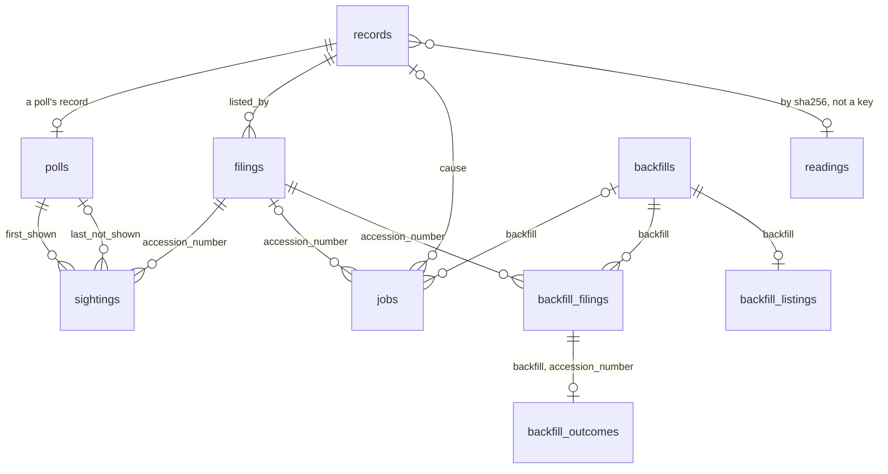
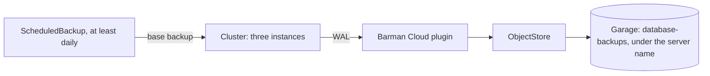

# PostgreSQL 18

<!-- status: PostgreSQL 18 -->
**Status** ([status page](../status.md)): PostgreSQL 18: Specified.
<!-- end status -->

PostgreSQL 18 holds the pipeline's record: a row for every fetch, what the
discoverer found in each, the views that give coverage, gaps, and lags,
and, once they're specified, the facts. This page explains how
CloudNativePG runs it, the database and its roles, its tables and views,
its backups to Garage, how it fails, and why PostgreSQL was chosen.

## What it does for the pipeline

The pipeline needs one place for its fetch records, the filings it has seen
and their times, its coverage and gaps, and the facts parsed from each
filing, and it must answer "as of" queries: what was known on a past date
([0004]). The scale is small, millions of rows even after a backfill, so
speed doesn't decide; memory, integrity, and what the project demonstrates
do ([0004]).

Three properties come with that choice:

- **The database enforces the append-only record.** Each service's role may
  insert into the tables it writes and select from the rest, and none may
  update, delete, or truncate a row ([LOG-3], [TABLE-3]). A correction is a
  new row ([snapshots, §1][store-guarantees]).
- **Writes are checked as they happen,** by the tables' constraints, so the
  database refuses a malformed row ([STORE-2], [TABLE-2]).
- **One transaction can hold what must agree.** The discoverer adds the
  rows each message calls for in one transaction ([DISC-2]). Decision 0004
  has a filing, its parse, and its facts recorded in one, so they can't
  disagree ([0004]); the notices' specification has the discoverer add the
  filing in its own transaction, when a poll's list names it, before any
  parse ([SEEN-2], [DISC-2]), and how facts are written waits on the facts
  specification ([T17]).

The times are the SEC's, not the database's. Every time is an explicit
column, kept as its source gives it, and never the database's write time
([0004], [0010]).

## Three instances, run by CloudNativePG

The umbrella chart renders one CloudNativePG `Cluster`, with three
instances ([PG-3]), each on a worker node of its own: the `Cluster` sets a
required pod anti-affinity on the node's host name ([PLACE-1]), so the
three run one on each worker node ([PLACE-2]). The three let the loss of a
node, and a failover, be shown ([the kind cluster][KIND-1], [0004]).

The major version is pinned through an image catalog. The charts render one
CloudNativePG `ImageCatalog`, whose only entry has `major: 18` and names an
image from `ghcr.io/cloudnative-pg/postgresql`, with a tag that begins
`18.`, by digest; the `Cluster` names its image only through that catalog
([PG-1]). Every instance then reports a `server_version_num` from 180000 to
189999 ([PG-2]). A new minor version changes only the catalog's image; a
new major version takes a decision record that supersedes 0004, and a major
version of the deployment's specification ([deployment, §7][pg-section]).

Version 18 is the one 0004 chose: from 18, PostgreSQL also checks writes by
temporal keys, `WITHOUT OVERLAPS` ([0004]). The tables specified so far use
constraints and grants; the fact table, with its valid and transaction
times, is still to be specified, in task T17 ([plan][plan-facts]).

The operator comes from the third of the four releases, the operators'
chart, with its Barman Cloud plugin, in the namespace `cnpg-system`;
cert-manager, the second release, gives the plugin its certificates
([Deployment](deployment.md#the-four-charts-and-their-order)). The
operators run one replica each, and while one restarts, its resources wait
in the API server ([deployment, §5][dependencies]).

## The database and its roles

The `Cluster` creates one database, `edgar`, owned by the role `edgar`,
whose password CloudNativePG generates in the cluster. It turns superuser
access off, and no service connects as the owner, who could change a
record: only the Job that creates the store's table does ([PG-6]). Each
service that uses the database connects as a role of its own, which the
`Cluster` declares, able to log in and without superuser, `createdb`,
`createrole`, `replication`, or `bypassrls`, with its password from a value
of the umbrella chart ([PG-7], [SECRET-1]).

| Role | Used by | `records` | The notices' tables | The views in `dashboards` |
| --- | --- | --- | --- | --- |
| `edgar` | The Job that creates the store's table ([PG-8]) | Owner | Not specified | Not specified |
| `fetcher` | The fetcher | `INSERT`, `SELECT` ([LOG-3]) | `SELECT` only ([TABLE-3]) | Not specified |
| The discoverer's | The discoverer | `SELECT` only ([LOG-3]) | `INSERT`, `SELECT` ([TABLE-3]) | Not specified |
| Each other service's | That service | `SELECT` only ([LOG-3]) | `SELECT` only ([TABLE-3]) | Not specified |
| Grafana's | Grafana | None ([VIEW-3]) | None ([VIEW-3]) | Use the schema, and select its views ([VIEW-3]) |

In the deployment's version 1.0.0, the values list one role, `fetcher`;
each other service's comes with that service ([PG-7]). The discoverer's
role and Grafana's, with their grants, are task T38's ([notices, left to
other specifications][notices-left], [telemetry, left to other
specifications][telemetry-left]).

## The store's table, records

The cluster store's records are the table `records`, one row per fetch,
which [`records.sql`][records-sql] defines ([STORE-1]). Its columns are a
record's fields, named as the fields are ([§6 of the store][records]), and
two more: `id`, which numbers the records in the order they're added, and
`job`, the job the fetch was made for, which no two records share. Each
header's value is kept as text, as the response gave it, and the record's
own times, `requested_at` and `received_at`, by the fetcher's clock, to the
millisecond ([records]).

The table refuses a row that breaks the record's rules ([STORE-2]):

- `sha256`, `bytes`, and `object` are all set or all null, and `object` is
  the name the hash gives ([REC-3]);
- a `200` without an error names a body ([REC-4]), a `304` that names no
  version has an error ([REC-5]), and no other outcome names one ([REC-6]);
- no response means an error ([REC-7]), and `received_at` is set exactly
  when there's a status, and `date` only then ([REC-11]);
- `tool` names the fetcher and the 40-character commit its image was built
  from ([records]).

Its index on `url` and `id` finds each URL's latest earlier record with a
version, which gives a conditional request its validators and a `304` its
version ([FETCH-4], [REC-5]).

A Job, run by Helm after each install and upgrade, connects as the owner,
creates the table and its index from a copy of `records.sql` in one
transaction, unless the table exists, so the table never exists without its
index. It grants the fetcher's role `INSERT` and `SELECT`, each other
service's role `SELECT` only, and no other role anything. It waits until
the database accepts its connection and each role exists, and succeeds when
what it would create already exists ([PG-8]). On kind, the fetcher's role
can insert a row and select it, every other service's can select it, and
none can update, delete, or truncate one ([PG-9]). Since the Job creates
the table only where there's none, a later version of the table needs a
migration, which a later version of the deployment specifies ([deployment,
§9][later]).

## The notices' tables and views

The discoverer keeps what it finds beside `records`, in the tables and
views that [`notices.sql`][notices-sql] defines ([TABLE-1]). Rows are only
added, so each row says what the discoverer found when it found it
([TABLE-3]). What the record's times mean, and what an "as of" query
returns, is on [The data model and its times](data-model.md).

| Table | One row for each |
| --- | --- |
| `polls` | Poll whose event the discoverer read ([GAP-1]) |
| `readings` | Version it read as a list, a header, or an index page, once for each version ([SEEN-1], [FILE-3]) |
| `filings` | Filing that a list names, with the values of its first listing, as given ([SEEN-2]) |
| `sightings` | Filing and Source whose polls showed it, with the two polls that bound when it first did ([SEEN-2]) |
| `jobs` | Job the discoverer queued ([FILE-2], [LIST-1]) |
| `backfills`, `backfill_filings`, `backfill_listings`, `backfill_outcomes` | Backfill the scheduler ordered, the filings in its range, when its lists were all read, and each filing fetched or failed ([LIST-1] to [LIST-4]) |

| View | One row for each |
| --- | --- |
| `held_files` | File of a filing that the record holds, with the first record that names a version of it ([FILE-6]) |
| `gaps` | Gap in a Source's coverage of a URL, ended or open ([GAP-2]) |
| `backfill_progress` | Backfill, with its progress ([LIST-6]) |
| `lags` | Sighting, with its times and the bounds of each lag ([LAG-1]) |

Two choices in these tables matter for what the record can be trusted to
say.

**Gaps are a view, not rows.** Each Source's gaps follow from its polls by
one definition, computed when the view is read, so a record that arrives
late changes what the view gives and nothing stored ([notices,
§1][notices-guarantees], [GAP-2]).

**Times are kept as given, and read as instants only in the views.** A
filing's `acceptanceDateTime` from `submissions` is kept as text, and so
are the 14 digits of its header's `ACCEPTANCE-DATETIME`, which give no time
zone ([SRC-1], [SRC-2]). The view `lags` reads the first as the instant it
states, and the header's digits as US Eastern time ([notices, §10][lags]).
A finding that settles the header's zone changes one function in
`notices.sql`, in a new version of the notices' specification, and nothing
stored ([notices, open question 2][notices-questions]).

The tables and views of `notices.sql` are made after the store's table,
with their grants, by a later version of the deployment: task T38 specifies
it ([notices, left to other specifications][notices-left]).

## The views Grafana reads

Grafana reads the record through three views made for it, `coverage`,
`gaps`, and `lags`, in a schema of their own, `dashboards`, which
[`dashboards.sql`][dashboards-sql] defines over the notices' tables and
views ([VIEW-1], [VIEW-2]). Grafana's role may use that schema and select
its views, and can neither read nor change any table or view of
`records.sql` or `notices.sql` ([VIEW-3]). The views don't run with the
reader's rights, so each reads the record as the views' owner does
([`dashboards.sql`][dashboards-sql]). What each view gives, and the
question it answers, is on
[Observability](observability.md#the-views-grafana-reads).

Grafana's role, its password, and its PostgreSQL data source, and
`dashboards.sql`, applied after `notices.sql` with [VIEW-3]'s grants, are
task T38's too ([telemetry, left to other specifications][telemetry-left]).

## Facts, still to be specified

The facts share the database with the record ([0004]). The decision record
gives their times: the fiscal period as valid time, the filing's acceptance
time as transaction time, and the pipeline's own first-seen time with the
bounds of any gap ([0004]). A parse worker writes an import manifest, reads
a filing's XBRL instance from Garage, and inserts its facts in one
transaction with the filing's acceptance time ([one filing, end to
end][end-to-end]). The fact table is task T17's, which cites a version of
`edgar-asof`'s specification for the fact model and what "as of T" returns
([plan][plan-facts]).

## Backups to Garage

The database's archive, its write-ahead log and its base backups, goes to
Garage through CloudNativePG's Barman Cloud plugin, as the `Cluster`'s WAL
archiver ([PG-4]):

- **Where.** One `ObjectStore`, whose destination is Garage's
  `database-backups` bucket, reached with that bucket's key from its Secret
  ([PG-4], [GARAGE-2]).
- **When.** The WAL continuously, and a base backup at least once a day, by
  a `ScheduledBackup` ([PG-4]).
- **Under which name.** A server name, the umbrella chart's value
  `database.backups.serverName`, which the chart requires and no committed
  values file sets ([PG-4]). Before a new cluster's first archive, the
  plugin checks that the archive under its name is empty. So each cluster
  has a name of its own: CI sets a new one for each cluster it creates, and
  the owner one for each cluster they create, keeping it for that cluster's
  upgrades ([PG-10]). A cluster recreated with the same host directory
  archives into an empty destination, and the earlier cluster's archive
  stays as it was ([deployment, §7][backups]).

On kind, the `Cluster` reports that continuous archiving to Garage works,
and a base backup completes ([PG-5]). Each instance serves the plugin's
metrics, which Prometheus scrapes ([SCRAPE-1]), and `DatabaseBackupStale`
fires once the latest base backup has been more than a day old for an hour
([ALERT-3]).

The plugin has been tested against MinIO, not Garage, so a restore from
these backups is shown on kind before they're relied on ([0002],
[deployment, §7][backups]). Task T31's drills restore the database from its
backups in Garage ([plan][plan-drills]).

## What outlives the cluster

The database's volumes are on kind's default class, `standard`, not on the
class `edgar-retained` that NATS, Garage, Prometheus, and Alertmanager use
([PG-3], [VOL-2]). A data directory left by an earlier cluster would stop a
new one from initializing, so the database's data doesn't outlive its
cluster; what does is its backups in Garage, from which it can be restored
([volumes]). Recreating the cluster therefore means restoring the database
from Garage, which the drills are still to show.

## How it scales

- **Rows grow with polls.** At the cadence each company's Source starts at,
  the three companies add 25,920 records a day ([0010]), about 9.5 million
  polls a year ([telemetry, open question 4][telemetry-questions]). Each
  filing adds a few rows more: its row in `filings`, its sightings, and the
  jobs, records, and readings of its files' fetches.
- **The views read every poll.** `coverage` and `gaps` grow with the
  record, so how fast the dashboards read them is measured on kind, and a
  later version adds what they need, such as an index or a stored summary
  of each day, if they slow ([telemetry, open question
  4][telemetry-questions]).
- **Memory is the cost.** Three always-on instances and the operator are
  the design's largest steady memory cost, and are sized on kind ([0004]).
  Each component's requests and limits come in a later version of the
  deployment ([deployment, §9][later]).

The [estimates](estimates.md#postgresql) put the tables and their indexes
at 6.2 to 9.3 GB a year at the default scope, and give the growth of the
write-ahead log and the backups. With a base backup a day, and none
removed, the backups grow with the square of the time, and are most of
what fills the host's disk
([scale and limits](scale-and-limits.md#the-hosts-disk)).

## How it fails

| What fails | What happens |
| --- | --- |
| One instance, or its worker node | Three instances, one on each worker node, keep the database running when one node is lost ([deployment, §1][dep-guarantees]). |
| The primary | A failover can be shown ([0004]), and a drill does: task T31 fails the database over, and checks that the record shows each gap and lost nothing ([plan][plan-drills]). The discoverer acknowledges a message only once its rows are added, so what it couldn't write waits in `RECORDS` and is delivered again ([DISC-1], [DISC-2]). |
| The operator, restarting | Its resources wait in the API server ([deployment, §5][dependencies]). |
| The archive to Garage | `DatabaseBackupStale` fires once the latest base backup has been more than a day old for an hour ([ALERT-3]). |
| The whole database | It's restored from its backups in Garage ([volumes]), which a drill is still to show ([0002]). |
| A malformed row, or a change to a row | The constraints refuse the first, and the grants the second ([STORE-2], [TABLE-2], [LOG-3], [TABLE-3]). |

Decision 0003 expects fetching to go on while the database fails over, with
the parse workers' work waiting in its stream ([0003]), and the design says
a failover pauses parsing, not fetching ([outages and recovery][outages]).
The fetcher adds each fetch's record to the table before it publishes the
event and acknowledges the job, though ([JOB-6]), and no statement yet says
what it does while the database can't take a record. The database's
replication lag and failovers are metrics of a later version of the
telemetry ([telemetry, left to other specifications][telemetry-left]).

## What it depends on

- **The CloudNativePG operator and its Barman Cloud plugin,** from the
  operators' chart, and **cert-manager,** which gives the plugin its
  certificates ([dependencies]).
- **Garage,** for its backups: the bucket `database-backups` and its key
  ([PG-4], [GARAGE-2]).
- **Three worker nodes** and kind's `standard` class ([PLACE-1], [PG-3]).
- **Its roles' passwords,** as values of the umbrella chart ([SECRET-1]).

The fetcher writes `records`, the discoverer writes the notices' tables,
the other services read them, and Grafana reads the views made for it.

## Where it's specified

| Statement | What it says | Checked by |
| --- | --- | --- |
| [PG-1], [PG-2] | One image catalog, of major version 18, names the image, and every instance reports PostgreSQL 18. | tests, kind |
| [PG-3] | One `Cluster`, of three instances, on kind's `standard` class. | tests |
| [PG-4], [PG-5], [PG-10] | The WAL and daily base backups go to Garage through the plugin, under a server name new for each cluster. | tests, kind, review, operator |
| [PG-6], [PG-7] | One database, `edgar`, whose owner no service uses; each service a role of its own. | tests |
| [PG-8], [PG-9] | A hook Job creates `records` and its grants; only the fetcher's role inserts, and none changes a row. | tests, kind |
| [PLACE-1], [PLACE-2] | Each instance needs a worker node of its own, and runs on one. | tests, kind |
| [STORE-1], [STORE-2] | `records.sql` defines the table, and the database holds it and refuses a malformed record. | tests, kind |
| [LOG-3] | Only the fetcher adds records, and no one changes them. | kind |
| [TABLE-1] to [TABLE-3] | `notices.sql` defines the notices' tables and views; the database holds them; only the discoverer adds rows. | tests, kind |
| [GAP-2], [FILE-6], [LIST-6], [LAG-1] | What the notices' views give. | kind |
| [VIEW-1] to [VIEW-3] | `dashboards.sql` defines Grafana's views; the database holds them; Grafana's role reads only them. | tests, kind |
| [ALERT-3], [SCRAPE-1] | The alert on a stale backup, and the scraping of the instances' metrics. | tests |

The database and its backups are built by task T20; the notices' tables and
Grafana's views are specified by T38, a version of the deployment's
specification; neither task is done ([plan][plan-observing]).

## The alternatives decision 0004 weighed

| Option | What the record says of it | Outcome |
| --- | --- | --- |
| PostgreSQL alone | One transactional store. Writes are checked as they happen: by constraints, by a role that can insert but not update or delete, and, from PostgreSQL 18, by temporal keys. It is the largest steady memory cost in the design. | Chosen: PostgreSQL 18, run by CloudNativePG with three instances. |
| DuckDB alone | Facts as write-once Parquet files in Garage, records in a NATS stream, and DuckDB embedded in the query service. The lightest option, with no database server, but integrity is checked after the fact rather than enforced, and records and facts are joined across files. | Rejected. |
| Both: PostgreSQL for records, Parquet and DuckDB for facts | Each of its benefits comes more cheaply from one engine, and it adds queries across two stores, reconciliation between them, and two of every backup, migration, and metric. | Rejected. |
| A natively bitemporal database, such as XTDB | Its transaction time is when the database received a write, but the pipeline's is when the SEC accepted the filing, so it would need explicit time columns anyway; it is also heavier and less familiar. | Rejected. |

The decision also gives the facts a deterministic Parquet export, written
to Garage, which makes the dataset portable: anyone can query it with
DuckDB, pandas, or Polars without the cluster ([0004]).

[0002]: ../decisions/0002-store-bodies-in-garage.md
[0003]: ../decisions/0003-queue-work-in-nats-jetstream.md
[0004]: ../decisions/0004-keep-the-record-in-postgresql-18.md
[0010]: ../decisions/0010-poll-each-companys-submissions-and-measure-lag-from-the-record.md
[end-to-end]: ../design.md#one-filing-end-to-end
[outages]: ../design.md#outages-and-recovery
[plan-drills]: ../plan.md#traces-logs-and-drills
[plan-facts]: ../plan.md#facts
[plan-observing]: ../plan.md#observing-filings
[SRC-1]: ../../investigation/edgar.md#findings-so-far
[SRC-2]: ../../investigation/edgar.md#findings-so-far
[backups]: ../../spec/deployment.md#instances-and-backups
[dep-guarantees]: ../../spec/deployment.md#1-guarantees
[dependencies]: ../../spec/deployment.md#5-dependencies
[GARAGE-2]: ../../spec/deployment.md#garage
[KIND-1]: ../../spec/deployment.md#the-kind-cluster
[later]: ../../spec/deployment.md#9-later-versions
[pg-section]: ../../spec/deployment.md#7-postgresql
[PG-1]: ../../spec/deployment.md#7-postgresql
[PG-2]: ../../spec/deployment.md#7-postgresql
[PG-3]: ../../spec/deployment.md#instances-and-backups
[PG-4]: ../../spec/deployment.md#instances-and-backups
[PG-5]: ../../spec/deployment.md#instances-and-backups
[PG-6]: ../../spec/deployment.md#the-stores-database
[PG-7]: ../../spec/deployment.md#the-stores-database
[PG-8]: ../../spec/deployment.md#the-stores-database
[PG-9]: ../../spec/deployment.md#the-stores-database
[PG-10]: ../../spec/deployment.md#instances-and-backups
[PLACE-1]: ../../spec/deployment.md#placement
[PLACE-2]: ../../spec/deployment.md#placement
[SECRET-1]: ../../spec/deployment.md#credentials
[T17]: ../plan.md#facts
[VOL-2]: ../../spec/deployment.md#volumes
[volumes]: ../../spec/deployment.md#volumes
[DISC-1]: ../../spec/notices.md#processing
[DISC-2]: ../../spec/notices.md#processing
[FILE-2]: ../../spec/notices.md#7-a-filings-files
[FILE-3]: ../../spec/notices.md#7-a-filings-files
[FILE-6]: ../../spec/notices.md#7-a-filings-files
[GAP-1]: ../../spec/notices.md#5-polls-coverage-and-gaps
[GAP-2]: ../../spec/notices.md#5-polls-coverage-and-gaps
[LAG-1]: ../../spec/notices.md#10-times-and-lags
[lags]: ../../spec/notices.md#10-times-and-lags
[LIST-1]: ../../spec/notices.md#8-backfills
[LIST-4]: ../../spec/notices.md#8-backfills
[LIST-6]: ../../spec/notices.md#8-backfills
[notices-guarantees]: ../../spec/notices.md#1-guarantees
[notices-left]: ../../spec/notices.md#left-to-other-specifications
[notices-questions]: ../../spec/notices.md#12-open-questions
[SEEN-1]: ../../spec/notices.md#6-when-each-source-first-showed-each-filing
[SEEN-2]: ../../spec/notices.md#6-when-each-source-first-showed-each-filing
[TABLE-1]: ../../spec/notices.md#4-the-record-of-notices
[TABLE-2]: ../../spec/notices.md#4-the-record-of-notices
[TABLE-3]: ../../spec/notices.md#4-the-record-of-notices
[dashboards-sql]: ../../spec/schemas/dashboards.sql
[notices-sql]: ../../spec/schemas/notices.sql
[records-sql]: ../../spec/schemas/records.sql
[FETCH-4]: ../../spec/snapshots.md#10-fetching
[JOB-6]: ../../spec/snapshots.md#jobs-and-events
[LOG-3]: ../../spec/snapshots.md#8-history
[REC-3]: ../../spec/snapshots.md#6-records
[REC-4]: ../../spec/snapshots.md#6-records
[REC-5]: ../../spec/snapshots.md#6-records
[REC-6]: ../../spec/snapshots.md#6-records
[REC-7]: ../../spec/snapshots.md#6-records
[REC-11]: ../../spec/snapshots.md#6-records
[records]: ../../spec/snapshots.md#6-records
[STORE-1]: ../../spec/snapshots.md#the-cluster-store
[STORE-2]: ../../spec/snapshots.md#the-cluster-store
[store-guarantees]: ../../spec/snapshots.md#1-guarantees
[ALERT-3]: ../../spec/telemetry.md#7-alerts
[SCRAPE-1]: ../../spec/telemetry.md#6-scraping
[telemetry-left]: ../../spec/telemetry.md#left-to-other-specifications
[telemetry-questions]: ../../spec/telemetry.md#11-open-questions
[VIEW-1]: ../../spec/telemetry.md#8-the-views-grafana-reads
[VIEW-2]: ../../spec/telemetry.md#8-the-views-grafana-reads
[VIEW-3]: ../../spec/telemetry.md#8-the-views-grafana-reads
