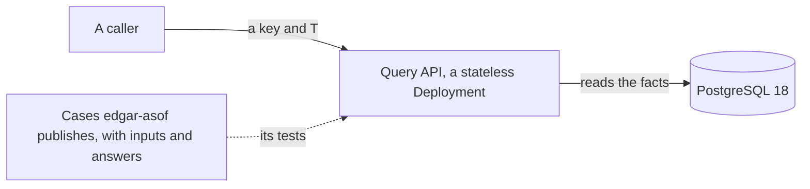

# The query API

<!-- status: Query API -->
**Status** ([status page](../status.md)): Query API: Decided.
<!-- end status -->

The query API answers "as of T": for a fact's key, what was known at an
instant T, decided by when the SEC accepted the filings that reported it.
Its role is decided, and no specification governs it yet. This page says
what's decided, what "as of T" returns as `edgar-asof`'s specification
defines it, and what's still open, with the task that settles each.

## What's decided

The design gives the query API one job, to answer "as of T". It's written
in Go, and runs as a stateless Deployment that reads PostgreSQL
([components][design-components]). Its libraries are `net/http` and pgx
([0006]). It's tested against cases that `edgar-asof` publishes, so that
the pipeline and the library answer the same way ([0009], [plan][plan-facts]).

An "as of T" query uses acceptance as transaction time. For each fact's
key, it returns the value from the latest filing accepted at or before T.
A restated value appears from its filing's acceptance on, and earlier
answers stay reproducible ([times][design-times]). Once a parse worker has
written a filing's facts, "as of" queries for any time at or after its
acceptance include them ([one filing, end to end][design-filing]).

The record keeps the times as explicit columns: a fact's fiscal period as
its valid time, and its filing's acceptance time as its transaction time,
never the database's write time ([0004]). First-seen time answers a
different question, what the pipeline held at T, and its gap flag says when
that answer is approximate. The time of recovery is never put in place of
the SEC's ([times][design-times]).

## What "as of T" returns

`edgar-asof`'s specification defines the fact model and what "as of T"
returns, and the pipeline's facts specification, task T17, is to cite a
version of it ([0009], [plan][plan-facts]). The library has
[a page of its own](edgar-asof.md). Its version 0.1.0 defines them
for the values of `companyfacts` ([edgar-asof's facts][asof-facts]).

- **A key** is a company's CIK, a concept, written as its taxonomy and its
  name, such as `us-gaap:Revenues`, a unit, and the value's `start`, if it
  has one, and its `end` ([FACT-7]). Each value is kept exactly, as an
  integer or a decimal ([FACT-8]), and each filing's value for a key is a
  fact of its own, beside every other's ([FACT-6]).
- **An answer** is for one key, an instant T, and an interpreter, which
  turns a filing's raw acceptance times into an instant. The caller passes
  all three, and there's no default interpreter ([ASOF-1], [TIME-6],
  [TIME-9]).
- **Each filing** of the key's facts is given to the interpreter once,
  with its raw times, and each fact is placed at the instant the
  interpreter gives its filing, or left unplaced if it gives none
  ([ASOF-2]).
- **The answer has four parts** ([ASOF-3]). Facts placed at or before T
  are known at T: those at the latest such instant are its `known`, and the
  others its `earlier`. Facts placed after T are its `later`, and the
  unplaced its `unplaced`. `known` holds more than one fact only when they
  share that instant: the library doesn't choose among them.
- **Only T and the instants decide** which part a fact is in. A fact's
  fiscal year and period, its `frame`, its form, and its filing date change
  nothing ([ASOF-4]). So an amendment is known from its own acceptance, as
  any filing is ([SRC-16]), and two filings of the same day are ordered by
  their instants, not their filing date ([SRC-10]).
- **The answer is reproducible.** Each part is in a fixed order
  ([ASOF-5]), and the answer gives its key, T, its interpreter, and its
  inputs: the URL and SHA-256 of each body its facts were read from
  ([ASOF-6], [FACT-5]). The same bodies, key, T, and interpreter give the
  same answer ([§1 of edgar-asof's facts][asof-facts-guarantees]).

An answer doesn't say whether a fact restates an earlier one or reports it
again, rounded or unchanged: `companyfacts` marks no change and gives no
`decimals`, so a changed value can be either
([§7 of edgar-asof's facts][asof-facts-asof], [SRC-15]).

The library's specification gives an example. Apple's
`us-gaap:OtherAssetsNoncurrent` in `USD` at 2025-09-27, with no `start`,
as of 2026-03-01T00:00:00Z, read with the interpreter that takes
`submissions`' `acceptanceDateTime` as the instant it states ([TIME-7]):

| Filing | Value | Part |
| --- | --- | --- |
| The 10-K for the year ending 2025-09-27 | 83,727,000,000 | `earlier` |
| The 10-Q of 2026-01-30 | 83,727,000,000 | `known` |
| The 10-Q of 2026-05-01 | 72,634,000,000 | `later` |
| The 10-Q of 2026-07-31 | 72,634,000,000 | `later` |

([§7 of edgar-asof's facts][asof-facts-asof], [SRC-15])

Facts about `edgar-asof` on this page were checked against its `main` on
October 14, 2026, at commit `515bb0d`.

### Where the design and the library's specification differ in detail

The design summarizes the answer as the value from the latest filing
accepted at or before T, for a key of company, concept, unit, period, and
dimensions ([times][design-times]). The library's version 0.1.0 gives more
and less than that:

- **Its answer has four parts,** and its `known` can hold several facts
  that share the latest instant ([ASOF-3]).
- **Its key has no dimensions,** since no `companyfacts` value has any
  ([SRC-14]). Facts read from XBRL instances, in a later version, may need
  them ([what edgar-asof's facts leave to later versions][asof-facts-left]).
- **It needs an interpreter,** since it keeps acceptance times raw and has
  no default ([TIME-9]).

Decision 0009 gives the library's specification the definition of what
"as of T" returns ([0009]), and task T17 cites a version of it
([plan][plan-facts]).

### Which acceptance time

The pipeline and the library keep each acceptance time raw: the header's 14
digits, which give no time zone, and `submissions`' `acceptanceDateTime`
([0010], [0009], [SRC-1], [SRC-2]). The library provides two interpreters:
one that reads `submissions`' time as the instant it states ([TIME-7]), and
one that reads the header's digits in a time zone the caller names
([TIME-8]). Which to trust, and the header's time zone, wait on the
investigation ([what waits on the investigation][design-waits]). Microsoft's
and Walmart's `submissions` times are 4 or 5 hours later than their headers'
digits, as converting US Eastern time to UTC would make them, and Apple's
are 8 hours later ([SRC-2]). The library may make the header's digits, read
as Eastern time, its default once a finding compares more headers with
`submissions` ([TIME-8], its task T12 in
[edgar-asof's plan][asof-plan-later]).

## Tested against `edgar-asof`'s cases

The query API is in Go ([0006]), and the library in Python ([0009]). The
two are held to the same answers by tests: the query API is tested against
cases the library publishes, with their inputs and their answers ([0009],
[plan][plan-facts]). The library's plan has these cases as its task T10,
after its first release, to be split when it's next into a minor version of
its facts specification, a building task, and a release that publishes
them ([edgar-asof's plan][asof-plan-later]).

The design's rebuild checks the answers a second way: it drops the facts,
imports them again from stored bodies, and compares the "as of" answers with
the originals ([testing on kind][design-testing]).

## What's still open

| What's open | The task that settles it | It waits on |
| --- | --- | --- |
| How facts are stored and their times, citing a version of `edgar-asof`'s specification for the fact model and what "as of T" returns | T17, `spec/facts.md` | T12, T16, and an `edgar-asof` release that specifies the fact model |
| Its metrics and traces | T32, a minor version of the telemetry specification ([§11 of telemetry][telemetry-left]) | T17, T18, T19 |
| Building it, tested against the cases `edgar-asof` publishes | T26 | T17 and T25, in this repository's plan |
| The published cases | `edgar-asof`'s T10, and the release that publishes them | `edgar-asof`'s first release, its T9 |

No document yet gives the query API's interface: its paths, its
parameters, the form of its answers, or who may call it. Nor does one say
which interpreter it uses, whether it also answers what the pipeline held
at T, or how many replicas it runs.

The pipeline's plan lists T26's dependencies as T17 and T25
([plan][plan-facts]). `edgar-asof`'s plan says the release that publishes
its cases is one that T26 waits on ([edgar-asof's plan][asof-plan-later]).

## State, replicas, and scaling

The query API keeps no state: it's a stateless Deployment that reads the
facts from PostgreSQL ([components][design-components]). Its database role
is its own ([PG-7]), and may only select the store's records ([LOG-3]) and
the discoverer's tables ([TABLE-3]).
Decision 0004 puts the scale at millions of rows, even after a backfill, so
speed doesn't decide the database ([0004]). Task T42 estimates the CPU and
memory it needs ([plan][plan-documentation]).

> **Analysis.** No task, decision record, or specification covers this.
> Being stateless, the query API could scale by adding replicas behind one
> Service, leaving the database as the resource they share. CloudNativePG
> also serves a read-only endpoint on the database's replicas, which could
> take its reads off the primary, at the cost of answers that trail the
> primary by the replication lag: a filing's facts would reach its answers
> that much later.

## How it fails

No document yet says how the query API fails, or what a caller sees while
the database is unavailable. Its pods hold no state, so losing one loses
none ([components][design-components]). Task T32 specifies its telemetry
([plan][plan-facts]).

## What it depends on

- **PostgreSQL 18,** for the facts, which the parse workers write
  ([0004], [parse workers](parse-workers.md)).
- **`edgar-asof`'s published cases,** for its tests, not at run time
  ([0009]).
- **`net/http` and pgx** ([0006]).

## The alternatives weighed

- **Its language** ([0006]). Go holds the services that move bytes and keep
  the rules for talking to the SEC: the scheduler, the fetcher, and the
  query API. One alternative gave Go only the scheduler and the query API,
  with a Python fetcher, which would leave Go the two thinnest services and
  put the Lease and the rate limit in Python.
- **Where the facts are queried** ([0004]). PostgreSQL 18 answers the "as
  of" queries, with its constraints, an insert-only role, and from version
  18 temporal keys. DuckDB alone would have embedded DuckDB in the query
  service, over Parquet in Garage: the lightest option, but with integrity
  checked after the fact. A natively bitemporal database, such as XTDB,
  takes its transaction time from when it received a write, where the
  pipeline's is when the SEC accepted the filing, so it would need explicit
  time columns anyway.
- **Where "as of T" is defined** ([0009]). A package in this repository
  would keep the specifications in one place, but is public only when the
  repository is. The owner chose a separate public library, whose
  specification defines the answer, and whose cases the query API is
  tested against.

## Where it's decided and specified

| Document | What it gives the query API |
| --- | --- |
| [The design's components][design-components] and [times][design-times] | Its role, its language, a stateless Deployment, and what "as of T" uses as transaction time. |
| [0006] | Go, with `net/http` and pgx. |
| [0009] | `edgar-asof`'s specification defines what "as of T" returns, and the query API is tested against its cases. |
| [0004] | PostgreSQL 18 answers the "as of" queries, with explicit times. |
| [ASOF-1] to [ASOF-6], in `edgar-asof` | What an answer holds, at the library's version 0.1.0. |
| [PG-7], [LOG-3], [TABLE-3] | Its database role is its own, and may only read the record. |

The status page names its decision records, 0006 and 0009; tasks T17 and
T32, which specify it; and T26, which builds it ([status page][status]).

[0004]: ../decisions/0004-keep-the-record-in-postgresql-18.md
[0006]: ../decisions/0006-write-the-services-in-go-and-python.md
[0009]: ../decisions/0009-read-edgar-through-a-public-point-in-time-library.md
[0010]: ../decisions/0010-poll-each-companys-submissions-and-measure-lag-from-the-record.md
[status]: ../status.md
[design-times]: ../design.md#times
[design-components]: ../design.md#components
[design-filing]: ../design.md#one-filing-end-to-end
[design-testing]: ../design.md#testing-on-kind
[design-waits]: ../design.md#what-waits-on-the-investigation
[plan-documentation]: ../plan.md#documentation
[plan-facts]: ../plan.md#facts
[SRC-1]: ../../investigation/edgar.md#findings-so-far
[SRC-2]: ../../investigation/edgar.md#findings-so-far
[SRC-10]: ../../investigation/edgar.md#findings-so-far
[SRC-14]: ../../investigation/edgar.md#findings-so-far
[SRC-15]: ../../investigation/edgar.md#findings-so-far
[SRC-16]: ../../investigation/edgar.md#findings-so-far
[LOG-3]: ../../spec/snapshots.md#8-history
[TABLE-3]: ../../spec/notices.md#4-the-record-of-notices
[telemetry-left]: ../../spec/telemetry.md#left-to-other-specifications
[PG-7]: ../../spec/deployment.md#the-stores-database
[asof-facts]: https://github.com/nslaughter/edgar-asof/blob/515bb0dc7af1b76a269413f29ba3edc390193e46/spec/facts.md
[asof-facts-guarantees]: https://github.com/nslaughter/edgar-asof/blob/515bb0dc7af1b76a269413f29ba3edc390193e46/spec/facts.md#1-guarantees
[asof-facts-asof]: https://github.com/nslaughter/edgar-asof/blob/515bb0dc7af1b76a269413f29ba3edc390193e46/spec/facts.md#7-as-of-t
[asof-facts-left]: https://github.com/nslaughter/edgar-asof/blob/515bb0dc7af1b76a269413f29ba3edc390193e46/spec/facts.md#left-to-other-specifications
[asof-plan-later]: https://github.com/nslaughter/edgar-asof/blob/515bb0dc7af1b76a269413f29ba3edc390193e46/docs/plan.md#later
[FACT-5]: https://github.com/nslaughter/edgar-asof/blob/515bb0dc7af1b76a269413f29ba3edc390193e46/spec/facts.md#4-reading-a-companys-facts
[FACT-6]: https://github.com/nslaughter/edgar-asof/blob/515bb0dc7af1b76a269413f29ba3edc390193e46/spec/facts.md#5-facts
[FACT-7]: https://github.com/nslaughter/edgar-asof/blob/515bb0dc7af1b76a269413f29ba3edc390193e46/spec/facts.md#5-facts
[FACT-8]: https://github.com/nslaughter/edgar-asof/blob/515bb0dc7af1b76a269413f29ba3edc390193e46/spec/facts.md#5-facts
[ASOF-1]: https://github.com/nslaughter/edgar-asof/blob/515bb0dc7af1b76a269413f29ba3edc390193e46/spec/facts.md#7-as-of-t
[ASOF-2]: https://github.com/nslaughter/edgar-asof/blob/515bb0dc7af1b76a269413f29ba3edc390193e46/spec/facts.md#7-as-of-t
[ASOF-3]: https://github.com/nslaughter/edgar-asof/blob/515bb0dc7af1b76a269413f29ba3edc390193e46/spec/facts.md#7-as-of-t
[ASOF-4]: https://github.com/nslaughter/edgar-asof/blob/515bb0dc7af1b76a269413f29ba3edc390193e46/spec/facts.md#7-as-of-t
[ASOF-5]: https://github.com/nslaughter/edgar-asof/blob/515bb0dc7af1b76a269413f29ba3edc390193e46/spec/facts.md#7-as-of-t
[ASOF-6]: https://github.com/nslaughter/edgar-asof/blob/515bb0dc7af1b76a269413f29ba3edc390193e46/spec/facts.md#7-as-of-t
[TIME-6]: https://github.com/nslaughter/edgar-asof/blob/515bb0dc7af1b76a269413f29ba3edc390193e46/spec/times.md#4-interpreters
[TIME-7]: https://github.com/nslaughter/edgar-asof/blob/515bb0dc7af1b76a269413f29ba3edc390193e46/spec/times.md#4-interpreters
[TIME-8]: https://github.com/nslaughter/edgar-asof/blob/515bb0dc7af1b76a269413f29ba3edc390193e46/spec/times.md#4-interpreters
[TIME-9]: https://github.com/nslaughter/edgar-asof/blob/515bb0dc7af1b76a269413f29ba3edc390193e46/spec/times.md#4-interpreters
