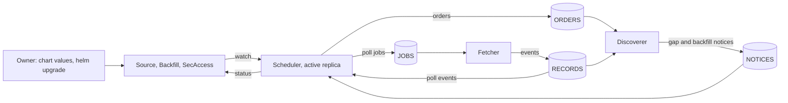
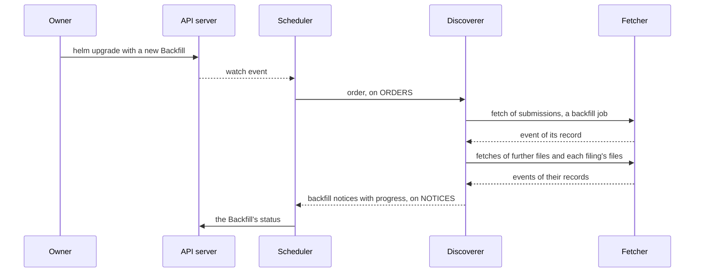
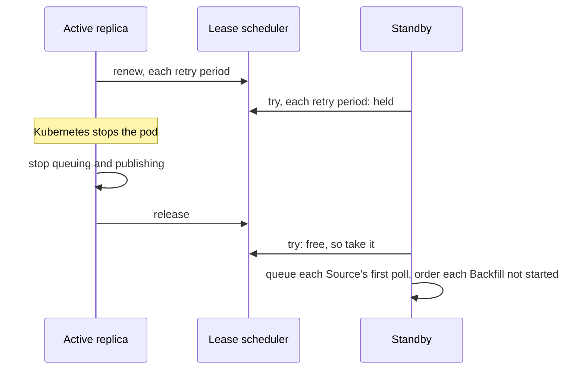

# The scheduler

<!-- status: Scheduler; The controls -->
**Status** ([status page](../status.md)): Scheduler: Specified. The controls: Specified.
<!-- end status -->

The scheduler is the controller that turns the owner's controls into work
for the pipeline, and the outcome of that work back into the controls'
status. This page explains what it does, what it keeps, how it fails, the
alternatives its decision records weighed, and the statements that govern
it.

## What it does

The scheduler is a Kubernetes controller, written in Go with
controller-runtime ([0006], [0007]). It reconciles the pipeline's three
custom resources, which the owner sets through the umbrella chart's values
and nothing else ([VAL-1], [RBAC-6]):

- **`Source`:** one URL the pipeline polls, such as one company's
  `submissions`, with its cadence and whether it's paused
  ([§6 of the controls][controls-source]).
- **`Backfill`:** a range of one company's past filings, by filing date,
  to fetch once ([§7 of the controls][controls-backfill]).
- **`SecAccess`:** one per cluster, named `cluster`, which says whether the
  pipeline may send requests to the SEC at all
  ([§8 of the controls][controls-secaccess]).

From them it does three things. It queues each Source's polls at its
cadence; it hands each Backfill to the discoverer; and it keeps the status
of each Source and Backfill. It never fetches, never writes the record, and
never reads what EDGAR publishes ([0007], [0006]): the
[fetcher](fetcher.md) sends every request, and the
[discoverer](discoverer.md) reads what comes back.

### Polling a Source

A Source is polling while it isn't paused and requests are allowed, which
they are while the SecAccess `cluster` exists, isn't paused, and has no
stop the owner hasn't acknowledged ([SOURCE-1],
[§2 of the controls][controls-terms]). The scheduler queues polls only of a
Source that's polling, in the release namespace. The Source's `Polling`
condition says whether it is, and if not, gives the first reason that
applies of `NoSecAccess`, `RequestsStopped`, `RequestsPaused`, and `Paused`
([SOURCE-1]).

Each poll is a job of kind `poll`, published on `edgar.jobs.poll` in the
stream `JOBS`, with the Source's name, `feed`, and `url`, and an
`expires_at` when the Source's next poll is due ([JOB-2]). Its timing
follows [SOURCE-2]:

- A Source's first poll is queued when it begins polling: when it's
  created or unpaused, when requests are allowed again, or when a scheduler
  replica becomes the active one.
- Each later poll is due a cadence after the one before it was due, not
  after it was sent, and is queued no earlier.
- A poll that can't be queued before the next is due is skipped, and
  counted in `edgar_scheduler_polls_skipped_total` ([METRIC-3]).
- A new cadence applies from the next poll, which is due the new cadence
  after the last poll queued.

The fetcher acknowledges a job whose `expires_at` has passed without a
request or a record ([JOB-5]), so a poll is sent within its own slot or
not at all. The record shows a slot with no successful poll as time the
pipeline wasn't looking ([§5 of the notices][notices-gaps]).

### The budget

All the Sources not paused share half the fetcher's limit of 5 requests a
second: 2.5 a second, which the controls call the budget
([§2 of the controls][controls-terms], [FETCH-6]). The other half is left
to each new filing's fetches and to backfills, which the fetcher takes only
when no poll is waiting ([JOB-4]).

The chart refuses values whose Sources together would poll faster than the
budget, before anything reaches the cluster ([VAL-3]): 25 Sources at 10
seconds pass, and 26 fail. On the cluster, the scheduler computes the same
sum and sets each Source's `WithinBudget` condition, `False` with the
reason `OverBudget` and the total in its message while they're over
([SOURCE-3]). Over the budget, it polls them as it would otherwise, and the
fetcher's limit still holds. The chart's check is the gate, and the
scheduler's is a report for anything that reaches the cluster another way,
which [RBAC-6] rules out and no admission webhook enforces
([§5 of the controls][controls-values], [0010]).

The chart's Sources start with three companies' `submissions` at 10
seconds each: 0.3 requests a second, 6% of the fetcher's limit ([0010]).

### Handing a Backfill to the discoverer

A Backfill's filings are found by reading its company's `submissions` and
the further files it names, which is reading EDGAR's content. The scheduler
doesn't read it ([0006]), and the discoverer can't read Backfills, since no
role grants it access to them ([RBAC-4]). So the scheduler hands each
Backfill over in an order ([§8 of the notices][notices-backfills]).

While requests are allowed, the scheduler publishes an order on
`edgar.orders.backfill`, in the stream `ORDERS`, for each Backfill in the
release namespace whose status has no `startTime` yet: when it first sees
the Backfill, and again each time it becomes the active replica or requests
are allowed again ([ORDER-1]). An order gives the Backfill's name, its
`metadata.uid`, which tells it from an earlier Backfill of the same name,
its `cik` and its range of filing dates, and when it was published
([order.schema.json]). The discoverer starts a Backfill only for a `uid` it
hasn't seen ([LIST-1]), so an order published again adds nothing: the
discoverer only publishes the Backfill's first job again, with its `id`,
unless its record is held ([DISC-2]).

Decision 0007 had the scheduler queue a Backfill's fetches itself
([0007]). The controls left to the notices specification which service
lists a Backfill's filings and queues their fetches, since the scheduler
doesn't read EDGAR's content ([§11 of the controls][controls-other]), and
the notices specification gives that work to the discoverer.

### Keeping status

Status is a summary for people; the record in PostgreSQL stays
authoritative ([0007]). The scheduler sets these fields:

| Resource | Fields | Set from | Statements |
| --- | --- | --- | --- |
| Source | `lastPollTime`, `lastSuccessfulPollTime` | The records of its polls, in their events | [SOURCE-4], [SCHED-8] |
| Source | `openGapSince` | The latest gap notice, by `at`, of its name and its `spec.url` | [SOURCE-5], [NOTICE-1] |
| Source | `Polling` and `WithinBudget` conditions | The SecAccess, the Source's `paused`, and the Sources' total | [SOURCE-1], [SOURCE-3] |
| Backfill | `startTime`, `filings`, `filingsFetched`, `filingsFailed`, `completionTime`, and the `Complete` condition | The latest backfill notice, by `at`, of its `uid` | [NOTICE-2], [BACKFILL-3] |

The fields set from notices follow the latest notice by `at`, so a notice
delivered twice, or after a later one, isn't the one a status follows.
kube-state-metrics exports every field as a metric ([STATE-1]), so status
is what Grafana shows of each Source and Backfill, and what the `SourceGap`
alert reads to tell a Source that's polling from one that isn't
([ALERT-2]).

## The messages and resources it reads and writes

| | What | Where | Statements |
| --- | --- | --- | --- |
| Reads | Sources, Backfills, and the SecAccess: `get`, `list`, `watch` | The API server | [RBAC-1], [SCHED-6] |
| Writes | The `status` of Sources and Backfills: `update`, `patch` | The API server | [RBAC-1], [SCHED-6] |
| Holds | Its Lease, `scheduler`: `create`, then `get` and `update` | The API server | [SCHED-3], [SCHED-6] |
| Publishes | Jobs of kind `poll` ([job.schema.json]) | `JOBS`, `edgar.jobs.poll` | [JOB-2] |
| Publishes | Orders ([order.schema.json]) | `ORDERS`, `edgar.orders.backfill` | [ORDER-1] |
| Reads | Gap and backfill notices ([notice.schema.json]) | `NOTICES`, `edgar.notices.gap` and `edgar.notices.backfill`, through `scheduler-notices` | [NOTICE-1], [NOTICE-2], [MSG-2], [NATS-5] |
| Reads | The records of its Sources' polls, in their events ([event.schema.json]) | `RECORDS`, `edgar.records.poll`, through `scheduler-polls` | [SOURCE-4], [SCHED-8] |
| Serves | Its metrics | `/metrics`, on its port `metrics` | [METRIC-1], [METRIC-3] |
| Exports | Its spans, by OTLP | The endpoint `OTEL_EXPORTER_OTLP_ENDPOINT` gives | [TRACE-7] |

It can change no resource's `spec`: no role the charts render lets it
([RBAC-4]). It acknowledges a notice that doesn't validate against its
schema, or whose `kind` isn't its subject's, without acting on it, and
counts it in `edgar_scheduler_messages_refused_total` ([MSG-2],
[METRIC-3]).

Each poll and each order starts a trace: the span that publishes it is a
root span, sampled ([TRACE-2]). The poll's fetch, the reading of its list,
and each filing the list first shows join that trace, so one trace follows
a filing from the poll that first saw it
([§9 of telemetry][telemetry-traces]).

## The state it keeps, and where

The scheduler keeps no store of its own. The controls are the resources'
`spec`, which the owner sets and the API server keeps through restarts, and
what the scheduler did with them is the resources' `status` ([0007],
[§1 of the controls][controls-guarantees]). Its polls and orders, once
queued, are messages in `JOBS` and `ORDERS`, kept until the fetcher and the
discoverer acknowledge them ([jobs and events][snapshots-jobs],
[§9 of the notices][notices-messages]). It writes nothing to the record
([0007]).

A replica that becomes the active one doesn't continue the last one's
schedule. It queues each polling Source's first poll then ([SOURCE-2]), and
orders again each Backfill not yet started ([ORDER-1]).

## Replicas

The scheduler runs as a Deployment `scheduler` of two replicas of its
image, `edgar/scheduler`, one of the pipeline's own, as the ServiceAccount
`scheduler` ([SCHED-1], [components][design-components], [0007]). Each
replica needs a worker node of its
own, so the loss of a node leaves the other running ([SCHED-2]). One at a
time is active: the one that holds the Lease `scheduler`, through
controller-runtime's leader election. Only it queues polls, publishes
orders, reads the scheduler's consumers, and sets status ([SCHED-4]). The
standby serves its metrics too, with `edgar_scheduler_leader` at 0
([METRIC-1], [METRIC-3]).

The Lease's timings come from the chart's values, 15, 10, and 2 seconds by
default for its duration, renewal deadline, and retry period, as the
fetcher's do, and the chart refuses those client-go's leader election
refuses ([SCHED-3], [LEASE-1]). A replica that can't renew the Lease within
its renewal deadline stops acting before another can take it over
([SCHED-4]).

A replica that Kubernetes stops while it holds the Lease, as in an upgrade
or a drain, releases it once it has stopped acting, so another replica, the
standby or the one that replaces the stopped one, takes it over at its next
try, without waiting out the Lease's duration ([SCHED-4], [SCHED-5]).
Waiting it out, 15 seconds by default, is longer than the 10 seconds each
company's Source starts at, so a poll queued that late can leave a gap in
the Source's coverage at each upgrade
([the scheduler's Lease][deployment-lease]). A replica releases the Lease
only if it stops acting within its pod's termination grace period. One
killed when that runs out, one that crashes, and one lost with its node
can't release it, and another replica takes it over once the duration has
passed.

> **Analysis.** No task, decision record, or specification covers more
> than one active replica. Two active replicas would each queue every
> Source's polls, so each Source would be polled twice a cadence and take
> twice its share of the budget, and each Backfill would be ordered twice,
> which [LIST-1] makes harmless. The pipeline could instead split the
> Sources between active replicas, at the cost of a way to assign each
> Source to one of them.

## How it scales

The scheduler scales with the number of Sources, not with replicas. Its
work is one job per poll, and the chart holds the polls to the budget, 2.5
a second ([VAL-3]). At 10 seconds, the budget covers about 25 companies;
past that, decision 0010 expects a feed that covers every company to become
the better notice source ([0010]), which task T11 revisits from the lags
the record shows ([plan][plan-observing]). Each poll also starts a trace,
25,920 a day at the starting cadence
([open question 3 of telemetry][telemetry-open]).

The [estimates](estimates.md#cpu-memory-and-storage) assume 30 to 100 MB
of memory a replica, and a few millicores at the default scope, until its
resource requests and limits are measured on kind, before a later version
of the deployment specification states them
([§9 of deployment][deployment-later]).

## How it fails, and what the record shows

The scheduler writes nothing to the record, so no failure of it can change
a record or an object. What a failure leaves is time in which no poll was
queued. The record shows it as a gap in each Source's coverage: from when
the last successful poll's job expired to the next successful poll's
request ([§5 of the notices][notices-gaps], [GAP-2]). A filing first seen
across a gap has `gap` set in the view `lags`, so its first-seen time is
known to be bounded more loosely ([LAG-1]).

| Failure | What stops | What the record and the cluster show | How it recovers |
| --- | --- | --- | --- |
| The active replica is stopped, as in an upgrade or a drain | Polls and orders, until another replica takes the Lease at its next try ([SCHED-4]) | A gap for each Source whose slot passes without a successful poll ([§5 of the notices][notices-gaps]). Releasing the Lease shortens the handover from the Lease's duration to another replica's next try, which makes such a gap less likely at the cadence the Sources start at, but doesn't rule one out: a slow stop, longer timings in the values, or a first poll that fails can still leave a slot without one | The new active replica queues each Source's first poll and orders each Backfill not yet started ([SOURCE-2], [ORDER-1]) |
| The active replica is lost, with its node | Polls and orders, until the Lease's duration has passed and the standby holds it | A gap for each Source whose slot passed without a successful poll | As above; the standby is on another node ([SCHED-2]) |
| The scheduler is scaled to zero, as a drill does ([outages and recovery][design-outages]) | Every poll and order | Gaps that stay open; `SourceGap` fires for each Source whose `Polling` condition still reads `True`, once its open gap has been longer than its cadence for 2 minutes ([ALERT-2]) | Polls resume when a replica is active again |
| The owner pauses a Source, or the SecAccess | That Source's polls, or every poll and order ([SOURCE-1], [ACCESS-2]) | A gap, and `Polling` `False` with its reason; `SourceGap` is silent for a Source kept from polling ([§7 of telemetry][telemetry-alerts]) | Polls resume when the owner's values allow them |
| A `403` stops requests | Every poll and order ([ACCESS-2]) | The stop in the SecAccess's status, `Polling` `False` with `RequestsStopped`, `SecRequestsStopped` firing ([ALERT-1]), and a gap | The owner acknowledges the stop ([§8 of the controls][controls-secaccess]) |
| The Sources on the cluster exceed the budget | Nothing | `WithinBudget` `False` on each Source ([SOURCE-3]) | The owner's values bring them within it |
| A notice is malformed | Nothing | It's counted, and acknowledged without effect ([MSG-2]) | — |

While requests are paused or stopped, the scheduler queues no poll and
nothing for a Backfill ([ACCESS-2]), and the time is recorded as a gap like
any other ([the design's controls][design-controls]). The design says more
broadly that nothing is queued then; the notices' specification has the
discoverer still queue a filing's fetches, which wait until requests are
allowed ([§7 of the notices][notices-files]).
While the scheduler is down, no service updates a Source's or a Backfill's
status, since only the scheduler sets it
([§9 of the controls][controls-rbac]). The gaps still reach the record,
which the discoverer derives from the polls the fetcher recorded ([GAP-1],
[GAP-2]).

## What it depends on

- **The Kubernetes API server,** for the three resources, their status,
  and its Lease ([0007]). It's granted only [RBAC-1]'s verbs and its
  Lease's, so it records no Kubernetes Events ([SCHED-6]).
- **NATS JetStream,** at the Service `nats`, to publish to `JOBS` and
  `ORDERS` and to read `NOTICES` and `RECORDS` ([0003], [SCHED-7]). NATS
  asks no credential yet ([§9 of deployment][deployment-later]). Each
  stream keeps its messages in files, replicated on all three NATS servers
  ([NATS-3]). Its durable consumer of gap and backfill notices,
  `scheduler-notices`, is made as soon as `NOTICES` is, before the streams
  whose messages a notice follows, so `NOTICES` keeps such a notice until
  the scheduler acknowledges it ([NATS-5]). Its consumer of poll events,
  `scheduler-polls`, is made with the discoverer's on `RECORDS`, before
  `RECORDS` takes its subjects, so it exists before the fetcher publishes
  ([SCHED-8]). The scheduler makes no stream or consumer itself, and waits
  for those it reads, which the Job makes once the release's resources are
  ready ([SCHED-9]).
- **kube-state-metrics, Prometheus, and an OTLP endpoint** for its
  telemetry ([STATE-1], [SCRAPE-1], [TRACE-7]).

It uses neither Garage nor `edgar-asof`. The library serves the Python
services that read EDGAR's content ([0009]), and the scheduler, in Go, reads
none ([0006]). It's tested against a real API server with envtest
([0007], [testing on kind][design-testing]).

## The alternatives weighed

Decision 0007 chose custom resources reconciled by the scheduler as a
controller, over these ([0007]):

| Option | Why it wasn't chosen |
| --- | --- |
| Controls in the dashboard, as buttons in Grafana or a page of the project's own | They need their own login, permissions, and audit trail, and put writes beside a view that's shared and left open. Grafana is read-only instead ([MON-2]). |
| An admin API with a command-line client, on one of the Go services | It rebuilds the authentication, authorization, and history the API server already has. |
| Helm values and scaling: cadence and scope in values, and a pause by scaling the fetcher to zero | A pause looks like a failure, status is shown nowhere, and resuming after a `403` has no place to be recorded. |
| A separate operator beside the scheduler | The same resources, with one more Deployment for work the scheduler exists to do. |

Decision 0007 framed the control as `kubectl apply` on a resource. Decision
0010 then had the Sources rendered from the umbrella chart's values, so a
configuration over the budget is refused before it reaches the cluster
([0010]), and the controls specification renders all three resources from
the values and has the owner change them only through Helm ([VAL-1],
[RBAC-6]). Decision 0010 also set aside an admission webhook for now: one
is added, with certificates from cert-manager, if anything other than the
chart comes to change Sources ([0010]).

Decision 0006 put the scheduler in Go, with the other services that move
bytes or keep the rules for talking to the SEC, because it doesn't read
EDGAR's content ([0006]).

## What's still open

- **An order refused on a new install.** The streams are made only once
  the release's resources are ready, so on a new install whose values allow
  requests from the start, an order published before `ORDERS` exists is
  refused. The notices' version 0.1.0 doesn't say that the scheduler
  publishes it again, so its Backfill waits until the scheduler next becomes
  the active replica or requests are allowed again ([ORDER-1],
  [the scheduler's access to NATS][deployment-nats]). The chart's default
  values pause requests, so an install with them has no such order
  ([VAL-4]). The owner decided on October 22, 2026 that a later version of
  the notices has the scheduler publish a refused order again until
  JetStream accepts it ([T48][plan-observing]).
- **NATS's credentials.** Any pod that reaches NATS may publish to any
  subject; a later version of the deployment gives each service
  credentials of its own, limited to the subjects it publishes and reads
  ([§9 of deployment][deployment-later]).
- **Its resource requests, limits, and probes,** measured on kind, in a
  later version of the deployment ([§9 of deployment][deployment-later]).
- **Exact gaps.** A job gives neither its due time nor its Source's
  cadence, so the record takes each poll's window as the cadence. A poll's
  due time in its job, in a minor version of the store's specification,
  would let a later version of the notices count missed slots exactly
  ([open question 3 of the notices][notices-open]).

## Where it's specified

| Statement | What it says of the scheduler |
| --- | --- |
| [API-2] | The definitions generated from its Go types are those in `spec/schemas/`. |
| [VAL-3] | The chart refuses Sources over the budget, the sum the scheduler reports. |
| [SOURCE-1] | It polls only a Source that's polling, and its `Polling` condition says why not. |
| [SOURCE-2] | Polls are due a cadence apart, from when a Source begins polling. |
| [SOURCE-3] | Each Source's `WithinBudget` condition says whether the Sources are within the budget. |
| [SOURCE-4] | Each poll is a fetch of the Source's `url`, under its `feed`, and its record's times set the status. |
| [SOURCE-5] | A Source's `openGapSince` gives when its open gap began. |
| [BACKFILL-3] | It keeps each Backfill's status and its `Complete` condition. |
| [ACCESS-2] | While requests aren't allowed, it queues no poll and nothing for a Backfill. |
| [RBAC-1], [RBAC-4], [RBAC-5] | It may read the resources, and change only Sources' and Backfills' status. |
| [JOB-1], [JOB-2] | Each poll is a job of kind `poll`, as its schema describes it, that expires when the next is due. |
| [ORDER-1] | It orders each Backfill not yet started, while requests are allowed. |
| [NOTICE-1], [NOTICE-2] | It sets `openGapSince` and each Backfill's status from the latest notices. |
| [NATS-5], [NATS-6] | Its durable consumer of gap and backfill notices, made as soon as `NOTICES` is, before `NOTICES` takes its subjects. |
| [SCHED-1], [SCHED-2] | Its Deployment of two replicas, as its own ServiceAccount, each on a worker node of its own, with no claim or credential but its token. |
| [SCHED-3], [SCHED-4], [SCHED-5] | Its Lease and its timings; only the replica that holds it acts, and one that Kubernetes stops releases it. |
| [SCHED-6] | Its grants: [RBAC-1]'s and its Lease's, and no others. |
| [SCHED-7], [SCHED-8], [SCHED-9] | NATS's address, without a credential; its consumer of poll events on `RECORDS`; and that it makes no stream or consumer. |
| [MSG-1], [MSG-2] | Orders and notices validate against their schemas; it ignores unknown fields and refuses malformed notices. |
| [METRIC-1], [METRIC-2], [METRIC-3] | Its metrics, served by each replica, with labels from small sets. |
| [TRACE-1], [TRACE-2], [TRACE-3], [TRACE-5], [TRACE-7], [TRACE-8] | Each poll and order starts a trace, carried in NATS headers. |

Task T48 specified the scheduler's deployment. T22 builds the scheduler,
with the Go types, the chart's Sources, and its Deployment, Lease, grants,
and consumer of poll events, and T24 builds its side of the notices: the orders, and each Source's
`openGapSince` and each Backfill's status, which it sets from notices
([plan][plan-observing]). The schemas' statements, [JOB-1] and [MSG-1],
have tests already. [SOURCE-4]'s tests await T23, the fetcher; those of its
metrics, of kube-state-metrics' grants ([RBAC-5]), and of its traces await
T28 and T29; and the others', its deployment's among them, await T22 and
T24
([§3 of the controls][controls-ids], [§3 of the notices][notices-ids],
[§3 of telemetry][telemetry-ids]).

[0003]: ../decisions/0003-queue-work-in-nats-jetstream.md
[0006]: ../decisions/0006-write-the-services-in-go-and-python.md
[0007]: ../decisions/0007-control-the-pipeline-through-custom-resources.md
[0009]: ../decisions/0009-read-edgar-through-a-public-point-in-time-library.md
[0010]: ../decisions/0010-poll-each-companys-submissions-and-measure-lag-from-the-record.md
[design-components]: ../design.md#components
[design-controls]: ../design.md#controls
[design-outages]: ../design.md#outages-and-recovery
[design-testing]: ../design.md#testing-on-kind
[plan-observing]: ../plan.md#observing-filings
[job.schema.json]: ../../spec/schemas/job.schema.json
[order.schema.json]: ../../spec/schemas/order.schema.json
[event.schema.json]: ../../spec/schemas/event.schema.json
[notice.schema.json]: ../../spec/schemas/notice.schema.json
[controls-guarantees]: ../../spec/controls.md#1-guarantees
[controls-terms]: ../../spec/controls.md#2-terms
[controls-ids]: ../../spec/controls.md#3-statement-ids
[controls-values]: ../../spec/controls.md#5-the-charts-values
[controls-source]: ../../spec/controls.md#6-source
[controls-backfill]: ../../spec/controls.md#7-backfill
[controls-secaccess]: ../../spec/controls.md#8-secaccess
[controls-rbac]: ../../spec/controls.md#9-who-may-change-what
[controls-other]: ../../spec/controls.md#11-other-specifications
[API-2]: ../../spec/controls.md#4-the-resources
[VAL-1]: ../../spec/controls.md#5-the-charts-values
[VAL-3]: ../../spec/controls.md#5-the-charts-values
[SOURCE-1]: ../../spec/controls.md#6-source
[SOURCE-2]: ../../spec/controls.md#6-source
[SOURCE-3]: ../../spec/controls.md#6-source
[SOURCE-4]: ../../spec/controls.md#6-source
[SOURCE-5]: ../../spec/controls.md#6-source
[BACKFILL-3]: ../../spec/controls.md#7-backfill
[ACCESS-2]: ../../spec/controls.md#8-secaccess
[VAL-4]: ../../spec/controls.md#5-the-charts-values
[RBAC-1]: ../../spec/controls.md#9-who-may-change-what
[RBAC-4]: ../../spec/controls.md#9-who-may-change-what
[RBAC-5]: ../../spec/controls.md#9-who-may-change-what
[RBAC-6]: ../../spec/controls.md#9-who-may-change-what
[snapshots-jobs]: ../../spec/snapshots.md#jobs-and-events
[FETCH-6]: ../../spec/snapshots.md#10-fetching
[JOB-1]: ../../spec/snapshots.md#jobs-and-events
[JOB-2]: ../../spec/snapshots.md#jobs-and-events
[JOB-4]: ../../spec/snapshots.md#jobs-and-events
[JOB-5]: ../../spec/snapshots.md#jobs-and-events
[notices-ids]: ../../spec/notices.md#3-statement-ids
[notices-gaps]: ../../spec/notices.md#5-polls-coverage-and-gaps
[notices-files]: ../../spec/notices.md#7-a-filings-files
[notices-backfills]: ../../spec/notices.md#8-backfills
[notices-messages]: ../../spec/notices.md#9-messages-and-processing
[notices-open]: ../../spec/notices.md#12-open-questions
[GAP-1]: ../../spec/notices.md#5-polls-coverage-and-gaps
[GAP-2]: ../../spec/notices.md#5-polls-coverage-and-gaps
[ORDER-1]: ../../spec/notices.md#8-backfills
[LIST-1]: ../../spec/notices.md#8-backfills
[NOTICE-1]: ../../spec/notices.md#8-backfills
[NOTICE-2]: ../../spec/notices.md#8-backfills
[MSG-1]: ../../spec/notices.md#streams
[MSG-2]: ../../spec/notices.md#streams
[DISC-2]: ../../spec/notices.md#processing
[LAG-1]: ../../spec/notices.md#10-times-and-lags
[telemetry-ids]: ../../spec/telemetry.md#3-statement-ids
[telemetry-alerts]: ../../spec/telemetry.md#7-alerts
[telemetry-traces]: ../../spec/telemetry.md#9-traces
[telemetry-open]: ../../spec/telemetry.md#11-open-questions
[METRIC-1]: ../../spec/telemetry.md#4-metrics
[METRIC-2]: ../../spec/telemetry.md#4-metrics
[METRIC-3]: ../../spec/telemetry.md#the-scheduler
[STATE-1]: ../../spec/telemetry.md#5-metrics-of-the-controls
[SCRAPE-1]: ../../spec/telemetry.md#6-scraping
[ALERT-1]: ../../spec/telemetry.md#7-alerts
[ALERT-2]: ../../spec/telemetry.md#7-alerts
[TRACE-1]: ../../spec/telemetry.md#9-traces
[TRACE-2]: ../../spec/telemetry.md#9-traces
[TRACE-3]: ../../spec/telemetry.md#9-traces
[TRACE-5]: ../../spec/telemetry.md#9-traces
[TRACE-7]: ../../spec/telemetry.md#9-traces
[TRACE-8]: ../../spec/telemetry.md#9-traces
[deployment-later]: ../../spec/deployment.md#9-later-versions
[deployment-lease]: ../../spec/deployment.md#its-lease
[deployment-nats]: ../../spec/deployment.md#its-access-to-nats
[SCHED-1]: ../../spec/deployment.md#the-scheduler
[SCHED-2]: ../../spec/deployment.md#the-scheduler
[SCHED-3]: ../../spec/deployment.md#its-lease
[SCHED-4]: ../../spec/deployment.md#its-lease
[SCHED-5]: ../../spec/deployment.md#its-lease
[SCHED-6]: ../../spec/deployment.md#its-grants
[SCHED-7]: ../../spec/deployment.md#its-access-to-nats
[SCHED-8]: ../../spec/deployment.md#its-access-to-nats
[SCHED-9]: ../../spec/deployment.md#its-access-to-nats
[LEASE-1]: ../../spec/deployment.md#the-fetchers-lease
[NATS-3]: ../../spec/deployment.md#nats
[NATS-5]: ../../spec/deployment.md#durable-consumers
[NATS-6]: ../../spec/deployment.md#durable-consumers
[MON-2]: ../../spec/deployment.md#monitoring
