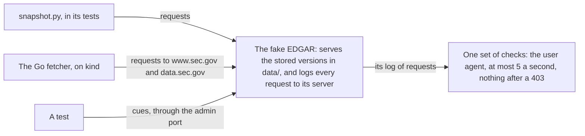

# Testing and verification

<!-- status: The fake EDGAR; The drills; The snapshot store in git -->
**Status** ([status page](../status.md)): The fake EDGAR: Built. The drills: Planned. The snapshot store in git: Built.
<!-- end status -->

How the repository checks that its data, scripts, charts, and services do
what the specifications say: how each statement gets its tests, what the
tests check today, and what later tasks add, from the fake EDGAR and the
tests on kind to the drills, the rebuild of the facts, and the cases
`edgar-asof` publishes for "as of T". The facts about `edgar-asof` here were
checked against its `main` on October 14, 2026, at commit `515bb0d`.

## How a statement is tested

Each specification is a list of numbered statements, such as [FETCH-6], and
each statement is one of two kinds ([§3 of the store][store-ids]):

- **An invariant** is a property of something at rest: the data stored, a
  schema, the charts as committed and what they render, or the built site.
- **A rule** is how a program, a service, or the owner behaves while it
  runs, such as how fast requests are sent.

Each specification's index says how each statement is checked. The
specifications name six ways ([§3 of the store][store-ids],
[§3 of the deployment][deployment-ids], [§3 of the site][site-ids]):

| Checked by | What checks it | For example |
| --- | --- | --- |
| `verify` | `scripts/verify.py`, against the git store at rest. Each problem it reports starts with the invariant's ID. | [OBJ-1], [LOG-1] |
| `tests` | A test that runs without the installed charts: it reads a schema, renders a chart with `helm template`, runs a script against a local server, or tests a service on its own or against a real API server with envtest. | [FETCH-6], [VAL-3], [SITE-3] |
| `kind` | A test of the installed charts, in the CI job that installs them on kind. It's skipped where no cluster is installed. | [STORE-3], [FETCH-16], [PG-2] |
| `review` | The reviewer of the pull request that changes what the statement covers. | [PIN-3], [PAGE-2] |
| `operator` | The owner, who keeps the rule. | [FETCH-7], [RBAC-6] |
| `first import` | The first import, when it runs. | [IMP-3] |

A few rules have no test, because the owner keeps them: one process
fetching from the SEC at a time, across every checkout and cluster
([FETCH-7]); changing the controls only through the chart's
values ([RBAC-6]); a new archive server name for each database cluster
([PG-10]); and no credential in a commit ([SECRET-4]).

### Every test carries the IDs it checks

`AGENTS.md`'s rules give the mechanism ([rules][agents-rules]). Each test
is marked with the IDs of the statements it checks, as
`@pytest.mark.spec("REC-5")`. A test,
[`tests/test_spec_coverage.py`](../../tests/test_spec_coverage.py), reads
every specification, and fails if a statement checked by `verify`, `tests`,
or `kind` has no test, or if a marker names no statement. A Go test
carries its IDs in a line of its doc comment, such as
`// spec: SOURCE-1, ACCESS-2`, directly above the test, and the coverage
test reads those too, and fails on such a line anywhere else ([0006],
[T22]).

A statement is written before the part it describes is built
([where documents go][agents-where]), so the coverage test allows one
exception. A statement whose tests a later task in the plan writes is
listed as awaiting that task. The listing is strict: the coverage test
fails if a listed statement has a test, or if the plan marks its task done
([§3 of the store][store-ids]). So the list shrinks only as tasks land, and
a task can't be marked done while a statement it owes has no test.

When a task adds a test, the agent doing it checks that the test fails
without the behavior it covers ([doing the next item][agents-next], step
9).

### Where each specification stands

| Specification | Statements with tests now | Statements awaiting a task |
| --- | --- | --- |
| [`snapshots.md`][snapshots] 1.1.0 | Those `verify.py` checks, and `snapshot.py`'s rules, brought to this version by [T35], done October 13, 2026; the schemas': [STORE-1], [REC-13], [JOB-1]; the scheduler's jobs, [JOB-2], written by [T22]; and the fetcher's and the cluster store's, written by [T23] ([STORE-2], [STORE-3], [OBJ-4], [LOG-3], [LOG-4], [FETCH-16], [FETCH-17], [ID-2], [JOB-4] to [JOB-7]); and the transfer's, with its read-only role and key, written by [T36] ([XFER-1] to [XFER-3], [LOG-5]) | [T24], the discoverer's jobs and its use of `edgar-asof` ([FETCH-18]) |
| [`deployment.md`][deployment] 2.0.0 | The charts', written by [T20]: their invariants, by rendering each chart, and their rules, on kind; and the pipeline's images' and the fake EDGAR's installation, written by [T21] ([IMG-1] to [IMG-3], [IMG-5], [FAKE-1] to [FAKE-5]); and the scheduler's Deployment, Lease, grants, and consumer, written by [T22] ([SCHED-1] to [SCHED-9]); and the fetcher's Lease, Deployment, grants, credentials, consumers, and trust of the fake EDGAR's authority, written by [T23] ([LEASE-1], [LEASE-2], [FETCHER-1] to [FETCHER-13]); and the transfer's role, key, and access to the cluster store, written by [T36] ([PG-15], [GARAGE-5], [TRANSFER-1] to [TRANSFER-6]) | None |
| [`controls.md`][controls] 1.0.0 | [API-1]; and, written by [T22], the generated definitions and the API server's refusals ([API-2], [API-3]), the chart's controls ([VAL-1] to [VAL-4]), the scheduler's polls and Sources' status ([SOURCE-1] to [SOURCE-4], [ACCESS-2]), and its grants ([RBAC-1], [RBAC-4]), [SOURCE-4]'s ahead of [T23]; and, written by [T23], the fetcher's use of the SecAccess, its Backfills last, and its grants ([ACCESS-1], [ACCESS-3], [BACKFILL-2], [RBAC-2]) | [T24] and [T28] ([§3][controls-ids]) |
| [`notices.md`][notices] 0.1.1 | [TABLE-1], [MSG-1] | [T24], the discoverer, with the scheduler's side of the Backfills ([§3][notices-ids]) |
| [`telemetry.md`][telemetry] 0.1.0 | [VIEW-1] | [T28], the monitoring of observing filings; [T29], the traces ([§3][telemetry-ids]) |
| [`site.md`][site] 0.1.0 | The site's statements checked by `tests`, written by [T40], and [PAGE-4]'s, written by [T42] once every topic had its page | None |
| [`fake-edgar.md`][fake-edgar] 0.1.0 | The schemas': [CUE-3], [REQ-3]; the fake EDGAR's, with the checks of `snapshot.py`'s requests to it, written by [T21]; and the checks of the fetcher's requests to it on kind, written by [T23] ([CHECK-3]) | None |

## What the tests check today

The status block above says which of the parts this page describes are
built. The tests that run today check seven things.

**The git store's invariants, with `verify.py`.** `verify.py` checks every
invariant of the git store, each of which holds whenever `data/` is at
rest: that each object's
decompressed bytes hash to its name ([OBJ-1]), that each record is well
formed and names an object that exists ([REC-1], [REC-3]), that each `304`
names the URL's latest earlier version ([REC-5]), that every record
validates against the record's schema ([REC-14]), that the scope covers
every record ([SCOPE-2]), and that `data/` keeps to its budget ([SCOPE-4],
[SCOPE-5]). `verify.py --since REF` also checks the history against an
earlier commit: each log as it was then is a prefix of the log now, and
each object and manifest is still there with the same bytes ([LOG-1],
[LOG-2]). `AGENTS.md` has it run before anything under `data/` is
committed ([rules][agents-rules]).

**`snapshot.py`'s rules, without the network.** Tests never reach the
network; they use a local server or stored versions
([rules][agents-rules]). So they check the rules every request to the SEC
keeps without sending one: the user's own user agent ([FETCH-2]), requests
at least 0.2 seconds apart ([FETCH-6]), the retries and their waits
([FETCH-8]), no request after a `403` ([FETCH-9]), conditional requests
from the latest version's validators ([FETCH-4]), one record per fetch,
written after its object ([FETCH-14]), and every field of the record, each
response's arrival and `Date` among them ([REC-10]).

**The schemas.** Each machine-checkable contract is a schema in
`spec/schemas/`, and tests read it without a cluster or the network: the
table of records and the JSON Schemas of a record, a job, and an event
([STORE-1], [REC-13], [JOB-1]); the definitions of the three custom
resources ([API-1]); the notices' tables and views, and the schemas of an
order and a notice ([TABLE-1], [MSG-1]); the views Grafana reads
([VIEW-1]); and the fake EDGAR's cue and the entry of its log of requests
([CUE-3], [REQ-3]). So the contracts between the services are checked
before the services exist.

**The site.** The tests build the site and check it, offline, by running
`scripts/build_site.py` ([SITE-9]): every link resolves, with its anchor
([SITE-3]); nothing loads from another host ([SITE-4]); the explanation
pages cover their topics, each on its page, in order ([PAGE-4]); and each
part's status matches the plan, the specifications, and the decision
records ([STATUS-3]). So each of CI's jobs fails on a site that doesn't
build, and the site needs no job of its own ([0012]).

**The fake EDGAR, on one machine.** Its tests run it on a `data/` of
their own and send it requests on the machine they run on: what it serves
([SERVE-1] to [SERVE-5]), the responses a test cues ([CUE-1], [CUE-2]),
its log of requests ([REQ-1], [REQ-2]), and its admin port ([ADMIN-1]).
The checks of the fetching rules report what breaks them ([CHECK-1]), and
`snapshot.py`'s requests to the fake EDGAR pass them, through a body cut
short, a `429`, and no response, each retried, and a stop on a `403`
([CHECK-2], [T21]).

**The scheduler, against a real API server.** The Go tests start an API
server with envtest, with the definitions in `spec/schemas/` installed, and
a NATS server with JetStream on the machine they run on ([T22]). They check
that the definitions generated from the scheduler's Go types are those in
`spec/schemas/` ([API-2]), and that the API server refuses what those
refuse ([API-3]). They run the scheduler against them: each Source's
conditions, and its polls only while it's polling ([SOURCE-1],
[SOURCE-3], [ACCESS-2]); its polls' timing, on a clock the tests step,
and that a poll it gave up while NATS was lost isn't queued once NATS is
back ([SOURCE-2]); each poll as a job of its Source's feed and URL, kept in
`JOBS` ([JOB-2]); two replicas, of which only the one that holds the Lease
acts, the standby setting no status, reading no poll events, and queuing
no polls, and of which one stopped releases the Lease, and one cut off
from the API server, its connections closed or its requests unanswered,
stops before the other could take it over, at timings whose retry period
and renewal deadline together pass the Lease's duration ([SCHED-4]); and
poll events, read through `scheduler-polls` once it exists, setting each
Source's poll times ([SOURCE-4], [SCHED-9]). Rendering the umbrella chart
checks the controls it renders from its values, and the values it refuses,
the budget summed exactly however many digits the sum needs ([VAL-1] to
[VAL-4]), and the grants on them across the four charts ([RBAC-1],
[RBAC-4]).

**The fetcher, against a local server, NATS, and a real API server.** The
fetcher's Go tests run it against a local server that answers as the SEC's
hosts over HTTPS, with a certificate for them from an authority of the
tests' own; an embedded NATS server with the chart's streams and
consumers; the table and the bucket in memory, whose writes fail on cue;
and, for its Lease and the SecAccess, envtest's API server ([T23]). They
check the fetching rules the fetcher shares with `snapshot.py`, from the
user agent to one record per fetch ([FETCH-1] to [FETCH-14] but
[FETCH-7]), and that it trusts only the certificate it's given for the
SEC's hosts, or else its image's roots ([FETCHER-13]); that it takes jobs
polls first and Backfills last, between a fetch's attempts too, as the
owner decided ([T23]), acknowledges an expired or malformed job
without a request, announces a recorded one again without one, and records,
announces, then acknowledges each other, holding a write that fails until
it succeeds ([JOB-4] to [JOB-7], [BACKFILL-2]); that it waits for its
consumers and makes none, and tells JetStream a long fetch is in progress
([FETCHER-10], [FETCHER-11]); and that only the replica that holds the
Lease sends, one cut off from the API server stopping before another could
take the Lease over, one stopped leaving the Lease to expire, and that it
sends only while requests are allowed, a stop after a `403` holding across
a handover until it's acknowledged ([FETCH-16], [ACCESS-1], [ACCESS-3],
[FETCH-9]). Without the owner's user agent it sends nothing ([FETCH-17]).

**The transfer, against fakes of the cluster store and the API server.**
The transfer's Go tests copy ranges from a cluster store held in memory
into a `data/` of their own ([T36]). They check that it copies only the
scope's records of the range, with their objects, and nothing if
`scope.json` is malformed or the copy would break the budget, saying which
limit ([XFER-1]); that it appends each record unchanged, as `snapshot.py`
writes a line, after placing its object, in the order of the records' ids
([XFER-2]); that it skips a record `data/` holds, and copies nothing when
records conflict ([XFER-3]); and that it reads a cluster that holds the
fake EDGAR but copies nothing from it ([TRANSFER-6]). Against a fake of the
API server, and a kubeconfig of their own, they check that it acts only on
the context it's given, reads only its two Secrets, and takes nothing of
its connections from libpq's environment or the AWS SDK's ([TRANSFER-3] to
[TRANSFER-5]).

**The charts, rendered and installed.** The deployment's invariants are
checked by rendering each of the four charts with `helm template`; the
hook Jobs' scripts, against fakes of `nats`, of `psql`, and of Garage's
admin API; and the command that builds the pipeline's images, against
fakes of `docker` and `kind` ([IMG-2]). The deployment's rules are checked
on a kind cluster the charts are installed on
([T20], [chart tests and tests on kind](#chart-tests-and-tests-on-kind)).

CI runs these checks in three jobs, one for each of Python 3.12, 3.13, and
3.14: the format check, the lint, the type check, the tests, and
`uv run scripts/verify.py --since origin/main` ([commands][agents-commands],
[doing the next item][agents-next], step 9). A fourth job, `Go`, checks
that the Go module and its generated code are current, and runs `go vet`,
golangci-lint, and the Go tests ([0006], [T22]). A fifth job, `kind`, creates
a kind cluster, builds the pipeline's images and loads them into it, points
its DNS for the SEC's hosts at the fake EDGAR, installs the four charts,
the fake EDGAR among them, with requests allowed, as the owner decided, and
upgrades them, and runs the tests of the installed charts ([FAKE-4],
[T23]). A pull request merges only once the jobs
pass that a ruleset on `main` requires; only the owner changes the ruleset
([commits and pull requests][agents-commits]).

## What later tasks add

The design's [testing on kind][design-testing] gives the shape: unit tests
that never reach the network, a fake EDGAR in the cluster, the scheduler
against a real API server, the alert rules under `promtool`, drills, and a
rebuild of the facts. Each comes with the task that builds what it tests.

| Layer | What it checks | Task |
| --- | --- | --- |
| Tests on kind | The `kind` statements of each service, against the installed charts, as [T20]'s are of the charts | Each task that builds a service |
| `promtool test rules` | The alert rules | [T28], [T33] |
| The drills | Recovery from outages caused on purpose, and the restore of the database | [T31] |
| The rebuild | The facts, imported again from stored bodies | [T31] |
| Published cases | The query API's "as of T" answers, against `edgar-asof`'s | [T26] |

### Chart tests and tests on kind

The deployment's invariants are properties of the charts as committed, so
tests check them by rendering each chart with `helm template`, without a
cluster or the network. Credentials, and the database archive's server
name, are set by CI for each cluster, so the tests give values of their own
for them ([§3 of the deployment][deployment-ids]). The charts render
without the network because each dependency from a chart repository is
committed, packaged ([PIN-2]), and Garage's chart as a directory
([PIN-3]).

The deployment's rules, and every other statement checked by `kind`, are
tested in the CI job that installs the charts on kind ([T20]). They cover
what can't be seen without a cluster: that the three NATS servers form one
JetStream cluster ([NATS-2]), each durable consumer has a replica on all
three, and a stream kept by interest keeps what it accepts, while the Job
makes it, for each of its consumers ([NATS-6]); that each replica of NATS,
Garage, and the database runs on its own worker node ([PLACE-2]); that
every database instance reports PostgreSQL 18 ([PG-2]) and a backup to
Garage completes ([PG-5]); that the database refuses a malformed record
and lets no service change one ([STORE-2], [LOG-3], [PG-9]), nor any but
the discoverer add to the notices' tables, lets each service's role read
the notices' views, and lets Grafana's role read only its views
([PG-14]); that Grafana's data source connects, verifying the server ([MON-6]); that
the SEC's hosts resolve to the fake EDGAR, and a pod's request for a
stored URL reaches it over HTTPS and gets the version `data/` holds
([FAKE-4], [FAKE-5]); that the pipeline's images run as built from the
commit installed ([IMG-3]); that the scheduler's two pods run on two
worker nodes, one holding its Lease, which another takes over before its
duration when that pod is deleted ([SCHED-5]); that the fetcher's two pods
run on two worker nodes, one holding its Lease, which another takes over
only once its duration has passed when that pod is deleted, each pod
sending only while it holds it ([LEASE-2], [FETCHER-3], [FETCH-16]); that
the fetcher's requests carry the user agent of its Secret and pass the
checks of the fetching rules, a cued `403` stopping them until a test
acknowledges the stop, as the owner does, with `helm upgrade`, after which
the jobs queued meanwhile go polls first and Backfills last ([FETCH-17],
[CHECK-3], [ACCESS-1], [ACCESS-3], [JOB-4], [BACKFILL-2]); that a poll
queued while a Backfill's fetch waits to retry a cued `503` goes before
the retry ([JOB-4], [BACKFILL-2]); that it
acknowledges an expired or malformed job without a request, and announces
a recorded one again without one ([JOB-5] to [JOB-7]); that a body is
stored once, under its name, and only the fetcher's key may write the
bucket ([OBJ-4], [LOG-4]); that each ServiceAccount can
do exactly what the table of grants allows ([RBAC-5]); that the
transfer's role may only read records, and its key only the store's bucket
([PG-15], [GARAGE-5], [LOG-5]); that the transfer, built and run as the
owner runs it, with other credentials in its environment and its files,
reads a range of CI's cluster store through its port-forwards but copies
nothing, since the fake EDGAR is installed there, and shows none of its
credentials ([TRANSFER-4] to [TRANSFER-6]); and that the
notices' and dashboards' views give what their sections define ([GAP-2],
[LAG-1], [VIEW-4]). The cluster store's own invariants, that every object
hashes to its name and every record finds its object, are checked the same
way ([STORE-3]).

### The fake EDGAR

The fetching rules have two implementations: `snapshot.py` for the git
store, and the Go fetcher in the cluster ([0006]). A fake EDGAR keeps them
from drifting apart. It's a service in Python, using the standard library,
that answers as EDGAR from the stored versions under `data/`
([`fake-edgar.md`][fake-edgar], [0006]):

- **What it serves.** A request for a stored URL gets the URL's latest
  version, with the `Content-Type`, `ETag`, and `Last-Modified` its record
  kept, so each URL carries the validators EDGAR gave it ([SERVE-3],
  [SRC-4]). A conditional request gets a `304` when the version hasn't
  changed ([SERVE-4], [SRC-22]), and a request for a URL it doesn't hold a
  `404` ([SERVE-2]). It reads `data/` once, when it starts, changes
  nothing, and sends nothing ([SERVE-1]).
- **Failures on cue.** The stored versions are the responses the SEC gave,
  and the investigation's fetches all got a `200` or a `304` ([SRC-20],
  [SRC-22]). The checks of [FETCH-8], [FETCH-9], and [FETCH-13] need a
  `429`, a `403`, a body cut short, or no response at all. A test cues the
  fake EDGAR, through its admin port, to give them to the next requests
  for a URL, or for any URL, and can cue an earlier version too ([CUE-1],
  [CUE-2], [ADMIN-1]).
- **Its log of requests.** It logs every request its server receives,
  with its headers and the status it got, in the order they arrive, since
  it answers one at a time ([REQ-1], [SERVE-5]). Tests read the log
  through the admin port. The log is kept in memory, and no request header
  is written anywhere else, so the user agent stays out of the cluster's
  logs ([REQ-2]).
- **One set of checks.** The checks read the log for the user agent, for
  requests at least 0.2 seconds apart, less 20 milliseconds for the time a
  request takes to arrive, and for nothing after a `403` ([CHECK-1]). They
  run against `snapshot.py` in its tests, on one machine ([CHECK-2]), and
  against the Go fetcher on kind ([CHECK-3]).

On kind, CI installs the fake EDGAR with the umbrella chart, and the
owner's installations don't ([FAKE-1]). Its image holds `data/` as the
commit it's built from has it ([IMG-5]). It answers for `www.sec.gov` and
`data.sec.gov` over HTTPS, with a certificate from an authority that the
release makes for it through cert-manager ([FAKE-3]). CI points kind's DNS
for those names at its Service, so the fetcher sends it the requests it
would send the SEC, at the URLs [FETCH-1] allows, and no pod reaches the
SEC ([FAKE-4], [FAKE-5]). There the chart gives the fetcher that
authority's certificate, which it checks the SEC's hosts against in place
of its image's roots, so a request of its that reached the SEC would fail
at its TLS handshake ([FETCHER-12], [FETCHER-13]).

So the whole chart can be installed on kind in CI and tested end to end
without the SEC ([design][design-testing], [0001]). [T47] specified the
fake EDGAR, and [T21] built it. As the first service code, T21 also set
where the Python services live, a package each under `src/edgar_pipeline/`,
and added the command that builds the pipeline's images and loads them into
kind, `scripts/build_images.py` ([IMG-2]).

### The scheduler, under envtest

The scheduler is a controller written with controller-runtime ([0007]).
Its rules, and the API server's refusals of a resource its definition
refuses ([API-3]), are tested against a real API server with envtest
([§3 of the controls][controls-ids]). So a test of, for example, the
`Polling` condition's reasons ([SOURCE-1]) or of a poll's due time
([SOURCE-2]) runs against the same API machinery the cluster uses, without
installing the charts. The same task checks that the definitions generated
from the scheduler's Go types are the ones in `spec/schemas/` ([API-2]),
and that only the replica that holds the scheduler's Lease acts, and
releases the Lease when Kubernetes stops it ([SCHED-4]). On kind, it checks
that a pod other than the deleted one takes the Lease over before its
duration when the active one's pod is deleted ([SCHED-5]).

### The alert rules, under `promtool`

Each alert is a rule ([ALERT-1] to [ALERT-3]), tested with
`promtool test rules` in CI, like any other rule ([0008],
[§3 of the telemetry][telemetry-ids]). A rule test feeds Prometheus series
over time and checks when the alert fires, so a test can show, for
example, that `SourceGap` waits its 2 minutes and stays silent for a paused
Source ([ALERT-2]), and that `SecRequestsStopped` keeps firing when an
acknowledgement differs from the stop only in its milliseconds
([ALERT-1]). [T28] tests the alerts on observing filings, and [T33] those
on facts.

## The drills

On kind, outages are caused on purpose, and each drill shows the pipeline
recovering and the gaps it recorded ([outages and recovery][design-outages]).
[T31] runs five, each of which shows the gaps recorded and nothing lost:

| Drill | What the design expects | Behind it |
| --- | --- | --- |
| Delete the active fetcher | The standby takes the Lease only once its duration has passed without a renewal, 15 seconds by default; the handover leaves a gap, by decision 0005, or only if it misses a poll, by the notices; and a stop after a `403` carries over through the SecAccess | [0005], [LEASE-1], [FETCHER-3], [§5 of the notices][notices-gaps], [ACCESS-3] |
| Fail over the database | Parsing pauses, and parse jobs wait in their stream until the database is back | [0003], [outages and recovery][design-outages] |
| Block the SEC | Polls fail, so a gap opens in each Source's coverage, and `SourceGap` fires while it lasts longer than the Source's cadence | [GAP-2], [ALERT-2] |
| Restore the database from its backups in Garage | The backups are shown to restore before they're relied on | [0002], [0004], [PG-4] |
| Rebuild the facts from stored bodies | The "as of" answers and the export's hashes are compared with the originals | [design][design-testing] |

The design's own list of ways to cause an outage also includes scaling the
scheduler to zero, pausing a Source, and blocking the SEC with a
NetworkPolicy ([outages and recovery][design-outages]). Deleting the active
pod is how "one process at a time" is tested in the cluster, since it
became "one Lease holder" ([0005]).

The restore matters because CloudNativePG's backup plugin has been tested
against MinIO, not Garage ([0002]). So the backups are restored on kind
before they're relied on ([§7 of the deployment][deployment-backups]).
[Failures and recovery](failures-and-recovery.md) explains what stops, what's
kept, and what the record shows after each failure a drill causes.

### The rebuild of the facts

The rebuild drops the facts and imports them again from stored bodies, and
compares the "as of" answers and the export's hashes with the originals
([design][design-testing]). It rests on three things:

- **Imports are pinned.** An import writes its manifest, naming each input
  by its SHA-256, before it reads anything, and reads only stored objects,
  never the live source. So a rerun with the same inputs and the same
  `tool` commit reads the same bytes ([IMP-1] to [IMP-3]).
- **The export is deterministic, and hashed.** The facts' Parquet export
  records each file's SHA-256, which is how a rerun of an import is
  compared with the original, answering the store's open question 3
  ([0004], [store's open questions][store-questions]). pyarrow is pinned,
  since the export's bytes depend on the writer's version ([0006]).
- **What the facts and the export are** is for their specifications,
  [T17] and [T18].

> **Analysis.** No task, decision record, or specification covers this.
> The pipeline's database roles can insert but not update or delete
> ([0004]), so dropping the facts takes a role no service has. The rebuild
> could import into a second, empty database and compare the two, which
> leaves the original untouched; or it could drop the facts as the
> database's owner. [T17] or [T31] could say which.

## The cases `edgar-asof` publishes for "as of T"

`edgar-asof`'s specification defines the fact model and what "as of T"
returns, and the pipeline's query API, written in Go, is tested against
cases the library publishes, so that both answer the same way ([0009],
[T26]). In the library's plan, [its T10][asof-later] publishes those cases
with their inputs and answers, after its first release. When it's next,
it's split into a minor version of [`facts.md`][asof-facts], a building
task, and a release that publishes them
([`edgar-asof`'s plan][asof-later]). The page on
[`edgar-asof`](edgar-asof.md) explains the library and its releases.

A case can be exact because an answer is reproducible. Given the same
bodies, key, T, and interpreter, the library gives the same answer, and
each answer names every body it was read from by URL and SHA-256
([`facts.md`, §1][asof-facts-guarantees]). Each part of an answer is in a
fixed order, total even among one filing's facts, so that an answer is
repeatable ([`facts.md`, §7][asof-facts-asof]).

The library's plan tests it as this repository tests the pipeline. Its
tests carry the `spec` marker, a guard fails any test that reaches the
network, and its coverage test works as this repository's does; its client
is tested against a local server that stands in for EDGAR, and its cache on
stored versions laid out as a snapshot store
([`edgar-asof`'s plan, T4 to T6][asof-first-release]).

## What the tests don't show

The tests check the code against the specifications, and the
specifications rely on EDGAR only through findings. This page describes
the tests and drills as they're designed, and claims no outcome of a test
on kind or a drill: the [status page][status] says which parts exist. Two
checks belong to operation, not to tests: how often the cluster store is
checked against [STORE-3], and the alert on a problem, are still open
([telemetry's open question 2][telemetry-questions]); and whether the SEC's
`Date` header is when it generated each response, which the fetcher's
clock check relies on, waits on a finding
([telemetry's open question 1][telemetry-questions]).

[0001]: ../decisions/0001-deploy-on-kubernetes-with-helm-on-kind.md
[0002]: ../decisions/0002-store-bodies-in-garage.md
[0003]: ../decisions/0003-queue-work-in-nats-jetstream.md
[0004]: ../decisions/0004-keep-the-record-in-postgresql-18.md
[0005]: ../decisions/0005-send-sec-requests-through-one-active-fetcher.md
[0006]: ../decisions/0006-write-the-services-in-go-and-python.md
[0007]: ../decisions/0007-control-the-pipeline-through-custom-resources.md
[0008]: ../decisions/0008-monitor-with-prometheus-and-grafana-then-tempo-and-loki.md
[0009]: ../decisions/0009-read-edgar-through-a-public-point-in-time-library.md
[0012]: ../decisions/0012-publish-the-documents-as-a-site-built-with-zensical.md
[design-testing]: ../design.md#testing-on-kind
[design-outages]: ../design.md#outages-and-recovery
[status]: ../status.md
[T17]: ../plan.md#facts
[T18]: ../plan.md#facts
[T20]: ../plan.md#observing-filings
[T21]: ../plan.md#observing-filings
[T22]: ../plan.md#observing-filings
[T23]: ../plan.md#observing-filings
[T24]: ../plan.md#observing-filings
[T26]: ../plan.md#facts
[T28]: ../plan.md#observing-filings
[T29]: ../plan.md#traces-logs-and-drills
[T31]: ../plan.md#traces-logs-and-drills
[T33]: ../plan.md#facts
[T35]: ../plan.md#observing-filings
[T36]: ../plan.md#observing-filings
[T40]: ../plan.md#documentation
[T42]: ../plan.md#documentation
[T47]: ../plan.md#observing-filings
[agents-rules]: ../../AGENTS.md#rules
[agents-commands]: ../../AGENTS.md#commands
[agents-commits]: ../../AGENTS.md#commits-and-pull-requests
[agents-next]: ../../AGENTS.md#doing-the-next-item
[agents-where]: ../../AGENTS.md#where-documents-go
[snapshots]: ../../spec/snapshots.md
[deployment]: ../../spec/deployment.md
[controls]: ../../spec/controls.md
[notices]: ../../spec/notices.md
[telemetry]: ../../spec/telemetry.md
[site]: ../../spec/site.md
[fake-edgar]: ../../spec/fake-edgar.md
[store-ids]: ../../spec/snapshots.md#3-statement-ids
[store-questions]: ../../spec/snapshots.md#13-open-questions
[deployment-ids]: ../../spec/deployment.md#3-statement-ids
[deployment-backups]: ../../spec/deployment.md#instances-and-backups
[controls-ids]: ../../spec/controls.md#3-statement-ids
[notices-ids]: ../../spec/notices.md#3-statement-ids
[notices-gaps]: ../../spec/notices.md#5-polls-coverage-and-gaps
[telemetry-ids]: ../../spec/telemetry.md#3-statement-ids
[telemetry-questions]: ../../spec/telemetry.md#11-open-questions
[site-ids]: ../../spec/site.md#3-statement-ids
[fake-edgar-ids]: ../../spec/fake-edgar.md#3-statement-ids
[asof-facts]: https://github.com/nslaughter/edgar-asof/blob/515bb0dc7af1b76a269413f29ba3edc390193e46/spec/facts.md
[asof-facts-guarantees]: https://github.com/nslaughter/edgar-asof/blob/515bb0dc7af1b76a269413f29ba3edc390193e46/spec/facts.md#1-guarantees
[asof-facts-asof]: https://github.com/nslaughter/edgar-asof/blob/515bb0dc7af1b76a269413f29ba3edc390193e46/spec/facts.md#7-as-of-t
[asof-first-release]: https://github.com/nslaughter/edgar-asof/blob/515bb0dc7af1b76a269413f29ba3edc390193e46/docs/plan.md#the-first-release
[asof-later]: https://github.com/nslaughter/edgar-asof/blob/515bb0dc7af1b76a269413f29ba3edc390193e46/docs/plan.md#later
[API-1]: ../../spec/controls.md#4-the-resources
[API-2]: ../../spec/controls.md#4-the-resources
[API-3]: ../../spec/controls.md#4-the-resources
[VAL-1]: ../../spec/controls.md#5-the-charts-values
[VAL-3]: ../../spec/controls.md#5-the-charts-values
[VAL-4]: ../../spec/controls.md#5-the-charts-values
[SOURCE-1]: ../../spec/controls.md#6-source
[SOURCE-2]: ../../spec/controls.md#6-source
[SOURCE-3]: ../../spec/controls.md#6-source
[SOURCE-4]: ../../spec/controls.md#6-source
[ACCESS-2]: ../../spec/controls.md#8-secaccess
[ACCESS-3]: ../../spec/controls.md#8-secaccess
[RBAC-1]: ../../spec/controls.md#9-who-may-change-what
[RBAC-4]: ../../spec/controls.md#9-who-may-change-what
[RBAC-5]: ../../spec/controls.md#9-who-may-change-what
[RBAC-6]: ../../spec/controls.md#9-who-may-change-what
[OBJ-1]: ../../spec/snapshots.md#5-objects
[REC-1]: ../../spec/snapshots.md#6-records
[REC-3]: ../../spec/snapshots.md#6-records
[REC-5]: ../../spec/snapshots.md#6-records
[REC-13]: ../../spec/snapshots.md#6-records
[REC-14]: ../../spec/snapshots.md#6-records
[REC-10]: ../../spec/snapshots.md#6-records
[LOG-1]: ../../spec/snapshots.md#8-history
[LOG-2]: ../../spec/snapshots.md#8-history
[LOG-3]: ../../spec/snapshots.md#8-history
[LOG-5]: ../../spec/snapshots.md#8-history
[SCOPE-2]: ../../spec/snapshots.md#9-scope
[SCOPE-4]: ../../spec/snapshots.md#9-scope
[SCOPE-5]: ../../spec/snapshots.md#9-scope
[XFER-1]: ../../spec/snapshots.md#records-the-cluster-made
[XFER-2]: ../../spec/snapshots.md#records-the-cluster-made
[XFER-3]: ../../spec/snapshots.md#records-the-cluster-made
[FETCH-1]: ../../spec/snapshots.md#10-fetching
[FETCH-2]: ../../spec/snapshots.md#10-fetching
[FETCH-4]: ../../spec/snapshots.md#10-fetching
[FETCH-6]: ../../spec/snapshots.md#10-fetching
[FETCH-7]: ../../spec/snapshots.md#10-fetching
[FETCH-8]: ../../spec/snapshots.md#10-fetching
[FETCH-9]: ../../spec/snapshots.md#10-fetching
[FETCH-13]: ../../spec/snapshots.md#10-fetching
[FETCH-14]: ../../spec/snapshots.md#10-fetching
[FETCH-16]: ../../spec/snapshots.md#the-fetcher
[FETCH-18]: ../../spec/snapshots.md#the-fetcher
[STORE-1]: ../../spec/snapshots.md#the-cluster-store
[STORE-2]: ../../spec/snapshots.md#the-cluster-store
[STORE-3]: ../../spec/snapshots.md#the-cluster-store
[JOB-1]: ../../spec/snapshots.md#jobs-and-events
[JOB-2]: ../../spec/snapshots.md#jobs-and-events
[IMP-1]: ../../spec/snapshots.md#11-imports
[IMP-3]: ../../spec/snapshots.md#11-imports
[PIN-2]: ../../spec/deployment.md#6-pins
[PIN-3]: ../../spec/deployment.md#6-pins
[IMG-1]: ../../spec/deployment.md#the-pipelines-own-images
[IMG-2]: ../../spec/deployment.md#the-pipelines-own-images
[IMG-3]: ../../spec/deployment.md#the-pipelines-own-images
[IMG-5]: ../../spec/deployment.md#the-pipelines-own-images
[PG-2]: ../../spec/deployment.md#7-postgresql
[PG-4]: ../../spec/deployment.md#instances-and-backups
[PG-5]: ../../spec/deployment.md#instances-and-backups
[PG-9]: ../../spec/deployment.md#the-stores-database
[PG-10]: ../../spec/deployment.md#instances-and-backups
[PG-14]: ../../spec/deployment.md#the-notices-and-the-dashboards
[PG-15]: ../../spec/deployment.md#the-stores-database
[GARAGE-5]: ../../spec/deployment.md#garage
[TRANSFER-1]: ../../spec/deployment.md#the-transfer
[TRANSFER-3]: ../../spec/deployment.md#the-transfer
[TRANSFER-4]: ../../spec/deployment.md#the-transfer
[TRANSFER-5]: ../../spec/deployment.md#the-transfer
[TRANSFER-6]: ../../spec/deployment.md#the-transfer
[NATS-2]: ../../spec/deployment.md#nats
[NATS-6]: ../../spec/deployment.md#durable-consumers
[MON-6]: ../../spec/deployment.md#monitoring
[PLACE-2]: ../../spec/deployment.md#placement
[SECRET-4]: ../../spec/deployment.md#credentials
[LEASE-1]: ../../spec/deployment.md#the-fetchers-lease
[LEASE-2]: ../../spec/deployment.md#the-fetchers-lease
[FETCHER-1]: ../../spec/deployment.md#the-fetcher
[FETCHER-3]: ../../spec/deployment.md#the-fetcher
[FETCHER-12]: ../../spec/deployment.md#the-fetcher-and-the-fake-edgar
[FETCHER-13]: ../../spec/deployment.md#the-fetcher-and-the-fake-edgar
[FAKE-1]: ../../spec/deployment.md#the-fake-edgar
[FAKE-2]: ../../spec/deployment.md#the-fake-edgar
[FAKE-3]: ../../spec/deployment.md#the-fake-edgar
[FAKE-4]: ../../spec/deployment.md#the-fake-edgar
[FAKE-5]: ../../spec/deployment.md#the-fake-edgar
[SERVE-1]: ../../spec/fake-edgar.md#4-what-it-serves
[SERVE-2]: ../../spec/fake-edgar.md#4-what-it-serves
[SERVE-3]: ../../spec/fake-edgar.md#4-what-it-serves
[SERVE-4]: ../../spec/fake-edgar.md#4-what-it-serves
[SERVE-5]: ../../spec/fake-edgar.md#4-what-it-serves
[CUE-1]: ../../spec/fake-edgar.md#5-cues
[CUE-2]: ../../spec/fake-edgar.md#5-cues
[CUE-3]: ../../spec/fake-edgar.md#5-cues
[REQ-1]: ../../spec/fake-edgar.md#6-the-request-log
[REQ-2]: ../../spec/fake-edgar.md#6-the-request-log
[REQ-3]: ../../spec/fake-edgar.md#6-the-request-log
[ADMIN-1]: ../../spec/fake-edgar.md#7-the-admin-port
[CHECK-1]: ../../spec/fake-edgar.md#8-the-checks
[CHECK-2]: ../../spec/fake-edgar.md#8-the-checks
[CHECK-3]: ../../spec/fake-edgar.md#8-the-checks
[TABLE-1]: ../../spec/notices.md#4-the-record-of-notices
[GAP-2]: ../../spec/notices.md#5-polls-coverage-and-gaps
[MSG-1]: ../../spec/notices.md#streams
[LAG-1]: ../../spec/notices.md#10-times-and-lags
[ALERT-1]: ../../spec/telemetry.md#7-alerts
[ALERT-2]: ../../spec/telemetry.md#7-alerts
[ALERT-3]: ../../spec/telemetry.md#7-alerts
[VIEW-1]: ../../spec/telemetry.md#8-the-views-grafana-reads
[VIEW-4]: ../../spec/telemetry.md#8-the-views-grafana-reads
[SITE-3]: ../../spec/site.md#4-what-the-site-holds
[SITE-4]: ../../spec/site.md#4-what-the-site-holds
[SITE-9]: ../../spec/site.md#5-building-and-publishing
[STATUS-3]: ../../spec/site.md#6-status
[PAGE-2]: ../../spec/site.md#7-the-pages-written-for-the-site
[PAGE-4]: ../../spec/site.md#7-the-pages-written-for-the-site
[SRC-4]: ../../investigation/edgar.md#findings-so-far
[SRC-20]: ../../investigation/edgar.md#findings-so-far
[SRC-22]: ../../investigation/edgar.md#findings-so-far
[SCHED-1]: ../../spec/deployment.md#the-scheduler
[SCHED-4]: ../../spec/deployment.md#its-lease
[SCHED-5]: ../../spec/deployment.md#its-lease
[SCHED-9]: ../../spec/deployment.md#its-access-to-nats
