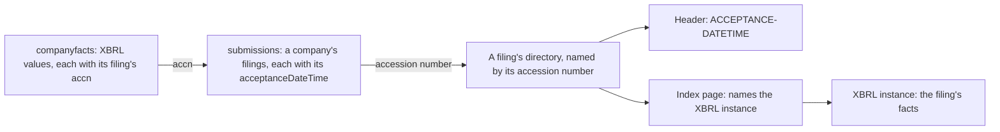

# The problem

<!-- status: all -->
**What's built,** as the [status page](../status.md) gives it:

- **Built:** NATS JetStream; Garage; PostgreSQL 18; The snapshot store in git; The charts.
- **Specified:** Scheduler; Fetcher; Monitoring: traces; The snapshot store in the cluster (built in part); The transfer from the cluster to git; The controls; The fake EDGAR; The documentation site (built in part).
- **Decided:** Discoverer (specified in part); Parse workers; Exporter; Query API; Monitoring: metrics, alerts, and dashboards (specified in part; built in part); Monitoring: logs; `edgar-asof`.
- **Planned:** The drills.
<!-- end status -->

This page covers what EDGAR publishes, and what its feeds keep and don't
keep, as far as the investigation's findings show. It then covers what the
pipeline keeps instead, what it doesn't claim, and why a record of what was
known at each time matters. Facts about `edgar-asof` here were checked
against its `main`, at commit `515bb0d`, on October 14, 2026.

## What EDGAR publishes

The investigation reads five feeds, for three companies in the Dow Jones
Industrial Average, chosen for their different fiscal years, for this
quarter's daily indexes, and for the latest filings of every company
([scope], [feeds]):

| Company | CIK | Fiscal year ends |
| --- | --- | --- |
| Apple | 320193 | The last Saturday of September |
| Microsoft | 789019 | June 30 |
| Walmart | 104169 | January 31 |

What each feed holds, as the findings show it:

| Feed | URL | What it holds |
| --- | --- | --- |
| `submissions` | `https://data.sec.gov/submissions/CIK##########.json`, one per company | The company's filings, in columns, each with its accession number, form, filing date, and `acceptanceDateTime`. `filings.recent` holds the latest 1,000 or so: on October 7, Apple's from 2015-09-17, Microsoft's from 2020-08-07, and Walmart's from 2023-06-02 ([SRC-9]); by October 16, Microsoft's four oldest had moved to its first further file ([SRC-24]). Further files, which `filings.files` names, hold the older ones in the same columns ([SRC-12]). |
| `companyfacts` | `https://data.sec.gov/api/xbrl/companyfacts/CIK##########.json`, one per company | XBRL values, each with its period, and with the `accn`, `filed`, `form`, `fy`, and `fp` of the filing that reported it, and for some values a `frame` ([SRC-6], [SRC-8], [SRC-14]). |
| `filings` | Under `https://www.sec.gov/Archives/edgar/data/CIK/` | One directory for each filing, named by its accession number, holding its header, its index page, and its XBRL instance, among its other files ([SRC-21]). |
| `daily-index` | Under `https://www.sec.gov/Archives/edgar/daily-index/2026/QTR4/` | The quarter's listing, and a master index for each business day, whose files are last modified between 10:01 and 10:04 PM on the day they name ([SRC-5]). |
| `latest-filings` | `https://www.sec.gov/cgi-bin/browse-edgar?action=getcurrent&type=&company=&dateb=&owner=include&start=0&count=100&output=atom` | The latest filings of every company and form, newest first, in an Atom document made for each request, which sends no validators ([SRC-26]). Each of a filing's parties has an entry of its own, with the filing's accession number, form, filing date, and a time to the second ([SRC-27]). Fetched on a Sunday, its 100 entries held 50 filings from the last 2 hours and 48 minutes of Friday evening ([SRC-28]). |

Each filing has an accession number, which names its directory in EDGAR's
archive, under the CIK of the company whose `submissions` lists it
([SRC-21]). Its header gives its acceptance time as `ACCEPTANCE-DATETIME`
([SRC-1]). Its index page names its XBRL instance, which holds the facts the
filing reports, and gives the same acceptance time as the header ([SRC-14],
[SRC-20]). An amendment, such as a 10-K/A, is a filing of its own, with its
own accession number ([SRC-16]).

`companyfacts` and the XBRL instances of 10-Ks and 10-Qs are the large
bodies, 0.9 MB to 10.9 MB each, and every other body the baseline holds is
1.7 KB to 0.6 MB ([SRC-18]). The three companies' 9,689 filings that the
stored `submissions` and further files list total 4.89 GB. Most are Form
4s, and the median filing is 6.3 KB to 12.7 KB, by company; their 208 XBRL
10-Ks, 10-Qs, and amendments total 2.51 GB ([SRC-19]).

## What the feeds don't keep

The design describes `submissions` and `companyfacts` as summaries that
the SEC rewrites in place, which show the present ([what the pipeline
keeps][design-keeps]). The findings show that each is a summary, and what
each leaves out. How often each one's content changes, and whether a URL
ever returns to an earlier body, is still the investigation's question Q1
([questions]): the baseline holds one version of each company's
`companyfacts` ([SRC-17]). The first refetch, task T4 of the
[plan][plan-investigation], on October 16, found each company's
`companyfacts` unchanged ([SRC-22]), and Microsoft's and Walmart's
`submissions` changed beyond their new filings: each gave every filing it
already listed a later `acceptanceDateTime` ([SRC-24]). The daily refetches
after it are runs the owner asks for, not tasks, and task T8 reads what
they show.

### No validators on the summaries

`submissions`, `companyfacts`, and filing directory listings send neither
`ETag` nor `Last-Modified`. A refetch of one of them can't be conditional,
so it receives the whole body each time ([SRC-4]). No validator says
whether the body changed since the last fetch, so the record tells versions
apart by their bodies' SHA-256 ([VER-1]).

### `companyfacts` is a subset, with no mark of change

`companyfacts` keeps each filing's value for a key beside every other
filing's: of the three companies' 40,702 keys, each a concept, a unit, and a
period, 24,825 have values from more than one filing, up to 12, and a
later filing's value replaces none ([SRC-14]). But it leaves out much of
what each filing reports, and it doesn't say what changed:

- **It holds a subset of each filing's facts.** It gives a filing's facts
  of `us-gaap` and `dei` concepts that have a unit, no dimensions, and
  aren't nil. Facts of a company's own concepts, facts with dimensions, and
  nil facts don't appear. Where an instance gives one key two values, to
  different `decimals`, it gives one of them ([SRC-14]).
- **No field says that a value changed.** A restated value differs from one
  reported again unchanged only in its `val`, and `companyfacts` gives no
  value's `decimals`. Of the 24,825 keys with values from more than one
  filing, 1,487 have more than one `val`, and their values change 1,559
  times ([SRC-15]).
- **`fy` and `fp` describe the filing, not the value.** Every value with the
  same `accn` has the same `fy` and `fp`, whatever its own dates ([SRC-6]),
  and Walmart's filings through March 2014 name a fiscal year differently
  from its later ones ([SRC-7]).
- **A `frame` follows the latest filing.** Of a key's values, only the
  latest filed has a `frame`, whether it repeats the earlier values or
  changes them ([SRC-17]). The baseline holds one version of each
  company's `companyfacts`, so it doesn't yet show a frame moving to a later
  filing's value when that filing appears; the daily refetches can
  ([SRC-17]).
- **It gives a filing date, not an acceptance time.** A value joins to its
  filing's `acceptanceDateTime` only through its `accn` and `submissions`
  ([SRC-9], [SRC-12]), and a filing date doesn't order two filings of one
  day: Apple made two filings with values on each of three days ([SRC-10]).

### Acceptance times that disagree

A filing's acceptance time is in two places, and they disagree:

- The header gives 14 digits, `YYYYMMDDHHMMSS`, with no time zone
  ([SRC-1]).
- `submissions` gives an RFC 3339 time with a `Z`. Since the first
  refetch, on October 16, it's later than the header's digits read as US
  Eastern time, by the Eastern offset from UTC on the filing's date, for
  each of the three companies: by 4 hours for seven of the eight stored
  filings, and 5 hours for Walmart's of January 30 ([SRC-25]). On October
  7, only Apple's were later by that offset; Microsoft's and Walmart's were
  later than the header's digits only as converting US Eastern time to UTC
  would make them ([SRC-2]). Between the two, `submissions` moved every
  filing in Microsoft's and Walmart's `filings.recent`, and in Microsoft's
  first further file, later by that offset, and changed no other column of
  them. That puts each of their 10-Ks and 10-Qs in `filings.recent` on the
  day after its filing date ([SRC-24]), as it puts Apple's 8-K/A
  ([SRC-2]).
- Read as the UTC instants they state, `submissions`' times put most of
  Apple's filings, and most of Walmart's before June 2023, outside the hours
  the SEC gives for EDGAR. Moved 8 hours earlier and read as Eastern time,
  nearly all of them fall within those hours ([SRC-13]). Since the change,
  they put 735 of Microsoft's 1,000 filings in `filings.recent`, and 341 of
  Walmart's 1,005, outside those hours too. Moved earlier by the Eastern
  offset on their dates, all but 2 of those 1,000 and all of those 1,005
  fall within them ([SRC-25]).

Neither feed says which time is right for any of the three companies'
filings, and the stored versions don't show it ([SRC-25]). Which
acceptance time to trust, and its time zone, waits on the investigation
([what waits][design-waits]).

### What no feed says

- **When a filing became public.** The SEC doesn't state it. It lies between
  the filing's acceptance and the time the pipeline first sees it, and the
  pipeline's record measures the delay ([times][design-times], question Q4,
  [0010]).
- **Whether a filing's archived files ever change after acceptance.** That's
  question Q1 ([questions]). The pipeline's record assumes they don't
  ([what the pipeline keeps][design-keeps]), and task T8 refetches the
  baseline's eight filings to see ([plan][plan-investigation]).

## What the pipeline keeps

The design claims three things, and no more ([what the pipeline
keeps][design-keeps]). Each rests on statements of the specifications.

1. **Every filing in scope, with its acceptance time from the filing
   itself.** When a Source's poll first shows a filing, the discoverer
   queues fetches of its header and index page, then of the XBRL instance
   the index page names ([FILE-2], [FILE-3]). It keeps the header's
   `ACCEPTANCE-DATETIME` as its 14 digits, and `submissions`'
   `acceptanceDateTime` beside it, each as given ([SEEN-2], [FILE-3]). A
   filing a Source already lists at its first poll isn't fetched for that
   poll; a Backfill of its dates fetches it ([FILE-2], [BACKFILL-1]).
2. **Every version it observed, never overwritten.** Each fetch adds one
   record ([FETCH-14]). Each distinct body is stored once, named by its
   SHA-256 ([OBJ-1], [OBJ-4]), and a URL's versions are its distinct bodies,
   in the order each first appeared ([VER-1]). Records and objects are only
   added ([LOG-3], [LOG-4]). The SEC's summaries are kept as evidence of what
   it published; the pipeline parses facts from each filing's XBRL instance
   ([what the pipeline keeps][design-keeps]).
3. **Where it was looking, and where it wasn't.** Each poll is recorded
   ([GAP-1]), and coverage and gaps follow from the polls by one definition
   ([GAP-2]). Each filing a Source shows keeps the two polls that bound when
   the Source first showed it, and whether a gap lies between them
   ([SEEN-3], [LAG-1]). Each Source's status shows its open gap
   ([SOURCE-5]).

| Question | What the feeds give | What the record adds |
| --- | --- | --- |
| When was this filing accepted? | Two times that disagree for each of the three companies' filings ([SRC-25]) | Both, kept as given, read as instants only in queries ([LAG-1], [0010]) |
| When did a feed first show it? | Nothing | The last poll that didn't show it and the first that did ([SEEN-3]) |
| What did `submissions` say yesterday at 14:00? | The body served when it's read | Each version observed, by its SHA-256, and each poll's record ([VER-1]) |
| What was known at T? | Each filing's values side by side, with a filing date ([SRC-14]) | An answer by acceptance time ([times][design-times]) |
| Was anyone looking? | Nothing | Coverage and gaps, for each Source ([GAP-2]) |

## What the pipeline doesn't claim

- **It doesn't recover what it didn't observe.** A version the SEC served
  and replaced during a gap is lost to everyone. The record says the gap was
  there, instead of implying that nothing changed ([what the pipeline
  keeps][design-keeps]).
- **First seen isn't public availability.** The record bounds when each
  Source first showed a filing between two polls, after the request of the
  last that didn't show it and by the arrival of the response of the first
  that did ([SEEN-3]). Each lag is therefore a range, not a point
  ([LAG-1]).
- **It holds a small scope, not all of EDGAR.** The chart's values start
  with a Source for each company's `submissions` ([§5 of the
  controls][controls-values]). The git store holds only the URLs that
  `data/scope.json` declares, each with its reason, within a budget of
  1 GB ([SCOPE-2], [SCOPE-3], [SCOPE-5]), and EDGAR's bulk archives of every
  company stay outside it ([§9 of the store][store-scope]). The cluster
  fetches what the owner's values ask for ([the scope and the
  cluster][store-scope-cluster]).
- **It rests on one assumption still to be shown:** that a filing's archived
  files never change after acceptance (question Q1,
  [what the pipeline keeps][design-keeps]).
- **It doesn't settle the header's time zone.** The lags read the header's
  digits as US Eastern time. A finding that settles the zone changes a
  function in a new version of the notices specification, and nothing
  stored ([open questions of the notices][notices-open]).

## Why a point-in-time record matters

A value reported for a period can change from one filing to the next, and
nothing marks the change ([SRC-15]). So what a company had reported depends
on when the question is asked.

- **Restated values.** Microsoft's `DividendsCommonStockCash` for
  2026-01-01 to 2026-03-31 is 6,760,000,000 in its 10-Q of 2026-04-29 and
  6,758,000,000 in its 10-K of 2026-07-29. Apple's `OtherAssetsNoncurrent`
  at 2025-09-27 is 83,727,000,000 in its 10-K and its 10-Q of 2026-01-30,
  and 72,634,000,000 in its 10-Qs of 2026-05-01 and 2026-07-31. Values also
  return: Apple's `LongTermDebt` at 2023-09-30 is 105,103,000,000 in its
  10-K of 2023-11-03, 105,100,000,000 in the three 10-Qs after it, and
  105,103,000,000 again in its next 10-K ([SRC-15]).
- **Amendments.** Apple's 10-K/A of 2010-01-25 gives `SalesRevenueNet` for
  the year ending 2009-09-26 as 42,905,000,000, where its 10-K gave
  36,537,000,000, and `NetIncomeLoss` as 8,235,000,000, where the 10-K gave
  5,704,000,000. Both filings' values stay in `companyfacts` ([SRC-16]).
- **Frames follow the latest filing.** Apple's `LongTermDebt` at 2025-09-27
  carries the frame `CY2025Q3I` on the 90,700,000,000 of its 10-Q of
  2026-07-31, not on the 90,678,000,000 of its 10-K, though the 10-K's is
  the more precise ([SRC-15], [SRC-17]). A reader who takes each frame's
  value gets the latest filing's, whatever was known earlier.

The design answers "as of T" by acceptance time: for each fact's key, the
value from the latest filing accepted at or before T. A restated value
appears from its filing's acceptance on, and earlier answers stay
reproducible ([times][design-times]). `edgar-asof`, the library the
pipeline's Python services read EDGAR through ([0009]), gives Apple's
`OtherAssetsNoncurrent` as the example. As of 2026-03-01T00:00:00Z, read
with `submissions`' acceptance times, the 10-Q of 2026-01-30's value is the
one known, the 10-K's is earlier, and the two later 10-Qs' are later
([`edgar-asof`'s facts specification, §7][asof-facts-7]).

That answer needs each filing's acceptance time, and the time has to be
trusted: a filing date doesn't order two filings of one day ([SRC-10]), and
the two sources of acceptance disagree for each of the three companies'
filings ([SRC-25]). So the record keeps both acceptance times raw, and
interprets their zones only in queries ([0010]).

The record answers a second question too: what the pipeline held at T. That
follows from first-seen times, and a sighting's gap flag says when the
answer is approximate. The time of recovery is never put in place of the
SEC's ([times][design-times]).

[0009]: ../decisions/0009-read-edgar-through-a-public-point-in-time-library.md
[0010]: ../decisions/0010-poll-each-companys-submissions-and-measure-lag-from-the-record.md
[asof-facts-7]: https://github.com/nslaughter/edgar-asof/blob/515bb0dc7af1b76a269413f29ba3edc390193e46/spec/facts.md#7-as-of-t
[BACKFILL-1]: ../../spec/controls.md#7-backfill
[controls-values]: ../../spec/controls.md#5-the-charts-values
[design-keeps]: ../design.md#what-the-pipeline-keeps
[design-times]: ../design.md#times
[design-waits]: ../design.md#what-waits-on-the-investigation
[feeds]: ../../investigation/edgar.md#feeds
[FETCH-14]: ../../spec/snapshots.md#10-fetching
[FILE-2]: ../../spec/notices.md#7-a-filings-files
[FILE-3]: ../../spec/notices.md#7-a-filings-files
[GAP-1]: ../../spec/notices.md#5-polls-coverage-and-gaps
[GAP-2]: ../../spec/notices.md#5-polls-coverage-and-gaps
[LAG-1]: ../../spec/notices.md#10-times-and-lags
[LOG-3]: ../../spec/snapshots.md#8-history
[LOG-4]: ../../spec/snapshots.md#8-history
[notices-open]: ../../spec/notices.md#12-open-questions
[OBJ-1]: ../../spec/snapshots.md#5-objects
[OBJ-4]: ../../spec/snapshots.md#5-objects
[plan-investigation]: ../plan.md#investigation
[questions]: ../../investigation/edgar.md#questions
[scope]: ../../investigation/edgar.md#scope
[SCOPE-2]: ../../spec/snapshots.md#9-scope
[SCOPE-3]: ../../spec/snapshots.md#9-scope
[SCOPE-5]: ../../spec/snapshots.md#9-scope
[SEEN-2]: ../../spec/notices.md#6-when-each-source-first-showed-each-filing
[SEEN-3]: ../../spec/notices.md#6-when-each-source-first-showed-each-filing
[SOURCE-5]: ../../spec/controls.md#6-source
[SRC-1]: ../../investigation/edgar.md#findings-so-far
[SRC-2]: ../../investigation/edgar.md#findings-so-far
[SRC-4]: ../../investigation/edgar.md#findings-so-far
[SRC-5]: ../../investigation/edgar.md#findings-so-far
[SRC-6]: ../../investigation/edgar.md#findings-so-far
[SRC-7]: ../../investigation/edgar.md#findings-so-far
[SRC-8]: ../../investigation/edgar.md#findings-so-far
[SRC-9]: ../../investigation/edgar.md#findings-so-far
[SRC-10]: ../../investigation/edgar.md#findings-so-far
[SRC-12]: ../../investigation/edgar.md#findings-so-far
[SRC-13]: ../../investigation/edgar.md#findings-so-far
[SRC-14]: ../../investigation/edgar.md#findings-so-far
[SRC-15]: ../../investigation/edgar.md#findings-so-far
[SRC-16]: ../../investigation/edgar.md#findings-so-far
[SRC-17]: ../../investigation/edgar.md#findings-so-far
[SRC-18]: ../../investigation/edgar.md#findings-so-far
[SRC-19]: ../../investigation/edgar.md#findings-so-far
[SRC-20]: ../../investigation/edgar.md#findings-so-far
[SRC-21]: ../../investigation/edgar.md#findings-so-far
[SRC-22]: ../../investigation/edgar.md#findings-so-far
[SRC-24]: ../../investigation/edgar.md#findings-so-far
[SRC-25]: ../../investigation/edgar.md#findings-so-far
[SRC-26]: ../../investigation/edgar.md#findings-so-far
[SRC-27]: ../../investigation/edgar.md#findings-so-far
[SRC-28]: ../../investigation/edgar.md#findings-so-far
[store-scope]: ../../spec/snapshots.md#9-scope
[store-scope-cluster]: ../../spec/snapshots.md#the-scope-and-the-cluster
[VER-1]: ../../spec/snapshots.md#7-versions
